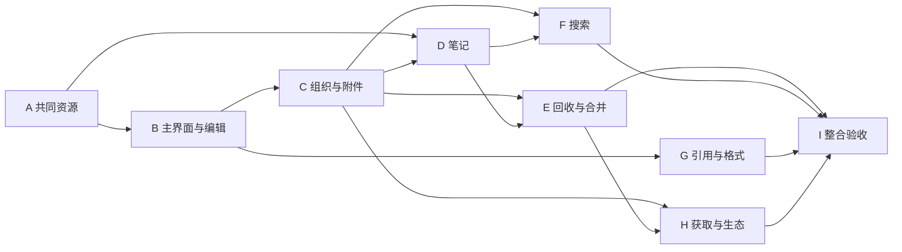

# 类 Zotero 文献管理工具实施计划

状态：职责与分批方案已确认，实施按所属OpenSpec授权推进。共同资源A批、公共基础和库管理入口恢复已交付；B批既定字段及表单覆盖已验收，完整平台与交付余项沿原change保留。下一片按[第十四轮安排](parallel-development-plan.md#第十四轮验收后的安排)规划C批组织与附件，止于apply所需工件齐备；不因开始C批宣称B批整项或平台已完成。

## 目标与完成标准

首先交付完整、可日常使用的个人桌面文献管理工具，功能和界面一同落地，再接知识分析与项目综合。基线是项目已选 Zotero 版本的个人桌面行为，逐项核对而非仅做相似外观；官方功能依据见[基线调查](research/zotero-desktop-baseline.md)。

保留工作台总体三区、tab 组及 Agent 双形态。项目文件和库附件使用共同编辑阅读接口；harness 保持所属项目，通过工具取得文献上下文和操作库。云同步、群组、外部 Office 引用插件继续后置，快捷键最后统一规划。

基础交付完成需同时满足：下表内功能均有产品入口及共同操作；重启能读回，失败及部分结果可诊断；双宿主真实接线、数据保护及实际依赖分发检查有证据。任何一批交付不能自动称为整个文献工具已完成。

## 一、当前差距与交付归属

未交付项沿2026-10-20静态差距，B批相关现状已于2026-10-25按库管理恢复交付及当前代码修订；其余批次在实施时继续重验。“已有”不代表本轮重新实跑，功能基线中的可选扩展不能借“完整”覆盖既有明确后置范围。

| 能力 | 当前事实 | 需要交付 | 批次 |
| --- | --- | --- | --- |
| 共同打开 | 项目文件与库附件已使用共同资源接口及格式视图，见 [A 批交付](../../openspec/changes/archive/2026-10-20-unify-workbench-resource-opening/delivery.md) | 后续复用稳定资源引用及共同阅读编辑接线 | A（已交付） |
| 主界面 | 有界列表／详情、管理表单、集合基础及真实菜单入口已恢复；集合仍是扁平筛选 | 完整集合导航、可配置条目表与领域菜单，保持已有入口和失败反馈 | B |
| 手动录入与编辑 | 手动建项、CSL JSON编辑、修订核对、标签／关联编辑及持久草稿已接回，见[库UI交付](../../openspec/changes/archive/2026-10-24-restore-library-management-entrypoints/delivery.md) | 类型对应字段、创建者及角色的产品化编辑；复用已接通保存并保留未知字段和冲突保护 | B |
| 文献选择与工具 | 共同连接快照与上下文工具已交付；当前列表选择仍以行索引维护并派生详情对象 | 稳定身份主选／多选，分页筛选后正确重建选择；完善文献贡献，切tab不改执行项目，不重建上下文系统 | B |
| 集合与标签 | parentId、tags 及基础写入已有，完整树和标签界面不足 | 集合树增改移除、归属拖放、标签筛选及批量整理；集合操作不复制条目 | C |
| 附件 | 托管／外链、分段读取、材料版本及重定位已有 | 产品化附件操作、独立附件和父子关系、缺失定位、名称／用途管理、统一打开 | C |
| 关系与批量操作 | relatedIds 及互反更新已有，界面仍占位 | 关联浏览／更正、多选批量操作、逐项结果与失败后核查 | C |
| 操作撤销 | 项目编辑历史已有，未见完整库操作撤销 | 元数据及组织操作的撤销／重做；复查后续修订，明确不可逆及外部副作用，不用数据库整库回滚冒充撤销 | C／E |
| 笔记与批注 | 附件版本上的阅读记录已有；不是独立／条目子笔记 | 独立及子笔记、共用文本编辑、批注到笔记与来源回看；必要可写能力由库提供 | D |
| 阅读功能完整化 | 已有基础 PDF／EPUB／HTML 阅读；没有证据覆盖全部固定基线行为 | 核对并补齐高亮、下划线、文字／图像批注、批注侧栏、批注到笔记、PDF Reading Mode 及朗读等基线行为，保持同材料版本与共同接口 | D 的阅读专项 |
| 去重与合并 | 摄取可按明确 DOI＋版本复用；无通用合并 | 候选重复视图、人工／Agent 选主项与字段、关系和附件合并、旧身份引用保留 | E |
| 回收与恢复 | 当前库没有完整条目／附件回收契约 | 软删除、恢复、永久删除及影响范围；与备份恢复、现有项目引用一起验收 | E |
| 快速／高级搜索 | 只按题名／DOI、单集合、标签过滤；固定更新时间排序 | 字段搜索、嵌套组合条件、保存搜索、列表排序；按条目／附件／批注／笔记选择结果层级及跨层级条件，核对批注类型、颜色、作者等条件；区分无命中与查询未覆盖 | F |
| 全文搜索 | 有单附件文档内搜索；无全库索引 | 可重建词法全文索引，含笔记及可解析附件；索引任务与覆盖状态；语义融合另接知识阶段 | F |
| 引用及导入导出 | CSL JSON 摄取已有；未见引用处理器及完整导出 | BibTeX／RIS／CSL JSON 等格式、样式管理、引用复制、参考文献表与可核查导出 | G |
| 既定插件兼容 | 独立宿主骨架及原型不等于生产兼容 | 固定版本 BBT／茉莉花原包接线、共同题录与阅读写回、引用键及导出；复用既有兼容决议和矩阵 | H，影响身份的调查提前 |
| 在线获取 | 当前存标识符，不等于能联网获取 | 标识符录入、元数据与全文获取、逐项来源与冲突；完整采集使用共同摄取 | H |
| Connector／迁入 | 宿主及旧原型不能当生产接线 | 自有 Connector、translators 接入、Zotero 单向迁入、中断续做和撤回；保持源库 | H |
| RSS | 当前未见实现 | 订阅、刷新、已读状态、将候选收录到库；网络失败不使已有库不可用 | H |
| 设置与可靠性 | 库授权及独立备份基础已有 | 集中可用设置、诊断、真实恢复／升级、大库负载、实际分发核对 | 各批＋I |

代码依据：[library protocol](../../packages/protocol/src/library.ts)、[catalog](../../packages/library/src/catalog.ts)、[库表](../../packages/library/src/schema.ts)、[文献UI及题录保存](../../apps/desktop/src/renderer/src/workbench/library/LibraryTab.tsx)、[详情容器](../../apps/desktop/src/renderer/src/workbench/library/CatalogItemPane.tsx)、[选择](../../apps/desktop/src/renderer/src/workbench/library/CatalogSelection.ts)、[tab状态](../../apps/desktop/src/renderer/src/workbench/tab-state.ts)。不要以组件文件存在代替其真实接线。

## 二、具体界面安排

目标界面随对应变更写入 [UI 设计事实源](../../docs/ui-design/README.md)。这里列操作和交付范围，后续不另维护一套样式规格。

| 区域 | 规划与交互 |
| --- | --- |
| 左侧全局区 | 继续放项目／会话与文献库入口，打开库不切换当前会话。 |
| 中间 library tab 的导航部分 | 可折叠集合树与标签筛选；提供全部条目、未分类、重复项、回收站、保存搜索及订阅入口。切换导航保留各自选择和滚动。 |
| 中间条目表 | 顶部放新增、标识符、导入、搜索与当前选择的批量动作；列支持显示、排序与调整。条目可展开附件／笔记。单选展示详情，多选展示共同值及可用批量动作；双击附件走共同资源入口。 |
| 右侧辅助区的文献详情 | 提供题录、附件、笔记、标签和关联内容；复用现有侧栏切换，不另加第四个全局区域。草稿随稳定条目保存；切项目或会话不误将选择归属改到项目。详情宽度和折叠沿当前 token。 |
| 中间资源 tab | 文件树、附件和笔记均调用共同打开控制器，按格式进入源码／可视／PDF／文档视图。同资源重新打开激活原视图，分屏共用正文与各自选区。 |
| 状态与错误 | 局部保存失败留在对象旁，全局批次、导出和采集进度通过既有状态栏贡献接口接入；明确受理、执行、部分成果和结果未知。 |

窄空间首先折叠库内导航及使用已有侧栏折叠，遵守工作台最小尺寸。列表分页／窗口化、详情惰性读取，只刷新实际可见范围；不通过全库投影同步每个字段。快捷键暂不分配新的全局组合，保留可键盘操作的菜单和焦点路径。

## 三、共同接口先定到什么程度

### 共同资源（A 批）

- 定位输入允许项目路径或稳定身份，解析后只以所属资源的稳定身份识别；库附件同时带材料版本。描述返回名称、格式、内容依据和实际能力。
- 读取、解析、保存及记录访问统一从资源端口进入，项目和库提供者掌握自身规则。项目文本沿既有条件保存；当前库正文只读，后续笔记及材料修订按其所属契约增加能力。
- 读取与解析使用同一内容依据；资料改变后不能把旧结果绑定到新资源。普通客户端不取得 nativePath。
- 首个正式变更见 [unify-workbench-resource-opening](../../openspec/changes/archive/2026-10-20-unify-workbench-resource-opening/proposal.md)，其规格、design 和 tasks 是 A 批实施依据。

### 选择与上下文（B 批）

- 工作台实例发布当前库、当前视图、主选条目、已选条目及可用附件引用；选择由稳定身份表示，筛选／分页后不把旧行号误作新条目。
- 上下文工具读取调用方关联工作台的快照，带是否可用和修订依据；没有工作台时返回无界面上下文，库操作仍能按显式身份调用。多窗口不共享一个“最后选择”的全局变量。
- 查询选择只提供可用上下文，不扩大库读取、写入或外发授权，不替代显式附加材料。工具执行再次经过所属领域授权，harness 的 projectId 保持不变。
- 快照发布在客户端连接生命周期内有界保存，断线／销毁后失效。可信调用方与工作台的关联纳入[公共基础接线](issues/10-parallel-design-and-delivery.md#q3公共基础优先补齐四组共同部分)；B 批接入真实文献选择提供者，库模块不承担连接身份管理。

### 后续领域数据（C—H 批）

库保持题录及材料权威；新增笔记、保存搜索、回收、合并关系和订阅各有稳定身份及修订。合并保持旧引用可核查；保存搜索持久化类型化条件树，不保存任意 SQL；索引只存可重建数据。库笔记的正文使用开放文本并通过共同编辑端口读写。具体 schema 在所属变更的 investigation／specs 中核对后确定，不从列表组件反推存储。

## 四、实施批次、文件与验收

下面是交付拆分。A 批已完成并归档，其余批次进入实施前形成各自 OpenSpec，按当前实现复核候选文件及剩余调查。文献线首个独立结果按[七域首期安排](issues/10-parallel-design-and-delivery.md#q4七条开发线的首个独立交付)衔接 B 批。

| 批次／建议变更 | 主要新增、修改或复用文件 | 可观察验收与前置 |
| --- | --- | --- |
| **A：`unify-workbench-resource-opening`** | 新 protocol/resources、editor/resource-access、工作台 resource 控制器；修改 projects 有界字节读取、宿主装配、tab-state/session/business-session、FileEditor、PdfReader、DocumentReader、附件打开回调 | 项目与库内同格式资源走共同接口；草稿／版本／撤权受保护；双宿主从实际入口打开。实施与验收状态见该变更 tasks／delivery。 |
| **B：`complete-library-catalog-workbench`** | 复用LibraryTab已恢复的表单与保存；修改CatalogItemList/Row、CatalogSelection、CatalogItemPane、LibraryToolbar，按需要提取类型化ItemForm／集合导航及完善文献上下文贡献 | 类型化录入／更正、集合导航、稳定主选／多选及可配置列；工具读取实际选择，切库后同一项目会话继续。公共基础已交付，受生态调查影响的字段／身份契约先闭合，领域接入经双宿主验证。 |
| **C：`complete-library-organization`** | 从 catalog 中抽出实际独立的集合／标签／附件／关系职责；修改 schema/migrations、protocol/library 和对应 sections，新增批量动作及可逆操作记录 | 条目跨集合不复制，标签及关联真正写回，附件独立与父子关系可查；批量更正／撤销核对后续修订，逐项失败与重启一致。依赖 B 的稳定选择及共同操作。 |
| **D：笔记与阅读专项** | `add-library-notes-workbench` 新库 notes 仓储及迁移、共同资源可写适配、ReadingSection；`complete-shared-reading-workbench` 补 ReadingRecordsPanel 与共同阅读视图的基线行为，复用文本编辑器；朗读适配统一平台能力 | 分别验收独立／子笔记创建编辑重开、批注入笔记回到原文；基线批注种类、PDF 阅读模式与朗读的真实目标行为、阅读位置与记录一致。过大的阅读专项再按功能拆分。依赖 A 及 C 的对象关系；笔记可由 Agent 工具读取。 |
| **E：`add-library-trash-and-merge`** | 新 trash/merge 领域逻辑、迁移和查询；修改附件／条目关系与 UI 特殊视图，扩展备份 | 删除—恢复、候选去重—选主合并—旧引用核查；中断及后续编辑不丢内容；真实副本恢复。依赖 C、D 的关系稳定，独立审查数据保护。 |
| **F：`add-library-search-workbench`** | 新类型化条件树、结果层级及可重建全文索引、saved-search 记录；修改查询 UI 与 collection 导航 | 字段／嵌套 AND-OR／保存搜索、条目或附件或批注或笔记结果及跨层级条件均可核对；支持基线批注条件，命中能继续打开资源；明确覆盖及重建。依赖 C、D 的类型与身份；不等待 E 全部完成。 |
| **G：`add-library-citation-and-formats`** | 新导入导出／CSL 适配；修改 protocol、库 UI 菜单与设置、editor 引文资源衔接 | 固定样本按已核对 oracle 输出引文／书目；CSL/BibTeX/RIS 往返保留字段，导出不覆盖人工内容。先评估已有 Quarto／Pandoc 的复用，B 字段契约稳定后可独立设计；引入依赖需单独授权。 |
| **H：`connect-library-acquisition` 等有界变更** | 新来源／标识符／全文适配、订阅与 RSS、Connector 和迁入接线；兼容宿主监督及 BBT／茉莉花适配；修改共同 ingest 及批次 UI | 从标识符和网页实际收录，部分下载失败可补取；RSS 收录不重复；原包共同数据读写与引用键可验；迁入源库保持、中断可续。依赖 C/E 的摄取与恢复；按来源、插件宿主、Connector、RSS、迁入拆开验收，不合成一个大任务。 |
| **I：基础工具整合验收** | 复用现有测试、补跨路径场景；更新开发入口、分发和真实交付记录 | 真实日常路径贯通、重启／恢复／大库负载／双宿主／目标平台分发有证据，确认功能清单无未说明缺项后再宣布基础工具完整。 |

每批先把可调用契约和必要持久化做实，再接界面并从产品入口验收。共享接线先由公共基础准备，文献领域契约、存储及视图由文献线维护；生态入口由生态线按[已定职责](issues/08-zotero-ecosystem-constraints.md#answer)交付，H 批核对文献侧交接。并行中公共补充及 dev 接入沿[共同工程约定](issues/09-shared-engineering-responsibility.md#answer)，具体写入范围在所属设计中明确。

G 可在 B 的字段契约形成后与 C—F 分开推进；F 的索引实现可替换，实际查询仍走共同文献接口。H 的上游兼容风险调查现在就能进行，其生产写入不能越过身份和恢复前置。

BBT／茉莉花的既定首批支持目标沿[生态决议](../scholoom-foundations/issues/41-zotero-ecosystem-integration.md)保留。引用键和共同身份的兼容调查在 B／C 定案前进行；H 的生产验收位置不表示这些风险可以最后才发现。

## 五、验证入口与质量边界

- 复用 `tests/kernel/tab-state.spec.ts`、`literature-catalog.spec.ts`、`literature-attachments.spec.ts`、`literature-reading.spec.ts`、`document-reading.spec.ts`、`manual-application.spec.ts` 和 `tests/ui/library.spec.ts`、`attachments.spec.ts`、`pdf-reading.spec.ts`、`document-reading.spec.ts`、`file-workbench.spec.ts`。它们的旧交付记录不能替代当前版本复验。
- 共同资源提供者及打开行为沿 A 批既有验证复用；后续只在现有覆盖不能表达关键稳定行为时补充。合并、删除、恢复、冲突和跨界权限需要可复现输入；列表外观和完整提示文本不作为测试目标。
- 类型与真实接线：`pnpm typecheck`、`pnpm check:architecture`、相关内核测试、`pnpm build` 与双宿主 UI 定向用例。启动开发／测试服务、依赖准备和真实模型按已有授权执行；各批实际结果见对应变更的 tasks／delivery。
- 字段编辑、批量整理、搜索、打开、保存和取消测确定性响应；数据量由明确代表样本确定，不能用任意阈值作硬门禁。科研质量与语义召回后续单独验收。
- 每批交付记录区分真实内部接线、替换的外部来源、Linux 本机、其他平台及实际分发范围。最后数据升级和副本恢复从真实格式验证。

## 六、后续调查与未决设计

这些事项不会阻塞 A，但会阻塞所属批次的实施规格定案：

| 问题 | 在何时闭合 |
| --- | --- |
| 固定 Zotero 基线的完整类型／字段与创建者映射，未知 CSL 字段保留 | B specs 前对照上游类型资料及样本，输出字段映射和可编辑行为。 |
| 独立附件、笔记及现有自动题录候选的关系迁移 | C／D investigation，核对旧身份、附件版本及引用；未经核对不改数据库。 |
| 合并旧身份、回收保留和永久删除的具体效果 | E specs 前明确转换、授权、恢复与项目引用行为，再实现。 |
| 全文索引、CSL 处理器、格式转换及网络适配的复用／依赖选择 | F／G／H investigation，核对现有依赖、上游许可及固定输入；需要新增依赖时申请授权。 |
| 文献 UI 选择在多窗口、断线及后台工具调用中的可信关联 | B specs 前闭合；不以“最后活动窗口”作为隐式全局选择。 |
| PDF Reading Mode、朗读、各类批注等固定基线细节 | D 的共同阅读专项在 specs 前对官方版本与真实目标样本核对，包含平台语音条件、复用及许可，再分步实现；不能以当前局部阅读能力冒充完整基线。 |

职责及分批安排已确认，后续按[七域并行安排](issues/10-parallel-design-and-delivery.md#answer)推进公共基础与文献首期详细规划。具体方案的实施准备度按所属 OpenSpec 的调查、规格、设计和任务核对，不能仅以职责票解决作为实施完成或授权依据。
