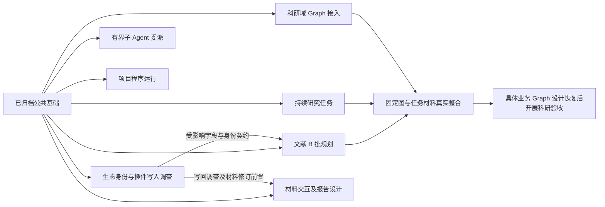

# 公共基础之后的七线并行开发计划

规划日期：2026-10-25。依据[七域安排 #10](issues/10-parallel-design-and-delivery.md#answer)与[共同工程分工 #09](issues/09-shared-engineering-responsibility.md#answer)。本文组织下一轮工作树、交付边界、依赖和整合任务；领域行为以所属决议及正式规格为准，实施任务和实际结果进入各 OpenSpec 的 tasks／delivery。

三条旧公共基础工作树已回收，以下七条工作树已从 `e3d58fc` 创建，统一使用 Codex、`gpt-6.1-sol`、推理强度 `high`。各线在后续获得独立实施授权，实际范围与结果见所属 OpenSpec 的 tasks／delivery；安装、Git 操作及真实数据授权分别沿用户实际指令，不从规划或验收推定。当前转入下述公共对接阶段。

## 起点与本轮取舍

公共基础交付起点为 `019f3df`，七树共同开发基线为包含本规划的 `e3d58fc`。三个公共基础 change 均已归档，已有接入口及证据见[公共基础规划](public-foundation-plan.md)和[开发说明](../../docs/development.md#领域独立接入)。

| 已有能力 | 下一轮直接复用 | 仍需领域交付 |
| --- | --- | --- |
| 工作域与授权 | 全局会话临时区、跨项目只读、可信调用身份及所属领域授权 | 任务工作内容、角色工作包与程序运行的具体业务规则 |
| 资源与执行交接 | ResourceRef／版本依据、首次创建及结果核查、图 driver、等待／checkpoint、共同受管命令 | 科研域的图发现配置与调用记录、通用程序运行记录、实际科研流程 |
| 工作台与上下文 | 连接所属快照、上下文工具、显式附加项、共同输入框与窗口草稿 | 文献的完整稳定选择、材料批注／差异、交互报告及各域界面 |
| 文献管理 | 手动建项、JSON／材料摄取、修订编辑、集合基础、附件与备份恢复入口 | 类型化字段／创建者编辑、完整导航、可配置表格及后续 C—I 批 |

科研 Graph 的底层受管执行已交付，但生产 `executionGraphs` 注册集合仍为空；`ResearchRuntime` 仍有旧材料分析路径。科研线须补科研领域层及实际固定图接线，不能重复实现 driver，也不能将通用 Agent 加完整 Skill 当作业务 Graph。Agent 线从通用委派闭环开始，不重做工作域和共同上下文。

平台范围沿[正式平台规格](../../openspec/specs/platform-access/spec.md)：Linux／Windows 使用受管执行；当前 macOS 明确不可用，保留人工操作。任何开发线不得为样例通过绕过该声明、改用无隔离执行或凭根 PID 消失释放容量。完整 macOS 后端另立变更。

## 第一轮启动顺序

保留七域各一条开发线，不设置常驻协调 Agent。七线可以并行调查与编写规划；实施只等待真正消费的接口，不等待其他领域整项完成。

1. **先产出生态约束和领域交接。** 生态线优先完成身份／字段映射、插件保存／SQL／引用键保护调查。文献线同时核对当前 B 批差距、字段样本和界面；受调查影响的契约在证据齐备后定案。项目、科研、Agent、计算、阅读交互的独立调查同步推进。
2. **各线形成首个有界 OpenSpec。** 完成 investigation、适用 specs、design 和 tasks，按项目 schema 在实施前所需工件齐备处停止；没有实际执行结果时不创建 delivery。先确定字段／返回值的含义、提供者与消费者，再安排接线。
3. **按局部依赖实施。** 项目任务、Agent 委派、程序运行和材料交互均可使用已有窄端口及明确替身独立交付。科研线先跑固定图，不在本轮自行确定被用户后置的综合流程节点。生态宿主可先用隔离样本验证原包装载，生产共同写入另过所属契约前置。
4. **能力就绪后分别整合。** 首轮先验证真实资源、任务文件、固定图及新会话读取的机械接线；真正的文献综合和科研质量验收须等用户恢复具体业务 Graph 设计后开展。

图中的箭头表示对应成果的前置，不阻止该线提前调查或用契约替身测试。程序运行、通用委派、交互报告及完整生态接入均不是基础单 Agent 文献综合的强制前置。

| 开发线 | 现在可并行推进 | 首轮实施的实际等待条件 |
| --- | --- | --- |
| 文献 | B批现状复核、导航／字段／选择设计 | 受影响的生态映射与插件写入调查闭合；不等完整插件宿主 |
| 项目 | 文件任务模型、发现和材料关联设计 | 本线文件契约及必要跨域引用明确；不等完整科研业务Graph |
| 科研 | 科研域注册／记录设计及固定图接入设计 | 消费的任务／资源端口已定；未就绪提供者可替换，真实整合再切换 |
| Agent | 委派工作包、角色模型、父子生命周期设计 | 本线共同契约与权限明确；不等具体科研流程 |
| 计算 | 环境供给、运行记录和基本操作设计 | 环境与授权方案明确；复用现有项目文件，不等完整任务UI |
| 阅读交互 | 材料交互与报告两份设计 | 写入所需领域能力明确；涉及材料修订时等待相应写回调查，不等完整生态 |
| 生态 | 身份／插件写入先行调查及宿主设计 | 隔离样例可先独立验证；生产写入等待实际共同身份、引用键、修订及恢复能力 |

## 七条开发线与首个交付

### 1. 文献：`literature-workbench`

依据[文献职责](issues/02-literature-knowledge-scope.md#answer)及[文献 B 批](library-foundation-plan.md#四实施批次文件与验收)。首个 change 建议沿用 `complete-library-catalog-workbench`。

- **成果：** 在已有管理入口上完成类型化题录／创建者编辑、集合导航、表格列与稳定主选／多选；工具读取实际工作台选择，切库及分页不改变会话接收者，冲突和迟到保存保留草稿。
- **先调查：** 既有字段和未知 CSL 字段的保留、固定 Zotero 基线映射、按身份而非行号选择。生态调查影响的类型／字段／来源身份约定先闭合；正式引用键仍归文献域，生态域提供兼容约束。
- **写入范围：** `packages/library`、文献同源 schema、`workbench/library`、文献 UI 设计分节及对应测试。已有摄取、授权、批次和恢复保留；不重复创建另一套库入口。
- **独立验收：** 收录、类型化更正、导航／多选、当前选择工具和重启读回；真实库与双宿主接线，模型可受控。不把 B 批完成称为完整 Zotero 工具完成。
- **后续：** 同一条线按 C 组织／附件、D 笔记、E 回收合并、F 搜索、G 引用格式推进。生态线交付 H 所需提供者，阅读线承接 D 的共用阅读专项；具体拆分仍由后续 change 调查决定。

### 2. 项目：`research-task-workspace`

依据[项目与研究资产职责](issues/03-project-research-assets-scope.md#answer)。首个 change 建议 `establish-file-backed-research-tasks`。

- **成果：** 人和 Agent 共用任务发现、创建、读取及更新；任务入口文件链接计划、过程材料、来源指针和实际成果，在右侧任务面板及中间详情接入。新会话可从项目文件找到目标、依据、障碍和下一步。
- **先调查：** 入口格式／目录、稳定身份及文件编辑后的发现、来源与成果关联、冲突和部分保存。对照 ResearchSpec 按本项目契约复用；数据库仅承载可重建索引或必要操作记录，不另存一份任务正文和进展权威。
- **写入范围：** `packages/projects`、项目／任务同源契约、任务工具及专属 UI、任务文件夹具。共享文件身份和条件保存继续复用；库指针不复制成知识副本，不建反向项目引用表。
- **独立验收：** 创建任务、保存长过程材料、关联来源／成果、人工修改后重读、新会话接续；覆盖来源不可用及保存／关联部分失败。不存在完整库删除记录提供者时，明确替换边界，不伪造已实现恢复。
- **交接：** 向科研、Agent、计算提供按需任务／工作项引用及材料发现能力；会话不绑定任务，一次方法调用不自动建任务。

### 3. 科研方法：`research-graph-runtime`

依据[科研 Graph 职责](issues/04-research-methods-scope.md#answer)。首个 change 建议 `connect-research-graph-runtime`。

- **成果：** 科研域提供内建图的发现、开放配置、整体实现／节点资源版本追溯和业务调用结果；通过已有 harness 图入口运行固定样例，实际读项目／库材料、首次保存成果、等待新输入并取消／接续。
- **先调查：** `ResearchRuntime`、`ResearchContent`、现有 attempts 记录与新图 driver 的职责差距；图启动与既有材料分析入口的迁入／共存边界。业务记录关联真实 harness 尝试，不复制进程状态或 checkpoint 权威，不新增独立 Method 实体。
- **写入范围：** `packages/research`、科研同源契约、静态图装配及科研测试夹具。`harness/runtime`／driver 的通用机制不在此重复建设；需要公共补充时单独提取。
- **独立验收：** 固定图经真实科研运行模块、broker 和受管 worker 完成材料与成果交接，覆盖等待、撤权、保存部分失败、取消和重启查询。项目任务尚未接入时可替换该端口，并明确不得据此认定任务整合完成。
- **边界：** 固定图只验证机制；首条真实综合的业务节点、顺序、回路及质量要求仍待用户恢复讨论。用户／项目自定义 Graph 继续后置。

### 4. Agent：`agent-delegation`

依据[Agent 协作职责](issues/05-agent-collaboration-scope.md#answer)。首个 change 建议 `add-bounded-agent-delegation`。

- **成果：** 一次有界子 Agent 委派，包含明确工作包、角色与命名模型配置、独立上下文、有效工具权限、实际成果引用、未完成项、等待和所属取消；用户沿现有会话查看状态和结果。
- **先调查：** 已有科研能力子执行哪些机制可复用，哪些仍是专用语义；父子进程容量、模型额度、权限收紧、父执行退出及重启核查。现有子执行不能直接宣称通用委派已交付。
- **写入范围：** `packages/harness`、必要模型配置、委派同源契约、静态 worker 适配及会话内委派组件。科研角色指导由科研域提供；harness 不定义科研业务流程和交付判断。
- **独立验收：** 两个真实受管执行及受控模型，子执行实际保存产物，父执行读回；覆盖材料变化、权限交集、容量不足、失败／取消／重启。独立初审提供原材料与标准，不预先注入其他审阅结论。
- **后续：** 跨会话持久通信和 advisor 分别立 change；不在首个委派闭环中顺带建设。

### 5. 科研计算：`project-execution`

依据[计算与环境职责](issues/06-managed-computation-scope.md#answer)。首个 change 建议 `add-project-program-runs`。

- **成果：** 人和 Agent 共用环境准备／选择、运行、状态、有界日志、取消及打开实际输出；人工路径无需会话或模型。固定程序产生真实结果表／图件。
- **先调查：** 可支持的环境、获授权准备方式、缺依赖、运行记录和重启核查；工具等待与程序时限分别表达。已有 `ManagedCommands` 返回退出码和输出，不等于已有可持久查询的通用运行记录。
- **写入范围：** 运行业务模块及其同源契约、项目运行面板／结果打开、宿主程序登记。复用 `platform` 完整归属和统一准入，editor 保留排版快照、缓存、最后成功预览等业务状态。
- **独立验收：** 固定程序实际运行；环境不可用、部分产物、输出过量、无日志等待、取消后代及重启核查可诊断。已知命令／参数／解释器、代码与输入依据可查，不宣称发现任意程序的全部依赖。
- **边界：** 不开放全局会话无隔离 Shell；终端／Notebook 的具体交互和通用远程计算另行设计。涉及安装依赖的实际操作按授权执行。

### 6. 阅读交互：`research-interaction`

依据[阅读写作交互职责](issues/07-research-interaction-scope.md#answer)。同一条线承接两个独立 change：`add-material-annotation-interactions`、`add-interactive-research-reports`。

- **材料首个闭环：** 打开材料 → 选择文字、已有结构对象或图片区域 → 批注 → 共同输入框检查发送 → 查看实际修改、差异及依据。复用已有 ContextItem 和输入框，不新增私有发送通道。
- **报告首个闭环：** 文献对比报告的筛选／排序／展开、所选对象进入共同输入框、更新、关闭和重开；有草稿时保留当前页面，更新提示由用户决定何时查看。基础综合不等待报告完成。
- **先调查：** 各格式实际选择能力、材料修订和保存权威、页面运行及资源隔离、更新协议、工作台关闭后的等待与接续。阅读写回调查在相关材料修订契约定案前闭合，不承诺跨版本持续精确定位。
- **写入范围：** 共同阅读／编辑／报告模块、资源视图和上下文贡献、差异组件及对应 UI 设计分节。库／项目分别掌握正文与记录权限；文献表格和任务详情仍由所属领域维护。
- **独立验收：** 真实阅读器、共同 composer、harness、保存与刷新，模型可受控；两宿主检查草稿、迟到更新、撤权及失败环节。用固定场景校准，不将页面浏览通过当作科研质量通过。

### 7. Zotero 生态：`zotero-ecosystem`

依据[生态职责](issues/08-zotero-ecosystem-constraints.md#answer)。先完成首个 change 的前置调查，再规划 `connect-zotero-host-bbt`；茉莉花、Connector、单向迁入分别立后续 change，共用兼容宿主。

- **最先交付调查：** 固定 Zotero 10 源库／条目身份、类型字段／关系映射；BBT／茉莉花实际保存、SQL、通知、缓存和固定引用键行为。对照共同授权、修订与提交结果，列出已知映射、缺口和不能证明的语义；不是整套迁入实现。
- **调查消费者：** 文献线决定共同字段、来源身份和正式键；项目线消费稳定库指针；材料阅读写回另核对 Reader／PDF 写回、材料版本和共同记录，不晚于对应修订契约定案。
- **首个可运行成果：** 真实兼容宿主加载未修改的指定 BBT 原包，以隔离样本核对生命周期、共同读写、已有键稳定及导出。外部 JSON-RPC／pull export 按真实外部入口另验，内部桥成功不代替。
- **写入范围：** `apps/zotero-host`、生态私有适配／插件与资源版本维护、生态同源契约及样本。共同题录／引用键／材料版本变更由文献线提供，不另建库权威。
- **生产前置：** 所需身份、授权、修订冲突和删除恢复能力实际就绪；不因固定样例通过提前写真实用户库。迁入无法证明可安全撤回的对象保留，不以遍历项目或未发现引用作为删除依据。

## 公共文件和跨线交接

各线拥有领域语义及 schema；共享目录不是另一个权威。下面列写入责任，细化到文件／符号的范围仍进入各 change 的 design，不提前指定七个新包或进程。

| 位置／约定 | 提供者与修改方式 |
| --- | --- |
| 库类型／字段、来源身份、正式引用键、材料修订 | 文献线维护共同权威，生态线提供上游证据和适配需求；受影响契约先对照调查，再进入实现 |
| 任务／工作项、来源指针、过程文件与成果关联 | 项目线提供；科研、Agent、计算按需消费，不强制所有调用绑定任务 |
| 图描述与调用记录、业务配置和节点资源 | 科研线维护；harness 公共执行 DTO 的补充由科研线与 Agent 线先核对，再独立接入 dev |
| 委派身份、工作包、角色模型及执行结果 | Agent 线提供通用机制；科研线保存实际角色指导和科研验收规则 |
| 程序环境、运行记录、有界日志与输出 | 计算线提供，消费项目资源与平台归属；不把 harness run 或 editor 编译记录复用为通用运行权威 |
| 共同选择／批注／报告动作及版本依据 | 阅读交互线维护通用契约，各领域贡献实际对象；沿现有上下文端口，读取有界且避免跨 DOM 或全库投影 |
| `protocol` 生成映射、`architecture.json`、kernel 装配 | 必要变更随提供该能力的工作树交付；生成映射从 schema 产生，宿主注册与消费者一同验证 |
| `Workbench.tsx`、`business-session.tsx`、UI 设计、语义 token | 优先领域组件、tab、贡献接口和薄适配；需要改同一公共位置时先交换具体符号／段落，提取独立公共增量，不各自复制工作台 |

公共补充由发现缺口的工作树先实现，整理成不依赖该树私有未合入业务代码的独立提交，包含契约、实现、必要调用方及验证；由本次接入执行者 cherry-pick 至 dev 并验证，再由用户同步到消费工作树。其余业务提交留在原线。完整业务 PR 接入和跨域验收分别记录，不要求每次公共同步重跑所有测试。

各线只检查自己的改动；本次 dev 接入者检查接入结果；以下整合任务的负责人只负责当次路径，不成为常驻协调 Agent。七条工作树由 Orca 管理，均从包含本规划的同一 dev 提交启动上述 Codex 配置。

## 独立验收和整合任务

| 整合任务 | 当次负责开发线 | 真实前置与完成依据 |
| --- | --- | --- |
| I1 任务材料与固定图接线 | 项目线 | 文献实际取材、项目文件任务与科研域固定图接入后，从用户入口读材料、保存过程／成果、查询部分结果，再由新会话从项目材料找到下一步；内部 broker／worker／仓储真实，外部模型可受控，不宣称真实文献综合质量 |
| I2 首条文献综合与新会话续做 | 科研线 | 用户恢复并确认具体业务 Graph 后，使用实际材料和产品内真实科研 Agent，补充材料再换会话，检查来源、研究判断及更新成果；不等待完整计算、报告、生态或通用多 Agent |
| I3 委派与实际产物回传 | Agent 线 | 真实父子执行、资源权限与成果保存；先可独立任务关联替身，再接项目实际提供者，核对材料变化和取消后的真实状态 |
| I4 程序环境及结果打开 | 计算线 | 真实环境、固定程序、项目输出与共同资源视图；人工／Agent查询同一运行事实，不以计算退出成功代替科研结果判断 |
| I5 批注修改与报告更新 | 阅读交互线 | 真实领域资源、共同输入、harness及保存提供者，分别检查选择、发送、实际修改和版本刷新，两个change分别验收 |
| I6 原包及共同文献权威 | 生态线 | 实际原包和宿主、文献正式键及必要修订／恢复提供者；外部接口、重复迁入和源库保护按后续有界change分别验收 |

所有 UI 接入复用浏览器／Electron 同一组件与事件路径；平台、模型和外部服务替身逐项注明。每个工作树固定自己的配置、库、项目、输出和测试端口，编号采用互不重叠的端口范围即可，实际占用在运行前核对；结束时仅停止本轮拥有的执行。定向测试期间不重建其运行中的共享产物。

## 当前 CI 基线的处理

2026-10-25读取 `55d020c` 的[完整 Checks 40100596838](https://github.com/leike0813/Scholoom/actions/runs/40100596838)：macOS job成功；Linux UI **101通过／9失败／2跳过**，Windows完整内核 **374通过／15失败／12跳过**。这与此前交付记录中的定向通过范围分别保留，不能称全仓绿色。失败日志本机保留于 `/tmp/scholoom-next-parallel-baseline-failures.log`。

各线在进入实施前保留相关基线失败输入及结果：只影响自己验收的失败先定位，阻塞自己的公共缺口按独立增量处理；无关失败不使七线调查与规划串行等待。分配如下，不将未诊断问题统一认定为“只需加超时”：

| 范围 | 先承接的线 | 必要核对 |
| --- | --- | --- |
| 同名项目 UI 定位、项目会话切换后的文件／草稿 | 项目线 | 按项目身份区分控件和隔离样本，核对实际选择及迟到刷新，不以 `.first()` 掩盖歧义 |
| harness UI 能力路径／RPC gate、Windows执行／恢复状态等待 | Agent 线，涉及科研调用时科研线参与 | 区分发送、受理、worker启动、实际执行、停止与刷新；对照真实诊断，生产时限不能随测试失败调整 |
| Windows lifecycle 与降级测试的子进程计数 | Agent 线承接最先遇到的公共增量 | 新增 `platform-availability` 在全组中观察到9次子进程而预期0；需识别是否为执行worker、系统适配辅助程序或测试干扰，不能直接删除“无未受管执行”保证 |
| 写作 PDF 预览 | 阅读交互线，必要时计算线参与 | 核对真实工具、保存稿件、编译状态及预览刷新；保留最后成功产物 |
| 文献摄取／附件、PDF隔离及材料接续的Windows失败 | 文献线与实际调用提供者 | 核对授权、材料身份、执行状态及实际保存；不从场景名称推定根因 |

首轮只调查并更新规划，不修复这些代码，也不追加全仓测试。macOS全功能、SSH远端、对外MCP及三平台签名／实际分发继续沿所属目标另行规划，不在本轮顺带实现或悄悄删除。

## 独立实施之后的公共对接阶段

本轮先验收各 change 已实现的任务，不以整个 change 尚有待办否定独立成果，也不因局部通过归档整项。下一步先处理实际公共缺口与接入冲突，再从共同 dev 基线启动受其影响的真实整合；不让七树继续各自扩展同一公共位置。

| 交接／公共增量 | 本轮提供者 | 消费者与停止边界 |
| --- | --- | --- |
| 固定 Zotero 10.0.5 映射、插件事务／键保护及 Reader 写回依据 | 生态线已有 investigation／evidence；文献线接收并决定所属字段及保存契约 | 文献不再等待整套生态宿主；共同来源身份、原字段保留、正式键及提交语义未定前，生态不写真实共同库。超出 B 批的能力另立有界 change，不能塞进类型化表单任务 |
| 两份阅读设计及已实现 ContextItem 位置增量 | 阅读交互线分别提供材料和报告 design、同源位置字段及实际验证 | 文献、项目、科研、Agent、计算、生态只核对各自触点；设计已交接不等于对应实现已进入当前树，也不把报告完成设为其他领域前置 |
| 任务引用与实际接口 | 项目线提供 `task-contracts.ts`、四个 tasks 操作及文件权威 | 科研／Agent按需消费 TaskRef、workItemId 和材料引用；计算首批仍可不关联任务。I1 在真实提供者进入共同基线后由项目线验收，不复制别树私有实现假接通 |
| 通用执行历史 | 科研线的 `add-harness-execution-history` 独立增量 | Agent 核对执行来源、查询和 runtime 注册符号；科研业务记录及 checkpoint 权威保持各自归属，实际业务 Graph 仍后置 |
| 项目数据库迁移与恢复组合 | 计算线负责本轮合并方案，消费 Agent 线 delegations 表增量；Agent 本轮不另改迁移入口 | 两线现稿都声明 v5，接入任一后会跳过另一份建表。必须形成一条明确迁移链并一起验证两域表、旧数据、保护副本、失败重试及独立恢复；不得用版本相等或 `CREATE IF NOT EXISTS` 掩盖缺表。精确升级方案进入所属 design／tasks，接入前由主线复核 |
| 资源 schema 叶模块及图片格式 | 项目线提供不依赖任务业务的 schema 抽取，阅读线提供图片格式增量 | 先抽取后接图片枚举及格式判断；复用原导出，避免 resources／projects 循环引用。抽取不改变资源行为，不复制第二套 schema |
| 受管命令观察与持久运行 | 计算线拆出可独立验收的 command 增量，生态线消费承载证据 | 有界命令收尾不能替代长驻 Electron ready／身份／双向 RPC 契约。长驻方案先明确公共边界，不因 H1 原包样本通过启用生产 |
| 文件修改归因及排版产物依据 | 项目线牵头 FileEdit 的可信来源设计，Agent 核对可提供的执行事实；阅读线拥有 editor 产物附加设计 | M2／M3先补具体同源方案与验证边界再实施，不能从文本内容猜执行者、给批量指令任选 instructionId，或把 PDF 产物位置附到源码 basis |

共享 `harness/runtime.ts`、kernel 装配、Workbench／tab 联合、恢复入口和 UI 夹具按具体符号合并；保留项目身份定位、多窗口夹具、任务／程序 tab 及全部领域工具，不以整文件覆盖解决冲突。生成映射由最终 schema 重生，不拼接两份生成结果。原型目录、测试 profile 和运行日志不进入公共业务补丁。

本阶段先交独立公共增量、必要缺陷修复及消费侧核对。未确认的新产品范围或跨模块契约只形成可审查方案；库正文写回、来源身份与正式键、科研实际角色等未决分支保持开放。题录选择以文献设计的 A（独立题录贡献）为优先核对方案，排序以原 B／F 分批范围为依据，在所属 design 中明确结论，不把候选当作已发布协议。

用户已请求本次主线验收与协调；这只是当次接入任务，不建立常驻协调 Agent。公共增量仍按独立提交 → dev 接入验证 → 同步消费者的既定路径处理；尚无提交或接入证据时，不宣称消费者已经使用更新。各树继续在原 tasks／delivery 维护实际结果，不另建进度账本。

## 公共切片接入后的下一轮

2026-10-26主线验收：A1委派版本授权、C1后台移交、C2配置容量／恢复、C3长时限、U1摘录边界均已复验关闭。公共实现及证据沿 [integrate-shared-domain-foundations](../../openspec/changes/integrate-shared-domain-foundations/delivery.md)；执行历史继续由 [add-harness-execution-history](../../openspec/changes/add-harness-execution-history/delivery.md)维护。主线已接资源叶抽取、双窗口夹具、执行历史、命令观察与长时限、统一v5委派→v6程序表迁移、材料位置和集合／CSL声明。任务、委派、科研和programs私有业务及图片格式消费者尚未全部接入dev。

无阻塞问题，基于“沿既有七线、只推进已定职责及可证明事实、用户手动同步公共dev”制定本轮方案。下表确定本轮实现边界；涉及新的行为先更新所属OpenSpec，不把候选方案或测试替身算作生产交付。

| 开发线 | 本轮具体实施 | 提供者、消费与停止边界 |
| --- | --- | --- |
| 文献 | X1采用独立题录选择贡献，完成同源声明、真实库／宿主provider和harness外发／恢复前权限复查；再接本线UI | 保留100项题录选择和原16项显式材料预算的区别；公共实现独立交回。来源原字段及正式键另走独立change；有界多对象原子提交保留完整事务目标，不缩成只逐条成功 |
| 项目 | M2先交可证明principal／session／run／instance和已核实委派链，instruction／tool不能证明时unknown；沿原单次完整FileEdit撤销，有界changes／edit查询 | 项目维护FileEdit权威与任务UI，Agent提供执行事实。I1只在任务详情挂单一“运行科研图”动作；本轮可先注入科研端口，真实组合必须使用实际提供者 |
| 科研 | 实现I1所需可信人工请求到宿主启动的窄适配，交付可组合补丁及固定图注入夹具 | 项目侧组合TaskRef／workItemId，调用引用进入任务process材料，科研记录不另加任务字段。服务端核对任务entry basis、所选sourceLinkIds及实际材料；renderer不得自报host身份。校准图仅测试注入，生产目录仍空 |
| Agent | 在新公共历史和统一v6上整理真实委派接线，保留A1，核对可选任务引用和M2可证明执行事实 | 不要求所有委派绑定任务；公共runtime按符号组合，不覆盖执行历史。通用worker可验机制，未设计的科研角色及完整I3保持开放 |
| 计算 | 消费统一v6与命令观察，完成programs实际装配、任务／程序tab联合、工具注册及恢复消费检查 | 计算只修改programs及其注册符号，保留任务入口。保留C1–C3回归；不能以公共表或命令接入宣称程序业务已经进入dev |
| 阅读交互 | M3采用只读render产物ResourceRef，为嵌入排版PDF直接附加选择，独立交公共提供者与实际消费者 | 产物拥有自己的projectId／outputId／basis，保留生产job及其输入依据；lastSuccess不借失败新job的basis。图片枚举须连同ImageResourceView、ResourceAccess及harness实际支持一起交付。报告可先实施独立manifest／codec／注入端口，不抢占材料主路径 |
| 生态 | E4采用独立认证host listener、一次性私有启动供应和真实监督；补原包profiler／shutdown错误可观察性 | ready与command started分别确认，未知和停止沿原生归属；无普通spawn兜底。先做不依赖文献键的原包监督校准，未取得真实文献提供者时I6及生产写入不关闭 |

I1的操作编排和任务选择归项目线，可信科研启动适配归科研线；两线各交独立补丁与调用契约，不能各自实现另一个入口。源树尚未同步时可先做不依赖公共增量的局部任务；涉及共同基线的验收等待用户同步，或在明确记录的临时组合中使用正式快照。临时组合通过不等于dev或消费者已接入。

用户已确认[来源副本政策](issues/08-zotero-ecosystem-constraints.md#q2提前调查的范围与优先级)及[正式键冲突规则](issues/02-literature-knowledge-scope.md#正式引用键冲突)，文献与生态本轮据此推进共同原值／来源／键及有界多对象原子提交。真实科研综合流程与角色、macOS全功能、SSH、发布及真实用户库操作继续沿原边界。

本轮允许各线将已验收的本线成果整理为可审查本地提交或补丁，保留已有改动；不自动merge／rebase／reset公共dev、不推送／开PR、不归档。用户手动同步后，先核对公共schema和迁移事实，再继续依赖接线。所有实际进度仍只记所属tasks／delivery；调度回执只保留在本机交接工件。

本轮提前发送任务后，用户授权改由主线完成同步及验证，再恢复Agent。七树已保全成果并合入0519904，定向验证通过后才重新启动；具体提交及证据见公共接入delivery。本轮不再等待用户同步。后续分派前先核实依赖基线已实际进入目标工作树并完成必要验证，再发送依赖它的实施任务。

## 共同领域实现接入后的真实整合

2026-10-26项目线及其余实施线均已交回，主线保全七树并建立本地检查点，将任务、可信FileEdit、科研请求、完整委派、programs、文献X1／原值权威、材料M3及报告独立模块合入dev。合并按符号保留同源契约、全部根工具、task／programs标签、恢复责任与权限；286个仅由单线修改的文件完整保留，20个共享文件分别核对。源码接入不等于I1／I3／I5／I6或整项完成。

生态回调收尾P2已复核：外层调用超时后，已受理回调继续受容量及关闭跟踪，未确认时保留unknown。独立审查另发现报告模块的共享JSON子树展开及BOM递归来源两项P2，主线以红回归确认并最小修复，组合70/70通过；报告仍未启用生产操作或页面。两轮原始证据分别位于`/tmp/scholoom-round4-acceptance-JCUBNw/`及`/tmp/scholoom-round5-acceptance-WBreMJ/`。阅读首次控制进程退出的历史原因仍未知，不将复验通过称为修复。

无阻塞的产品决策，基于“先完成共同组合验证与七树同步，再使用真实提供者整合”安排下一轮：

| 开发线 | 下一轮任务 | 停止边界 |
| --- | --- | --- |
| 项目 | 负责I1：将TaskResearchPort接科研实际graphs／requestGraph，经任务详情、真实库／文件、broker／受管固定worker、过程文件和任务关联验收；新会话从文件接续 | ManualApplication仍可脱离harness；测试图只注入，生产目录保持空。保留原调用去重、授权、保存／关联部分成功，不实现真实综合流程 |
| Agent | 将可信执行事实经broker接M2保存来源；用真实TaskPort完成通用worker的I3机械子范围，父负责重读任务并关联子成果 | 不扩子权限、不新增必填TaskRef、不伪造科研角色或指令／工具因果。实际科研角色仍后置，未知保持unknown |
| 文献 | 实施B批5.3文献详情页签，消费同一选择／草稿／表单，保留项目右栏；以已完成4.1a／4.2a及新增已支持映射推进此独立消费者 | 不要求先补齐所有复杂映射，不据此关闭完整4.1／4.2。先更新UI设计，不复制保存入口、不扩C—I批或来源重绑定UI |
| 阅读交互 | 消费实际files.changes／edit、origin／Evidence／editId及整次undo，完成M2差异／来源／覆盖缺口的真实消费者与双宿主子范围 | 展示可证明系统事实，不猜科研理由；未接入的委派来源如实未知。M1库正文修订与报告生产／隔离仍后置，不再重复未复现的TeX测试 |
| 计算 | 完成真实task／programs标签联合验收；承接阅读已交回的最小公共退出诊断，保留controller code/signal、stopped及native状态线索 | 只补现有诊断路径，不改变状态、停止判据、容量、超时或ErrorInfo业务契约。真实Windows仍按已有前置，不以Linux结果关闭 |
| 生态 | 消费真实library原值／正式键／commitRecords及监督，在既定最多100条普通期刊隔离范围实现补缺键／原包导出的首个真实共同库切片 | 缺原值／映射明确拒绝，不反猜原类型；不把逐条写冒充事务，不新增库权威。保持真实用户库禁用，超出提供者原子范围及E6留待所属变更 |
| 科研 | 已交付可信请求适配，暂不新增实施；I1由项目线消费共同实现并验收 | 不重复接口或自定生产业务图／科研角色；有具体契约缺陷由主线单独安排 |

M2共同接点：当前文件来源hook是同步形态，真实`harness.executionFacts`经broker返回Promise。Agent线将可信来源获取改为可等待窄端口，在保存临界区之前完成核对，并在异步后复查资格；保留现有同步测试注入可用，不在数据库事务中等待，不直接跨模块读取harness表。无法证明逐推进指令时继续unknown，精确工具token不在本轮。

共享写集按符号分工：项目拥有kernel的TaskResearchPort默认装配、任务调用及I1测试；Agent拥有executionFileFacts／fileOrigin及来源调用点；文献只新增文献详情贡献和AuxiliaryPane页签；阅读拥有MaterialChangeView／材料历史消费；计算拥有programs联合回归及platform退出诊断；生态拥有zotero操作／host适配及其生命周期接点。协议字段仍由所属领域维护，不互相重写共享构造参数、工具集合、恢复入口或生成文件。必要新同源声明先进入原design／specs，再实施。

主线组合及同步证据、逐线prompt和启动回执保存在本轮本机验收目录；必要验证未通过不启动依赖任务。同步以保留七树检查点的快进合并完成，不reset／rebase或覆盖成果。各线统一Codex、`gpt-6.1-sol`、`high`，只维护原tasks／delivery；不推送、开PR、归档、安装新依赖或操作真实用户库。真实科研质量、Windows／macOS及分发验收保持各自范围。

## 真实整合后的收尾与下一片

2026-10-27主线接收本轮六线交付，科研运行时线按约无新改动。已接入真实任务科研入口及独立调用输入快照、默认异步执行来源、通用worker任务机械闭环、单一库草稿的右栏详情、真实文件历史及整次撤销消费者、公共进程退出诊断，以及最多100条隔离普通期刊的共同库／受管原包补键和导出。上述范围仍不等于整个change、完整I3／I5／I6或真实科研质量完成。

独立Standards审查发现生态工具未登记持续库外发授权的P1；主线真实only-export用例先复现撤权后仍进入模型，再复用既有会话库身份追踪修复。Spec轴未发现其他确证问题。运行及追加审查结论由同一公共接入delivery和本轮本机证据 `/tmp/scholoom-round6-acceptance-dXuzCA/`维护，不以静态审查代替实跑。下一轮仍须共同验证通过、保全同步并复验后才能发送。

最新可用CI基线为 `6b22d60` 的[Checks 40315429083](https://github.com/leike0813/Scholoom/actions/runs/40315429083)：Linux内核689通过／9失败／16跳过，Windows内核628通过／49失败／30跳过；macOS执行不可用校准2项通过，入口3通过／1失败。失败日志和按平台清单已保留于上述证据目录。原生进程定向组与完整内核分别表达，不能据前者通过消除后者失败。下表以当前证据替代泛泛的“缺目标结果”，尚无真实目标环境重跑时不关闭平台任务。

| 开发线 | 下一片具体任务 | 写集及停止边界 |
| --- | --- | --- |
| 项目 | 消费已接入的通用委派任务闭环，核对4.4c的真实可选消费；诊断并修正project-backend两项旧CI失败，使隔离测试符合当前可信执行／FileEdit契约 | 项目任务及project-backend测试／必要窄夹具；先复现，不能放宽ManualApplication的执行拒绝或生产撤权检查。完整库删除／恢复仍待提供者；清理“来源身份尚不存在”等已失效前置 |
| 科研 | 承接research-capabilities六项Linux／Windows共有失败，核对独立模块夹具中的合成执行身份与当前领域端口；按模块边界修正并验证持久成果、重试及身份保护 | 科研模块及所属测试／窄夹具；不改真实harness授权来容纳假身份，不定义生产Graph或科研角色，不重复项目I1入口 |
| Agent | 依据最新Windows实际日志／artifact，优先诊断执行、取消和恢复的共同失败，按模型请求／工具／实例／停止阶段区分根因；承接context-session双平台失败 | harness及其直接诊断／测试；先交有界、可复现公共修复，不给所有失败统一加时限，不把Linux复验当Windows通过。共享生命周期由计算线牵头，不并改kernel生命周期入口 |
| 计算 | 使用新退出诊断核对历史nativeTeX unknown；承接Windows lifecycle两例及macOS关闭重开未连接的实际失败证据，区分发现／引导／连接／进程退出 | platform诊断及kernel lifecycle／bootstrap的必要窄接点、对应测试；不改归属、容量或unknown判据。平台证据不足时交精确调查结果，不猜修复，不扩环境安装能力 |
| 文献 | 继续B批4.1／4.2未闭合映射及类型化编辑，依据固定上游映射整理已支持、明确不可映射和需决策值，实施可证明无损的剩余子范围 | library-metadata／表单／所属测试，不改来源原值或正式键权威，不从CSL反推原值。保留右栏单一草稿；真实Windows文献失败沿最新证据分阶段核对，不归因于名称或超时 |
| 阅读交互 | 接真实委派来源完成M2细分联合；修正Windows内容选择夹具的路径转义；推进报告1.1b／1.2b的真实资源／授权装配 | MaterialChangeView、报告资源／公开操作的窄接点及所属测试；先沿原design更新具体子范围和UI说明。报告页面／iframe／桥／HTML自动发布仍后置，库正文M1无提供者时不可写，不改委派或FileEdit权威 |
| 生态 | 已接收普通期刊真实切片及持续授权修复；下一轮只做CSL更正与原值／导出差异的具体调查和可审查方案，列出可无损显式映射与有损／歧义分支 | 原change investigation／design／specs／tasks及隔离证据，不写生产自动同步。正式契约要求只更正CSL不覆盖未明确修改原值，不能为导出一致而绕过；新的选择交主线与用户确认后再实施 |

各线统一Codex／`gpt-6.1-sol`／`high`，继续原有会话。新增行为或未决选择先进入原OpenSpec；已定契约内的夹具修正走轻量路径。六条实施线及一条生态规划线均从已验证共同基线开始，不依赖本轮尚未合入的消费者改动；跨线新缺口以具体契约／反例交回。共同运行日志只用既有诊断入口，避免新增进度账本、常驻协调Agent或重复工具层。

## 首轮 Agent 的共同起始任务

各线采用下述共同要求，并附上本文件中该开发线的小节：

> 从已同步的dev开始，读取AGENTS、所属职责决议、公共基础正式规格及本线相关交付记录。先按当前代码复核已有能力与差距，复用已有深层模块和诊断／测试入口；按 `scholoom-dev` 创建本线首个有界change，完成调查、适用规格、设计和任务。写明拥有的文件／符号、提供和消费的接口、真实前置、允许替身和独立验收。受其他线影响的接口先核对提供者，未决的产品／架构问题带证据返回，不猜测定案。达到实施前所需工件齐备即停；报告change路径、已闭合问题、尚需输入及可独立实施的首批任务，不创建delivery、不启动业务实现、不操作其他工作树。

首轮接收的是七线可审查的实施规划，而不是七个笼统“全部做完”的任务。取得实施授权后，按本文件的局部前置推进和整合；具体进度从此由所属 OpenSpec 维护。
