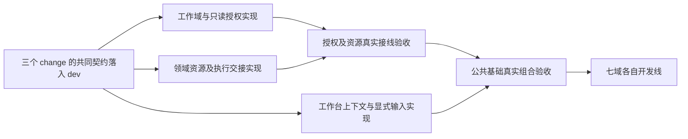

# 七域并行开发的公共基础实施规划

依据[七域安排](issues/10-parallel-design-and-delivery.md#answer)与[共同工程分工](issues/09-shared-engineering-responsibility.md#answer)。本文件只组织实施入口、依赖及领域交接，任务勾选和运行结果仍在各 OpenSpec 的 tasks／delivery。

## 契约先行与并行实施

| OpenSpec | 实际缺口与完成依据 |
| --- | --- |
| [establish-scoped-execution-foundation](../../openspec/changes/archive/2026-10-23-establish-scoped-execution-foundation/proposal.md) | application 归属及 scratch 已存在；补可信目标只读访问和领域再次授权，保留目标零持久修改及本项目保存保护。 |
| [establish-domain-execution-handoffs](../../openspec/changes/establish-domain-execution-handoffs/proposal.md) | 复用 ResourceRef，补实际材料／成果、新建及未知核查、源码装配图及等待恢复、宿主受管命令窄端口和独立夹具。 |
| [establish-workbench-context-bridge](../../openspec/changes/establish-workbench-context-bridge/proposal.md) | 补认证连接所属快照、工具当次查询、显式选择项、共同 composer 可靠发送与多窗口草稿保护。 |

三个变更采用共同契约先交付、三个工作树并行实现、真实整合按依赖验收的安排。公共基础以工作域、真实内部资源／执行接线、固定样例及独立开发入口的实际证据验收，不以 CLI ready 或替身通过代替已交付。七域开发仍等待全部公共基础验收。

### 共同契约的交付边界

共同契约由原 change 的任务承接，不新增第四个 change，也不另建进度账本：

| 所属 change 与任务 | 并行实施前交付到 dev 的内容 |
| --- | --- |
| 工作域 1.1 | WorkDomain、可信来源范围及 project.readTarget 输入输出 |
| 领域交接 0.1、1.1 | ResourceEvidence、ExecutionResourcePort、新建／核查结果、图执行及等待恢复、受管命令契约 |
| 工作台 1.1 | 当前快照、contextItems、指令来源及消息／执行输入扩展，产品协议版本统一升为 4 |

先接入工作域与资源证据声明，再接入消费它们的图／上下文契约；此处只要求声明之间的依赖，不等待实现。各契约增量生成映射、通过架构与类型检查，并回归原普通会话及历史消息读取；已有内核、客户端和 worker 共同使用版本 4，后续两条线不再次各自升版。未接通的新能力明确不可用，不为通过检查补一个成功替身到生产。各线同步同一 dev 契约后开始并行实现；发现契约缺口先由下表所属线补齐并经 dev 同步，再继续依赖实现。

### 写入范围与接入责任

下表是职责归属，不增加永久协调角色。共享文件按具体段落或符号交付独立增量；生成映射由每次契约接入者统一生成，消费方同步，不各自维护副本。

| 共享位置 | 修改归属与交接 |
| --- | --- |
| protocol/core、projects 及工作域契约 | 工作域线负责可信范围；工作台线只负责连接来源及共同协议版本；同一 CallContext 修改在契约阶段合并 |
| protocol/resources | 领域交接线负责资源证据和创建／核查；工作台线的显式项集中在 workbench-context，引用共同证据 |
| protocol/harness、harness-record-contracts、harness-module-contracts、execution-graph | 领域交接线负责图选择、等待和恢复；工作台线负责指令来源和 contextItems；交叉 DTO 在共同契约阶段定案 |
| projects/store.ts、files.ts | 工作域线先交付只读范围和无写入读取；领域交接线同步该增量后修改新建、候选与操作收据，不重复改授权 |
| kernel/manual.ts、application.ts、architecture.json | 各线只注册自己能力：工作域／资源图命令／窗口上下文；共享装配同一函数的修改按增量依次接入 dev |
| harness/runtime.ts 及执行适配 | 工作域线负责范围与只读工具；领域交接线负责图驱动与资源端口；工作台线负责来源、显式项和上下文工具。若涉及图 driver 提取的同一代码块，工作台线先同步领域交接 2.2，再改该块 |
| Playwright 配置、tests/ui/fixture.ts 及现有 UI 用例 | 领域交接线先接入 4.1 的 URL 改造；工作台线同步后扩展共用 fixture 和受影响用例，多窗口／上下文专用用例归工作台线 |
| tests/types/contracts.ts、docs/development.md | 随各自能力补对应类型反例及开发说明，共同契约或同一章节修改依次接入；任务进度只保存在原 tasks |

每个增量在自己的工作树实现，以不依赖未合入业务代码的独立提交 cherry-pick 到主工作树 dev，接入者验证后通知消费者同步并验证调用。具体执行者和本次 dev 接入负责人在实施任务开始时明确，不要求同一个 Agent 常驻统筹三线。

### 实际依赖与整合点

| 消费任务 | 所需实际前置 | 前置未就绪时可推进的工作 |
| --- | --- | --- |
| 领域交接 1.2、2.4、3.3 的真实授权路径 | 工作域 1.2、1.3、2.1、2.2 对应能力已接入 dev 并通过权限验证 | 图 driver、创建收据、命令机制与独立夹具依共同契约及明确替身开发 |
| 领域交接 1.4 的项目保存改动 | 工作域 1.2 涉及 store/files 的增量已接入 | 先实现独立操作收据部分；保存调用方在同步后接线 |
| 工作台 2.2、3.2 的真实资源与授权路径 | 工作域上述能力及领域交接 1.2 的资源适配已接入 | 连接生命周期、来源记录、草稿与 UI 贡献独立验证，不等待完整 Graph 或命令 |
| 工作台修改图驱动公共块、共用 UI fixture／URL | 分别同步领域交接 2.2、4.1 的对应增量 | 其他上下文、草稿及组件任务继续推进 |
| 工作台 4.5 的 dev 真实组合验收 | 三线实际能力和各自必要验证已就绪 | 各线独立测试、审查及接入检查继续；不以替身勾选组合验收 |

最终组合验收由工作台 change 的 4.5 承接，在执行前指定当次负责人，调用其他两线的真实提供者；此项是整合任务归属，不使工作台线承担其他 change 的模块交付。实际依赖按增量读取 delivery，未完成任务保持未勾选。

## 四组公共基础覆盖

| 已确认范围 | 所属实现入口 |
| --- | --- |
| 资源与成果交接 | 工作域只读端口及领域交接变更；沿项目／库权威，新增成果必须支持首次创建、返回身份和原操作核查 |
| 执行与授权 | 工作域、源码装配图交接与共同受管命令；具体科研流程、计算环境和通用运行记录留在所属领域 |
| 工作台与 Agent 接线 | 连接所属的实时上下文及显式输入；工具调用时理解隐含对象，用户明确附加项随指令保留 |
| 独立开发与验证 | 各变更的窄端口测试、领域交接变更的真实固定图／程序、单源隔离 URL，以及最终双宿主组合 |

## 七域后续入口

公共基础实际验收后，按[首个独立交付表](issues/10-parallel-design-and-delivery.md#q4七条开发线的首个独立交付)及各域职责票开展首期 OpenSpec：文献 B 批、持续研究任务、共同科研 Graph 运行基础、子 Agent 委派、程序执行与环境、材料批注和交互报告、兼容宿主与 BBT。这里不提前生成七套缺少各域内部调查的实施任务。

公共基础交付源码图装配与进程接入机制，各域仍掌握实际图定义、节点、环境及业务记录；固定图不能替代具体科研 Graph。库内分析／主题保存、引用键、插件 SQL、材料修订及删除恢复不在本轮三个公共变更中扩展。生态身份、写入与阅读写回调查仍须在受其影响的领域契约定案前完成；公共基础沿现有 ResourceRef，不预判新生态存储设计。

## 交接与检查

每个变更包含 proposal、investigation、delta specs、design 和 tasks；delivery 在实际执行后形成。源码与现状依据在各 investigation，已执行的共同契约及回归验证见所属 delivery，不把契约交付视为真实授权、图运行或工作台功能已经完成。

共同契约基线使用协议版本 4。三条实现工作树现为 scoped-execution-foundation、domain-execution-handoffs、workbench-context-bridge，均归 Orca 的 Scholoom 项目。2026-10-23 在 dev 接收三线首批 PR，接收验证及剩余范围见各自 delivery；用户手动将更新后的 dev 同步到工作树，再发送下一阶段指令，不由接入者控制工作树内 Agent。三个变更继续按局部前置开展，七域等待全部公共基础验收。

下一批交付按实际缺口安排：工作域线做本变更的最终核对、规格同步／归档，并可独立处理阻断三线 CI 的文献库 UI 既有 lint 清理；领域交接线优先交付 1.2 资源适配的独立增量，再做 1.3／1.4 保存、关联及首次创建；工作台线推进来源进入执行、多来源选择和可靠指令，资源／外发真实验证等待资源适配接入。工作域收尾不扩大为七域业务开发；各线进度、证据及待办仍只在原 tasks／delivery 维护。

实施前先读所选变更、上表对应依赖增量的实际 delivery 及 dev 接入结果，取得 apply instructions；不要求其他 change 全部完成才开始独立任务。规划就绪不构成新增操作授权。公共补充仍按自己的工作树实现、dev 接入检查后同步；真实整合任务当次明确负责人。各变更的验证必须区分真实模块、外部受控响应、平台及尚未验证范围。
