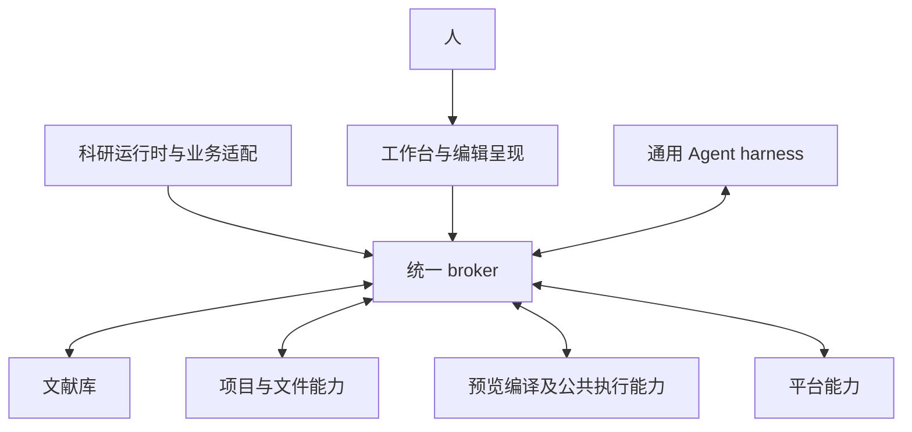

# 明确模块依赖方向、装配职责与数据权威

Labels: wayfinder:grilling
Type: grilling
Mode: HITL
Status: resolved
Assignee: Codex；与用户讨论模块依赖和共同权威（2026-10-17）
Parent: [模块依赖、运行时进程与接口架构决策地图](../map.md)
Blocked by: none

## Question

文献库、Agent harness、工作台及项目模块如何经明确接口独立使用与测试？应用宿主负责哪些装配和协调，哪些职责属于 harness；谁可以依赖谁、谁拥有结构化事实和普通文件的写入规则？

需要讨论：

- 无 Agent 的文献管理、无工作台的科研执行、GUI 与 Agent 同时修改同一对象三条路径，分别需要哪些模块。
- harness 如何使用文献、项目、模型与科研能力；文献分析如何请求执行，避免文献模块和 harness 互相依赖具体实现。
- 授权、应用级资源调度、会话控制与领域保存职责的位置；装配入口可以知道实现，调用者需要知道哪些接口。
- “科研 Agent 内核”、应用宿主与运行时监督的名称和关系；只在含义确定后补充术语。
- 各模块如何独立替换依赖、诊断及验证；包划分以职责和真实复用为依据。

### 当前依据

- [七个逻辑模块及职责](../../scholoom-foundations/issues/24-logical-modules-and-responsibilities.md)、[科研能力契约](../../scholoom-foundations/issues/18-native-capability-runtime-and-content.md)、[存储与变更模型](../../scholoom-foundations/issues/13-storage-and-change-model.md)。
- [KernelApplication](../../../apps/kernel/src/application.ts)集中创建模块并注入具体实现；[Harness](../../../apps/kernel/src/harness/runtime.ts)直接持有 Projects、ModelAccess、ModelConfigStore、ResearchRuntime、LiteratureCatalog。
- 上述是 2026-10-17 静态阅读事实；构造函数集中装配本身不构成错误，需要审查的是调用与权威是否越过职责。

### 结束条件

用户确认模块职责和依赖图、共同权威、装配位置及独立验证边界，并明确依赖守卫、broker 契约的单一事实源、类型和校验的传播、提供者注册与实现符合性检查，以及对应开发／CI 反馈。上述约束需足以指导实现并阻止架构漂移；此票不决定具体进程数量。

## Comments

- 2026-10-17：本票已领取，继续 wayfinder 讨论，不实施重构。第一轮用户确认 Q1“通用 harness＋外部科研业务适配”：领域工具、方法含义和交付检查经业务适配接入，harness 不直接依赖 LiteratureCatalog、ProjectStore 等具体实现。用户确认 Q2“入口认证＋领域模块执行授权规则”：入口建立可信调用上下文，领域操作入口核对有效授权和自身规则，harness 限制工具集合与委派范围。其余职责和数据访问组织仍待讨论，尚不关闭本票。
- 2026-10-17 第二轮 Q3：用户纠正主 Agent 对科研业务模块位置的理解。移除 harness 后，产品仍是可以直接供人使用的“文献库＋编辑器”，可管理文献、手动写作、预览与编译，相当于 Zotero 和 VS Code 部分能力的结合。加入 harness 后，Agent 成为同一套能力的第二个使用者，并支撑科研运行时。harness 是产品核心，其他组件以服务 Agent 为优先，同时服务人类；科研运行时依赖 Agent harness，不是统辖文献库和编辑器基础操作的独立中心。
- 第二轮 Q4：用户明确不允许跨模块直接访问对方数据库表，且要求所有跨模块动作由统一 broker 管理和路由。此前 Q2 的入口认证与领域操作授权规则仍有效；broker 的精确覆盖范围和职责继续讨论，不据此自行选择传输或进程方案。物理数据库布局尚未确定。
- 第二轮 Q5：用户采纳私有 workspace 包与明确导出，允许共同依赖，不承诺独立部署；模块应达到将来可容易提取为独立产品的程度。需要明确可替换的宿主接入和实际所需依赖，不能只拆目录而依然依赖整个应用内部实现。
- 从用户确认的人工写作、预览与编译路径可知，其文件、渲染及程序执行基础能力必须在移除 harness 后仍可使用。后续平台与进程票据此核对原“执行环境为 harness 子系统”的职责范围；不能将人工编译强制接入 Agent 会话或模型调用。
- 第三轮用户回复“采纳你的建议”，确认 Q6、Q7：文献模块请求平台读取附件、编辑器请求编译等跨模块操作也经过 broker；模块内部函数调用、共享类型和普通库依赖不属于跨模块动作。broker 负责能力注册、路由、可信调用上下文及请求／结果／事件传递；宿主负责模块装配、启动和停止，领域模块保留业务规则及最终授权。本票完成职责核对并收束，正式结论见 Answer。
- 用户指出此前收束过早：模块关系还需要可执行的依赖守卫，统一 broker 的契约需有 SSOT 并传播到各方，实现过程需防止架构漂移。本票恢复 claimed，保留已确认职责，继续讨论这些约束；后续依赖票保持阻塞，尚未进入实现。
- 用户回复“采纳”，确认 Q8–Q10：机器可读架构策略与依赖／能力守卫、按提供方维护的无实现契约入口、同源类型与校验传播、类型化提供者注册及本地／CI 符合性检查。正式约束补充于 Answer；仍需核对现有代码迁入时的守卫启用与例外，以及运行时违约的处置范围，尚不关闭本票。
- 用户回复“同意”，确认 Q11 新边界即时启用、旧代码分批迁入与受限临时例外，以及 Q12 注册／调用违约的局部处置和未知副作用先核查。模块职责、权威、契约事实源、守卫、迁入及违约处置均已讨论，本票按扩展后的结束条件解决；平台职责、进程拓扑和传输细节由后续票继续，不宣称已实现或实跑验证。

### 本轮代码核对

- [ResearchRuntime](../../../apps/kernel/src/research/runtime.ts)已有方法解析、能力调用记录和真实产物核查；科研语义并非全在 harness 中，不应为拆分重写已有职责。
- [Harness](../../../apps/kernel/src/harness/runtime.ts)直接注册科研与库工具，并为能力调用构造子 Agent 和 ProjectBackend；这些绑定说明通用执行与业务接线仍在同一实现中。
- [ProjectStore.check](../../../apps/kernel/src/projects/store.ts)在 application 范围只允许 send，当前材料分析要求 read/write/send，因此无法在纯文献库范围执行；[原生科研能力契约](../../scholoom-foundations/issues/18-native-capability-runtime-and-content.md#情境核对)允许纯文献库科研工作。该实现覆盖缺口需由后续契约与实施承接，不能成为新架构强制依赖项目的理由。
- [内核包依赖声明](../../../apps/kernel/package.json)当前同时包含文献存储、PDF 和 AI 执行依赖；工作台已经共同客户端接入。以上来自静态代码阅读，未运行测试或调用模型。

## Answer

2026-10-17，用户确认通用 harness、领域授权与包隔离，并纠正科研运行时的位置，随后采纳统一 broker、依赖守卫、契约 SSOT 和实现符合性约束，最后同意 Q11–Q12 的迁入与违约处置。本票完成模块逻辑关系及防漂移约束的决策。broker、包拆分和架构守卫尚未实现，进程数量及 IPC 传输另议。

### 产品构成与依赖方向

harness 是产品核心。文献库、编辑器与外围能力优先服务 Agent，同时供人使用。移除 harness 后，用户仍可管理文献、手动写作、预览和编译；加入 harness 后，Agent 成为同一套基础能力的另一个使用者，科研运行时依托 Agent 开展科研方法、能力和工作流。

科研运行时不是人工文献管理和编辑操作的调度中心。通用 harness 管理会话、上下文、模型与工具调用、委派、等待和执行恢复；科研方法含义、领域工具绑定及交付检查由业务适配接入。harness 不直接依赖文献、项目或科研业务的具体实现；领域模块也不依赖 harness 才能提供基础操作。方法、程序和图继续沿已有科研契约组织，不将每个程序调用变成模型调用。

下图表示逻辑使用关系，连线经 broker 路由，不表示物理进程或每次都要序列化。工作台的编辑呈现与提供文件、预览、编译操作的基础能力分别表达。

科研运行时经 broker 使用 harness 的执行能力；harness 执行中的领域工具调用，经相同 broker 到达对应提供者。图中的公共执行和平台职责分组不预定具体包名，细分由后续票承接。

### 模块、broker 与宿主

| 位置 | 掌握的职责 | 对外协作 |
| --- | --- | --- |
| 文献库 | 题录、附件、阅读记录及库内科研事实的规则与权威 | 向人和 Agent 提供相同领域能力；所需平台操作经 broker |
| 项目与文件能力 | 项目事实、文件身份、开放编辑与保存保护 | 向人和 Agent 提供共同操作，项目引用库记录 |
| 工作台 | 导航、编辑呈现、草稿、选择与人类介入 | 经客户端接入 broker；不持有另一份领域权威 |
| 通用 harness | 会话、上下文、通用执行与必要执行记录 | 使用受限工具和运行接口，通过业务适配接入科研能力 |
| 科研运行时与业务适配 | 科研方法、能力／工作流接线及交付检查 | 依托 harness 的 Agent 执行，结果交回所属领域 |
| 平台及公共执行能力 | OS／文件系统适配及人和 Agent 共用的文件、渲染、程序执行基础 | 在没有 harness 时仍可支撑人工预览与编译；具体能力拆分沿平台票 |
| broker | 能力注册、路由、模块消费范围约束、可信上下文及请求、结果、事件传递 | 为跨模块交互提供受限接入，领域规则与保存顺序由所属模块负责 |
| 应用宿主 | 模块装配、启动、停止与宿主接入 | 绑定实际提供者和共享资源设施；不将这些职责放入 broker 或领域规则 |

模型、凭据等共同依赖可以按实际职责共享；应用级资源准入由宿主侧统一管理，与 Agent 执行监督的具体分工沿[执行进程决议](03-session-execution-processes.md#answer)。宿主或框架适配器可以管理公共设施，但普通模块不能借此取得整个应用对象及其他模块的内部实现。

跨模块的请求、结果与事件都经统一 broker，包括文献模块使用平台能力、编辑入口请求编译、科研适配调用 harness。模块内部函数、静态类型和普通共享库依赖不经过 broker。各模块通过公共契约与 broker 接入接口协作，宿主绑定提供者；broker 不接管科研流程、领域状态或数据权威。统一逻辑入口不预定独立服务或强制网络 RPC，具体承载沿[内部接口与 IPC 票](06-internal-interfaces-and-ipc.md)确定。

### 数据权威与授权

模块只能通过公共接口访问其他模块掌握的记录，禁止取得对方数据库连接或直接读写其表。库事实归文献库，项目事实归项目模块，会话与执行记录归相应运行模块；科研成果归属仍按已有库／项目语境确定。科研运行时、broker 和工作台不复制一份当前科研权威。物理数据库是否共用、连接和 checkpoint 的管理沿[持久化与恢复票](04-execution-persistence-and-recovery.md)细化，不把模块隔离等同于每模块一个数据库。

入口识别调用者并建立可信上下文，经 broker 传递；领域模块在实际操作入口核对自身规则与有效授权，并掌握自身持久化顺序，harness 限制工具集合和委派范围。GUI、Agent、CLI 和插件使用同一套规则。普通文件沿既有开放编辑契约操作，外部编辑器与获授权程序的直接写入仍按实际竞态处理，不能用 broker 宣称所有文件写入均已串行化或受到强隔离。

### 包隔离与独立提取

文献库、通用 harness、科研业务和平台等宏观模块采用私有 workspace 包及明确导出，按实际职责细化包边界；共享契约与成熟依赖可以复用。不要求每个内部工具成为一个包，也不承诺独立部署、升级或公开 SDK。

模块通过所需领域契约和受限、类型化的窄消费接口使用能力，生产装配经 broker 接入；模块核心不依赖全产品操作集合。独立测试可替换该消费接口，无需启动完整 broker、宿主或无关模块；真实接线由整合验证覆盖。

模块核心应能连同明确的公共依赖提取使用，宿主装配与具体运行位置通过接入适配替换。提取某一部分为独立产品时，允许组合必要模块、broker 接入和新的产品宿主，不应重写核心业务或携带完整 Scholoom 应用内部实现。

### 三条路径与独立验证边界

以下为已确认职责的语义核对，未运行应用或测试。

| 路径 | 使用的能力与保护 |
| --- | --- |
| 不加载 harness，管理文献和手动写作、预览、编译 | 工作台经 broker 使用文献库、项目／文件、平台及公共执行能力；不要求创建 Agent 会话或调用模型 |
| 没有工作台，Agent 开展科研 | 宿主装配 harness 与科研适配，Agent 经 broker 使用领域及平台能力；纯文献库科研不强制建立项目 |
| 人与 Agent 同时修改同一对象 | 两条入口到达同一领域实现，复用授权、内容变化重读和逐项结果；broker 不另造写入权威或全局文件事务 |

文献模块可替换平台／broker 接入，验证题录与材料行为；harness 可替换模型、工具和持久化接入，验证通用执行；科研适配验证方法输入、执行绑定与实际交付；工作台替换客户端来源，验证交互与草稿；broker 验证注册、路由、调用上下文及事件传递。整合再核对真实内部接线，不能用各自独立通过替代跨模块验收。复用现有测试和诊断入口，精确测试方案由对应实施变更确定。

### 同步与后续

原[逻辑模块职责](../../scholoom-foundations/issues/24-logical-modules-and-responsibilities.md)、[执行环境](../../scholoom-foundations/issues/40-research-execution-environment.md)及[架构基线](../../scholoom-foundations/issues/09-electron-architecture.md)引用本票修订后的模块关系；架构、技术和接口草稿同步调用组织，项目 AGENTS.md 增加入口。正式行为规格及代码由后续 OpenSpec 变更承接。

本票解除[统一平台模块](02-platform-access.md)与[会话执行进程](03-session-execution-processes.md)的前置阻塞。按编号继续统一平台模块；进程分工、物理存储、传输及外部开放范围尚未决定。

上一轮文档检查：16 份相关文档的 290 个本地文件链接可达，票状态、决策索引和依赖图检查通过；独立只读检查未发现相关文档间的当前态冲突，并澄清原职责表中 harness“授权”的含义。这些检查不覆盖依赖守卫或 broker 契约的架构符合性，也不构成本票讨论充分的依据。未修改业务代码或正式规格，未运行程序测试或进程实验。

### 架构策略与依赖守卫（Q8）

用一份机器可读的架构策略表达允许的模块／契约依赖，以及模块提供、消费的能力范围。它是依赖政策的事实源；package.json 表达实际依赖，源码引用表达实际使用，检查器据此核对政策与现状。不同检查入口复用该策略，避免在 lint、脚本和 CI 各维护一份规则。

检查包声明及解析后的源码 import／export，覆盖反向依赖、静态依赖循环、跨包私有路径和绕过 broker 的实现引用；类型依赖也遵守模块方向，宿主装配例外明确到职责。静态与可分析的动态引用均需纳入，不能仅凭模块名字符串搜索声称覆盖全部路径。公共契约不反向依赖实现，broker 通用核心不依赖全产品领域实现或契约聚合。

broker 根据宿主登记的模块消费范围提供调用入口与路由，调用者不能仅凭知道操作名获得所有能力。该模块级范围控制与领域最终授权分别执行。静态依赖循环检查不把 Agent 通过工具继续开展工作的运行时往返当作包依赖循环，具体等待和重入语义沿 IPC／执行票处理。

优先复用现有工具；守卫必须用实际违约样例验证能发现反向引用、私有路径绕行和消费范围越界，错误提供相关模块、位置及违反的规则。检查接入本地开发与 CI，不以文档约定代替检查效果。

### 契约 SSOT 与传播（Q9）

契约由能力提供方维护，放在无实现依赖的契约入口，沿 packages/protocol 按领域分入口组织。模块核心只依赖所需契约与 broker 接入，提取为独立产品时可携带必要契约及其公共依赖。具体入口或包命名在实施时确定。

操作标识、输入、输出、事件、错误及必要交互语义在各自唯一声明中定义；公共错误与可信上下文归公共核心，领域特有部分归对应契约。客户端调用类型、提供者签名、窄消费接口、注册约束和运行时验证从同一声明推导或生成，不另外手写等价 DTO、方法映射或独立校验结构。broker 和不同传输适配消费该契约，传输封装不重新定义领域载荷。公共接入接口须保持契约与输入／输出类型的绑定，不能仅核对操作键而允许独立指定不一致的类型映射；该约束针对正常类型检查路径，不以显式不安全断言作为成立依据。

传播路径为“提供方维护契约声明 → 类型／校验／注册约束 → 提供者与调用方 → broker 与传输适配”。类型推导可直接完成的部分无需引入额外代码生成阶段；受编译器限制而采用生成映射时，生成物继续引用原 schema，生成入口及一致性核对纳入开发与 CI 流程，复用已有类型检查能发现的差异。协议定义只维护一处，变更应自动传播到派生类型与校验，并使不兼容的调用方或提供者在检查中暴露；业务含义变化仍需调整受影响实现。OpenSpec 保存行为契约及变更理由，程序契约保存可执行声明，两者按各自职责核对，不能用结构通过替代行为满足。

### 注册与实现符合性（Q10）

提供者以契约约束的映射注册，编译发现操作键和签名不符；宿主按实际启用配置检查缺失、重复提供者及消费依赖。用少量代表性编译期反例验证错误参数、错误返回类型、越界操作及契约与类型映射不一致会被拒绝，避免仅验证合法路径可编译。保留文献管理和编辑在没有 harness 时可使用的组合，不能要求所有产品能力无条件注册。

跨信任／进程边界使用同一契约校验参数、结果与事件。编译和结构校验之外，授权、取消及副作用等规则以代表性行为测试验证，复用现有测试与诊断入口。契约变化通过同源类型检查、注册检查与受影响行为检查暴露调用方及提供者影响，不只验证 schema 文件自身有效。

### 迁入与临时例外（Q11）

新模块、新边界建立时立即启用相应架构检查；现有代码按实际交付路径分批迁入。临时例外限定到具体依赖边或路径，记录原因和明确的移除条件，迁入后删除。例外纳入同一策略管理，不能以全局关闭检查或扩大豁免范围维持通过。

实施记录区分已受守卫约束的模块、仍在迁入的现有范围及例外退出条件。仅在实际迁入及验证完成后报告守卫生效，不以完成包拆分或新增规则文件替代真实检查。

### 运行时违约处置（Q12）

提供者缺失或注册冲突阻止相关注册／能力启用，错误保持可诊断，不静默覆盖已有提供者。影响限定在相关能力和实际依赖方，其他独立能力继续可用。

非法请求在执行前拒绝；不符合契约的结果或事件拒绝传播，返回或保留结构化诊断，关联实际操作及提供者。结果校验失败不能撤销已经发生的副作用；实际效果未知时先核查，不能自动重试或宣称没有修改。

上述是注册与交互违约的处置范围；宿主或 broker 自身故障、进程监督及传输重连由对应后续票细化，不以一次调用错误触发整个应用重启或停用无关模块。

### 当前实现与后续验证

当前 packages/protocol 的操作参数与结果 schema 已被客户端、服务端用于 Ajv 校验，类型也由 schema 推导；business.ts 仍手工枚举 Inputs／Outputs，客户端还另列读取操作与等待策略。当前 Biome 配置未设置目标模块的允许依赖策略。已安装版本提供相关导入与循环检查规则，可优先评估复用；真实覆盖范围须在实施中验证。此次只读核对未实现或验证上述目标守卫。

后续实施需验证真实反向引用、私有路径绕行、消费范围越界、契约与实现不符及局部失败的反馈，并核对无 harness 的人工路径与无工作台的 Agent 路径。具体传输、进程和细粒度资源行为仍由对应后续票决定；这些待实施验证不等同于本票尚未选择职责或约束。
