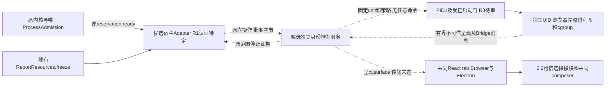

# 交互报告：独立执行身份与受控服务候选

2026-10-29；核对基线 `8d8f339c3e561154b05d4db39b4264c6db2c42e6`，起始工作区干净。本文供主线选择架构，**没有采纳、安装或运行服务**。原报告 change 保持8/14，2.1b／I5及活动页不可用。仓库仅写报告规划工件和本文，不改生产接口／策略／UI。

## 结论与主线决定入口

第17轮主线验收已按原报告spec和平台决议选定可信账户模型：原登录用户及正常内核可信，不可信报告使用独立受限身份；不承诺对已控制可信账户的任意同UID程序作代码认证。peer凭据不升级为程序证明，报告取得可信通道仍是隔离失败。原真实ProcessAdmission、领域授权和unknown／停止责任保持。当前选择及下一片以[原design](../../../openspec/changes/add-interactive-research-reports/design.md#第17轮主线接收与下一片)为准；下方R1较强对手模型及其反例保留为候选比较，不再作为必须迁移整个内核的前置。系统部署及正式呈现仍须具体方案与真实验证，本轮没有安装许可。

值得继续审查的最小方向是：由系统管理器启动、与登录用户及浏览器不同身份的可信控制服务，按固定注册表启动每实例受限浏览器单元；领域授权及唯一进程准入继续留在原权威。它能改变旧入口由原用户预先跟踪的启动关系，但**独立UID不自动解决请求者认证、浏览器策略或共同呈现**。

目前不能把该候选排成生产实施：R1可信调用方／准入授权、R2双宿主呈现和R3跨身份启动／安装链尚待主线决定及T1证明。推荐先选定R1威胁范围，再授权一个只用固定native输入的T1；T1未通过不运行浏览器T2，不申请安装已否决的同UIDlauncher。没有证据支持直接迁移全内核或采纳画面流。

| 决定 | 选项与推荐 | 不能省略的代价／阻断 |
| --- | --- | --- |
| R1：谁有权请求服务并证明原准入 | 推荐让持有唯一准入的可信控制权威处于受OS保护的身份，再由服务核其连接；具体是保护现有内核身份还是另行重组受保护接缝，交主线决定，不在本片迁移内核 | `SO_PEERCRED`、用户可读token、`/proc/pid/exe`及客户端自报reservation都不能区分该模型下的同UID伪客户端。仅信账户而不鉴别程序不能被当成同等保证的替代。迁移权威身份涉及内核、配置、项目／库访问与凭据，超出本报告写集；不能复制admission或领域ACL补洞 |
| R2：如何保留既定呈现 | 推荐先定义下文同一语义surface的验收约束，校准Browser与Electron；传输／绘制方案由主线另选 | Electron原生View不提供普通Browser嵌入；offscreen位图不是DOM文本或可访问性树。不能先用图像替代，再把复制／查找／IME／无障碍降为优化 |
| R3：部署及启动权威 | 候选使用固定非root控制UID、每实例独立运行UID及PID1管理的固定单元；跨UID创建／停止仅由受控窄启动门完成 | 管理员需批准账户、受保护程序／unit／策略／路径及窄管理授权；不是已获安装许可。精确profile附着、FD交付和cgroup控制链需T1，不提供可直接安装的配置 |

## 已核事实，不是新运行结果

| 事实 | 依据与边界 |
| --- | --- |
| 同UID固定入口已否决 | [AppArmor研究](apparmor-fixed-launcher-ptrace.md)：Ubuntu `740b3235…` 的已有unconfined tracer检查早于exec-stop却特殊放行，不能依赖目标tracedby deny。main禁dump、TracerPid检查、静态链接或0755修改不补上该窗口。本文不重试这些路线 |
| profile名称不等于系统身份 | 同文追加：按名称stack可保留unconfined成员；不切换UID，也不保证纯目标域。0750能保护真实入口的DAC，但不能阻止profile名称stack。磁盘策略不是已加载策略 |
| 完整浏览器仍未进入 | 原报告investigation“完整浏览器前置校准”：两轮固定Electron均未到main／renderer；实际userns子域探针补充了限制，但没有捕获原浏览器完整失败因果。不能把错误提示列出的可能原因当唯一根因 |
| 已有可复用模块 | `ReportResources.freeze(entry, access)`同一次load返回snapshot及实际入口／依赖bytes，不复制sources正文；静态native provider只有`linux-x64-static-v1`策略，六操作和唯一ProcessAdmission已接入。没有浏览器策略或系统服务Adapter |
| 独立身份可由系统管理器在exec前选择 | 本机systemd259.5的`User=`；user manager不能任意切换UID。必须检查全部启动／停止命令及其`+`／`!`前缀、程序与依赖可写性，不只看主ExecStart。DynamicUser的数值UID会复用，不能当持久归属键 [S1] |
| peer凭据不是程序认证 | `SO_PEERCRED`是连接时PID／UID／GID快照，FD可转交；pidfd不认证代码。PID1创建并listen的socket被服务接手时，客户端所见server凭据还可能是PID1／UID0，不能误当实际服务UID [S2] |
| socket activation不提供每请求隔离 | `Accept=no`把监听FD交给一个服务处理所有连接；`Accept=yes`才按连接创建单元。两者都不等于按报告实例／消息自动建cgroup。pathname socket默认mode0666，root属主本身不限制客户端；abstract地址不受节点mode保护 [S3] |
| 权限、委派及停止是不同保证 | `ProtectControlGroups=true/strict`是只读视图，`Delegate=`只给所属子树控制，不授予跨UID或PID1管理权限；polkit的manage-units另管D-Bus。`StartUnit`返回异步job，`Type=exec`不等于报告ready；cgroup.kill／populated不替代范围身份与持久停止回执 [S4–S6] |
| 呈现API没有补齐共同体验 | Electron WebContentsView是Main进程View；offscreen文档描述bitmap／GPU texture；辅助技术支持发生在对应Electron进程。三份官方页均HTTP200，只核API说明，不是本机44.5.1或跨身份呈现实跑 [S8] |

## 一个候选的可信执行链

候选角色名只表达职责，不是已批准的服务名或新增业务身份：K为现有内核／准入权威，C为固定非root控制服务，M为PID1及受控窄启动门，P为单实例浏览器运行身份。C与登录用户、P分别不同；P也不得共享其他任务的控制权威。是否采用DynamicUser及其回收规则由R3确定，不能只凭UID不同宣布可用。

### 认证、入口与自动附着

1. 安装物由管理员控制的路径提供。候选C入口例如`/usr/libexec/scholoom/report-control`及其父目录、运行库、配置和unit均不可由原用户或P修改；不能执行工作区脚本、用户PATH／插件／NODE_OPTIONS。C由PID1固定unit创建，原用户不是它的fork／exec父进程；首次用户态指令前的UID／完整LSM label、原生映像及无不可信tracer必须实际核查。
2. 受控入口DAC与LSM附着分别验证。固定入口仅授予需要的执行身份；profile的自动附着或unit指定转换是否取得所需完整label须读回并追踪顺序，不把`AppArmorProfile=`字样当已生效。原用户按名称stack不得因此取得C／P身份、控制socket或宽启动能力。不改stock bwrap profile／全局sysctl，也不以SUID补救。
3. pathname控制socket由系统创建、父目录不可由原用户替换；候选路径`/run/scholoom-report/control.sock`。必须显式规定节点mode／owner／允许的调用身份，不依赖默认值；不公开TCP、CDP或abstract控制地址。客户端核根受控端点与绑定的服务实例，不能仅检查SO_PEERCRED等于某服务UID，尤其不能误读socket activation的server凭据。
4. **R1前不写认证成功路径。** 服务对每连接固定配置／宿主incarnation，instanceId关联原真实reservation；字段来自认证接缝，不能从请求JSON建立信任。重连和复制配置不能接管旧实例。一次性启动许可必须绑定该连接、原instanceId、登记程序／策略版本、冻结集和有效期限，且由唯一权威在`reservation.ready`与领域末次核查之后产生；具体证明机制尚未采纳。

R1最小反例：同UID程序A读取同一用户token或把受信路径程序K预先置于trace关系后连接，服务看到相同UID；A可以自报一个未reserve的instanceId。只做UID／token／exe匹配的方案不能同时证明可信代码和唯一准入。不能以“服务也加一个运行数上限”修正；那会产生第二容量权威。若要排除A，需主线明确并实现受OS保护的权威接缝；本文不擅自迁移全内核。

### 冻结字节与能力封闭

应先由原provider取得唯一准备资格，再调用原`freeze`；失败／撤权不交付部分集。沿原`stage/put`上限传输同一批实际字节，不能在C或P重新按宿主路径读取。入口／依赖仍是原ResourceRef与basis；服务只持原instanceId及OS回执，不新增reportId、来源表或报告存储。

这里仍有实际接线缺口：当前`IsolatedReportProvider.stage()`自身调用reserve，而stage已要求精确assets字节长度；`freeze()`才返回完整实际字节。**不能在宿主先reserve再调用原stage，也不能先完整freeze再把排队说成只含元数据。** 推荐主线审一个原provider内部的受信准备回调接缝：唯一reservation.ready之后调用宿主的freeze，按其结果建立原stage清单及分片，继续使用同一租约；不再调用一次公共stage取得第二槽位。具体私有Interface尚未批准，本轮没有实现或向公共schema加入字段。该接缝的资源／撤权／失败回收需在后续真实整合验证，固定已知长度样本T1不能替代它。

C的控制连接永不进入P。最小候选的对外请求只接受既有有界JSON／字节分片，拒绝用户提供argv／env／mount／宿主路径／任何额外FD；不把共享目录或任意SCM_RIGHTS当快速通道。若C→P内部需要只读FD，必须由C自行生成并封存，核regular／只读方向／大小／身份／seals，在原生门消费或关闭；dev／ino不替代内容basis。特殊文件、硬链接、目录、socket、FIFO及可写／未封存对象拒绝。

stdio逐项固定用途：无通用请求解释器；报告不能继承K／C的socket、终端、D-Bus、X11／Wayland、宿主字体服务、凭据、cgroup控制或fdstore。浏览器必需的内部socketpair／SCM若被允许，只能在已清空的浏览器图内传递其自身能力，不能连到控制服务或其他任务。允许AF_UNIX不等于允许宿主代理；拒绝AF_INET／INET6也不证明所有代理已封闭。所有接收口、迟到FD及原有pathname socket反例必须在T2重核。

### 完整浏览器、资源与控制器失联

- 受控启动门只允许安装注册表中的runtime／app／policy版本，不能接受任意StartTransientUnit属性、命令、User或profile。C的非root身份不能自行变成P；所需PID1启动／停止权限由M提供。窄启动门必须核固定允许的操作和原unit InvocationID／配置绑定；不能只用polkit允许一个通配unit名，再放任客户端提供ExecStart等属性。
- 每实例在放行前拥有实际cgroup范围，涵盖主browser、zygote、renderer、network／utility、GPU、crash等进程及后代；不得连接组外共享浏览器、GPU、crash、桌面或网络代理来掩盖范围。若某运行时要求组外服务且无法受控，组合unavailable，不删进程图节点制造通过。
- 原native默认拒绝策略不适用于Chromium；禁止把`linux-x64-static-v1`改名用于浏览器。浏览器自己的sandbox必须可用，不能用`--no-sandbox`弥补。所需namespace／seccomp／LSM、目录和运行库另登记，明确拒绝网络／代理和迁移；原生适配可复用，但新的受控服务启动Adapter及浏览器策略须另经主线审批与真实校准。
- 浏览器CPU／memory／swap／pids、scratch／输出、桥消息和呈现处理分别给预算。控制路径不得与恶意脚本共用事件循环；C及M应在P的受限cgroup外，C自身仍受有界资源保护，所有开销纳入宿主预算。CPUWeight不是保留CPU证明，cpu.max不是墙钟期限；浏览器线程计入pids。旧20%／64MiB／16tasks或浏览器前置512MiB／128tasks不是产品默认。
- T1需决定谁控制原cgroup：若M持有，C不能靠Delegate猜有管理权限；若委派给受信controller，仅该controller持有可写范围，P不可见。ProtectControlGroups严格只读与自行管理子树不能不加解释同时宣称成功。读回实际控制器／限制／权限后才放行。
- K失联停止新增动作，C收尾原实例；工作台关闭／Browser断线不等于K失联，不改变原普通内核及已受理执行生命周期。C丢失时M须收尾C所属的全部活动P单元；跨unit依赖和kill范围需实际证明，不能只依赖各job的父PID。P内controller丢失由独立管理路径终止原范围；C或M重启不自动恢复执行。
- intent先于创建范围，完整unit／InvocationID／boot／cgroup物理身份和配置绑定先于gate。get只查询原实例；失联或回执丢失为原unknown，不换instanceId重试。范围记录仍只有一个写入权威：拟由服务侧原records的OS Adapter维护，宿主保存原准入归属和已核回执引用，不并行维护可独立改写的scope账本。只有原ProcessAdmission记容量；不可核查的服务残留阻止恢复屏障开放新受管工作。只有固定原范围完整停止及停止回执持久化，才resolve原live承诺或settleRecovered；服务显示inactive、根PID消失或目录消失单独均不足。

## 呈现、输入、文本与可访问性接缝

共同React资源tab保留报告版本、更新提示、草稿及composer；执行页不在工作台进程内运行脚本。建议的`PresentationSurface`仅是待审Interface职责名，无新schema：接收经核准的report版本／视图generation；展示隔离端输出；传递当前surface内的指针／键盘／滚动／IME；提供同一实际内容的文本选区、复制、查找、焦点和可访问性信息；销毁后拒绝旧generation。尺寸、解码工作、帧率／语义树大小和输入队列均有界，不把重活移到内核主线程。

可审查的实现差分如下，尚不采纳任何一个：

| 路线 | 能保留的部分 | 对当前首批的阻断 |
| --- | --- | --- |
| 外部原生浏览器View／独立窗口 | 浏览器内部DOM、输入和辅助技术 | Electron main View不是普通Browser可嵌入的能力；独立窗口也不符合共同tab。因此不能作为双宿主现成解 |
| 可信语义surface／受限投影 | 父页可用真实DOM承接经验证的文字、对象、焦点和辅助信息，接原2.2选择模块 | 不得把任意回传HTML／CSS／JS注入父页；需证明与隔离页当前可见内容／canvas／交互一致，不能暗中把开放HTML改成新DSL。若无法覆盖既定场景，需产品决定，不能宣布已相容 |
| offscreen画面／输入转发 | 可传递视觉结果及部分交互 | 位图／texture本身没有父工作台DOM文本和辅助树，且共享GPU句柄另有能力风险。本轮不采纳画面流，也不把补文字／无障碍留作首批外优化 |

版本绑定的Bridge继续只带原JSON与objectIds／request。宿主用原snapshot解释对象，实际附加由research-graph-runtime本轮负责的可信选择模块接`appendContextItems`，检查同步boolean及原接收者；不向页面或服务开放KernelClient、模型、文件写入或session.send。此研究不修改该线文件，也不替它决定模块Interface。

## 运行时、字体与部署许可

候选安装布局仅供审查：固定runtime及字体位于root管理的版本目录（例如`/usr/lib/scholoom/report-runtime/<version>/`），受保护控制／启动程序在`/usr/libexec/scholoom/`；unit在系统unit目录；控制socket在受保护`/run`子目录；OS回执在独立服务私有状态目录。具体名称、控制服务账户及per-job UID选择由R3确认，例路径不是获准配置或现成文件。

runtime必须有版本／架构清单、全部依赖与字体、许可证／再分发声明、漏洞更新责任、磁盘预算和原版本保留策略。不使用用户profile、用户字体／fontconfig缓存、已有Playwright缓存或宿主桌面代理作为产品依赖。硬编码版本或root属主都不替代完整路径／库／配置链审查。

| 阶段 | 需要的实际许可和保护 |
| --- | --- |
| 安装／首次启用 | 管理员批准创建系统账户／组、部署受控runtime／字体／程序／unit、必要LSM策略及窄PID1授权，设置端点和状态目录权限。验证有效策略与权限后才启用；不给普通用户通用manage-units／root Shell／mount能力 |
| 升级 | 管理员替换受控安装物；核旧job及unknown，不让旧回执指向新policy或runtime。并存旧版本还是先停旧实例由主线定；失败保留旧成果／证据，不自动重放 |
| 卸载／禁用 | 先拒新请求、禁所有socket／activation触发源，再核全部服务job／unknown及停止回执；disable或删unit不等于stop。确认后才撤安装物、策略和授权；有unknown保留必要运行／核查工件及状态，不删除账户／目录来伪造停止。保留还是删除用户数据需单独明确 |

本轮没有创建上述任何系统对象，没有安装许可。Linux候选不声明Windows或macOS可用；Windows独立身份／令牌／Job及显示接缝需另一目标证据，macOS受管执行仍不可用。

## 文件、Interface与依赖交接

| 实际已有事实源 | 后续最小增量建议／归属 |
| --- | --- |
| `editor/report-resources.ts::freeze`、`resources.ts`及原ResourceEvidence | 阅读交互消费原冻结集；领域仍管ref／basis／read/send，原模型queue／final／restart不变 |
| `platform-isolation.ts::isolationOperations` | 六操作保持；服务认证封套、系统策略与呈现契约均尚未批准，不在原输入中偷偷加UID／原生路径／lease DTO，不复制schema |
| `platform/isolated-reports.ts`、`isolated-report-controller.ts`、`isolated-report-records.ts` | 经主线审后提取可替换启动／范围Adapter，复用stage/put、记录同步、get/stop/unknown。现有user-manager／静态ELF假设不能直接重用于系统服务／浏览器 |
| `platform/admission.ts::ProcessAdmission` | 唯一实例及原reserve/retainUntil/retainUnknown/settleRecovered；服务无第二执行计数器。R1若要求移动权威，必须另做跨模块设计，不能局部绕过 |
| 后续系统打包／固定启动门 | platform／主线负责OS安装面、unit／profile／窄授权、进程范围与升级卸载；不是renderer或editor私有脚本。R3决定前不预定生产文件名 |
| 共同tab／2.2选择模块 | 阅读交互与主线负责surface与生命周期；research-graph-runtime独立实现可信选择模块，本片只声明需要的版本绑定及原子附加接缝 |

真正前置是R1认证及准入证明、受控安装／有效策略、跨UID启动与停止、完整浏览器可运行组合、R2双宿主体验。可替换依赖是合成冻结字节、独立模型边界和授权回调；OS认证、实际UID／label、浏览器图、配额／停止及共同呈现不能用成功替身关闭。

**主线需审的最小Interface差分：** 原六操作的业务载荷不变；服务接线还需要一个在操作前建立的、不能由JSON自报的可信host binding，以及仅该binding可读取的原范围inventory。当前`IsolationRecords.load()`在本地初始化中承担inventory职责；系统服务Adapter须提供等价的`loadOwnReceipts(binding, cursor)`能力，先恢复全部未知占用，再开放stage，get不能代替“查全自己遗留范围”。该签名仅说明职责，binding的R1证明、分页／回执的同源表示及跨进程认证封套均待主线批准，不是新增第七个公共操作或另一份DTO。M所需跨UID启动／观察／停止只能消费C已核的固定程序／策略和原unit身份，不接受客户端给出的D-Bus properties。新增契约获批后必须在唯一protocol来源定义并生成类型，本轮只交这个缺口。

## 最小T1／T2与停止规则

以下均是后续需另获实施／部署许可的校准，**本轮没有执行**。仅用自有配置、合成文件和loopback端点，先固定输入、限制和真实清理归属；不运行任意不可信浏览器来填未知。

**T1：固定native、入口和服务信任。**

1. 正例：由选定的受保护权威取得原reservation，经认证连接交同一冻结字节；PID1创建独立UID的固定代码。外部观察首用户态前身份／label／tracer、真实范围和资源限制；正文只读且不见宿主诱饵。
2. 认证反例：原用户直接／同UID伪客户端、旧token、转交连接FD、同名可写路径、已有tracer、profile名称stack、错误config／incarnation／lease及非ready请求；全部在新job创建前拒绝，且不虚构SO_PEERCRED能鉴别程序。反例成功即阻断R1，不继续T2。
3. 能力反例：高FD、stdio误放socket／SCM、目录／迁移句柄、pathname代理、可写／特殊资源、任意unit属性或程序／策略版本。区分进入前拒绝与实际已进入后的OS拒绝。
4. 故障：创建intent后失联、gate前撤权、快速exit、C及P-controller丢失、服务／宿主重启、复制配置、unit身份失配及停止落盘失败；核全部登记范围、持久回执与同一admission。没有完整停止证据不释放，重启不重放；M无权／机制缺失时unavailable。

**T2：T1通过后，固定文献对比报告的真实浏览器及双宿主。**

1. 正例须真正到main／renderer及筛选、排序、展开，核当前页面、中文／公式／表格选区、复制／查找、IME、键盘／焦点与辅助树，2.2只接实际同版本对象。Browser与Electron共用tab／composer，不能用浏览器内部截图代替父工作台文本／无障碍证据。
2. 完整进程图含network／GPU／utility／crash与子孙；配额覆盖恶意CPU／内存／线程／输出，控制路径保持独立。漏一进程或依赖组外代理即失败，不按根PID退出或单个空scope判断。
3. 自有HTTP／UDP／DNS计数器先做危险正控制，再测fetch／STUN／导航／popup／form／字体图片／worker／嵌套、Unix及桌面代理／FD转交；正常页面资源只从冻结集取得。没有到达相应动作不计零外发通过。
4. 旧view／generation、洪泛、版本更替／撤权、失联／停止和卸载触发器均不得泄露控制或改变原草稿；保留首败、真实停止及剩余unknown。任一隔离或体验保证失败，活动报告继续unavailable，回到对应R项，不放宽CSP、sandbox、期限、容量或OS限制。

## 来源与证据入口

本轮cache根为`/home/joshua/.cache/scholoom-parallel-resume-20261029-A5WuXN/research-interaction/work/`，不依赖现有`/tmp`。辅助只读核查使用同配置gpt-6.1-sol／high、无历史fork，已停止；正文决定由主Agent复核。官方资料不是部署验收。

- [S1] systemd259.5：本机`systemd.exec(5)` User／DynamicUser，`systemd.service(5)`执行前缀；[官方文档](https://www.freedesktop.org/software/systemd/man/systemd.exec.html)。对应本机包`259.5-0ubuntu3.4`，缓存`official-service-research/sources/`及`official-service-facts.md`保留条目／行号。
- [S2] Linux man-pages6.17 `unix(7)` SO_PEERCRED／SCM_CREDENTIALS、`pidfd_open(2)`；[公开手册](https://man7.org/linux/man-pages/man7/unix.7.html)。已核Ubuntu定版[af_unix.c](https://git.launchpad.net/~ubuntu-kernel/ubuntu/+source/linux/+git/resolute/tree/net/unix/af_unix.c?id=740b32353f43e9b00d0350d6fa7b29a6667deabd#n809)，双向凭据复制在1740／1772行附近；本轮源码仅只读保存于cache。
- [S3] systemd259.5 `systemd.socket(5)` Accept／SocketMode／PassCredentials／AcceptFileDescriptors；[官方文档](https://www.freedesktop.org/software/systemd/man/systemd.socket.html)。不以latest网页替代本机版本条目。
- [S4] systemd259.5 `systemd.exec(5)` ProtectControlGroups／PrivateUsers／NoNewPrivileges、`systemd.resource-control(5)` Delegate及预算；本机缓存条目已核。
- [S5] 固定Ubuntu [cgroup-v2.rst](https://git.launchpad.net/~ubuntu-kernel/ubuntu/+source/linux/+git/resolute/tree/Documentation/admin-guide/cgroup-v2.rst?id=740b32353f43e9b00d0350d6fa7b29a6667deabd#n1051)：delegation、cgroup.kill／events及CPU／memory／pids，缓存全文。
- [S6] systemd259.5 `org.freedesktop.systemd1(5)`异步job／Security、`systemd.service(5)` Type／Restart／FD store、`systemd.kill(5)`、`systemctl(1)`停止与返回码；缓存精确条目，不作实际已停止结论。
- [S7] systemd259.5 `systemd.unit(5)`、`systemd-sysusers(8)`及systemctl disable／daemon-reload；仅核安装面，未调用系统写操作。
- [S8] 官方[WebContentsView](https://www.electronjs.org/docs/latest/api/web-contents-view)、[offscreen](https://www.electronjs.org/docs/latest/tutorial/offscreen-rendering)、[accessibility](https://www.electronjs.org/docs/latest/tutorial/accessibility)，2026-10-29三份HTTP200，cache `official-presentation/fetch-results.json`／原HTML／文本。latest API说明不等于锁定runtime或两宿主实测。

官方资料两份定版源码与三份呈现网页首次下载均成功；辅助首个`systemd --version`因PATH不含程序失败，改用已装绝对路径并保留原日志。未安装依赖、运行服务／namespace／浏览器／恶意样本、编译或加载策略、创建用户、改权限／sysctl、触发或查询CI。当前只有方案及待证条件，不存在新的服务运行通过结论。
