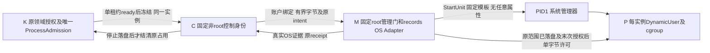

# 固定 native T1：独立身份的安装前方案

2026-10-30；基线 `825f3fac57664a8d07f70e1145a3baee1434273c`，初始 Git clean。本片为第20轮 2.1e 的**候选规划**，只新增本文，未安装、加载策略、启动服务或运行 T1。报告 tasks／delivery 由主线维护，本片不勾任务；T1／2.1b／I5、完整活动报告与 Windows W2 继续开放。

依据：[第20轮设计](../../../openspec/changes/add-interactive-research-reports/design.md#第20轮接收及下一片)、[第17轮账户模型和单租约决定](../../../openspec/changes/add-interactive-research-reports/design.md#第17轮主线接收与下一片)、[原独立身份研究](report-independent-identity-service.md)。后者较强的同 UID 对手假设不成为本片新增要求。已否决的 [AppArmor 入口](apparmor-fixed-launcher-ptrace.md)与 [bwrap 挂载路径](bwrap-fixed-launch-mounts.md)研究保留，不重试其 launcher，不改变 stock 策略或 sysctl。

## 提交主线的一个具体候选

建议先审 **K 保留业务权威、非 root C 接可信账户请求、root M 只管理固定系统模板、PID1 为每实例 P 分配受限身份**。新增 M 是本候选明确的特权成本，尚未获准；不是把已有 user manager 改名。若主线不接受 M，应返回管理授权设计，不用模板名前缀的宽 polkit 规则替代固定属性保证。[S1][S3]

| 主体 | 候选身份与职责 | 不交给该主体的权威 |
| --- | --- | --- |
| K：正常内核 | 原可信登录账户；原 `IsolatedReportProvider` 的准备、领域核权、唯一 `ProcessAdmission` 和恢复占用 | 不获得 root、通用 PID1 管理、mount 或策略加载权限；不迁整个内核 |
| C：控制入口 | 新系统账户 `scholoom-report-control`，无登录 shell／home、无附加管理组，PID1 固定程序启动；核 peer 账户、连接及配置 incarnation，转发有界物理操作和回执 | 无第二容量表、领域 ACL、项目／库正文读取或任意命令执行；不向 P 转交连接 |
| M：固定管理门 | PID1 启动的最小 root 程序；仅接受 C；管理固定 `scholoom-report-t1-v1@.service`，派生内部路径，持久化原 records 的 OS 数据 | 不接受任意 D-Bus properties、User／ExecStart／环境／mount／unit 名或宿主路径；不实现领域授权或调度 |
| P：实例 gate 与 probe 及后代 | PID1 系统模板，`DynamicUser=yes` 且不固定 `User=`；原 native 策略约束及每实例 cgroup | 无 K/C/M socket、system bus、notify、cgroup 写权、继承代理或跨实例材料 |

DynamicUser 的名字由完整 unit 名派生，非法用户名时使用含散列的名字；在用动态 UID 不重复，但静态同名账户会被复用，UID 停止后可回收。故每实例分离是**启动门必须读回的条件**，不能只凭 `DynamicUser=yes` 宣称成立；冲突、落到 K/C/root 或与活动实例同 UID 均拒绝。数值 UID 不作恢复身份，不在不可确认范围结束前因 unit inactive 就允许清理／回收假设。[S1]

### 安装物与精确保护清单

配置草案统一保存于 `/home/joshua/.cache/scholoom-round20-acceptance-INWZnx/next/zotero-ecosystem/drafts/`：`control.{socket,service}.in`、`manager.{socket,service}.in`、`native@.service.in`、`paths-and-installers.tsv`、`policy-requirements.md`。它们未部署；C/M/gate 程序与有效策略尚待实现，`.in` 不能当安装包使用。以下路径和名字是供主线选择的固定安装布局，不是请求参数。

| 安装对象 | owner／mode 候选 | 创建／修改主体与所需系统权限 |
| --- | --- | --- |
| `scholoom-report-control` 静态账户及同名组；`scholoom-report-callers` 调用组 | 无 home／登录；仅获准登录账户加入 callers；P 不加入两组 | 管理员创建账户／组、配置调用者成员；需要系统账户数据库写权限。不能由用户态 C 自建 |
| `/usr/libexec/scholoom/report-t1/v1/` | root:root 0755；C 程序 root:control 0750；M 程序 root:root 0700 | 管理员部署经审程序，所有父目录、解释器／运行库及配置链不可被 K/C/P 改写；无 SUID、文件 capability、用户 PATH／插件加载 |
| `/usr/lib/scholoom/report-t1/v1/root/` | root:root 0755；`bin/gate`、`bin/probe` 为静态 ELF、root:root 0555；预建空 `/input` | 管理员部署固定架构和版本；T1 不用工作区脚本、浏览器、字体、shell 或用户 runtime 缓存 |
| `/etc/scholoom-report/installation.json` | root:root 0644，父目录 root:root 0755 | 管理员登记固定 program／policy／unit 版本、允许的账户及来源清单；不是 secret、用户凭据配置或可传任意 argv 的入口 |
| `/etc/systemd/system/scholoom-report-{control,manager}.{socket,service}` 及 `scholoom-report-t1-v1@.service` | root:root 0644；含 drop-in、别名及 mask 的有效链一起审 | 管理员写系统 unit、后续 daemon-reload／启用；不准 K/C 修改。全部 Exec 行拒绝绕降权的 `+`／`!` 前缀 |
| `/etc/apparmor.d/scholoom-report-{control,manager,native}-t1-v1` | root:root 0644，enforce；准确转换和文件规则待编写 | 管理员部署；加载另需有效策略管理权限（包括适用的 CAP_MAC_ADMIN）。本片不写可加载 profile、不执行 parser 加载或策略操作 |
| `/etc/tmpfiles.d/scholoom-report-t1.conf` | root:root 0644，仅保护目录定义 | 管理员／PID1 准备下列 runtime 目录，不配置按年龄删除记录／成果的规则 |
| `/run/scholoom-report/` | root:root 0755；K 与 C 均可遍历，不可改写 | 管理员／PID1；控制 socket 为 root:callers 0660；私有子目录 root:control 0750、manager socket root:control 0660 |
| `/run/scholoom-report/gates/<storageId>/permit.fifo` | gates 与实例目录 root:root 0700，FIFO root:root 0600 | M 创建；由 PID1 执行准备阶段打开读端，M 持写端；P 获得的仅是固定 FIFO 读 FD，不获得路径管理权。具体打开顺序待 T1 |
| `/var/lib/scholoom-report/records/` | root:root 0700；原配置/index/receipt 文件 0600 | 管理员准备根、M 的 records OS Adapter 唯一写入；K/C 通过受控操作取得所属投影，不能按路径读取 |
| `/var/lib/scholoom-report/jobs/<storageId>/` | root:root 0700；封存 input 0555、文件 0444；日志 0600 | M 从实际字节创建，拒绝链接／特殊对象及替换；PID1 将 input 只读 bind 到新根 `/input`。管理员/M 掌握封存后的修改责任，不向 P 授予修改权 |

所有符号组名以 TSV 的完整候选名为准；不能忽略父目录权限、ACL、额外组、可写 drop-in 或 symlink。每个版本目录包含来源、许可证、架构、完整依赖与升级责任；T1 静态程序无动态运行库不等于后续 Chromium 已有可分发 runtime。系统目录 mode 的本机观察不构成这套安装物链已经安全。

本候选**不安装 polkit 放行文件**。K/C 无 `manage-units`／`StartTransientUnit`／`SetUnitProperties` 授权，M 以 root 仅调用固定静态模板的 StartUnit／StopUnit 及只读查询。M 的 root 身份和 system bus 可达性是新增特权面；AppArmor 与程序校验须把它约束为窄门，不能把 root 自带权限当最小授权证明。主线若选择非 root M 或直接 polkit，需另证精确方法／属性授权；手册未证明“通配模板名允许 manage-units”能达成同等限制。[S3]

## 原 Module 与候选 Adapter：保持权威，不复制流程

以下为基线源码事实，行号取本轮基线；它们解释实际改造接缝，**不是已完成远程提供者**。

| 原 Interface | 当前行为与复用点 | 跨身份必须另审的部分 |
| --- | --- | --- |
| `platform.reportIsolation.check/stage/put/start/get/stop`，`platform-isolation.ts:57–88` | 仅 program/policy、instance、视图内相对文件及分片；共同 phase／gateReleased／stopConfirmed／next／failure | 不加第七公共操作、UID／任意路径／凭据 DTO；认证封装和 inventory 只是私有 OS Adapter 职责 |
| `IsolatedReportProvider.prepare`，`isolated-reports.ts:316–455` | 原 authorize → 同一 reserve → ready → authorize → freeze/load → 校验实际字节 → 原 create/put → authorize；重复实例复用 Promise | 回调留 K，不序列化到 C；不能在 C 再实例化一个会 reserve 的 provider，也不能先 freeze 后“补领”名额 |
| 原 records，`isolated-report-records.ts:74–169,175–286` | config、index、receipt、逐步偏移与 sealed、原子 sync/rename；inventory 上限4096、编码上限1MiB | 默认当前 UID／本地目录 FD 和原根 dev/ino 假设要改造为受控物理 IO；本候选让 M 在服务保护根维护**唯一原 records**，不另造服务 scope 台账 |
| controller，`isolated-report-controller.ts:140–236,284–370` | intent 先落盘；实际 boot／InvocationID／cgroup dev/ino／PID birth 与限额；放行前再核权；停止核原范围 | 现为 `systemd --user`、`/user.slice/` 及当前 UID，不能直接拿来证明 PID1 系统模板；系统范围、gate 及停止 Adapter 均待实现 |
| provider 私有 `IsolationNative`，`isolated-reports.ts:58–71` | support／lock／controller／stopRecovered 可替换 | 不足以单独承载全部跨 UID IO：构造 records 与 `start:622–658` 的本地 gate／程序／文件写入尚在 provider 内。要明确提取该物理 IO seam，不能用“换 Adapter 即可”掩盖 |
| 原 `ProcessAdmission` 与 initialize，`admission.ts:40–61,107–132`；`isolated-reports.ts:202–217,275–314` | 先 retain 全部 unknown，再核查；stopped receipt 保存成功才 resolve/settle | K 仍唯一容量权威；C/M 不按系统 job 数开第二池。原范围库存不可完整读取时，K 不得开放新的受管执行 |

两种接线比较：把整个 provider 搬到 C 会连带迁移唯一准入、领域回调和冻结资源访问，不采此候选；在 K 保留业务 Module、将物理 records／字节／启动停止集中为系统 OS Adapter，能复用单租约与原六操作。后者仍需主线批准私有 Interface 的提取范围，当前代码不是现成实现。未来 tests 应跨同一 Interface 验证本地与系统 Adapter，OS 身份／范围证据不能用成功替身关闭。[Code]

M 的 jobs 输入与诊断是原实例暂存物，不是新材料库；K 只保存原占用及回执引用，C 只持活动连接／投影。M 的原 receipt 是唯一 scope 写入事实源，原 intent 的创建、状态转换与物理保存由同一串行路径协调；不能让 K 本地和 M 各写一份可独立采纳的 scope receipt。断点后的库存、原子写入、旧格式／旧版本读取也属于未来 records Adapter 的验收。

## 可信 K 到 C，再到 M 的窄请求与字节流

1. **安装时固定调用账户。** 管理员给获准登录账户 callers 组资格，并登记其数值 UID；运行时 C 对接收连接读取内核 peer UID，核原允许账户。C→M 同样核固定 C UID。账户变更／UID 复用需管理员重新核对，不只比较组名。[S2]
2. **K 核固定端点链。** pathname socket 由 PID1 创建，父目录与节点不可被 K/P 替换；K 核路径和当前服务 binding。socket activation 的客户端 SO_PEERCRED 可能是创建 listener 的 PID1/root，不能把它误判为 C UID，更不能拿 JSON 中的 serviceId 自认证。服务 incarnation 的握手、断连和库存关联须在 T1 实测；未绑定前 unavailable。[S2]
3. **凭据只证明账户。** 正常 K 是已选可信账户内的正常内核，因此 C 可以消费 K 在准入／末次核权后发出的可信声明；C 无法从一段 instanceId JSON 独立证明 reserve，也不宣称能辨别该账户内已受控的恶意程序。页面/P 不是该账户，不得取得 K 的连接或代理。不要引入用户 token／exe 路径来虚构更强认证。[Decision]
4. **绑定在连接上下文。** 账户 principal、原 configId、K incarnation 与 C incarnation 由受信连接建立，业务六操作沿原 instanceId；连接上不得重新自选其他配置。configId 来自正常 K 的现有配置身份，物理根身份仍由原配置核查保证，不让 C 按传来的任意宿主路径打开配置。复制配置／活跃 K 争用／旧 incarnation 不自动认领，阻断并交原身份核查；准确 binding 表示待主线定，不新增公共 schema。
5. **一份租约、一份冻结集。** K 在原 ready 后 freeze，随后建立实际清单及原 intent；只有相对位置与批准字节进入 C。沿原 stage/put 约束交付给 M 的受控 IO，不接 SCM_RIGHTS、目录 FD、用户路径、程序映像或任意 argv/env。固定 program/policy ID 必须与已安装注册项一致，现有 host-bound program image 的版本对应另核，不开放新上传执行入口。
6. **物理写入与封存。** M 由原 storageId 派生路径，逐段不跟随 symlink，核普通单链接对象、偏移、尺寸及原物理身份；写入 sync 后才推进原 next，完整封存及 receipt 保存后才允许 start。P 只见固定新根里的 `/input`，没有项目／库挂载；没有 C/P 共享可改暂存目录。mounted 文件身份不能替代 K 的 ref/basis/read/send。
7. **传输与错误有界。** 复用原清单最多33个文件、单依赖8MiB、总32MiB、原 put 分片编码上限及原诊断约束；每连接串行当前请求、仅有限元数据等待，满额明确拒绝。records 的4096项／1MiB限额是库存／编码界限，不能变成第二运行容量表；不要截断 inventory 后继续启动。附带FD、截断辅助数据、超限或未知字段在分配OS范围前拒绝，关闭实际收到的多余FD，不能只忽略 ancillary 内容。[Code][S2]

## 原 intent 到 PID1 真实范围的放行与停止

候选模板只允许 M 从原 receipt 的 storageId 构造名字；unit 固定 `RootDirectory`、`ExecStart=/bin/gate /bin/probe /input/entry`、只读输入 bind、无 Restart、无 notify 给 P。不存在由业务端传入的 User、policy 路径、动态 ExecStart 或任意 transient properties。

**启动顺序：**

1. 原准备实际完成，持久化原 instance/program/policy、封存集和 `scopeIntent`，再向 PID1 请求固定实例；返回 job 路径仅表示请求受理。
2. PID1 为实例选择受限身份、cgroup／mount／LSM，再启动固定 gate。gate 未收到放行字节不进入 probe；不能把 Type=exec 或 gate 自报 ready 当放行完成。
3. M 核 system manager 的 unit／job 结果、bootId、InvocationID、真实 cgroup 目录 dev/ino、实际 PID/birth 及进程所属范围、UID/GID／补充组／完整 LSM label、真实 cpu.max/memory.max/swap/pids 限额。持久化原范围身份后才可推进放行。
4. K 对原实例再执行领域授权并确认原 reservation 仍有效；M 先保存原 launchIntent，再核连接 incarnation／未撤销状态，向自有 FIFO 写一个固定许可字节。失联、EOF、错误字节、撤销或未落盘都只停止，不重发许可或创建新实例。
5. gate 核 FD0 为该 FIFO 只读端，FD1/2 为同一已核普通日志写端；关闭高 FD、activation／notify／DBus／环境能力。消费许可后关闭 FIFO，装原静态 native 的精确默认拒绝 seccomp，再执行唯一固定 probe。P 不持控制 socket，也不能通过 stdout／ready 字样改变可信状态。

FIFO 用 `StandardInput=file:/run/.../permit.fifo`；官方明确允许 FIFO，但其打开是否阻塞、root侧打开与 RootDirectory／降 UID 的先后、reader 就绪及 M 的写端关闭需要 T1，草案没有假定已经打通。不把 FIFO 换成 `StandardInput=socket`／stdio AF_UNIX 通用代理“解决”失败。此时网络、能力、挂载和默认拒绝规则也必须先于目标指令；对“首用户态前”若只有事后 `/proc` 快照，记缺证，不把 `TracerPid=0` 当完整前序证明。[S4]

日志由 M 先建**新的空普通文件**，PID1 `StandardOutput=file:` 取得只写 FD、stderr 继承 stdout；不映射 journal socket。`file:` 不截断，故不得复用旧日志冒充新轮；`LimitFSIZE=65536` 只限单进程扩展文件，非累计写量／总磁盘配额。T1 probe 只许这一个输出对象，并验证错误／洪泛下的固定文件上限；后续 scratch/多文件需要另设总量保护。日志完全不可信，不能作为 scope 或停止的事实源。[S4]

候选单实例校准值为 CPUQuota=20%、memory.max=67108864、swap=0、pids.max=16，运行与启停各5秒；C/M 各32MiB、16 tasks及独立 watchdog 候选。它们**未在本身份组合校准**，CPU配额不是保留CPU、5秒不是硬实时保证，不能写成产品默认或总RSS达标。C/M 在 P 受限 cgroup 外，但全机开销和 watchdog 仍需计量。所有 cgroup 由 PID1 控制，C/M/P `Delegate=no`，不同时声称 cgroup 只读和自行写子树。[S1][S5]

**停止与 unknown：** stop 只指原 instance；M 核原 unit＋InvocationID＋boot＋固定 cgroup 对象后发 StopUnit，KillMode=control-group、SendSIGKILL=yes负责原组后代。请求成功、inactive、主 PID 消失、cgroup路径消失或 C 退出，单独都不构成 stopConfirmed。须确认所有受约束进程从未获迁移能力、原范围确为空／已由管理器回收且身份链完整，再成功保存原 stopped receipt，K 才 resolve live 或 settleRecovered。任一步权限不足、身份失配、D-state/超时、丢回执或持久化失败，原 unknown 保留槽位；不停止同名接替者，不延长期限／删目录造通过。[Code][S5]

P 对 C/M 配置单向 BindsTo＋After，另以 PartOf 传播主动 stop/restart；C/M 用主进程存活和 watchdog，不能用 ExitType=cgroup 将残存子进程当控制器健在。P 的 ExitType=cgroup 仅用于保持后代存活状态，不是停止器。K 控制连接失联只停止该 binding 的实例；工作台断线／关闭不等于 K 失联。C crash、M crash、watchdog 和连接中断的真实依赖传播均待 T1，不以 parent PID 或 unit 文件存在替代。[S5]

## 重启库存、升级与卸载

- **正常及异常重启：** C/M 启动先恢复同一原 records inventory；K 对所属全部未确认实例先 retainUnknown 再逐项核查。库存可有界分页但必须证明完整，无原配置/index或中途读失败就关闭新准入；get仅查单实例不能代替 inventory。当前原 `load()` 有4096／1MiB界限，超限明确阻断，不增第二台账、自动丢弃旧记录或后台重放。
- **旧连接与跨启动：** C/M 重启不自动 start，unit Restart=no；新 K 不用复制配置或新 incarnation 接管旧 live。bootId 变化、动态 UID 回收只触发核查，不能推原数据和回执已安全；原不可核查范围保留 unknown。服务端同一记录写入锁、inventory配置绑定、未索引 receipt 与收尾中断的恢复顺序需要实际故障验收。
- **升级：** 管理员先封新请求、保留查询／停止路径并核全部 live/unknown；优先首片维护窗口全部确认停止后切版本。固定 v1/v2 gate、unit、policy和runtime并存只为核原实例，不能让旧 receipt 解释为新策略；任何 unknown 阻止移除其核查物。新安装校验失败保留原版本与成果，不重放冻结集／发布。
- **禁用／卸载：** 管理员先封新请求和全部 activation 触发，再借仍可用的 M 停原实例并保存回执；disable／daemon-reload／删除 unit 不等于 stop。逐个确认后才撤 socket、manager授权面、程序、策略和账户；unknown 时保留必要程序／策略／records／输入／日志供核查，不先删账户或范围路径。P动态UID的回收不能作为删除遗留文件的理由。用户项目／库／报告成果不归安装器删除；暂存冻结内容可能含受保护材料，只以独立明确的数据保留／删除决定处理。[S6]

## 实证、候选假设与 T1 待证表

证据性质：**L** 为本机只读，**C** 为基线源码，**D** 为定版官方文档；**H** 为候选设计，**U** 为真实组合未证。D 不等于本机配置生效，C 不等于跨 UID 实跑。

| 项目 | 已有依据 | 尚不能填成事实的部分 |
| --- | --- | --- |
| 基线与写集 | L：指定 HEAD、初始 clean；仅本文新增 | 本片不代表主线已经采纳本方案 |
| 系统前提 | L：UID/GID1000，PID1 systemd/root；systemd259.5、AppArmor5.0.2、内核7.0.0-38；self label unconfined；AppArmor enabled=Y | U：候选profiles未加载，完整label／policy附着未知 |
| 安装路径权限 | L：系统unit、apparmor、libexec、var/lib、run目录均root:root0755；polkit规则目录root:polkitd0750 | U：新对象不存在，ACL／全部父链／有效drop-in未验；不能继承系统目录观察当安装审计 |
| 控制账户 | L：getent指定账户exit2；本轮未创建 | U：实际UID、组、NSS冲突、P动态身份及并发隔离 |
| cgroup资源 | L：根controllers含cpu/memory/pids；根cgroup.type读取ENOENT原样记 | U：每实例控制器、限制、权限及完整停止；不由controllers列表推委托或达标 |
| 唯一准备资格 | C：原prepare同租约ready后freeze、取消/unknown规则 | U：跨连接绑定、远程物理IO、故障后同租约及原intent对应 |
| peer账户认证 | D：SO_PEERCRED，PID1 listener凭据陷阱 | H：受保护pathname与可信账户声明；U：两个方向实际凭据、旧binding拒绝、附带FD关闭 |
| M启动权限 | D：system manager可换UID，非特权manager操作需授权 | H：root窄门；U：实际D-Bus调用、固定模板限制、无通用代理／属性绕路 |
| 挂载／FIFO／FD | D：RootDirectory、只读bind、FIFO允许及stdio语义 | U：跨UID DAC、路径解析／打开先后、只读内容、gate握手、首指令前FD关闭及迟到能力 |
| 策略 | C/D：原默认拒绝syscall、既有同UID入口否决 | U：新安装程序的精确enforce profile、首指令前label与exec转换、实际拒绝及无迁移 |
| 失联／重启库存 | C：原scope身份、retainUnknown和停止落盘；D：BindsTo/KillMode语义 | U：系统范围Adapter、C/M故障传播、无漏项inventory及停止保存失败保护 |
| 浏览器与呈现 | 原R2/R2b反例及当前设计边界 | U：T2、完整进程图、系统IME／读屏、任意HTML、三平台与科研质量；本文不验 |

## 最小实施／验收顺序：哪些可离线，哪些需系统许可

| 顺序 | 行动、权限与实际完成判据 | 失败时停在哪里 |
| --- | --- | --- |
| 0 主线决策 | 审本候选及cache草案；确认下方三个真实差异，另定实施写集与部署操作者 | 未批准不写生产Interface／安装脚本；本片到此只交规划 |
| 1 离线实现审查 | 在隔离cache构建未来固定C/M/gate/probe；核原六操作、records物理IO seam、版本和许可；单租约/取消/停止落盘保留原行为。无系统权限，依赖已有工具 | Adapter不足时回主线，不绕过provider造成功fixture |
| 2 离线安装物核对 | 校验静态ELF、无动态解释器／SUID／filecap、全部父路径与unit/drop-in清单；systemd离线verify及AppArmor**只编译**有效策略；读本机版本/能力，不加载 | 缺程序／策略/权限或语法问题准确报错，不把文件文本当部署可用 |
| 3 获批系统部署 | 管理员明确批准账户／组、固定受保护文件、unit/socket、目录、策略加载和启用；先禁新请求，逐项读回有效owner/mode/ACL、unit、profile | 任何前置不能兑现组合unavailable；不自动提权／改sysctl／回退旧launcher |
| 4 T1正反／故障组 | 实际K原provider/ProcessAdmission＋真实C/M/PID1及固定native，无成功OS替身；输入仅自有合成材料 | 任一必要条件未测或失败保持T1开放，停止自有范围，保留原unknown |
| 5 主线审T1证据 | 对照原intent、真实范围、停止回执和下面矩阵，复验安装移除顺序；确定是否另授权T2 | native通过也不启活动报告；R2正式呈现和浏览器策略缺口继续独立处理 |

本轮实际只执行0的研究及部分只读事实收集；未执行上述1的程序构建、2的unit/profile有效配置检查或3–5。只改Markdown和cache草案，无受测产物变化，不重复构建／业务绿测。未来1–4必须先构建再冻结产物测试，原始命令、首败及scope归属按本表保存。

### T1 必须到达的正负例及故障判据

| 类别 | 固定、自有测试动作 | 必须取得的真实结果 |
| --- | --- | --- |
| 正常字节与身份 | 可信K取得唯一槽后freeze合成入口；M启动唯一probe读取精确字节 | 原instance/intent→unit/InvocationID/boot/cgroup对象一致；C与P非K/root且彼此不同，实际label／limits／挂载正确；范围和停止回执落盘。probe输出仅辅助对照 |
| 进入前采证 | 由获批观察方法核PID1身份建立、完整label／tracer／FD清理及gate次序 | 要有先于目标执行的证据链；只有main后快照或程序“ready”则缺证。观察若另需root tracing/audit权限，先另批，不伪装普通用户已能取证 |
| 调用账户隔离 | 不同未获准账户及P尝试K→C／C→M、旧连接/配置/实例及非ready start | 未授权账户在创建范围前拒绝；P既不能连接，也无继承FD／代理。恶意同UID程序鉴别不在已选模型，本片不要求其作为认证反例 |
| 唯一容量 | 原共享池满额、等待后ready／撤权、freeze途中取消、重复instance | 满额不freeze、不创建P；同实例不再reserve；回调实际结清前不释放。C/M无第二池替代证明 |
| 输入及封存 | 错偏移／超限、缺块、链接/特殊对象/可写替换、含用户exec/env/unit属性请求 | 在放行前拒绝，无部分集启动；同原字节/身份且只读。拒绝附带SCM_RIGHTS，真正收到的FD关闭 |
| FD／网络／路径 | 固定probe中有限高FD、stdio socket误配、SCM接收、宿主诱饵、Unix及loopback网络动作 | 区分进入前关闭与到达syscall后的真实拒绝；仅自有端点、先有可达正控制。不能以没执行／没到达动作宣称零请求；P不见M/K通道 |
| 范围与配额 | 固定probe的有限多代/detached子孙、迁移企图及CPU/内存/pids/输出代表 | 全部在原范围，迁移无权，实际限制读回；64KiB单日志／故障上限真实到达，控制路径不随P忙死。未校准总量或deadline保留缺证 |
| 关键断点 | intent保存后、PID1受理后范围保存前、gate前、放行回执丢失、快速exit、K断连、C/M crash/watchdog | 不重启/重放，查询原实例；依赖传播后仍核完整范围；无确证则unknown不释放。工作台关闭另作不会误判K失联的对照 |
| 恢复与接替者 | 原配置重启、复制配置、旧/新incarnation、InvocationID/cgroup ino失配、inventory中途失败 | 先恢复全部原unknown占用；不停止接替者，不漏库存后准入。查询只读，不采当前文件新版或新UID替代原证据 |
| 落盘／升级移除失败 | 已停但receipt保存失败、部署中断、unknown仍在时卸载请求 | 原槽保留、原成果/冻结集与核查物保留；不用disable/删unit/删账户证明停止，未决时拒绝完成卸载 |

**进入 T2 的门槛：** 主线批准的安装与有效策略、真实 T1 必要正负／失败收尾全部有对应证据，真实OS范围与唯一准入/库存无剩余必需缺证，且另获完整浏览器实施许可。随后另登记固定browser/gate/policy/runtime/字体与许可，核完整browser/zygote/renderer/network/GPU/utility/crash后代、无组外代理和浏览器自带sandbox；不得把 `linux-x64-static-v1` 改名用于浏览器、加 `--no-sandbox` 或复用T1 unit便声称已通过。双宿主共同tab的文本/MathML/选择/复制/查找/输入事务/IME/焦点/辅助语义仍沿R2决定验收，不能由native安装或画面流推出。[Decision]

## 主线需要决定的三个真实差异

1. **是否接受新增 root M。** 本候选避免向可信账户／C开放通用manager权限，代价是安装与维护一个极窄的特权程序。M无CAP_SYS_ADMIN、不自行setuid/mount，借PID1固定模板；空capability集合能否完成必需观察待证，不能自动扩权。拒绝M则需一套可证明固定方法／属性权限的替代，不扩大现有账户模型。
2. **私有物理 IO 与原records放在哪里。** 推荐K留provider/prepare/admission，M作为唯一原records物理writer；需明确扩展现有私有Seam，处理config根身份、inventory、gate程序读取和字节写入。不是只传一个remote controller，也不在C新建会reserve的provider；若主线选择其他归属，先修正这一处设计再实施。
3. **首片身份／版本保留策略。** 推荐DynamicUser每实例并核冲突/回收，首个升级采用全部确认停止后的维护窗口。若需要跨boot固定每实例UID、在线版本并行或unknown下继续新部署，会增加账户及恢复策略，须单独决定，不能由本片默认承诺。

这些差异不阻塞提交本安装前候选；会阻塞后续系统实施和部署授权。本文不修改正式规格/报告工件来替主线选定它们。

## 本轮证据与来源

新cache根：`/home/joshua/.cache/scholoom-round20-acceptance-INWZnx/next/zotero-ecosystem/`，TMPDIR为其`tmp/`。`readonly-commands.json`与`evidence/*.log`记录本机命令、UTC、exit及原输出；`source-review.md`为显式default/gpt-6.1-sol/high、fork_context:false辅助对官方原文的核对；代码只读辅助同配置，完成后均关闭。`apply-instructions.json`返回16/26及ready，仅是CLI工件状态。完整结果、首败/缺失、独立新增文件patch及新文件清单见cache RESULT/manifest/commands。

下列保全sources目录的完整路径为 `/home/joshua/.cache/scholoom-parallel-resume-20261029-A5WuXN/research-interaction/work/official-service-research/sources/`。本轮必要摘录与来源摘要另存在新cache `sources/`，不依赖旧工作树或当前`/tmp`。

- **[Decision]** 上述原报告design第17／20轮、spec“准入后准备报告字节”“页面隔离与有界动作桥”，原tasks 2.1e；本轮不改这些事实源。旧研究更强R1内容不替代已定账户模型。
- **[Code]** `packages/protocol/src/platform-isolation.ts`；`packages/platform/src/{isolated-reports,isolated-report-controller,isolated-report-records,admission}.ts`；相邻preparation/provider/records测试只阅读定义，未实跑。本轮使用当前源码行号，不用文档填补实现缺口。
- **[S1]** systemd259.5，本机`systemd.exec(5)`的User/DynamicUser/NoNewPrivileges/ProtectControlGroups及`systemd.resource-control(5)`；[官方入口](https://www.freedesktop.org/software/systemd/man/systemd.exec.html)。保全exec文本457–526／625–635／1608起，准确条目以cache原文为准；不以移动网页替代本机版本。
- **[S2]** 同保全目录`unix.man.txt:95–115,149–158,189–230`、`systemd.socket.man.txt:185–224,389–414`；Ubuntu固定commit `740b32353f43e9b00d0350d6fa7b29a6667deabd`的`ubuntu-af_unix.c`；[unix(7)](https://man7.org/linux/man-pages/man7/unix.7.html)。服务端/客户端凭据方向见原独立身份研究及本cache source-review。
- **[S3]** 同目录`org.freedesktop.systemd1.man.txt:797–809,1007–1017`；[官方manager接口](https://www.freedesktop.org/software/systemd/man/org.freedesktop.systemd1.html)。静态模板启动也需要管理权限，未证明名字白名单足以限制所有管理方法。
- **[S4]** 同目录`systemd.exec.man.txt:65–94,298–326,655–663,682–734,2375–2434`；本机`fifo(7)`与`getrlimit(2)`。新cache保存必要定版摘录/版本关联，不重复下载旧资料。RootDirectory/stdio/FIFO组合尚未执行。
- **[S5]** 同目录`systemd.unit.man.txt:456–482`、`systemd.service.man.txt:183–201,431–445`、`systemd.kill.man.txt:22–50,78–93`及固定Ubuntu`ubuntu-cgroup-v2.rst`；[cgroup-v2官方入口](https://docs.kernel.org/admin-guide/cgroup-v2.html)。条目语义以保全版本为准，不能把停止请求或目录名当范围证明。
- **[S6]** 同目录`systemd.unit.man.txt`、`systemd-sysusers.man.txt`和`systemctl.man.txt:599–618,938–944`，已有来源关系见原`official-service-facts.md`；本轮没有执行sysusers/tmpfiles/daemon-reload/enable/disable或任何系统写操作。

只读结果和文档说明不能将候选升级为可用部署。完成规划后停止，等待主线审查及单独部署／T1授权。
