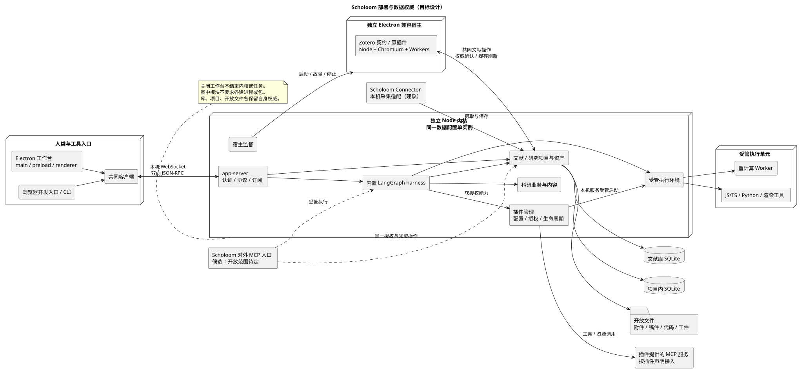
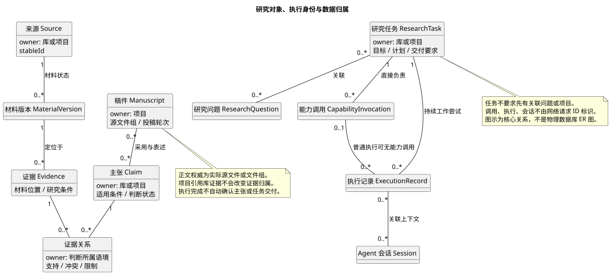

# Scholoom 架构设计草稿

状态：供评审；起草日期：2026-10-12。

本文把已确认的产品与基础决议组织成系统架构，并提出实施组织建议。**“已决议”不代表已实现；“设计建议”不代表用户已采纳。** 本次不改变既有产品契约，也不关闭未决议题。

阅读顺序：先读本文，再读[技术设计](technical-design.md)和[模块接口设计](module-interfaces.md)。产品行为以 [PRD](prd/README.md) 为准，术语以 [CONTEXT.md](../CONTEXT.md) 为准，决策理由及确认记录以[决策地图](../.scratch/scholoom-foundations/map.md)及对应票的正式结论为准。具体功能通过 OpenSpec 落实；实际工程状态以代码、测试和[开发说明](development.md)为准。

## 1. 目标与范围

Scholoom 是可独立执行完整科研工作的本地 Agent 系统。人类通过 Electron 工作台参与；内核在没有工作台的情况下也能管理文献、开展研究、保存成果并等待必要决定。浏览器开发入口和 CLI 使用同一套内核能力。

首阶段产品范围贯通文献获取、阅读分析、研究综合、问题与方案、研究执行、写作、审阅修订及投稿准备。工程交付可以分步，但不能将仅有文献管理或聊天界面的阶段成果视为完整产品。

架构需要同时支持：

- 跨项目共享的长期文献库，以及能独立移动、恢复的研究项目。
- 人、内置 Agent 和兼容插件访问共同领域事实；候选对外 MCP 入口复用同一权威。
- 持续任务跨会话、跨执行尝试继续；局部失败不抹掉已完成成果。
- QMD／MD 与既有 LaTeX 工程的开放编辑、材料定位、实际科研执行和交付。
- Windows、macOS、Linux，Linux 为主验证平台；三平台成功以实际验收为准。

首阶段不承诺云同步、多人实时协作、移动端、任意插件兼容或任意代码强隔离；不提供金额预算封顶。次数、用量、时长、并发与授权控制仍是运行时职责。依据：[PRD 范围](prd/README.md)、[#01](../.scratch/scholoom-foundations/issues/01-first-product-loop.md)、[#02](../.scratch/scholoom-foundations/issues/02-agent-first-contract.md)。

## 2. 当前实现基线

以下按 2026-10-12 仓库静态核对记录，未在本次重新运行应用。

| 入口 | 当前代码已具备 | 目标设计尚待实施 |
| --- | --- | --- |
| `apps/kernel` | 独立 Node CLI，帮助与运行时信息 | 驻留服务、领域模块、存储、Agent 运行和进程监督 |
| `apps/desktop` | Electron main、sandbox preload、React／assistant-ui 共享工作台 | 真实连接、四种布局、阅读、写作、审查和任务介入 |
| `apps/zotero-host` | 独立 Electron 入口及隐藏 Chromium 页面 | Zotero 10 兼容运行时、原插件装载、领域写回 |
| `packages/protocol` | JSON-RPC 请求、内核运行信息的 JSON Schema 和推导类型 | 业务协议、响应、事件及运行时边界校验 |
| `packages/client` | 连接坐标接口、协议类型出口 | WebSocket、认证、请求处理、订阅与重连 |
| `tests` | 入口 smoke、Chromium／Electron 共用 UI 行为用例 | 真实内核、数据保护、科研运行、插件和分发验收 |

当前工作台默认未连接，可编辑草稿而不能发送；开发样例只注入固定材料和回复。LangGraph、数据库、阅读编辑组件及受管科研工具尚未接入。兼容宿主原型和预览实验是选型依据，不是上述应用已具备的能力。

部分决议票保留了讨论当时“尚未初始化目录”或“renderer 尚无实质内容”的调查快照。本文采用当前代码状态，不据此改写决议历史，也不把新骨架误认成业务交付。

## 3. 系统结构与运行部署

### 3.1 三类应用入口

已决议采用单个独立 Node 内核集中承载领域模块与科研调度。领域模块不拆微服务，七个逻辑模块不机械对应七个包或进程。

[PlantUML 图源](diagrams/deployment.puml)。图中内核 app-server、领域模块、harness、执行管理及宿主监督是逻辑位置，除明确标出的 Worker、受管进程与兼容宿主外，默认在 Node 内核内实现。宿主监督可复用受管执行设施。宿主与领域的双向连线表示写入及刷新两个方向，不表示无序同步：权威提交后刷新，相关缓存可读到确认结果后才能依其导出。Connector 的本机采集适配是接线建议，配对协议待实施调查，不改变 GUI／CLI 的共同 WebSocket 协议。

| 运行位置 | 职责 | 隔离与失败范围 |
| --- | --- | --- |
| Electron main／preload | 窗口、系统集成、发现或启动内核、提供窄桥接 | 不持有领域写入权威；关窗不取消任务 |
| 工作台 renderer | 展示有界领域投影，编辑草稿，提交操作 | 不直接访问数据库、凭据或 Node 能力 |
| 独立 Node 内核 | 领域读写、授权、任务与 Agent 调度、连接和宿主监督 | 同一应用数据配置仅一个实例；同时管理一个库与多个项目 |
| 内置计算 Worker | 图谱布局等重计算 | 可取消并报告失败；事实写回由所属领域模块处理 |
| 受管执行进程 | 用户 JS／TS、自定义图、Python、CLI、渲染及需本机启动的插件服务 | 按实际调用管理资源与进程树，首阶段按可信代码执行 |
| 独立 Electron 兼容宿主 | 原包装载、Zotero 可观察对象语义、DOM 和后台能力 | 按需启动；共享宿主失败时标记所有受影响调用 |

内核与宿主独立于工作台生命周期。不默认开机自启，不新增常驻重启守护进程；无法连接尚存活的内核时不能强制替换。明确停止与连接中断必须区分。依据：[#09](../.scratch/scholoom-foundations/issues/09-electron-architecture.md)、[#23](../.scratch/scholoom-foundations/issues/23-kernel-entry-and-lifecycle.md)。

### 3.2 七个逻辑模块

| 模块 | 对外提供的能力 | 自身掌握的职责 | 调用关系 |
| --- | --- | --- | --- |
| 文献管理 | 获取与管理、材料读取、分层检索、分析和主题知识访问 | 库来源身份、题录、附件、批注及库内研究关系 | 使用存储与材料适配；分析执行委托 harness |
| 内置 Agent harness | 持续任务执行、能力调用、工作包委派、等待与恢复 | 调度、会话、执行记录、checkpoint 与交付协调 | 调用共同领域接口和执行环境，不另造科研事实 |
| 工作台界面 | 导航、指令、阅读编辑、审查和人类介入 | 展示状态、草稿、选择、布局和暂态交互 | 经共同客户端取得领域事实 |
| 科研业务与内容 | 方法、能力与工作流定义、交付检查、科研工具 | 方法含义、输入产物与检查要求、角色配置 | 内容交给 harness 执行，产物交给所属领域保存 |
| 执行环境与沙箱 | 受管程序、环境供给、资源与取消 | 进程、解释器、工具版本、实际退出与输出 | 是 harness 子系统；不判定科研结论成立 |
| Zotero 插件兼容层 | 选定原插件能力、Zotero API／SQL／DOM 兼容 | 兼容对象、插件配置与专属缓存 | 题录与附件写回共同文献权威 |
| 研究项目与研究资产 | 项目、任务、计划、稿件、证据主张、问题决定、上下文与归档 | 项目事实、开放文件定位及有意义的成果版本 | 引用库来源，向 harness 与工作台提供共同事实 |

这里的“文献分析”包含两个协作面：业务内容定义分析方法，harness 执行，文献模块管理库产物及其依赖。对项目问题作出的判断由项目模块保存。依赖方向按操作职责处理，不通过各自复制数据库状态解决模块协作。

**组织建议：** 先在 `apps/kernel/src` 内按已落地能力建立内聚模块；只有真实跨应用复用时才抽共享包。`packages/protocol` 保持跨边界契约，`packages/client` 保持通用连接与调用；Node 启动协调不塞入浏览器客户端包。依据：[#24](../.scratch/scholoom-foundations/issues/24-logical-modules-and-responsibilities.md)、[#14](../.scratch/scholoom-foundations/issues/14-agent-development-discipline.md)。

## 4. 领域事实与数据权威

### 4.1 身份、关系与执行分离

术语完整定义见 CONTEXT。架构必须保留以下关系：

- 研究问题与任务多对多；主题与研究问题多对多。任务可以只服务文献库，也可以暂未关联问题。
- 来源覆盖文献及项目数据、代码、实验、结果和图件。证据指向具体材料版本；支持、反驳和限制是带研究语境的关系。
- 项目可以包含多份稿件。稿件共享来源与研究成果，各自保留表述、投稿目标及审稿轮次。
- 研究任务负责持续目标；能力调用记录一次明确科研使用；执行记录描述尝试与恢复；会话承载交流与运行上下文。四者身份不与网络请求或连接绑定。
- Agent 会话统一建模，研究任务是通过工具交互的业务对象，会话不设类型或显式任务绑定，依据 [#43](../.scratch/scholoom-foundations/issues/43-free-agent-conversation-and-research-tasks.md)。运行入口及能力调用契约仍须按此细化，下方领域图只覆盖任务相关工作的部分记录关系，不表示会话所属任务。
- 会话沿用通用 harness 的工作自由度，多个会话可并行操作同一文件或业务对象；不按会话设置对象独占或要求预先建立协作关系。内容保护与冲突协调由实际读写接口承担。
- 发现、主张、正式决定、正文变化、程序退出与任务完成分别表达。任何一项不能自动替代其余状态。

对象按价值渐进建立，不要求逐句结构化正文，也不为一次工具或 Skill 使用自动新建任务。依据：[#06](../.scratch/scholoom-foundations/issues/06-research-domain-boundaries.md)、[#17](../.scratch/scholoom-foundations/issues/17-native-research-capability-model.md)、[#31](../.scratch/scholoom-foundations/issues/31-core-research-business-model.md)。

[PlantUML 图源](diagrams/domain-ownership.puml)。这里只画影响接口设计的核心关系；多重性表示候选领域关系，不预定物理表结构。执行会话关联与能力调用记录仍按实际运行需求建立。

### 4.2 权威分配

先按研究语境确定事实属于文献库还是项目，再选择持久化位置；Evidence／Claim 等对象类型本身不决定全局归属。任务、计划和必要执行记录同样跟随其负责的库或项目。

| 事实或内容 | 权威位置 | 其他模块如何使用 |
| --- | --- | --- |
| 库来源、题录、附件记录、批注、文献自身主张、可复用分析 | 全局文献库数据库与对应开放材料 | 项目持引用；引用不转移归属 |
| 项目问题、任务计划、选用证据、项目主张、稿件关系、Issue／Change／Decision | 项目目录内数据库，关联工作区工件 | GUI 与 Agent 调用共同项目接口 |
| 正文、笔记、代码、数据、图件、科研方法 | 实际源文件或文件组 | 数据库保存身份、关系和必要状态；预览是派生结果 |
| 已保存关键证据、提交稿与审稿轮次 | 按用途留存的材料版本和成果快照 | 表达历史使用内容，不作为另一份当前可编辑库记录 |
| 执行图 checkpoint 与会话 | 运行时持久化 | 用于执行恢复；不得替代任务、正式决定与科研成果 |
| 项目位置登记与摘要 | 应用配置／可重建登记 | 项目读取恢复不依赖全局登记 |
| 全文／语义索引、解析缓存、定位视图、工作区概览 | 可重建派生层 | 不覆盖正式决定、身份绑定、合并结果或已建研究关系 |

项目结论经明确整理才能成为跨项目知识，并保留最初来源与成立条件。核对文献确实如此表述，不等于本项目接受其判断。

数据库使用自身事务。开放文件允许人和 Agent 在授权内直接工作，不建立所有文件与数据库之间的通用事务、事件溯源或版本冻结平台。普通修改直接应用、可看差异和撤销；只有确需先审时走候选提案。并发变化优先重新读取与调整局部修改，出现实质含义歧义或无法保护内容时仅暂停相关修改。

内部身份与 DOI、Zotero key、citekey、路径分开。项目 `.bib`／CSL JSON 保留手工内容，库导出不整份覆盖；文件修改也不自动写回全局题录。依据：[数据 PRD](prd/data-and-operation.md)、[#13](../.scratch/scholoom-foundations/issues/13-storage-and-change-model.md)。

## 5. Agent 与科研业务的协作

统一使用 LangGraph、LangChain、Deep Agents 的 JavaScript／TypeScript 路线。LangGraph 承担图、checkpoint 和等待恢复；LangChain 提供模型与工具执行基础；Deep Agents 提供可定制 harness 基线。多模型供应商共用这一执行机制，不接入 ACP 外部 Agent 或第三方 harness。具体 SDK 扩展点在实现时核对，不把框架内部状态变成领域模型。

通用 harness 负责会话、上下文、工具执行、子 Agent 和恢复；科研模块提供领域工具、方法、原生图及交付检查。模块通过自身接口独立验收，按需要替换模型、文件、进程或领域依赖，不要求可替换整个执行引擎。普通会话与科研能力调用分别表达，沿 #43 细化通用入口。

按已采纳的[多 Agent 初设 #46](../.scratch/scholoom-foundations/issues/46-multi-agent-interaction.md)，subagent 委派、已有会话间主动协作与 advisor 共用原生运行设施，分别明确管理责任、上下文和触发方式。跨会话沿持久收件箱、执行边界消费与有界唤醒组织，不强制创建研究任务；通信不取得对方会话控制权，用户暂停或停止后不因来信自动恢复。A2A 留在对外互操作层评估，内部执行方向沿 #07；具体契约和 SDK 接线在实现中打磨。

harness 消费的 MCP 能力由插件声明并由宿主管理配置、启用、连接、生命周期与授权，不提供任意 MCP 服务的独立接入入口。原生领域、图与 UI 扩展可使用各自接口。插件内部操作的状态、取消和恢复按实际契约验证，不能由 MCP 调用或 checkpoint 推断。

Scholoom 自身作为 MCP 服务向外部开放能力是独立候选，开放范围、认证及分发待定；若采用，仍调用共同领域接口，内部执行由 LangGraph 控制。它不意味着 Scholoom 托管外部 Agent。以上决定集中见 [#07](../.scratch/scholoom-foundations/issues/07-agent-runtime-boundaries.md#answer)。

普通任务由当前 Agent 加载方法、调用已授权工具并保存产物。明确调用能力入口时，运行时自动完成输入校验、必要调用记录及交付检查。一个工作流作为整体调用，其内部步骤沿 LangGraph 记录；仅在确有独立目标或交付需求时另建任务或调用。

方法使用标准 `SKILL.md`，可发现能力增加 YAML 声明，输入和结构化交付使用 JSON Schema。内置、用户、项目内容共用定义体系；同名候选显式选择，不按目录顺序静默覆盖。方法声明资源需要，但不授予资源权限。

Agent 在提出方案、完成分析、改变研究条件或明确下一步时，通过文件或领域工具保存相应科研内容。内核负责产物关联、执行记录、上下文发现及实际保存结果核对。科研承接不能依赖 session context 或 transcript；所需研究内容必须能从工作区持久化材料、研究记录与事实取得。执行中断后按实际任务、材料与已完成成果继续，不要求精确重放全部模型调用。

工作区提供概览、发现和读取入口。概览展示目标、约束、稿件、进展、决定、问题及下一步，每项附实际来源引用；它是派生视图，完整分析、研究条件与论证仍沿引用从权威材料读取。

分工使用主 Agent、执行者、学术审阅者和可显式启停的文风 advisor。独立审阅者首轮不接收其他审阅结论，将报告与候选修改保存为工作区产物，默认不直接改稿；主 Agent 汇总并安排获授权执行者修订。汇总保留分歧，不用多数票确认科研结论。advisor 仅监督 Agent 生成文本，向写作 Agent 提建议，由写作 Agent 依据研究材料处理；不形成无限互相触发的润色循环。

依据：[#07](../.scratch/scholoom-foundations/issues/07-agent-runtime-boundaries.md)、[#18](../.scratch/scholoom-foundations/issues/18-native-capability-runtime-and-content.md)、[#25](../.scratch/scholoom-foundations/issues/25-harness-business-integration.md)、[#35](../.scratch/scholoom-foundations/issues/35-research-workspace-context.md)、[#36](../.scratch/scholoom-foundations/issues/36-research-business-methods-workflows.md)、[#37](../.scratch/scholoom-foundations/issues/37-multi-model-research-collaboration.md)。

## 6. 主要跨模块路径

### 6.1 文献获取、理解与维护

检索、Connector、标识符、文件导入和 Zotero 迁入进入共同文献模块。模块处理身份、去重与材料管理；候选、收录、全文可读、分析可用分别表示进展。材料就绪后，harness 运行基础分析，形成 Digest、参考文献提取、引用分析与文献评价。

题录、Digest、原文共同参与有界混合检索。Agent 可以按需要直接读原文，三层是信息组织而非必须逐层通过的关卡。材料服务可无阅读窗口运行；界面选区和 Agent 引用共享材料版本与位置契约。

分析及综合保存实际依赖与发现范围。变化先识别受影响候选，再由 Agent 判断科研影响；维护失败保留旧可用成果并显示过期或来源问题。库级分析与主题综合继续按维护规则运行；对当前没有 Agent 在工作的项目，仅保存影响线索，恢复项目时提示，由用户手动启动复核。未经科研核对的候选影响不能表示为原结论已失效。依据：[文献 PRD](prd/literature.md)、[#32](../.scratch/scholoom-foundations/issues/32-literature-management-behavior.md)、[#33](../.scratch/scholoom-foundations/issues/33-layered-literature-knowledge.md)、[#34](../.scratch/scholoom-foundations/issues/34-analysis-synthesis-maintenance.md)、[#42](../.scratch/scholoom-foundations/issues/42-cross-module-research-walkthrough.md)。

### 6.2 研究执行与成果论证

研究任务保存问题、条件、计划和交付要求；执行环境在项目工作目录运行程序，将数据、代码、报告和图件留在工作区。harness 关联执行记录与实际成果，科研业务检查产物、来源、数值与结论适用条件；程序退出成功仅说明执行结果。

重计算进入 Worker 或受管进程，使用共同取消和资源管理。项目中缺少某个材料或执行失败只影响实际依赖工作；已完成成果可以继续使用。正式决定在共同领域服务中等待授权答复，GUI、CLI 与 Agent 看到同一待处理事项。

### 6.3 写作、审阅和修订

新稿默认 QMD，MD 用于笔记与报告，LaTeX 沿已有工程。源码与可视编辑共用同一源文件权威；无法理解的内容必须保留。编辑器、阅读器、图件及 Agent 面板通过共同对象引用提交指令。

审阅意见关联实际稿件、当时摘录及可用位置，修改后检查实际差异与回应；意见处理、实际应用与整体交付分别可查看。按 [#44](../.scratch/scholoom-foundations/issues/44-defer-continuous-precise-source-location.md)，当前架构不以持续精确原文定位为前提，不安排逐句持续关联、随编辑跟踪或自动重定位功能。撤销保护后续编辑并回到原任务，通知不等于 Agent 已消费。正文变化不自动改写已确认主张。普通预览读取正文与已有结果，工程计算、构建 hook 和可执行扩展经授权进入受管执行；失败时保留并明确标注最后成功结果。

交付关联实际稿件版本和资源，支持 DOCX、PDF、LaTeX 源文件；外来复杂文稿与批注保留原件，不承诺无损双向编辑。依据：[#27](../.scratch/scholoom-foundations/issues/27-research-results-and-argumentation.md)、[#28](../.scratch/scholoom-foundations/issues/28-manuscript-writing-review-and-revision.md)、[#38](../.scratch/scholoom-foundations/issues/38-workbench-artifact-interaction.md)、[#40](../.scratch/scholoom-foundations/issues/40-research-execution-environment.md)。

### 6.4 续做、迁移与归档

关闭工作台不结束任务，结束会话不结束研究。重启后先读取当前任务、材料、正式决定与执行结果，核查可能遗留的程序及副作用，再恢复未完成工作；取消的执行不自动重启。

移动项目保留项目内事实，外部材料按实际可达性重连。研究包用于独立交付、迁移或归档，日常写作直接连接库材料与成果，无需先导出包；独立项目包包含选用材料并列出未包含依赖。备份覆盖明确范围并验证恢复。Zotero 单向迁入保持源库原状，保存来源映射，断点续做保护迁入后的编辑；撤回只处理仍可安全撤销部分。依据：[#29](../.scratch/scholoom-foundations/issues/29-research-continuation-and-reuse.md)、[#41](../.scratch/scholoom-foundations/issues/41-zotero-ecosystem-integration.md)。

## 7. 外部系统与复用边界

Scholoom 维护自有工作台、daemon 与共同客户端，Paseo 主要提供连接、SSH、生命周期、订阅、诊断及界面组织的借鉴，按具体职责评估可吸纳实现，不整体 fork 或迁入其 daemon／provider 体系。前端继续使用 React DOM＋assistant-ui，依据 [#12](../.scratch/scholoom-foundations/issues/12-technology-stack.md)。

Zotero 兼容层初始固定 Zotero 10.0.5 源码与接口基线，以独立 Electron 宿主提供 Node＋Chromium 环境，支持指定 BBT、茉莉花原包；原插件发布包及代码保持不变，适配由 Scholoom 宿主承担。产品使用不要求另行安装或启动 Zotero。宿主需要保持对象身份、同步属性、异步方法、可修改原型、SQL 与 DOM 等实际可观察语义；跨进程通信使用 DTO 不意味着插件对象可全部退化成 JSON 投影。兼容数据写入最终进入共同文献权威，插件缓存不成为第二份题录主库。

Scholoom Connector 复用采集与 translator 源码，拥有自己的保存交互与配对，与官方 Zotero 扩展共存；不再以官方 Connector 无改动直连作为承诺。迁入后独立维护，默认不双向同步。

旧 zotero-agents、ResearchSpec 和相关代码按语义与成熟方法吸纳，不兼容旧包、CLI 或执行引擎，不复制重复的取材和写回流水线。重计算按已确认 TypeScript 路线组织，旧 Rust 原型指标不作为新架构性能证明。项目采用 AGPL-3.0，仓库当前声明为 AGPL-3.0-only；第三方源码按实际许可、版本与组合记录来源，换语言或分进程不自动解决许可条件。受非商业等限制的内容不成为默认内置依赖。

依据：[#03](../.scratch/scholoom-foundations/issues/03-zotero-plugin-host-research.md)、[#04](../.scratch/scholoom-foundations/issues/04-zotero-ingest-research.md)、[#05](../.scratch/scholoom-foundations/issues/05-zotero-compatibility-policy.md)、[#08](../.scratch/scholoom-foundations/issues/08-existing-project-integration.md)、[#16](../.scratch/scholoom-foundations/issues/16-zotero-host-prototype.md)、[#19](../.scratch/scholoom-foundations/issues/19-existing-source-and-rust-reuse.md)、[#41](../.scratch/scholoom-foundations/issues/41-zotero-ecosystem-integration.md)。

## 8. 工作台、Figma 与开发 harness

按 [#45](../.scratch/scholoom-foundations/issues/45-interactive-research-reports.md)，交互式科研界面作为 Agent 与工作流共用的一等原生接口：调用方呈现和更新界面，工作台承载显示并回传用户选择与输入，后续工作沿共同执行路径处理。zotero-agents 与 ResearchSpec 迁入工作流复用该入口；界面不另立研究事实或执行权威，具体接口及运行隔离待细化。

已有产品契约包含 Agent、文献、写作、审查四种预设，首次进入 Agent 布局。布局切换保留任务、稿件草稿、未发送指令和附加材料，不改变对象归属或授权。具体分区比例、组件造型、面板展开方式由并行 Figma 设计与实际交互评审确定；[#39](../.scratch/scholoom-foundations/issues/39-writing-live-preview.md)的预览布局、刷新与性能要求仍待确认。

导航分别呈现持续任务、Agent、会话与资源，研究对象可以独立查找。会话与对象导航独立，切换会话保留各自草稿和附加材料，不替换正在阅读或编辑的对象。文献库有独立入口；从项目打开库材料时保留原有工作上下文，并明确浏览来源和交给 Agent 的材料。

**协作建议：** Figma 提供整体布局、信息层级及关键状态；本项目 UI harness 在真实 Workbench 上调整间距、键盘、滚动、选择、状态反馈与性能。实现时将采纳的 Frame 链接关联到具体 OpenSpec 变更；设计图中的示例不自动成为领域契约或已实现能力。

工作台继续在 `Workbench.tsx` 及共同样式上演进。浏览器与 Electron 共用组件、session 和事件路径；场景只注入数据与回调。真实状态从共同客户端获得，不为 Figma 稿或测试另造一套消息控制器、研究状态或专用工作台。

需要同时区分两类 harness：**科研 Agent harness** 是产品内核的执行与恢复系统；**UI／开发 harness** 是同一工作台的开发场景和验证设施。Orca 属于外部开发工具，不进入产品科研执行链。依据：[工作台 PRD](prd/workbench.md)、[#10](../.scratch/scholoom-foundations/issues/10-workbench-interaction.md)、[#20](../.scratch/scholoom-foundations/issues/20-ui-debugging-and-e2e-harness.md)、[开发说明](development.md)。

## 9. 实施顺序建议与评审边界

以下是建议顺序，不是已批准的实施任务表。每步通过项目默认 OpenSpec schema 固化行为、调查具体接口并验收真实接线。

| 阶段 | 可独立验收的交付 | 依赖与边界 |
| --- | --- | --- |
| 共同内核入口 | GUI／CLI／浏览器真实连接、单实例、状态、重连、明确停止 | 沿已决议 #23；先不构造假研究任务 |
| 数据与持续工作基础 | 库／项目权威、开放材料、任务及工件读写、授权与模型配置 | 先用窄场景验证保存、外部修改与恢复 |
| 首条真实科研纵向链 | 收录一篇材料→读取→分析保存→工作台查看→跨会话继续 | 接入共同 harness、能力入口和最小交付检查 |
| 文献生态与维护 | 原插件指定功能、Connector、迁入、分层检索与更新 | 复用前阶段权威；各适配按实际风险独立验收 |
| 研究与稿件纵向链 | 计算图件、QMD／LaTeX、审阅修订、正式决定、导出 | 编辑组件可并行接入；预览体验受 #39 约束 |
| 分发与科研效果 | 独立运行时、三平台安装恢复、真实论文全流程 | #21 评价方案另议；前期持续做跨平台构建 |

Figma 可以持续并行，不阻塞内核和数据权威建设；最终 UI 交付仍需在同一工作台和真实 Electron 上验证。

评审重点：模块归属是否完整；设计建议是否满足低摩擦协同；技术设计中的订阅、局部修改、恢复和宿主写回是否足以进入首个功能变更。尚需实验或用户决定的部分集中列在[技术设计待决表](technical-design.md#13-待决事项与实施调查)。

## 10. 需求覆盖与证据入口

| 需求面 | 本文 | 技术设计 | 主要来源 |
| --- | --- | --- | --- |
| 全流程、场景与领域 | §1、§4、§6 | §4、§6、§12 | [PRD 总览](prd/README.md)、[#26](../.scratch/scholoom-foundations/issues/26-research-scenarios-and-existing-toolchain.md)、[#30](../.scratch/scholoom-foundations/issues/30-research-scenario-coverage.md) |
| 文献与生态 | §6.1、§7 | §7、§10 | [文献 PRD](prd/literature.md)、#32–34、#41 |
| 科研工作与多模型 | §5、§6.2 | §6、§8 | [科研 PRD](prd/research.md)、#17–18、#25、#35–37 |
| 工作台与写作 | §6.3、§8 | §5、§9 | [工作台 PRD](prd/workbench.md)、[#11](../.scratch/scholoom-foundations/issues/11-reading-writing-format.md)、#38–40 |
| 数据与运行 | §3、§4、§6.4 | §2–5、§8、§11 | [数据 PRD](prd/data-and-operation.md)、#09、#13、[#22](../.scratch/scholoom-foundations/issues/22-model-data-and-execution-policy.md)、#23 |
| 验证与交付 | §2、§9 | §1、§11–13 | [约束 PRD](prd/constraints-and-validation.md)、[#12](../.scratch/scholoom-foundations/issues/12-technology-stack.md)、[#15](../.scratch/scholoom-foundations/issues/15-validation-and-release-discipline.md)、[#21](../.scratch/scholoom-foundations/issues/21-agent-dogfooding-and-evaluation.md) |

起草依据覆盖 `docs/prd` 的六份文档及决议 #01–42。PRD 没有正式需求编号，本稿沿用文件、章节与决议票号，不新增一套竞争编号。研究底稿未全面重跑；本稿的机制建议需要按实施范围验证。
