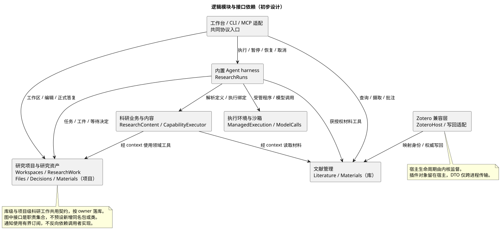
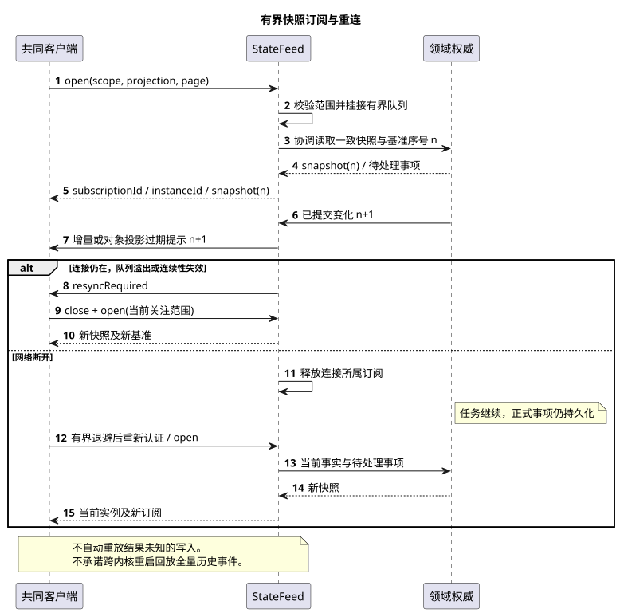
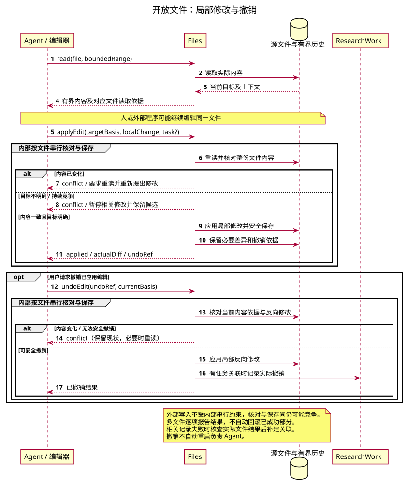
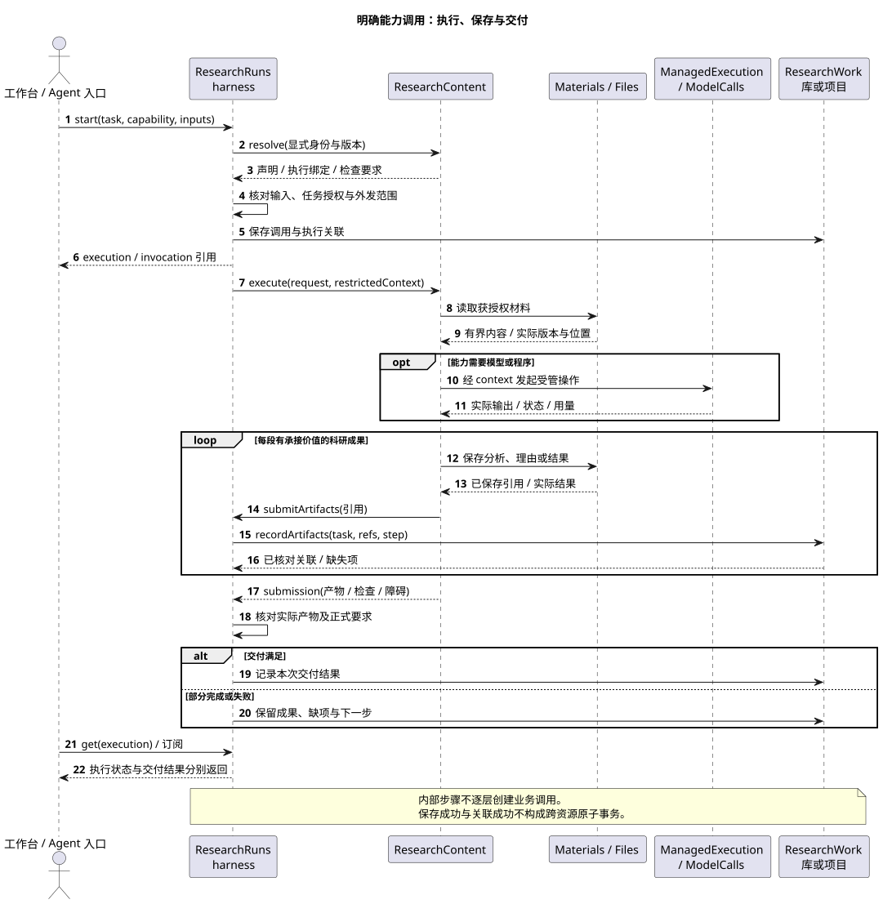
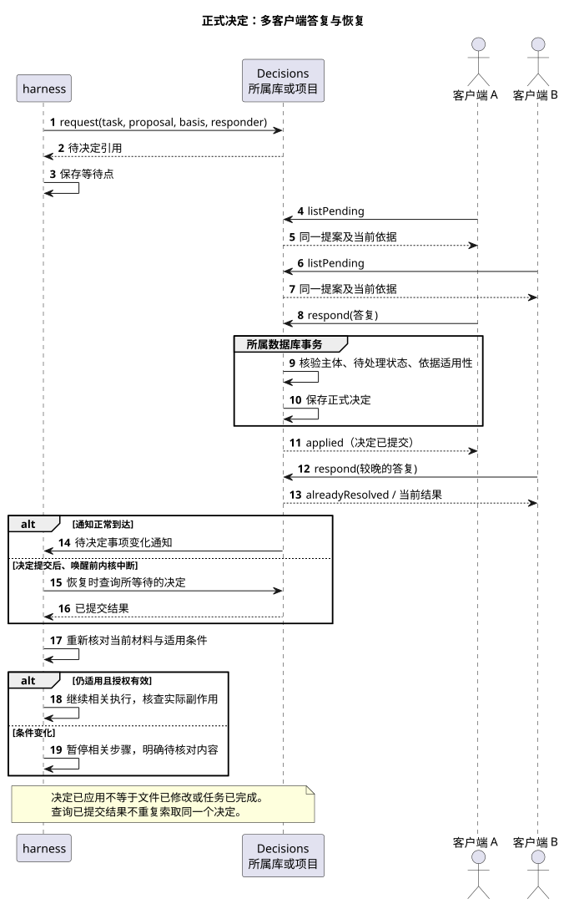

# Scholoom 模块接口设计草稿

状态：供评审；起草日期：2026-10-12。配套：[架构设计](architecture.md)、[技术设计](technical-design.md)。

本文将七个逻辑模块的协作细化到接口职责、初步操作及输入输出。**所有新操作名、字段与状态都是候选设计，尚未进入 `packages/protocol` 或成为兼容承诺。** 实施时先在对应 OpenSpec 确认，再由 JSON Schema 生成跨边界 DTO；本文的 TypeScript 只解释形状，不另立类型事实源。

已确认的行为依据沿两份上层设计的来源引用，特别是决议 #09、#13、#17、#18、#23、#25、#31、#35、#37、#40、#41。精确字段、库版本及 SDK 接线由相应实施调查确定。本文中的接口图为接口建议的视图；`.puml` 是图源，SVG 为本地生成的阅读副本。

## 1. 接口归属与调用方向

宏观模块采用私有 workspace 包及明确导出，逻辑职责不机械对应包或进程。下列名称表示模块提供的操作集合，不预设必须创建同名 TypeScript interface 或类。跨模块交互、宿主装配与数据权威以[模块依赖决议](../.scratch/runtime-architecture/issues/01-module-dependencies-and-authority.md#answer)为准；具体操作名与字段仍为候选。



[PlantUML 图源](diagrams/module-interfaces.puml)。图表达调用者到提供方的能力关系，跨模块箭头统一由 broker 路由；异步通知不表示提供方依赖 UI 或 Agent 实现。broker 的逻辑关系见[模块依赖图](../.scratch/runtime-architecture/issues/01-module-dependencies-and-authority.md#产品构成与依赖方向)，通信承载与调度沿[内部接口决议](../.scratch/runtime-architecture/issues/06-internal-interfaces-and-ipc.md#answer)，不从逻辑箭头推定网络连接。

| 提供方 | 接口面 | 主要调用者 | 调用与权威边界 |
| --- | --- | --- | --- |
| 内核入口 | `KernelControl`、`StateFeed` | CLI、工作台、共同客户端 | 跨进程；启动桥只在本机 Node／Electron 引导层，业务页不能任意启动程序 |
| 统一 broker | 能力注册、路由、模块消费范围约束与可信交互上下文 | 所有跨模块调用者 | 传递请求、结果与事件；装配、生命周期及应用级资源准入由宿主侧管理，业务规则、最终授权及持久化顺序归领域模块 |
| 文献管理 | `Literature`、`Materials` 的库范围操作 | GUI、harness、插件／Connector 适配 | 经 broker 到达同一领域操作；文献模块掌握库数据与规则 |
| 研究项目与资产 | `Workspaces`、`ResearchWork`、`Files`、`Decisions` | GUI、harness、科研工具 | 项目与库级任务使用同一工作契约，按 owner 落到对应存储 |
| 科研业务与内容 | `ResearchContent`、`CapabilityExecutor` | Agent 与业务适配 | 科研运行时依托 harness；方法与交付检查经适配接入，领域操作经 broker |
| 内置 harness | `ResearchRuns`、受限执行上下文 | 入口、维护调度、科研能力 | 关联任务、调用、执行和会话；不复制领域事实 |
| 公共执行基础 | `ManagedExecution` | harness、程序／图适配、预览服务 | 支持无 harness 的人工操作，平台提供进程机制；不自行判定科研交付 |
| 模型接入 | `ModelCalls` | Agent 执行、子 Agent、advisor 等 | 宿主统一准入及额度，实际 SDK 调用在执行进程；连接与凭据沿共同模型政策 |
| Zotero 兼容层 | `ZoteroHost` 及共同文献写回适配 | 内核监督与生态功能入口 | 独立宿主；插件内部对象保持可观察语义，跨进程传序列化数据 |
| 工作台 | session／视图适配、对象指令入口 | React 组件与编辑阅读组件 | 消费客户端投影，草稿和选择属于本地 UI；不向内核提供第二个研究数据库 |

`Materials` 按来源 owner 路由到库或项目材料实现，`ResearchWork` 同样可处理库级任务。二者是共同契约而非新的全局数据库。模块经 broker 传递领域参数和可信上下文，包括对平台模块的调用；模块内部函数、静态类型和普通共享库依赖不经过 broker。模块只消费所需领域契约和受限、类型化的窄接口，生产装配经 broker 接入；独立测试可替换消费接口，无需启动完整 broker、宿主或无关模块，也不依赖全产品操作集合，依据[独立提取与测试边界](../.scratch/runtime-architecture/issues/01-module-dependencies-and-authority.md#包隔离与独立提取)。进程内路由不预设每次序列化 JSON-RPC，模块不能借路由取得其他模块的数据库连接或表。

### 1.1 契约事实源与实现约束

能力提供方维护无实现依赖的契约，沿 packages/protocol 按领域分入口组织；操作、输入、输出、事件和错误各自只声明一次。调用类型、提供者签名、窄消费接口、注册约束和运行时校验由声明推导或生成，broker 与传输适配共同消费。公共接入接口保持 schema 与输入／输出类型绑定，不接受仅操作键一致、载荷类型却独立定义的映射。公共上下文与错误归公共核心，broker 通用核心不依赖全产品领域聚合。

协议变更从唯一声明传播到类型与校验，不兼容的调用方和提供者由检查指出；业务逻辑仍按变更含义调整。直接类型推导优先，确需生成映射时复用已有类型检查并核对生成物与声明的一致性；具体传播和验证要求沿[契约 SSOT](../.scratch/runtime-architecture/issues/01-module-dependencies-and-authority.md#契约-ssot-与传播q9)及[实现符合性](../.scratch/runtime-architecture/issues/01-module-dependencies-and-authority.md#注册与实现符合性q10)，不另建协议副本。

模块允许依赖与提供／消费范围由机器可读架构策略统一维护，检查实际包声明及解析后的源码引用，覆盖反向依赖、静态循环、私有路径及 broker 绕行，类型引用同样受约束。broker 按宿主登记的消费范围提供调用入口；该范围控制不替代领域最终授权。

提供者按契约约束的映射注册，编译核对签名，宿主按启用配置检查缺失及重复。跨信任／进程边界校验请求、结果与事件，授权、取消和副作用以代表性行为测试验证；必要检查接入本地与 CI。新边界即时启用检查，旧代码分批迁入并限定临时例外；注册与调用违约局部处置，未知副作用先核查。完整规则见[架构执行约束](../.scratch/runtime-architecture/issues/01-module-dependencies-and-authority.md#架构策略与依赖守卫q8)，现有功能的迁入及验证由 [migrate-runtime-architecture](../openspec/changes/migrate-runtime-architecture/tasks.md) 承接，实际覆盖范围以该变更的实施证据为准。

### 1.2 平台能力与原生适配

系统访问沿[平台决议](../.scratch/runtime-architecture/issues/02-platform-access.md#answer)，按文件、锁、进程、网络／环境、私有存储及宿主能力分组。普通模块经 broker 使用绑定资源范围的能力，领域继续掌握授权、身份与业务规则；纯计算可使用普通共享库。

条件保存在资源执行端有界地完成重新定位、核对与写入；支持接口或字节注入的第三方依赖复用平台，必须原生访问的依赖收在明确资源及生命周期的适配器内。宿主注册真实可用的 Node、Electron 或浏览器适配，不能提供必要保证时明确报告。初始化沿宿主装配职责，不以初始化为由开放普通业务的系统访问。

临时句柄及时释放，长期资源明确归属和收尾；断线、取消、已发生副作用及实际退出分别表达。共同契约区分原子替换、持久性、互斥与进程退出，平台诊断有界。系统访问守卫和真实目标环境验证沿同一票；现有功能的实施范围见 [platform-access](../openspec/specs/platform-access/spec.md) 与[迁移交付](../openspec/changes/migrate-runtime-architecture/delivery.md)。

执行进程粒度、宿主准入与 harness 监督、后台移交、资源归属及取消完成依据沿[进程决议](../.scratch/runtime-architecture/issues/03-session-execution-processes.md#answer)。旧执行实例不能继续发起动作或覆盖新状态，已受理操作与迟到结果按实际效果收尾；状态写入与 checkpoint 归属沿[持久化与恢复决议](../.scratch/runtime-architecture/issues/04-execution-persistence-and-recovery.md#answer)，通信组织沿下节，精确字段由实施规格细化，不从候选接口名推导实现位置或恢复保证。

### 1.3 通信承载与调用调度

[内部接口决议](../.scratch/runtime-architecture/issues/06-internal-interfaces-and-ipc.md#answer)确认以下目标接线，共用领域契约与跨进程双向 JSON-RPC 机制，按入口角色注册操作；现有本机 broker、客户端 WebSocket 和 Node IPC 的实际范围见[迁移交付](../openspec/changes/migrate-runtime-architecture/delivery.md)，表中的插件兼容宿主接线仍属后续范围。

| 路径 | 承载方式 |
| --- | --- |
| 同一进程内跨模块 | 经 broker 直接调用类型化异步接口，保留授权与领域检查 |
| 应用宿主与自有 Node Agent／计算子进程 | 独立 Node IPC，日志与协议分开 |
| 应用宿主与 Zotero 插件兼容宿主 | 受认证的回环 WebSocket，绑定内部角色与实例范围 |
| Zotero 插件兼容宿主的主进程与内部页面 | Electron 窄 IPC／MessagePort 适配 |
| 工作台／CLI 与内核 | 共同 WebSocket，远端经 SSH 隧道承载 |

普通外部程序仍由受管执行能力管理，不强制实现 RPC；内部通道不增加通用 stdio RPC 入口，插件 MCP 按自身契约接入。对外 MCP 的 stdio 属于公共协议适配，不开放任意内部 RPC。跨进程传契约数据与受控资源引用，大材料使用所属模块的有界读取／传输，不传数据库连接、SDK 实例或进程内函数。

双向调用可有界交错处理，等待对端不占住其回调所需的锁、事务或额度；会话串行及文件保存保护仍由所属模块执行。消息、在途请求及发送队列有界，超载在新工作受理前报告，保留响应与必要控制的处理能力；慢连接局部处置。通知重同步、持久消息与实际结果查询继续沿既有职责，通道断开不证明业务未执行。

## 2. 共用引用、上下文与返回形状

### 2.1 所属范围和对象引用

```typescript
type ScopeRef =
  | { kind: 'library'; id: string }
  | { kind: 'project'; id: string };

type ObjectRef = {
  owner: ScopeRef;
  kind: string; // 在具体 Schema 中约束为允许的对象种类
  id: string;
};

type MaterialRef = {
  source: ObjectRef;
  versionId: string;
};

type PageRequest = { limit: number; cursor?: string };
type Page<T> = { items: T[]; nextCursor?: string };
```

`ObjectRef` 描述稳定身份，不把文件路径、DOI、citekey 或 Zotero key 当内部主键。关系端点可以属于不同 owner，关系本身由作出判断的库或项目保存。普通未登记文件直接用获授权根目录下的文件引用访问，不要求先创建 Source 或 MaterialVersion；需要证据定位或成果留存时才建立相应材料身份。

文件引用建议区分项目相对路径、库托管相对路径与已授权外部文件引用。外部引用在内核解析，调用者不能凭一个任意路径字符串取得访问权。符号链接／路径穿越和真实文件范围在文件边界检查，目录移动不改变项目身份。

材料位置是 PDF、EPUB、网页、源码等格式的联合类型，含实际版本与必要上下文，仅描述当次读取或对应材料版本，详见[技术设计 §5.2](technical-design.md#52-共同位置契约)。按 [#44](../.scratch/scholoom-foundations/issues/44-defer-continuous-precise-source-location.md)，接口不承诺跨内容变化的自动重定位、持续位置跟踪或依赖这些能力的交互。分页上限、读取字节／字符上限和图谱节点／边上限由服务端限制；游标不授予权限，跨范围或失效游标返回重新查询提示。

### 2.2 授权上下文由内核建立

进程内 `CallContext` 建议包含已认证主体、当前任务／调用／执行引用、有效授权引用和本次操作取消信号。RPC 参数只接受请求目标和必要授权记录引用，**不接受客户端自报 `isAuthorized` 或任意权限集合**。内核校验主体、对象范围、操作、接收方及当前条件后建立上下文；各服务在自己的访问边界执行检查。

任务授权可以持续有效。当前操作的取消信号和持续科研任务的取消不同：网络请求断开不能顺带取消研究任务。只有明确的 `ResearchRuns.cancel` 才启动受管取消流程。

能力执行上下文取得受限的领域／文件／模型／程序工具和提交通道，不取得数据库连接、原始凭据或可绕过领域规则的宿主通道。声明资源需要与实际授权分开。

### 2.3 结果和错误

短操作返回实际结果；长操作返回 `execution` 等稳定引用，状态从查询或订阅获得。领域结果用有含义的联合状态，例如修改返回 `applied | conflict`、决定答复返回 `applied | alreadyResolved | noLongerApplicable`；权限或协议错误使用结构化错误。

操作的业务副作用类别、返回实际结果或受理引用的模式及等待策略沿同源契约声明，客户端与内部 RPC 据此处理超时、断线，不另列只读方法名单和特殊分支。等待时长与资源参数在实施中验证；这些是接口定义上的规则，不是逐次调用的通用台账。

建议错误类别为 `invalidInput`、`permissionDenied`、`notFound`、`conflict`、`unavailable`、`incompatible`、`outcomeUnknown`。错误包含相关引用和是否可重试等信息，精确代码及 JSON-RPC 数值映射待规格定案。`outcomeUnknown` 表示尚不能确认副作用，不能作为“安全重试”信号。

只有确需防止重复副作用的操作才使用持久操作键，例如迁入批次或外部提交。JSON-RPC 请求 ID 不充当幂等键。正式答复依待决定对象自身的状态保证一次应用；普通文件编辑核对该文件读取时的内容，不套全项目 revision 门禁。

文件编辑复用上述分类并提供必要原因：内容变化要求重读，目标不明确需保留候选并澄清；目标不存在、权限不足和暂不可用分别处理，不全部归为内容冲突，也不统一自动重试。结果未知先核查实际保存内容。具体代码随 Schema 定案。

## 3. 工作台／CLI ↔ 内核入口

本机与远端完整环境的接入沿[部署决议](../.scratch/runtime-architecture/issues/05-local-and-remote-deployment.md#answer)。SSH 适配负责远端引导、组件传输和隧道，不另定义业务 DTO；既有共同接口在所选工作机执行，资源路径按所在端解释。目录选择区分远端浏览与客户机文件选择，上传／导入及下载／导出表达副本，不把本机路径直接当作远端可读资源。草稿和未确认输入按环境及对象隔离，重连先核查实际状态，不自动补发新操作；引导及握手精确字段在实施规格确定。

接入核对可信身份、目标实例与协议版本，并按角色报告实际注册的可用接口。首阶段支持当前协议版本，不要求应用版本号完全一致；缺少可选接口只限制相关功能，协议不兼容明确拒绝该连接，升级时机沿部署决议。接口发现不代替调用时授权检查，也不通过试探性写入判断兼容性。完整规则见[连接兼容决议](../.scratch/runtime-architecture/issues/06-internal-interfaces-and-ipc.md#q7按协议版本与角色可用接口判断兼容)。

交互式科研界面的原生接口按 [#45](../.scratch/scholoom-foundations/issues/45-interactive-research-reports.md)纳入共同契约。Agent、科研能力与工作流需能呈现、更新界面并接收用户交互，浏览器与 Electron 共用接线；具体操作名、载荷、动作授权、等待与恢复语义尚未定案。迁入工作流使用同一接口，不按工作流另设交互协议。

| 初步操作 | 输入 → 输出 | 必须满足的语义 |
| --- | --- | --- |
| `KernelControl.ensureRunning`（本机引导） | 数据配置 → 连接坐标、实例身份 | 仅引导层调用；并发启动协调；不能替换存活但不可达的内核 |
| `KernelControl.status`（本机发现／已连接查询） | 数据配置或当前连接 → 停止／运行／无法确认 | 查询不启动实例，连不上不自动判定已停止 |
| `KernelControl.stop` | 实例身份、停止意图 → 停机进展／实际结果 | 检查权限，说明影响全部客户端；连接断开不等于成功 |
| `StateFeed.open` | 授权范围、投影种类、分页参数 → 订阅 ID、快照、基准游标 | 在内核协调挂接与读取，快照内含范围适用的待处理事项 |
| `StateFeed.close` | 订阅 ID → 已释放 | 释放队列；不取消任务或修改业务状态 |

跨进程业务命令建议采用 `literature.search`、`researchRuns.start` 等命名映射对应模块操作。内置模块通过统一 broker 使用领域接口，broker 的内部接入不要求绕行 MCP 或客户端 app-server 传输。Agent 执行统一使用 LangGraph harness，人工文献管理、编辑、预览与编译独立于 harness，不设置 ACP 外部执行适配。

插件 MCP 由插件声明并由宿主管理，向 harness 提供获授权工具和资源；不增加任意 MCP 服务的独立配置入口。插件声明、连接和生命周期接口待实施调查，不能把该扩展点当作第三方 harness 的执行接口。此消费方向沿 [#07](../.scratch/scholoom-foundations/issues/07-agent-runtime-boundaries.md#answer)，与下述公共服务分别管理。

对外 MCP 沿[外部接口决议](../.scratch/runtime-architecture/issues/07-external-interfaces-and-extensions.md#answer)提供 stdio、Streamable HTTP 与 Tasks 扩展，并保留普通工具路径。公共适配仅发布已确认的查询及有限工作请求，复用提供方的 Schema、结果和副作用规则；调用方权限、插件公共发布与稳定版本独立于内部角色注册，不把表中的候选内部操作自动发布。服务默认关闭，HTTP 默认回环，明确配置后支持远程 HTTPS。

工作请求沿协作请求和回复关联，提交、补充、撤回及查询共用所属收件与结果状态。可以指定获准接收请求的已有会话，未指定时创建普通会话；不因请求自动创建研究任务或独立委托资产。协议 Tasks 仅映射处理状态，取消须受请求归属及实际停止规则约束；会话被用户停止或归档后不因来信自动唤醒。字段、标准授权接线、所选 SDK 与双路径互操作由后续 OpenSpec 验证，本节不另立一份外部 DTO。

通知建议包含 `subscriptionId`、本次实例身份、订阅内序号和有界事件。事件按业务用途分为对象失效提示、运行进展、消息增量、待决定事项变化及 `resyncRequired`。客户端收到失效提示后按引用读取；包含的快照／增量字段以对应投影 Schema 为准，不广播任意数据库行。



[PlantUML 图源](diagrams/subscription-recovery.puml)。队列满时放弃该段投影连续性并重新同步，未处理正式事项仍持久化在领域存储。读取流与消息显示游标均不成为任务身份，也不承诺跨内核重启回放历史通知。

`StateFeed` 属于内核 app-server，队列只缓冲面向客户端的变化通知。溢出只影响相应订阅；`packages/client` 重读范围快照，工作台保留旧视图并呈现刷新状态，独立保管草稿和未保存编辑。只合并明确可替代的更新，消息追加片段不能只留末条；已保存结果与待处理事项通过持久查询恢复。粒度、容量及重复重同步成本按真实负载验证，详见[技术设计 §3.2](technical-design.md#32-快照与订阅之间不丢变化)。

## 4. 文献管理与材料接口

| 初步操作 | 输入 → 输出 | 权限、副作用及部分失败 |
| --- | --- | --- |
| `Literature.search` | 库范围、查询、内容层、PageRequest → 归组命中、覆盖情况、下一页 | 读取权限；命中保留来源、材料版本及位置；索引缺失不假报全覆盖 |
| `Literature.ingest` | 采集／标识符／文件候选、来源信息、目标集合 → source 引用与各项结果，或批次执行引用 | 写库与文件授权；题录保存、附件获取和分析状态分别表达；源候选不是永久身份 |
| `Literature.updateMetadata` | source、字段变更、所依据的旧字段／来源 → 实际更新及冲突字段 | 检查实际受影响字段；自动填空，已有冲突保留候选；citekey 不随题录变更自动改写 |
| `Literature.merge` | 显式选定来源、字段和关系协调方案 → 保留身份及重定向结果 | 高影响写入；保护附件、批注与项目引用；同库事务及跨库影响分别处理 |
| `Literature.getAnalysis` | source、用途／方法筛选、PageRequest → 成果引用、输入依据、更新状态 | 旧可用成果与本次更新分别返回；不同观点不按时间简单覆盖 |
| `Materials.read` | MaterialRef、格式位置、读取限额 → 内容、位置、实际覆盖和缺项 | 不依赖可见阅读器；缺原文只影响原文读取 |
| `Materials.saveAnnotation` | 材料与位置、摘录／批注内容、作者信息 → 保存后的批注引用 | 校验位置与可写范围；区分原文和解释，保护依赖版本 |

维护调度消费材料和分析变化，按实际依赖调用 `ResearchRuns.start`；运行入口承担任务授权、模型限制和取消。展示性题录更新不重算全文分析，未用批注变化不全量重算。库侧继续维护，当前没有 Agent 工作的项目只持久化影响线索供用户启动复核。

附件替换、回收站、恢复、迁入及导出沿相同接口原则在各切片补齐具体 Schema。本稿不把它们伪装成一条可对所有对象任意写字段的通用 `update`。

旧记录保留摘录、来源和版本依据；`Materials.read` 沿记录对应的版本读取并明确缺项。新版核查形成新记录，旧页码不用于新版，不提供跨版本候选重定位或位置重绑入口。摄取长操作沿 §2.3 返回稳定执行引用，逐项结果由查询或订阅取得，不要求另建一套批次身份机制。

## 5. 工作区、研究事实与文件接口

`Workspaces` 管项目打开、定位及派生上下文；`ResearchWork` 管具有库／项目 owner 的任务、关系和产物。二者可位于同一模块，但库级任务不要求创建虚拟项目。

| 初步操作 | 输入 → 输出 | 保证与限制 |
| --- | --- | --- |
| `Workspaces.openProject` | 已授权目录 → project 引用、缺失依赖、可用状态 | 从项目自身读取身份与事实；全局登记可修复，不是打开前提 |
| `Workspaces.overview` | owner、可选任务／稿件、大小上限 → 带来源引用的概览 | 只派生，不保存另一份当前研究记录 |
| `Workspaces.discover` | owner、问题／任务／材料筛选、分页 → 文件及对象引用 | 普通文件也可发现；按授权与范围读取 |
| `ResearchWork.createTask` | owner、目标、初始约束、交付要求、可选关联 → task | 不以问题、会话或连接作为创建前提；不启动执行 |
| `ResearchWork.updatePlan` | task、局部计划调整、理由与依据 → 当前计划、实际变更 | 保护并发调整；不等于正式决定或完成任务 |
| `ResearchWork.recordArtifacts` | task、已保存引用、用途／来源、可选调用／步骤 → 逐项已关联、未关联或结果未知 | 允许部分成功；保留已确认关联，重试补缺且不重复登记，不以部分关联判定任务完成 |
| `ResearchWork.relateEvidence` | 判断 owner、evidence、claim、支持／冲突／限制及条件 → 关系引用 | 验证引用与权限；项目采用不转移库来源归属 |
| `ResearchWork.recordReview` | task、稿件依据、报告引用、问题与候选修改 → 审阅记录 | 保存原意见和分歧，不直接应用候选或自动确认主张 |
| `ResearchWork.noteImpact / listImpacts` | 项目、变化来源、受影响候选与依据 → 已保存线索／有界待复核列表 | 库更新可留线索但不启动项目 Agent；只有实际科研复核后才改变判断 |
| `Files.read` | 获授权文件引用、范围上限 → 有界内容与对应文件的读取依据 | 无需事先建领域对象；读取依据用于保存时核对文件内容，不把未保存草稿当磁盘事实 |
| `Files.writeNew` | 已授权目标、内容、可选任务关联 → 实际文件引用 | 新建时目标若已存在则返回冲突，不转成静默覆盖；已有文件走局部修改 |
| `Files.applyEdit` | 文件引用、目标范围与读取依据、局部变更、可选任务关联 → applied／conflict、原因、差异、撤销引用 | 内部按文件串行核对与保存；整份内容变化即返回重读，不自动合并；人类保存无需先建任务 |
| `Files.undoEdit` | 已应用编辑引用、当前读取依据 → 实际撤销或冲突 | 同样核对文件内容和反向修改，不能安全应用则保留现状；有任务关联时记回，不自动唤醒 Agent |

`recordArtifacts` 只关联已经保存的文件或对象。新建文件由文件工具保存并返回引用；关系记录失败时保留实际输出与必要线索，恢复后核查补建，不能声称文件和数据库原子提交。普通编辑的撤销引用是有界本地历史记录，不要求每次编辑都创建领域 `Change`；显式提案／审查时才使用相应业务对象。

文件可读不等于关联提交成功，数据库故障按实际确认结果报告，不删除已经保存的文件。关联的事务／分批方式由实现确定。多文件编辑逐项表达成功、冲突及未执行项，不自动回滚成功部分；持续竞争时保留候选并暂停相关修改。内部串行不能约束外部编辑器或直接写文件的 shell 程序。

项目暂不可达时，库侧可保留有界的变化线索；项目重新打开后结合实际依赖核对并归入项目影响记录。线索不是项目结论的第二份权威，也不表示原结论失效。具体离线传递与保留范围随维护切片确定。



[PlantUML 图源](diagrams/local-edit.puml)。图中的核对不会锁住任意外部编辑器；保存方式、保存前后变化检测和恢复保留按平台验证。

## 6. 科研内容 ↔ harness ↔ 执行环境

### 6.1 内容与科研运行

本节是任务相关工作的候选接口。[统一会话决议 #43](../.scratch/scholoom-foundations/issues/43-free-agent-conversation-and-research-tasks.md)确认研究任务为工具可操作的业务对象，会话不设类型或显式任务绑定。因此下表必填 task、按 task 查询执行和运行记录归属不能直接作为通用运行入口；通用执行上下文、对象操作及能力调用关系仍待细化。追加消息默认在下一可处理边界调整工作，并区分已受理与已处理。

通用会话／执行入口与科研能力调用分别建模，复用同一 LangGraph 控制机制，不引入第三方执行后端接口。模块独立测试通过已定义接口替换模型、工具或领域依赖；插件 MCP 的调用结果、取消和恢复按工具实际支持范围核对，不以协议响应替代科研交付检查。

用户交互沿[会话边界](../.scratch/runtime-architecture/issues/04-execution-persistence-and-recovery.md#会话交互边界)：发送消息驱动同一 session，以下执行级 pause／resume 等候选操作用于内部编排，不要求用户通过另一操作接续会话，也不直接对应新的 UI 按钮。当前公开推进统一为 `session.send`；已移除 `session.resume` 与 CLI `continue`，正式行为见[会话规格](../openspec/specs/agent-harness/spec.md)。

通用协作入口按已采纳的 [#46 初设](../.scratch/scholoom-foundations/issues/46-multi-agent-interaction.md)细化：提供获授权对象发现、请求／通知、回复及处理情况查询，复用 harness 生命周期控制；消息受理、消费和请求结果分别表达。下表 `ResearchRuns.delegate` 仅覆盖委派侧，不代替已有会话间的主动通信；通用工作包的任务／调用关联按实际业务关系提供。操作名、Schema 与恢复接线仍在实现中打磨，A2A 不作为内部接口前提。

| 提供方／初步操作 | 输入 → 输出 | 约束 |
| --- | --- | --- |
| `ResearchContent.discover` | 方法／能力／角色用途、内容来源筛选、分页 → 候选描述 | 同名候选并存，不以目录顺序覆盖 |
| `ResearchContent.resolve` | 显式内容身份与版本／来源 → 声明、方法资源、执行绑定、输入及交付 Schema | 校验内容结构；资源声明不授予权限；普通 Skill 可直接加载 |
| `ResearchRuns.start` | task、指令与材料引用、可选能力及模型配置 → execution、可选 invocation／session | 无能力的普通 Agent 工作不强制建立能力调用；启动前校验材料发送及任务授权 |
| `ResearchRuns.get` | execution → 实际执行、产物、检查及障碍 | 执行结果与交付成立分别返回，内容有界 |
| `ResearchRuns.pause / resume` | execution、理由／恢复意图 → 实际状态 | 暂停等到可恢复边界；恢复重读当前材料与决定，不等于重放旧调用 |
| `ResearchRuns.cancel` | execution、理由 → cancelling 或已确认停止 | 沿依赖取消未完成单元，保留成果；不能确认时不报已取消 |
| `ResearchRuns.delegate` | 工作包、角色与模型、当前授权 → 子执行引用 | 独立子 Agent 执行独占进程；业务任务关联可选，委派方负责收尾，后台继续需显式移交 |
| `CapabilityExecutor.execute`（执行绑定） | request、受限 context → submission | 业务内容定义检查，harness 管生命周期；内部图步骤不自动注册子调用 |

`submission` 建议包含实际产物引用、检查结果、未完成事项和必要方法／输入依据。harness 校验必要产物及正式要求后记录交付结果，不能仅凭 TypeScript 类型、Schema 合法或程序退出成功判定任务完成。

每个能力调用只直接负责一个 task；同一次科研使用在重试、换 Agent 或恢复时沿用 invocation，可以增加 execution 或关联不同 session。`resume` 返回实际继续的执行引用；独立的新使用才创建新 invocation。内部运行记录按任务 owner 持久化，当前连接只决定如何呈现它们。

checkpoint 不可用时可返回新的执行尝试，保留旧记录，依持久材料接续原工作；效果未知的副作用先核查，暂停／取消不自动恢复。通用会话恢复沿已保存指令、材料、正式决定和必要执行记录，不要求 task 存在，也不要求重建原图节点或完整 transcript。未处理指令及协作消息保留可查询处理状态，详见 [#25](../.scratch/scholoom-foundations/issues/25-harness-business-integration.md#持续保存分批交付与恢复)。

保留中的会话正常跨轮保持有效上下文；工作所需内容独立保存，会话可用完即弃。核查复用所属模块已有状态和实际结果，harness 工具收据服务交互及内部恢复，不另建通用工具调用台账。必要记录保存失败时停止依赖它的新操作，局部故障不阻止独立工作；后台结果交 Agent 判断后续，harness 负责保存、投递及有界唤醒。完整约束沿[持久化与恢复决议](../.scratch/runtime-architecture/issues/04-execution-persistence-and-recovery.md#answer)。

上下文的 `submitArtifacts` 通道将实际保存引用交 `ResearchWork.recordArtifacts`；运行时记录产生它们的调用和步骤。普通 Skill 使用及一次工具读取没有额外“登记—开工—结项”义务。advisor 是同一运行时的显式角色，其建议按执行边界注入；无建议静默，关闭后不新增监督或自动继续。

`start` 返回结果未知时，先按 task 查询已有执行，不能直接重复启动昂贵计算或外部操作；需要自动恢复受理结果的切片可保存独立启动操作键并关联已有执行，不复用网络请求 ID。



[PlantUML 图源](diagrams/research-invocation.puml)。图以明确调用能力为例；普通 Agent 工作省略能力解析／调用记录，仍走相同授权和成果保存路径。

### 6.2 程序与模型调用

| 初步操作 | 输入 → 输出 | 约束 |
| --- | --- | --- |
| `ManagedExecution.prepare` | 工具／项目环境声明、已有环境选择 → ready 或缺项与所需授权 | 准备环境的写入和联网需要授权；不接管用户已有 Conda |
| `ManagedExecution.start` | owner、可选父 execution、程序、参数数组、授权工作目录／资源、输出与时限 → run 引用 | 不以 shell 拼接代替明确参数；支持长任务，初始受理不代表运行成功 |
| `ManagedExecution.inspect` | run 引用、日志分页 → 状态、退出信息、有界输出、实际产物 | 超时／不明与失败分别表达；重启后验证进程归属 |
| `ManagedExecution.cancel` | run 引用 → 停止进展与确认结果 | 先请求协作退出，再按归属终止进程树；不误杀复用 PID |
| `ModelCalls.generate`（执行侧） | 命名模型配置、消息／材料、任务授权、限制 → 流式片段及最终用量／状态 | 调用前验证外发及取得宿主准入；共享并发与重试上限；凭据不传给 UI；没有隐式供应商回退 |

`run` 是执行环境的技术运行句柄，`execution` 是 Agent 执行记录，二者与 PID 分开，业务任务关联可选。一次 Agent 执行可以关联多个程序运行；用户直接预览稿件只需项目 owner 和当前授权，可以没有科研任务或 execution。进程状态和日志以 run 查询，需要科研交付时才关联相应执行记录，不为每次编译建立科研任务。

受管子进程需要读写领域事实时，通过限定到该运行的桥接调用共同接口；不把进程内函数、数据库连接或整个 `CallContext` 序列化给它。首阶段可信代码执行不等于强安全隔离，桥接权限检查不能阻止已获本机代码执行权的恶意程序绕行操作系统。

QMD／LaTeX 工程渲染作为受管工具接入；预览只读路径与会执行 hook 的工程路径分开检查。结果保留最近成功产物及输入依据。客户端等待结束、UI 切换和连接中断均不自动取消子进程；明确任务取消由 harness 传播。

稿件呈现适配建议提供 `Preview.request(manuscript, inputBasis, mode)` 和 `Preview.get(manuscript)`，内部复用 `ManagedExecution`。返回分别包含本次尝试、对应输入依据和最近成功产物；旧请求晚到不覆盖较新请求的当前展示，编译失败仍可读取已保留成功产物。`mode` 区分只读预览与授权工程渲染，刷新策略及延迟仍按 #39 待定，不另建任务调度器。

## 7. 正式决定与恢复

`Decisions` 保存具有 owner 的正式选择与待答事项，harness 只保存等待点及其引用。

| 初步操作 | 输入 → 输出 | 原子性与恢复 |
| --- | --- | --- |
| `Decisions.request` | task、提案、依据对象及必要版本、条件、可答复主体 → 待决定引用 | 保存后才进入等待；已有待决定事项可复用，节点恢复不重复制造询问 |
| `Decisions.listPending` | owner／task、分页 → 实际待处理事项 | GUI、CLI、Agent 同源；消息通知缺失仍可查询 |
| `Decisions.respond` | 待决定引用、答复、依据引用 → applied／alreadyResolved／noLongerApplicable | 在所属库或项目事务中核验主体、状态与依据；同一决定仅应用一次 |

答复“已应用”指决定记录提交，不表示后续文件变更、外部发送或研究任务已经完成。harness 取得决定后重新核对适用条件，再继续受授权操作；其副作用按所属接口核查实际结果。



[PlantUML 图源](diagrams/decision-resume.puml)。决定提交后、唤醒前崩溃时，恢复查询正式记录即可找到结果；无需依赖持久全量通知或重复向用户索取同一个决定。

## 8. Zotero 宿主与生态适配

| 初步接口 | 输入 → 输出 | 必须保留的边界 |
| --- | --- | --- |
| `ZoteroHost.ensureReady`（内核监督） | 已支持宿主／插件基线、配置 → 宿主实例、实际可用能力 | 内核按需启动共享宿主，不依赖可见工作台；版本声明不等于能力验收 |
| `ZoteroHost.invoke` | 已验收操作、映射对象引用、参数、执行授权 → 实际结果或执行引用 | 操作限定到支持范围；不是让客户端执行任意插件 JS 的后门 |
| 宿主 → `Literature` 写回适配 | Zotero 身份、实际字段／附件操作、执行身份 → 共同权威确认结果 | 先映射身份和校验权限；不得让缓存写回覆盖较新字段 |
| 内核 → 宿主失效通知 | 受影响对象／领域版本、必要变化范围 → 有界刷新 | 通知在权威提交后产生；防循环；缺通知可重读权威 |
| Connector → 摄取适配 → `Literature.ingest` | 配对身份、采集数据、目标库／集合 → 条目与附件各自结果 | 目标不可用时失败或等待重试，不静默改存其他应用或云端 |

原插件发布包及代码不变；宿主内部同步属性、共享对象身份、可修改原型、SQL 与通知时机须按实际原包验证。上表只是宿主外部操作意图，**不能据此把每个同步 getter 转成异步 RPC**。兼容 SQL 投影和共同权威之间的刷新／写回实现仍是专项调查项。

依赖最新题录的插件导出，应由宿主操作协调权威写回回执和所需缓存刷新，待相关对象可读到确认结果后执行；不能把单向广播已发送当成缓存已更新。断线时暴露未确认范围，避免对陈旧投影宣称最新导出。

宿主崩溃由内核标记所有受影响调用。重启后只重建派生缓存与兼容对象，结果未知的写入先查询实际文献事实，不直接重放。Zotero 单向迁入的批次接口与安全撤回沿[技术设计 §10.3](technical-design.md#103-单向迁入设计建议)另行细化。

## 9. 首批接口实施与检查

先实现 `KernelControl`、最小 `StateFeed` 和共同连接；随后按“材料读取—任务执行—保存工件—界面查看—跨会话继续”的真实纵向路径接入必要接口。接口表不是要求一次性生成全部实现或空 stub 的任务清单。

| 接口风险 | 最小行为检查 |
| --- | --- |
| owner／权限错配 | 项目任务能引用库材料但不能绕过其写权限；库级任务不依赖项目 |
| 订阅竞态 | 快照生成期间的变化可观察；溢出重读；断线不丢正式待处理事项 |
| 身份混淆 | 重连请求 ID 改变仍指向同一任务；重试增加执行尝试而非重复领域成果 |
| 开放编辑 | 内容变化即重读，内部按文件串行；持续竞争保留候选，多文件部分成功如实报告；撤销不覆盖后续编辑 |
| 提交与交付混淆 | 文件已写但关系未记时可核查恢复；Schema 合法但缺实际成果不能报交付满足 |
| 决定与副作用混淆 | 两个客户端答复只提交一次；提交后崩溃可恢复；不自动重复外部操作 |
| 宿主缓存越权 | 插件与 UI 并发更正题录不被旧投影覆盖；通知不形成写回循环 |
| 取消不明 | 收到取消请求先呈现取消中；进程未确认停止时不报成功 |

每个接口落实时明确具体 Schema、授权边界、失败结果、分页／保留上限、事务范围及对应真实接线测试。框架对象和数据库行保持内部实现，外部 DTO 随协议版本管理；新增类型与定义只在实际需要时进入 `packages/protocol`。

## 10. 图源与阅读副本

图源位于 `docs/diagrams/*.puml`，同名 SVG 为生成结果。已安装本地 PlantUML 时，在仓库根可用下列命令校验及生成；修改图时维护 `.puml`，不要单独手改 SVG。生成只需本机 Java／Graphviz，不向在线服务发送文档。

```powershell
plantuml -charset UTF-8 -checkonly 'docs/diagrams/*.puml'
plantuml -charset UTF-8 -tsvg 'docs/diagrams/*.puml'
```

图中时序为关键分支示意，完整授权与失败语义以相应接口段落为准。新增接口或修改职责时核对相关图，而非依图中简写生成未评审的代码。
