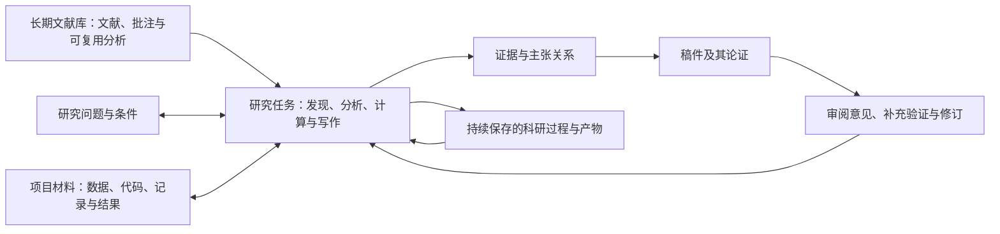

# Scholoom 产品需求文档

本文档汇总截至 2026-10-18 已确认的宏观产品设计，供产品讨论、设计核对与后续规格编写使用。范围包括科研业务、工作台交互、数据与运行政策，以及已经选定的架构约束。开发排期、实现任务、接口字段和数据库结构由具体功能规格另行确定。

## 文档导航

| 文档 | 内容 |
| --- | --- |
| 本文 | 产品定位、目标、场景、业务关系、模块与范围 |
| [文献与知识](literature.md) | 获取、管理、阅读成果、分层访问、分析综合、Zotero 生态与迁入 |
| [科研工作与 Agent 协作](research.md) | 方法、能力、工作流、持续任务、研究执行、分工审阅与文风监督 |
| [工作台、阅读与写作](workbench.md) | 布局、导航、对象指令、编辑预览、审查、外部反馈与交付 |
| [数据、授权与运行](data-and-operation.md) | 数据权威、开放编辑、上下文承接、模型配置、授权、取消与恢复 |
| [约束、质量与后置事项](constraints-and-validation.md) | 已定架构及技术路线、工程与发布要求、验证边界、后置议题 |

本文档将决策整理为可独立阅读的产品说明。术语定义统一见 [CONTEXT.md](../../CONTEXT.md)；各项设计的理由、确认记录与调查依据保留在[决策地图](../../.scratch/scholoom-foundations/map.md)及对应票中。发生歧义时，以用户最新明确决定和对应票的正式回答核对，并同步修改受影响文档。

文中描述的是目标产品行为。已确认设计、已经实现、实际验收通过分别记录；当前工程状态见[开发说明](../development.md)，不能依据本文认定功能已经可用。

按能力整理的要求与代表性场景见[初设规格书](../initial-spec/README.md)，供后续 OpenSpec 变更选取和细化；正式实施后的行为契约仍维护在 `openspec/specs`。

## 产品定位

Scholoom 是面向完整科研流程的独立 Agent 系统，提供跨平台 Electron 桌面工作台。科研 Agent 内核由 Agent 运行时及其配套 harness 构成，管理任务、上下文、科研能力、执行与成果；Agent 工作台供研究者访问材料、参与研究、编辑和审查产物，形态参考为文献管理与写作定制的 VS Code 类界面。

内核能在未打开工作台时执行完整科研任务。研究者随后打开工作台，可以接入同一项工作，查看进展、产物和待决定事项，并继续介入。关闭界面、结束会话或更换 Agent，不等于结束研究任务。

产品沿用「All by agents, all for agents」：科研资源和能力应能由 Agent 直接发现、读取与操作，人类通过共同事实源参与。文献整理、阅读批注和普通编辑仍有适合人的直接入口。

主要设计依据：[全流程产品形态](../../.scratch/scholoom-foundations/issues/01-first-product-loop.md#answer)、[Agent 一等公民约束](../../.scratch/scholoom-foundations/issues/02-agent-first-contract.md#answer)。

## 为什么建设 Scholoom

最初使用者是项目维护者本人。其日常工作已经组合 Zotero、zotero-agents 与 ResearchSpec：先与 Agent 讨论研究，到 Zotero 建库和分析，再导出研究包回到写作环境，多个 Agent 工具在同一目录协作。

这套工具链已有可取的文献管理和科研方法。实际障碍集中在工具间的操作与交接：建库与研究环境分离，按需读取更多材料困难，预先打包的内容可能遗漏后续写作所需信息；补充材料后继续使用也不顺畅。Zotero 的运行环境还限制综合算法的实现和排障。ResearchSpec 的科研功能得到用户认可，科研产物的图形交互与原生 Agent 体验需要改善。

Scholoom 的目标是把这些工作放进持续、共同的科研环境。已有方法与源码按实际价值吸纳，产品独立演进。改变运行环境和整合工具为改善质量提供条件，科研效果仍需真实任务验证。

依据：[选题、检索与综合场景](../../.scratch/scholoom-foundations/issues/26-research-scenarios-and-existing-toolchain.md)、[研究结果与论证场景](../../.scratch/scholoom-foundations/issues/27-research-results-and-argumentation.md)、[既有项目关系](../../.scratch/scholoom-foundations/issues/08-existing-project-integration.md#answer)。

## 产品目标与范围

首阶段产品必须贯通文献获取与管理、阅读分析、研究综合、问题与方案设计、研究执行及结果整理、整篇论文写作、审阅修订、投稿材料与审稿回复。开发顺序和每一步的深度可以另行安排，全流程各环节均在产品范围内。

具体目标包括：

- 研究者与 Agent 在同一环境中使用材料、研究事实和产物，减少日常导出研究包及跨工具手工交接。
- Agent 按研究目的渐进取材，既能复用分析与综合，也能继续检查原文和自己的研究材料。
- 研究过程持续保存，目标、论证、理由、问题与下一步能够供不同会话及 Agent 接续。
- 人可以直接围绕正文、报告、图表和审阅意见发指令，查看修改与依据，在执行过程中继续编辑或介入。
- 自主执行沿任务授权连续推进；正式判断、破坏性操作和对外提交保有相应授权节点。
- 材料缺失、执行失败、部分交付、等待决定和取消等情况如实呈现，已完成成果可继续使用。

## 代表性科研场景

当前设计以四类已经复盘的场景为基础。研究可从宽泛方向、已有文献、数据与结果、候选假设、半成稿或审稿意见开始，允许往返调整。

| 场景 | 研究者和 Agent 的工作 | 需要保有的成果及关系 |
| --- | --- | --- |
| 选题、检索与文献综合 | 讨论方向，发现和收录文献，逐层阅读，比较争议、研究局限和空白，调整研究问题 | 筛选理由、单篇分析、主题综合、来源与适用条件、问题和下一步 |
| 研究结果与论证 | 使用已有材料或运行分析，检查结果、生成图件，组织证据与主张，选择论证路线 | 数据、代码、实际结果、图件与来源，主张依据、限制及方案比较 |
| 论文撰写、审阅与修订 | 制定写作计划，起草整篇稿件，开展分工审阅和文风监督，补充验证、修订并回应意见 | 当前稿件、原意见、修改理由、实际修订、回复及交付版本 |
| 已有研究的续做与复用 | 换会话或 Agent，补充材料，读取既有研究过程，继续未完成工作或跨项目复用 | 完整可取回的持久材料、成立条件、重要决定、已知问题及当前内容 |

文献库也可独立使用，日常收录、阅读与知识积累无需先建立研究项目。后续遇到新的科研场景时补充设计；这四类是当前讨论基础。

依据：[场景覆盖](../../.scratch/scholoom-foundations/issues/30-research-scenario-coverage.md#answer)、[核心业务模型](../../.scratch/scholoom-foundations/issues/31-core-research-business-model.md#answer)。

## 核心业务关系

研究项目是当前工作空间，长期文献库跨项目共享。主题组织某个领域、现象或方法的知识；研究问题表达当前希望弄清什么及其条件。一个主题可服务多个问题，一个问题也可横跨多个主题。一个研究问题可由多个任务推进，一个任务也可服务多个问题，任务不要求先绑定研究问题。

文献与自己的数据、代码、实验记录、结果和图件都可以成为来源。证据定位到实际材料版本；它对某个主张的支持、冲突或限制，需要结合研究条件判断。发现相关文献、核对原文、认定足以支持研究主张，是不同进展。

一个项目可以有多份稿件，共享来源和研究成果，同时分别保存各稿件的表述、投稿目标与审稿轮次。任务产物可以成为后续工作的来源。

分析发现、研究主张、正式决定、文件修改与任务完成各有含义。正文发生变化不自动改写已确认判断；程序成功不自动证明科研交付成立。充分说明证据不足可以完成评估任务，修订答复中的完成声明则须能找到实际结果和对应版本。

这些对象采用渐进管理：优先记录核心贡献、关键结论、定量表述和争议，允许先编辑正文，再补充关联。无需逐句建立结构化对象。

依据：[领域边界](../../.scratch/scholoom-foundations/issues/06-research-domain-boundaries.md#answer)、[核心业务模型](../../.scratch/scholoom-foundations/issues/31-core-research-business-model.md#answer)。

## 七个逻辑模块

| 模块 | 产品职责 | 与其他模块的边界 |
| --- | --- | --- |
| 文献管理 | 题录、集合、附件、批注、导入、检索、去重与稳定身份 | 管理长期文献事实，供研究、阅读和兼容插件共同使用 |
| 内置 Agent harness | Agent、会话、持续任务、上下文、委派、工具调用、授权及恢复 | 执行科研定义，保持实际运行与交付记录 |
| 工作台界面 | 编辑、阅读、资源导航、交流、任务观察与产物审查 | 呈现共同事实，保存必要界面状态 |
| 科研业务与内容 | 业务 Graph／子图、能力入口、节点实现与指导资源、科研交付要求 | Graph 定义业务步骤及控制，harness 提供共同执行机制，成果归所属领域 |
| 执行环境与沙箱 | 环境供给、程序与工具执行、资源限制、取消及隔离边界 | 属于 harness 子系统，返回执行结果，上层判断科研完成 |
| Zotero 插件兼容层 | 插件装载、宿主能力、插件状态及原生服务适配 | 插件通过共同文献权威读写，专属配置与缓存分别管理 |
| 研究项目与研究资产 | 项目材料、证据与主张关系、稿件、审稿问题及正式决定 | 管理项目研究语境，保留所引用库对象的原归属 |

七项是逻辑职责，不自动对应七个进程、包或发布单元。部署选择见[约束文档](constraints-and-validation.md#已定架构约束)。

依据：[模块职责](../../.scratch/scholoom-foundations/issues/24-logical-modules-and-responsibilities.md#answer)。

## 全流程中的共同约定

工作台、内置 Agent 与兼容插件使用同一领域契约，科研执行统一由内置 LangGraph harness 控制；插件 MCP 与对外 MCP 服务（已确认目标，尚未实施）的边界见[运行约束](constraints-and-validation.md#已定架构约束)。普通文件保留开放编辑。题录和附件获取、程序执行、产物检查、科研判断与整体交付分别表达实际情况，GUI 使用相同记录显示结果。

分析与主题综合的维护保留已有成功成果和当前更新状态。当前无人工作的项目受到库更新影响时，保存影响线索，待用户恢复研究时提示，由用户手动启动复核。此规则的完整说明见[数据与运行文档](data-and-operation.md#项目恢复时的材料变化提示)。

跨会话接续依靠持久研究材料和事实。实际进入模型的上下文按需选择，但可取回的内容不能仅剩结论或交接摘要。

完整科研情境已经做过语义走查，用户认可共同契约能够贯通。来源：[跨模块走查](../../.scratch/scholoom-foundations/issues/42-cross-module-research-walkthrough.md#answer)。

## 产品成功的判断

用用户的一篇真实原创论文检验完整工作：文献、方法与结果、图表、整篇稿件、投稿材料，以及审稿后的修订与回复。核对无工作台执行、随后接入、人的介入、补充材料和跨会话承接。具体论文、科研评价指标和门槛仍待功能初步可运行后确认。

以 Linux 为主要开发与日用验证平台，从开发开始维护 Windows、macOS、Linux 构建，首个稳定版完成三平台实际分发包验收。完整流程、数据保护、插件重点能力、性能与真实科研效果均需验证。

目前已有工程骨架、部分宿主和预览实验、工作台草图与静态调查。这些证据有各自边界，尚不能证明全流程产品可用。详见[质量与后置事项](constraints-and-validation.md#质量与验收目标)。

## 当前范围边界

- 云同步、多人协作、移动端等长期方向未纳入当前产品承诺。
- 首阶段暂不提供金额预算、价格估算或金额封顶；调用次数、用量、时间与并发控制仍保留。
- 首阶段按可信代码执行明确启用的程序与插件，强安全隔离需另行讨论。
- Zotero 单向迁入后由 Scholoom 独立维护，不默认双向持续同步；插件支持按版本及功能验收，不承诺所有插件无缝运行。
- Scholoom 吸纳 zotero-agents 与 ResearchSpec 的方法和源码，不承诺兼容其旧包、CLI 或执行机制；可选学科和工具扩展留待后续。
- 预览布局、刷新体验与性能门槛继续后置；真实科研评价在功能初步可运行后讨论。

本 PRD 收束宏观设计。后续修改产品选择时更新对应决策与本文档；需要落地的功能再形成具体规格。本文档不安排实现路线。
