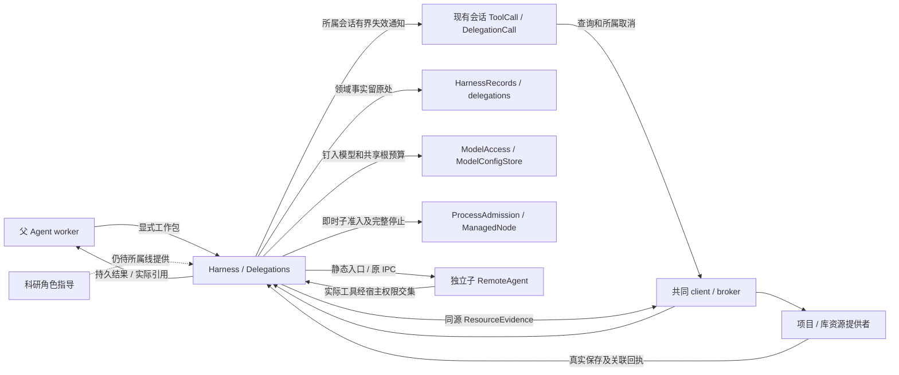
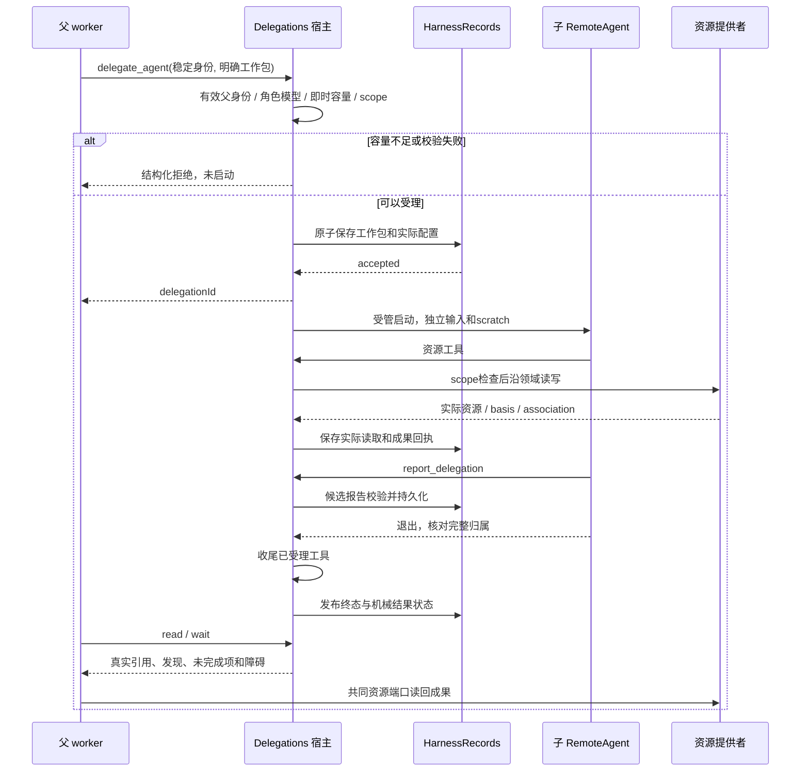

# 实现设计

## 首次断言前的有界诊断（8a2f0ce）

本片只扩展测试诊断，不新增产品行为或schema。`tests/execution-diagnostics.ts`复用execution-stages采样/附件：observer在send和首次状态轮询前装配app变化与worker启动/退出订阅，采样合并为单个在途操作；保留初始及最近有限样本、工具/实例/进程元数据，禁止正文、凭据、原始argv或全库。finally在所属app关闭前停采，afterEach从缓存写附件，首个assert失败也保留；附件有固定字节上限，超限显式计数/裁剪。原expectExecutionCompleted复用该实现，原等待与诊断期限不扩大。

实际边界为32条样本/32个子进程、单样本最多16条指令/工具/委派及32个实例（SQL最多读取100实例/17委派），附件最多256KiB；首次失败时间及最近已完成样本独立固定，不被后续裁剪覆盖。诊断snapshot单次500ms预算，首次超时即停止启动新读取，最多遗留一条不可取消读取；不阻止收尾。SQLite只读timeout=0，错误只写诊断码，业务断言仍直接读取原snapshot。excerpt仅针对已证明的轮询末段盲区调整intervals=[100,250]，名义5秒期限与原内容/checkpoint断言不变；不批量调整其他失败。

仅接context-instructions的real worker excerpt和agent-delegation取消两个代表场景，真实broker/仓储/worker；excerpt既有材料describe/check为明确模块替身，外部模型受控。先原时限复现与受控临时失败验证附件，再决定是否存在本域夹具缺陷；生产恢复/准入、报告来源及kernel生命周期不在本片写集。原tasks/delivery保存结论，Windows自动CI与旧基线分别记录，无目标通过不关闭平台任务。

## 共同领域接入后的A/B有界切片

本节取代下文历史阶段的未同步/TaskPort缺失与构造器候选说明。1026796共同基线已包含七域正式源码；主线同步证据为`/tmp/scholoom-round5-acceptance-WBreMJ/{acceptance.md,synchronized.json}`。只修改本树，不重放旧patch。科研角色/guidance与真实质量仍未设计，不以worker代替。

A：复用ManualApplication的FileExecutionFacts窄端口，返回值允许同步或Promise；fileOrigin及其project.saveFile、files.save/undo、resources.create、tasks.create/save调用点在进入原projects保存前await。Kernel默认经原executionFacts/broker查询，仅把verified且匹配的project/session/run/instance与verified委派关系映射为既有FileEditOrigin；指令/工具未知不推断。等待后再次checkExecutionContext，projects的withAccess授权及原锁/CAS继续负责撤权、身份、发布与事务；不在SQLite事务等待，不另造schema/来源表。同步注入夹具继续验接口，实际父子FileEdit验证默认装配，二者分开。

B：父沿现有TaskPort读取TaskRef/入口basis，入口及明确材料作为ResourceEvidence交原worker。子只读这些材料、创建指定成果并report；父重读入口，使用原tasks.save整份候选关联result/workItemId。无需DelegationRequest字段或新增角色/权限。材料变化拒绝旧依据，关联冲突保留成果供重读后续接，取消保留已保存成果与未完成关联；不自动重放或创建任务。内部broker、项目/委派仓储、worker、文件真实，仅外部模型HTTP受控。

写集限定kernel executionFileFacts/originFacts/fileOrigin及上述await调用点，现有execution-facts/file-edit-origins测试和必要TaskPort委派测试；不改TaskResearchPort默认装配、构造器尾参、根工具、迁移/restore、tab、资源叶或其他域规格。复用现有双宿主委派正例，不新增UI语义。构建后顺序验证，运行中不重建，首次失败保留；任务及delivery记录本轮实际结果。

## 变更总览

本文件记录实施设计，调查依据见 [investigation](investigation.md)，完成目标见 [proposal](proposal.md)，实际验证与剩余项见 [delivery](delivery.md)。深层模块设计采用 codebase-design：`Delegations` 把可靠受理、权限求交、子进程、结果和收尾集中在小 Interface 后面；真实资源端口与测试 Adapter 是已有可替换 seam，不增加万能调度层。

不把科研 ability attempt 改名为 delegation。保留 `executeCapability` 入口、科研进展及交付检查，抽出它与通用委派确实共用的实例生命周期／停止追踪；不迁移科研业务记录。生产图集合不变，也不引入新 Graph 类型。

## 方案与接口

### 1. 同源数据与归属

新增声明源 `packages/protocol/src/delegation-contracts.ts`，由 `harness.ts` 重导出；操作、DTO 和 Ajv 校验均由同一 schema 派生。所有输入为关闭额外字段的 object。以下是实施字段语义；不改变现有2 MiB帧和资源分片上限。

| 对象 | 字段与语义 |
| --- | --- |
| `DelegationWorkPackage` | `objective` 非空目标≤32768字符；`materials: ResourceEvidence[]`≤32，每项复用 ref/basis，可选 role 标明原材料／标准／背景；`outputs`≤16，明确当前可写项目中的新建相对路径或既有 ref/basis；`requirements`≤32768字符，说明交付、检查和停止条件；不接受原生路径、任意代码或自报工作域 |
| `DelegationRole` | `id/version`、`guidance`≤32768字符、`tools`（受支持工具能力集合）、可选 `modelProfileId`。宿主注入源码定义，harness 内置通用 worker；科研角色由科研提供者贡献。只携带节点指导，不含流程图／交付判断 |
| `DelegationRequest` | `delegationId`稳定操作身份、`roleId/roleVersion`、`workPackage`、`tools`（请求的更窄范围）、可选 `modelProfileId`。父 project/session/run/instance 来自可信 CallContext，不能从参数覆盖；首批不接收递归委派或后台移交选项 |
| `DelegationRecord` | 委派身份、原父 session/run/instance、受理时派生的 childInstanceId、项目、完整工作包、实际角色指导及版本、命名配置身份／修订与解析后模型、有效工具范围、状态、时间、结构化 error；启动后可记录实际父子 PID 用于诊断，不授予执行权限。保存受理原载荷供幂等比较，不依赖文本预览或 hash 判相等 |
| `DelegationReport` | `findings`、`unfinished`、`blockers`（各有界文字≤32768字符）；`artifacts`≤16，必须对应真实保存回执；`reads`来自宿主实际资源取用记录。子提交是候选报告，宿主校验归属、真实引用及保存结果后才发布 |
| 记录内结果 | `state`沿本 capability 生命周期；`artifacts`包含原 ResourceSaveResult；`creations`分别保存客户端operationId与宿主resourceOperationId、路径和状态，≤16；`writes`保存修改前的ref/basis、宿主身份和pending/complete/unknown，≤64。`resultState: available/partial/missing/unknown`表达机械交接完整性；不设researchPassed或复制任务进度。报告缺失、保存未知、关联未完成均可诊断 |

材料初始总量按完整编码字节受128 KiB工作包预算保护，候选报告同为128 KiB，完整持久记录上限512 KiB；超限明确拒绝，不截断指导或显式材料。长成果本身走共同资源读取，每次工具的16 KiB预览不当作完整报告。已有 `ResourceEvidence.role` 是用途说明，不是权限或角色注册身份。delegationId只接受1–128位字母、数字、下划线、短横线，不能穿越scratch路径。

`Delegations` 使用根 run 下的 childInstanceId，不建立可发送普通消息的子 Session 或第二份 Run 状态机。角色／模型解析快照用于审计，不包含密钥；父与子每次请求分别用自己的运行实例及取消信号授权。通用子不得调用科研能力等可再启动执行的入口，首批工具只覆盖明确资源取用、保存、报告和自己 scratch。

### 2. 提供／消费的 Interface

| Interface | 输入／返回 | 权限、等待和副作用 |
| --- | --- | --- |
| 内部 `harness.delegate` | DelegationRequest → `{ delegationId }` | 仅当前根父执行；先同步 reserve()及校验、持久化后受理；普通5秒调用预算，不等待业务完成；失败无新执行 |
| `delegation.get` | 公共projectId/sessionId/delegationId → 当前记录与结果 | GUI／CLI沿既有已认证会话读取；执行调用另核对所属身份；只读，5秒；敏感预览仍经当前材料权限，不回读密钥 |
| `delegation.list` | projectId/sessionId/cursor/limit → 摘要与nextCursor | 默认25，最多100，单页≤512 KiB；稳定seq游标，仅当前会话，不把完整工作包塞进workbench snapshot |
| 内部 `harness.waitDelegation` | delegationId/waitMs → 当前结果与 `timedOut` | 默认1000ms，最多5000ms；同一父实例最多一个实际等待，无轮询积压；等待预算包括宿主开销，RPC声明保留更长控制期限；到期不取消 |
| `delegation.cancel` | projectId/sessionId/delegationId → 当前状态 | GUI核对所属会话；Agent只能取消自己委派的子。5秒受理停止，实际确认由查询观察；重复请求幂等，不取消其他会话 |
| 内部 `harness.reportDelegation` | 当前子绑定的报告 → 确认回执 | 宿主派生 delegationId，子不能指定别人身份；只是保存候选，实际完成仍需子退出和工具收尾。未确认落盘不向父发布 |
| 内部 `harness.roles` | 无业务参数 → 已注册角色及版本、指导 | 源码注册≤100项、编码≤128 KiB，整体按schema验证；不允许 Agent 注册角色／改权限或配置凭据 |

父工具名为 `delegate_agent`、`read_delegation`、`wait_delegation`、`cancel_delegation`、`list_delegation_roles`；子只得到 `report_delegation` 与被授予的资源／scratch工具。上述内部操作声明进入 harness module operations，经 broker、architecture 消费列表及生成类型映射接线；worker动态工具仍用原 `execution.custom`，不另造传输，也不把父身份放进模型可改的工具参数。

`delegation.get/list/cancel` 在业务契约中复用同一声明和结果。状态变化调用现有 `changed(projectId, sessionId)`，客户端只对当前会话失效范围重读。报告与工具按delegationId定位，工具消息可选保存该结构化引用，避免从截断JSON预览反推身份。

消费端口：`ExecutionResourcePort`、`HarnessStorage/HarnessRecords`、`ProcessAdmission`、`ModelAccess`沿既有宿主组合；角色使用源码注入 `DelegationRole[]`。项目 task/work-item 不进入首批必填DTO。未来真实任务关联若已有共同资源可表达，直接用材料／成果文件引用；确需新taskRef必须先收到项目提供者接口，再核对规格，本轮不填虚构字段。

### 3. 有效权限在宿主落实

`effectiveTools = parentEffective ∩ roleTools ∩ requestedTools`，随后每个实际操作再交所属领域检查当前授权。工作包输入授权仅覆盖所列资源和允许的输出；材料角色、工具名称和用户选择都不是授权。第一批不开放无界文件发现、任意路径读写、库写入、程序执行和嵌套科研能力启动。

- read／describe只允许工作包ResourceRef集合及本子实际新建的成果；读基于原basis，变化交回负责Agent判断，不自动替换。
- save首次只允许工作包明确save输出的精确ref+basis；后续只沿本委派最近确认保存回执推进，不从materials／读取依据扩展写版本。保留pending／unknown及同ref并发保护，继续交原项目CAS条件保存；create只允许列出的当前项目新路径，路径经项目原解析、身份及禁止覆盖保护。输出位置不含通配符或客户端原生目录。
- scratch为 `sessions/<parentSession>/delegations/<delegationId>/scratch` 下的私有目录，仅挂自己的虚拟临时路径。SDK默认文件工具的Backend同样是这个受限Adapter：项目路径不能穿透、禁用操作在宿主返回permissionDenied，不只在传给模型的tools中删条目。
- 子不挂父 conversation_history；不注入 continuation()或父指令消费中间件，子报告不消费父用户指令。可信来源只从宿主选中的已有指令事实复制，不得让子凭自报instructionId读取其他窗口。
- 每次资源交付及模型排队前后／最终同步准入，复用领域实例检查并加上本子scope。子scope只收紧父可用范围，父重开项目／实例撤权后不继续。

不写独立的材料版本机制或批注修订逻辑。初审默认不含原稿写能力；科研提供者和负责Agent保证交给它的是原材料及标准。harness从结构上不自动附入任何其他审阅结论，不能以字符串过滤判定科研输入正确。

### 4. 模型配置和共享额度

models维护命名配置，复用 `ModelConfigStore` 的私有目录／原子写及现有模型目录校验，在独立 `model-profiles.json` 中保存≤100份配置；缺文件表示空配置集，不改现有provider.json语义。每份含id、name≤200字符、revision、当前供应商id和RunModelConfig。沿原串行tail防止本机并发丢写，使用expectedRevision核对保存／移除。损坏不覆盖，已有运行只使用已钉入值。

公开 `provider.profiles` 分页读取、`provider.saveProfile` 按修订创建／更新、`provider.removeProfile` 按修订移除；内部 `models.resolveProfile` 返回无密钥解析值。配置操作沿现有用户设置入口，Agent不可修改。现有模型设置区增加命名配置小表单，不做新供应商或角色市场。

解析顺序：工作包明确modelProfileId → 角色modelProfileId → 父run.modelConfig。显式缺失引用报错；不再取当前应用默认。落盘实际profileId/revision/provider/model/effort；不支持effort时按原能力检查，不能默默换模型。

把 `ModelAccess.execution()` 目前闭包内32次计数提成models拥有的私有根预算，根推进创建一次，能力子执行和不同描述的通用子执行持有同一预算引用。允许以内部执行参数传入该引用，不能经public DTO或worker载荷指定剩余额度。每个ModelExecution仍有独立lease集合、authorize/confirm/signal；新子只分离descriptor，不复制计数或另建ModelAccess实例。压缩与安全重试继续逐次acquire，父在工具等待期不持有模型槽。

### 5. 受理、结果及收尾顺序

重复受理先按会话和delegationId读取原记录，比较完整原载荷，再返回原引用；不重新解析变化后的角色或配置，也不二次reserve。取消／重复受理的串行临界区在宿主，不跨进程共享内存锁。记录可靠保存后启动失败，须写明确failed或interrupted，不能删除记录假装从未受理。

`report_delegation`不把子自报路径升格为成果。宿主从实际create/save回执汇集资源及association，核对报告引用。子异常退出但已有文件时保留partial结果；无报告为unfinished，非完整成功。结果持久化先于向父返回，父工具预览截断不影响按ID读取。子保存回执继续进入既有pending-artifacts，补关联复用原reconcile/creation，不再建产物事务。

创建前保存本委派的客户端身份→宿主随机领域身份映射，查询只用此映射并核对实际项目及路径；兄弟复用客户端operationId不能取得同一领域收据。每次修改前先持久保存pending意图，确认实际回执后才标complete；真正调用后抛错保留未核清状态，旧回执不能使后续未知保存变成available。本委派已有成功回执时，下一次修改只接受最近保存basis，旧版本在领域调用及意图落盘前拒绝，不猜错误码是否意味着无副作用。

子资源端口延迟至onStart注册实际实例后绑定，避免提前核验未存在的实例。SDK默认Backend拒绝项目访问，只把子自己的临时路由挂到FilesystemBackend；拒绝按Backend错误值返回，使子可继续完成允许的报告。受理等待异步配置解析后重新核查项目信任和材料外发授权；同ID在途受理还核对可信会话及父实例，不能跨会话复用Promise。

父只等待时子继续运行；父正常结束、失败、取消或进程停止时，撤销子资格并取消未完成工作，root终态仍等待其所有子和已受理工具收尾。主动取消某子不取消父或兄弟。停止未知沿原instances和reservation保留，不按child根PID猜安全。旧事件核对childInstanceId，只更新原委派。

首批重启仅核查／展示旧委派和实际操作，不恢复子checkpoint或自动重跑工作包。新消息仍是父接续入口；父可读旧结果，确认原归属已退出后按当前意图明确新建委派。旧delegationId永不启动新子。角色更新、模型变化或scratch丢失不导致旧结果被抹除。后续若需要子checkpoint接续，应另行增加行为契约，不在这次偷建跨会话通信。

### 6. 仓储、备份与恢复

新增harness所属 `delegations` 表，索引sessionId/seq和parentRunId，value存上述JSON记录；实例仍在run_instances，工具仍在messages／既有收据。列表摘要由记录投影，不独立持久化第二份状态。

宿主 `initializeProjectContainer` 从v4增量升至v5，升级前按原安全模式保留版本副本、事务建表及索引，重试核查版本；不得重走v4信任迁移而重置grants。旧容器打开前完成升级，新空容器与旧版本链路均有定向验证。harness仅访问自己的表。普通数据库快照保留委派记录；scratch和临时模型上下文仍非科研成果备份。

独立恢复副本沿 `HarnessRecords.restore(projectId)` 重绑定自身工作域／自身项目资源，父子身份只作历史，不恢复执行资格；外部库／跨项目引用保持原对象，不猜新映射。副本不会保留原进程占用为当前资格，也不操控原项目执行；当前项目普通重启的未知实例保护不因副本恢复规则被削弱。损坏／迁移失败保留原数据并停止依赖操作。

### 7. 会话内 UI 草案与交互线边界

已先读 `docs/ui-design/README.md`，局部设计已写入该文档。以下实施沿现有工具详情、模型设置与共同资源打开；阅读线设计交换仍待输入。

- `ToolCall`遇到带delegationId的委派工具行，委派摘要与原tool事实相邻；点击展开 `DelegationCall`，显示角色、实际模型、状态、障碍、成果链接和停止按钮。候选报告与缺项按需展开，不自动展示所有子文本。
- dock仍只呈现最新tool单行，点开沿原overlay；overlay在父记录下展开详情，不新增子会话树、tab骨架或独立composer。原会话取消覆盖所属链，局部停止按钮只提交该委派取消。
- `business-session`提供当前会话分页委派摘要、展开对象get和cancel回调；请求键绑定project/session/delegation，AbortController释放自己的读取。关闭详情／切会话丢弃迟到投影，不取消执行或清草稿；无变化摘要不重绘全部消息。
- 成果链接用原resource-controller打开，真实报告可正常读文件／阅读器；新增样式只引用现有token。复用tool-call、表单和alert样式；如确需新语义token，浅深两套同时定义，但首批预计无需新token。按钮有可访问名，局部错误就地保留，不靠颜色表达终态。
- 命名模型表单位于现有 `ProjectNavigation.tsx` 导出的设置内容，分页／选中一项编辑，保存冲突保留草稿；不在composer塞入开发机制说明。

阅读线两份设计现已由主线快照正式转交并逐份核对，精确路径及触点见文末公共对接。它们分别拥有材料批注／差异和交互报告／页面运行，本线只消费ResourceEvidence与共同打开，不实现iframe、annotation provider、报告刷新或页面动作协议。本线符号为DelegationContext、工具消息可选delegationId、ToolCall按该字段添加独立详情、Workbench薄Provider和模型设置局部表单；未把阅读实现导入本树，公共组合／真实角色整合仍归6.1／6.2。

## 文件变化

下表记录本线职责及可影响范围，实际修改见git diff和delivery；未发生必要修改的候选文件保持原状。

| 拥有者／文件 | 新增／修改与明确范围 |
| --- | --- |
| Agent：`packages/protocol/src/delegation-contracts.ts`（新增）、`harness.ts`、`harness-module-contracts.ts`、`harness-record-contracts.ts` | 委派DTO及操作，工具消息可选delegationId；不改科研execute参数或Graph语义。公共harness module符号须与科研线核对增量 |
| Agent必要模型补充：`protocol/src/models.ts`、`models/src/config-store.ts`、`model-access.ts`、`execution-model.ts`及对应导出 | 命名配置、内部解析、根预算共享，原并发／租约释放保证保留；无新依赖 |
| Agent：`harness/src/delegations.ts`（新增）、`schema.ts`、`records.ts`、`runtime.ts`、`checkpoint-files.ts`、`node.ts` | 通用深层模块、仓储、独立scratch、父工具及取消钩子；提取共用生命周期，保留科研专用progress。runtime不增加科研角色正文 |
| Agent必要静态适配：`harness/src/remote-agent.ts`、`execution-driver.ts` | 仅必要的受限Backend和工具接线；优先原dynamic tools／IPC，默认task仍不启用，不增客户端worker路径 |
| 公共增量随本线：`apps/kernel/src/storage/project-container.ts`、`application.ts`、必要的源码角色装配文件 | v5迁移、broker提供者、模型配置及角色注入；worker入口继续原execution-worker。科研guidance实值待其提供 |
| 公共增量随本线：`protocol/src/operations.ts`、`index.ts`、生成的`business-types.ts`／`harness-module-types.ts`及必要模型映射、`architecture.json` | 从原schema生成并核对映射；仅增加本线操作和真实调用方。client通用call/watch应无需新传输 |
| Agent会话组件：`workbench/shell/DelegationCall.tsx`（新增）、`ToolCall.tsx`、`session.ts`、`business-session.tsx`、`projection.ts`、`ProjectNavigation.tsx` | 当前会话委派详情、取消／资源打开、命名模型设置；Workbench.tsx仅在实有props接线需要时薄改，先交换符号 |
| 文档与样例：`docs/development.md`、`docs/ui-design/README.md`、`docs/initial-spec/research.md` R-08 | 实施时补诊断／真实入口、UI局部分节；只在正式规格同步后把已转入R-08范围改成引用，未实施通信及advisor保留。不趁机修整个架构旧链接 |
| 验证：`tests/kernel/agent-delegation.spec.ts`（新增），现有model-admission-integration、execution-isolation/capacity、harness-recovery、public-contract-baseline、project迁移／备份相关用例；`tests/model-server.ts` | 新增通用委派行为集，其余复用或表格扩展，不重复基础机制套件。容量、版本、权限、实际保存和取消以独立预期为oracle |
| UI：`tests/ui/agent-delegation.spec.ts`（新增）及受影响组件用例；`tests/execution-diagnostics.ts` | 双宿主入口和阶段诊断；CI已知夹具修复另作公共增量，当前不改变workflow或生产时限 |

无业务文件删除任务；不为“更少代码”移除旧科研能力、授权或错误处理。公共增量仅新增本线符号，原科研execute及Graph语义保持原契约；现已消费主线符号快照，dev组合验证仍待执行，当前不提交或cherry-pick。

## 验证与风险

### 独立验收与诊断

1. 独立模块：组合HarnessStorage／真实HarnessRecords、ProcessAdmission、原静态worker、真实项目／资源端口和受控HTTP模型；测试角色与任务关联Adapter明确标注替身。至少观察两个不同的受管执行进程，不能把两个模型回复当成两个实际执行。
2. 核心样例：父发送有版本的材料，子实际读材料并create不存在路径的报告，父以返回ref/basis读回并核对预先约定内容／原输入；对照父私有标记、兄弟scratch和初审原标准验证输入隔离。不能以新实现输出自身充当oracle。
3. 风险代表集：同ID同／异输入、只读角色尝试改原稿、原basis变化／同路径替换、模型排队撤权、容量仅1、不同模型合计32次、报告缺失／保存成功关联失败、子崩溃／父退出、取消期间已受理保存、停止未知、重启无自动请求及旧实例迟到。优先扩展已有机制用例，避免每条文案一个测试。
4. UI通过现有composer发指令，真实kernel/broker/worker/资源保存，浏览器和真实Electron均查原委派、打开实际文件并取消；切换会话、关窗重连和迟到刷新保草稿。受控模型仅替换外部HTTP。依赖和二进制已存在时直接使用Playwright入口，未准备就保留待验，不运行setup安装。
5. Windows既有失败先取得investigation列出的阶段证据，保持原等待语义，不统一放宽timeout。Linux先验证新独立闭环；Windows真实受管父子和旧故障回归仍是相应平台接受条件；macOS检查明确unavailable和人工路径，不能称完整委派通过。

诊断使用delegationId、父run/instance、childInstanceId、状态／停止依据、模型请求数及租约归属、最后工具错误码、实际资源和association。复用 `expectExecutionCompleted` 及run_instances，附阶段记录到测试artifact；不输出密钥、argv秘密或完整材料。UI区分“请求未受理”“已受理未启动”“运行中”“停止核查”“结果刷新失败”，后台事实和页面读取失败分别显示。

最小命令范围：先 `node packages/protocol/scripts/contract-types.mjs --self-test` 及生成映射比对、`node scripts/check-architecture.ts`；按根scripts完成受影响构建／typecheck，再用现有Playwright kernel config运行新增委派、model-admission-integration、execution-isolation、execution-capacity、harness-recovery及所改迁移用例。UI定向新增委派与受影响harness夹具双宿主。实际命令、结果与替身边界见delivery，最终接入检查由接入者执行。

临时profile／库／项目／输出须与用户目录分开，端口拟用5631–5639，运行前核占用。测试结束仅停止所属单元；产物和诊断按delivery说明保留。独立初审审查者取得原契约、原材料、原始结果和标准，不预先注入其他审查者结论。

### 数据与性能风险

最主要风险是受限工具描述与实际Backend权限不一致、不同子模型复制预算、父结束留下无主子、保存后报告丢失、迁移恢复把历史实例重新授权。分别由宿主Adapter交集、共享预算、统一收尾、真实保存回执及恢复核查覆盖。数据保存／必要记录失败须停止相关依赖操作，不删除已有成果。

不为委派增加持续项目总时限。工作包有限范围、根模型32次、现有SDK递归及工具／RPC限制共同限制一次执行；等待和健康超时分别诊断。元数据、列表和同时等待有界，流式状态更新只使所属会话失效，不能每个token查询全部委派。实际吞吐／内存结论留给本线实跑，不复用旧样本宣称新功能性能。

## 待办边界

- **等待输入／接入**：科研实际委派角色与真实质量仍缺；项目TaskPort、阅读源码、公共历史和统一v6已随1026796正式进入本树。构造器沿现有共同顺序保留，任务关联采用父读/交ResourceEvidence/重读/保存原links，无需新委派DTO。机械接入验证见本轮delivery，不再等待同一公共接入方案。
- **待实证**：Windows失败阶段与新父子真实路径、macOS人工路径及目标分发；Linux迁移／恢复、权限与独立审查范围见delivery，工件存在不替代执行证据。
- **后续change**：已有会话持久通信、advisor、递归委派、后台移交、子checkpoint自动接续、角色编辑／分发管理和新供应商。产品／跨模块方向若需变更，带选项回用户，不能在实施中顺便决定。

## 主线第二阶段公共对接

以下保留第二阶段的输入与候选。当前同步状态以文末“同步恢复后的本轮范围”为准；统一v6／history及资源叶已进入本树，不再执行下面旧的迁移版本或同步候选。

本节消费用户正式转交的`/tmp/scholoom-phase2-handoff-VZS5mS`（下称S），不是读取其他工作树。S/manifest.json确认七线基线均为`e3d58fc807827a78493dcd16e38de28c8d02766e`，快照仅含改动／未跟踪工件。S/acceptance.md的A1与I-MIGRATION优先于前阶段独立通过结论；S/coordination-plan.md的“独立实施之后的公共对接阶段”规定组合迁移由计算线负责。本轮不改迁移入口或版本。

### 已收到的提供者事实

| 精确消费路径（均相对S） | 已核对内容与本线消费边界 |
| --- | --- |
| `research-graph-runtime/openspec/changes/add-harness-execution-history/{design.md,tasks.md,delivery.md,specs/domain-execution-handoffs/spec.md}`；同线`packages/protocol/src/{harness-module-contracts.ts,graph-contracts.ts,execution-graph.ts}` | 内部`harness.executions`，project/session固定，runId／instructionId／originInstructionId恰选一；默认0/25、最多100、512KiB。按instruction返回所属原Message，host/system及绑定范围核查，查询不推进执行。GraphBinding及registered初始化根字段带宿主originInstructionId，旧记录不猜补 |
| 同线`packages/harness/src/runtime.ts`的`executions/acceptedInstruction/send`及registered初始化；`apps/kernel/src/application.ts`；`architecture.json` | 来源、并发重放和显式新图选择需整体保留，不能只复制查询函数。与本线`delegationInternalOperations`并入同一操作表；历史查询不授权委派，不给子添图／任务工具，不改变根预算或childInstance链 |
| `research-task-workspace/packages/protocol/src/{task-contracts.ts,projects.ts,resource-contracts.ts}`；`packages/projects/src/tasks.ts`；`packages/harness/src/task-tools.ts`；所属`establish-file-backed-research-tasks/design.md` | TaskRef=`{projectId,taskId,fileId}`；workItemId是任务内引用，非另一执行状态机。tasks.list按候选分页；read返回入口ResourceEvidence／正文而不读全部links；create沿稳定operationId返回原资源创建结果；save按TaskRef+basis保存整份候选。四操作5秒，结果文件先保存，再更新入口links；普通资源association不等于任务链接 |
| `research-interaction/openspec/changes/add-material-annotation-interactions/design.md`及同线`packages/protocol/src/{workbench-context-contracts.ts,workbench-context.ts}`、`packages/harness/src/instruction-context.ts` | 材料已有位置／region.target／object.contentState增量，16项／64KiB不变。关闭清理及明确附加沿共同composer；M1库写回、M2可信修改关联、M3嵌入排版产物证据仍未闭合。不能把quote或delegateId当作可信FileEdit归因 |
| `research-interaction/openspec/changes/add-interactive-research-reports/{design.md,tasks.md}` | 报告仅规划。ReportResources／ReportView独立于委派，计划原子appendContextItems、版本绑定MessagePort及来源授权；report.ready／关闭页面均不恢复Graph或代用户发送，不依赖本线先建报告运行能力 |
| `research-graph-runtime/packages/research/src/{graphs.ts,records.ts}`、`packages/protocol/src/research-contracts.ts`、`connect-research-graph-runtime/delivery.md` | 生产图目录为空；delivery.roles是成果角色名，不是DelegationRole。没有实际科研委派角色ID／版本／guidance；固定图成功不能替代其交付 |
| `project-execution/{apps/kernel/src/storage/project-container.ts,apps/kernel/src/application.ts,packages/programs/src/records.ts}`及S/overlaps.json | 两份当前迁移同为v5但各只建一表，不能顺序调用作为组合。restore入口需保留两域历史保护；当前计算快照含C1等待修，不当成已修安全实现接入 |

### 共享符号及待主线选择

| 位置 | 必须合并的实际符号／选择 |
| --- | --- |
| `Harness.constructor`及kernel `new Harness(...)` | 前15项截至executionResources一致；第16项本线是`delegationOptions:{roles?,resolveProfile?}`，项目线是`taskPort(context):TaskPort`，计算线是`programs:{port(context):ProgramsPort,settle(context):Promise<void>}`。方案A（最小推荐）：固定16=delegationOptions、17=taskPort、18=programs，缺项显式undefined，逐个同步源码与夹具调用者。方案B：改成一个具名扩展参数，分别容纳上述三项，减少位置风险但改动全部提供者签名。本轮只给选项，主线确认一种后再实施，不能把后合入者覆盖到第16项 |
| 普通根`buildAgent.tools` | 合并委派五工具、项目createTaskTools（含read_task_creation）、计算programTools／describe_program_material，保留context、文件、科研原工具。工具schema同名只保留所属源。受限子仍只挂明确资源／报告工具，不能因根工具合并获得tasks.save、程序启动或递归委派 |
| 生命周期 | 保留本线childrenController、delegations.stopParent、实例链及未知停止保护；计算的programs.settle是另一个所属操作收尾，不得在其完成前把实例当exited。准确组合顺序需与计算修复后源码核对；不导入待修C1后台移交路径 |
| 执行来源／M2 | 本线可信事实为父session/run/instance、childInstanceId、delegationId和宿主记录工具调用身份；历史originInstructionId是registered图的启动关联，不是每次文件修改的唯一用户指令。本轮不新增FileEdit字段，不从整批指令任选一个、不用PID或工具预览推断作者。M2由项目提出可信归因契约，本线可提供上述事实；当前不足以宣称修改意见已消费 |
| `harness-module-contracts.ts`／生成映射 | 将科研harness.executions和本线delegationInternalOperations按符号并入最终schema；GraphBinding／execution.initialize来源字段一并保留。最终schema后重生映射并格式比对，不拼接各树生成文件；内部history查询保持host/system，不变成子可调用的公共工具 |
| kernel `project.restore` | 本线`HarnessRecords.restore(identity.id)`保留；科研接入后改为`ResearchRecords.restore(identity.id)`以保留GraphCall本域及原来源；计算增加`ProgramRecords.restore(identity.id)`及close/finally。组合失败必须保留恢复副本／源库，不注册半恢复项目，不自动执行任何历史实例 |
| UI共享符号 | 本线是projection的tool.delegationId、ToolCall条件详情、DelegationContext及Workbench薄Provider、business-session.delegations和命名模型表单。材料位置增量归原ContextContribution／编码；报告计划appendContextItems须并入既有会话草稿与provider，不替换delegations或pending发送。ResourceView／tab中的任务、程序、报告分派各自保留；委派成果继续共同打开，ToolCall不拥有报告页面或批注语义 |

**任务关联选择：** 推荐先由父使用真实tasks.read获得TaskRef／入口basis，将入口及所需材料作为原ResourceEvidence交子；子保存真实成果后，父重读入口并用tasks.save写result链接及workItemId。该路径复用已交付四操作，不扩大子权限，不因委派自动创建任务。替代方案为DelegationRequest增加可选TaskRef／workItemId并由宿主机械关联，需要新增同源消费契约、冲突／部分成功和UI语义；只有主线明确选择后才另行有界规划。本轮未新增这些字段，也未接入任务私有源码；实际角色仍缺，I3保持开放。

### 给计算线的迁移与恢复事实

以本树`packages/harness/src/schema.ts`和`apps/kernel/src/storage/project-container.ts`的现有声明为准：delegations含seq自增INTEGER主键，id非空唯一，session_id／parent_run_id非空，child_instance_id非空唯一，value非空TEXT；索引`delegations_session(session_id,seq)`和`delegations_parent(parent_run_id)`。本线单域旧稿从v4迁到v5，先保护原v4副本、检查普通文件／非链接／版本／quick_check，再事务建表索引及推进版本；失败重试不能重写原副本或重走信任迁移。**本轮不修改此稿，不把其作为最终可接入的公共迁移。**

计算组合至少覆盖新库、原公共v4、两种局部v5（只有delegations或program_runs），保留旧数据和信任、两表及索引约束、受保护副本、失败重试、恢复副本；具体版本链由计算统一设计后主线复核，不以version相等或CREATE IF NOT EXISTS代替验证。恢复时本线仅重绑原本属自身项目的工作包材料／save输出、reads、writes、报告及实际成果ref，外项目／库ref保持原对象；live委派转interrupted/unknown，不授予旧实例执行资格。组合测试还需核对程序historical、命令宿主身份清除、科研GraphCall来源及所有close责任。

公共资源叶schema先由项目提供者接入，保留resources原重导出；本线继续消费原ResourceEvidence，不复制叶声明。阅读图片枚举／格式判断在该叶增量之后组合；不会因为本线能打开报告文件就宣称交互报告实现。公共补丁文件、适用前提与实测范围记录在delivery；dev组合及用户同步消费者后才进入真实I3。

## 上一轮同步恢复范围（历史证据）

实际HEAD为2cb6aed4d0f3034ca2d1426858a64a0039e51ede，0519904（含b838402）已是祖先，启动时clean。用户已明确恢复，原等待同步条件失效。主线恢复记录`/tmp/scholoom-sync-recovery-wyn13R/{recovery.md,synchronized.json}`及本树日志提供先构建后34/34内核证据。直接使用本树正式源码，保留harness.executions／Graph来源、统一v5→v6、资源叶、projectId和双窗口基础，不再复制隔离组合或改迁移。

本轮新增内部`harness.executionFacts`，输入为关闭额外字段的空对象，唯一身份来自宿主绑定的CallContext。KernelApplication提供同名窄适配方法，经kernel实际消费声明／broker注册调用；不注册public业务操作、不加入模型工具，不接收runId或principal等替代参数。

当前有效execution／agent上下文返回`{state:'verified',principal,projectId,sessionId,runId,instanceId,delegation,instructionContext,tool}`。复用checkExecutionContext核对当前run、宿主、整条实际父实例链及资格；principal必须为agent且id等于绑定session。delegation为`{state:'none'}`（实例确实无父）、`{state:'verified',delegationId,parentInstanceId,parentRunId}`（delegations的child、parent、project、session、run全部一致）或`{state:'unknown'}`。最多返回一条直接委派关系，不读全会话消息／成果或构造因果图。instructionContext固定`{state:'unknown',reason:'notCaptured'}`，tool固定`{state:'unknown',reason:'notBound'}`；不从当前指令集合选作者。

缺少／失效的执行身份返回`{state:'unknown'}`；非execution或principal不匹配拒绝permissionDenied。保存提供者在实际操作受理时取得快照；执行退出／取消／宿主重启后旧上下文不再被认证，不能用历史查询重新赋予资格。公共harness.executions继续只负责持久Run／来源查询，两者不替代授权。无需新表、迁移或存储principal副本；项目M2消费实际CallContext和该查询快照，在自己的FileEdit事务保存已证明来源，当前本树不修改FileEdit契约／保存临界区。

任务可选：真实项目TaskPort未进入本树，不复制其私有实现、不添加必填TaskRef。现有工作包可交接任务入口的ResourceEvidence，父在任务提供者就绪后补原links；本轮只保留已核对TaskRef／workItemId语义与接口接线说明。实际科研角色仍未交付，通用worker及固定图只作机制验收。

验证复用真实资源保存端口：父读子成果、子首次创建时分别取得实际CallContext并经kernel/broker查询，核对不同实例和匹配委派链；错误实例／退出／重启为unknown，伪造参数及非执行主体拒绝。保留A1、首次创建范围、父退出／取消、恢复和history原测试；不触碰ToolCall／tab布局。公共事实端口补丁与相对0519904的完整委派领域切片分别导出，包含同源映射、注册／消费和必要测试，不提交或同步其他树。
