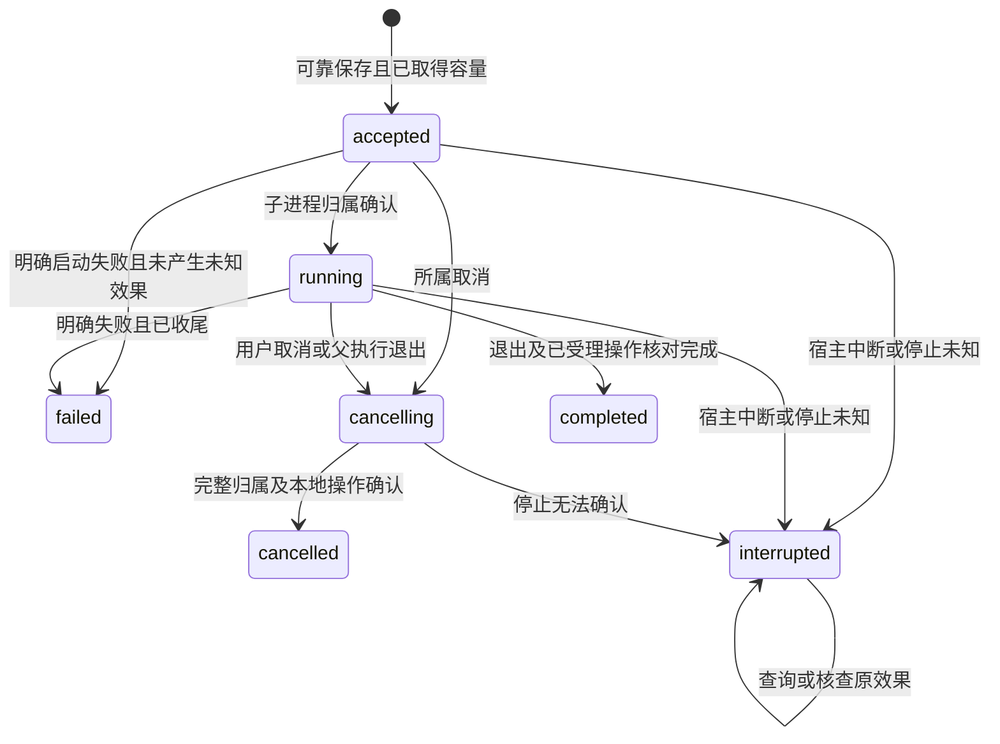

# Agent delegation delta

## Purpose

为普通会话提供一次可核查的有界子 Agent 委派，让调用方明确交付工作、材料、角色、模型及权限，并在真实独立执行后取得保存成果、发现、未完成项和障碍。通用委派只保障执行和交接事实，科研流程、原材料判断及整体交付验收仍由负责 Agent 和所属领域承担。

## ADDED Requirements

### Requirement: 明确工作包与可靠委派身份

系统 SHALL 接受当前有效父执行提交的有界工作包，包含目标、初始材料、允许操作、输出范围、交付及检查要求、角色和模型选择。宿主 SHALL 派生父子执行归属，先可靠保存稳定委派身份及实际配置，再允许子执行产生效果；调用方不得自报父实例或工作域扩大权限。同身份同输入重复提交 SHALL 返回原委派，不重复启动；同身份不同输入 SHALL 拒绝。首批子执行不再发起委派，不创建永久子会话树，也不自动创建研究任务。

#### Scenario: 受理回执丢失
- **WHEN** 工作包已可靠受理但父执行未收到响应，随后按原身份补交或查询
- **THEN** 返回原委派和真实状态，不启动第二个子执行或重复创建成果

#### Scenario: 旧实例或保存失败
- **WHEN** 旧父实例提交工作包，或必要委派记录不能保存
- **THEN** 在子进程启动及材料外发前拒绝，不能以先执行后补记录代替可靠受理

### Requirement: 角色与独立执行上下文

角色 SHALL 声明稳定身份、版本、指导、可用工具范围及可选命名模型配置。系统 SHALL 保存实际采用的角色内容、有效工具范围和模型配置，缺少角色或命名配置时明确失败，不静默选其他角色／模型。子执行 SHALL 只取得明确工作包与角色指导，不自动导入父 transcript、摘要、checkpoint 或临时文件；子执行临时区与父和其他子执行隔离。明确资源和可信来源事实可以交接，来源不授予窗口查询或材料权限。

独立初审 SHALL 使用原始材料和标准，不预置主 Agent 拟结论或其他审阅意见；默认保存意见／候选修改，直接改稿必须有明确修订职责及相应权限。harness SHALL 不定义科研角色正文、审阅流程或达标规则，也不以文本关键词检查声称证明内容独立。

#### Scenario: 独立初审
- **WHEN** 父执行委派对同一原材料的独立初审
- **THEN** 子实际模型输入只包含指定原材料、标准和角色指导，没有自动附入的父分析或其他意见；意见保存后由负责 Agent 核对

#### Scenario: 同名临时文件
- **WHEN** 父执行和两个子执行分别在临时区保存相同相对名称
- **THEN** 各自只能读取自己的字节，不能经文件工具读取对方 scratch、checkpoint 或凭据

### Requirement: 有效工具及材料权限交集

子执行权限 SHALL 为父有效权限、角色工具范围、工作包限制及所属领域当前授权的交集，并由宿主在实际工具、后端文件操作和模型请求入口执行，不能只隐藏工具描述或依靠提示语。子不得通过 SDK 默认文件工具、工具别名、broker 参数或资源引用绕过范围。读取与修改 SHALL 经所属领域核对身份及内容依据，材料变化返回结构化失败，不能改读同路径替代对象。撤权阻止后续依赖操作及模型外发，保留已发送内容和已保存成果的事实。

首次修改 SHALL 精确匹配工作包允许save输出的ref与basis；同一对象的可读材料版本不得成为写入授权。后续修改 SHALL 仅沿本委派已确认的最新保存依据推进，继续保留同资源在途／未知意图保护及领域条件保存。

#### Scenario: 同文件的只读新版本
- **WHEN** 工作包仅允许保存文件V1，同时允许读取同一稳定ref的V2，子读取V2后请求保存V2
- **THEN** 在新写入意图及领域保存前拒绝，文件V2保持原样，不从读取权限派生写入授权

#### Scenario: 只读审阅试图改原稿
- **WHEN** 子角色允许审阅和保存指定报告，但请求保存或重命名未授予修订职责的原稿
- **THEN** 宿主拒绝该动作，原稿保持不变；允许的报告仍能沿项目保存能力生成

#### Scenario: 材料变化与模型排队撤权
- **WHEN** 子读取原依据后材料发生变化，或后续模型请求排队时对应外发权限撤销
- **THEN** 旧依据读写或新模型请求被拒绝，保留原依据和原因，由负责 Agent 决定补读或重新审阅，不自动认定旧意见适用

### Requirement: 受管子执行及有界等待

子 Agent SHALL 使用独立受管 OS 执行进程，沿现有父实例链、宿主准入与模型控制运行。父等待子结果仍占进程名额；子容量不足 SHALL 立即返回资源不足，不排在占用容量的父执行之后。异步受理 SHALL 尽快返回稳定引用，调用方可有限等待或查询；等待到期只返回仍在进行的状态，不等同取消、失败或模型终止。查看状态 SHALL 不触发执行。受管平台不可用时在创建子执行前拒绝，保留人工功能和已有成果。

#### Scenario: 仅剩父执行容量
- **WHEN** 父执行占用最后名额并提出委派
- **THEN** 委派即时返回 resourceLimit，不启动子进程、不加载材料，不制造父子互等死锁

#### Scenario: 有限等待到期
- **WHEN** 等待在子仍运行时到期
- **THEN** 返回同一委派的实际进行状态，子仍受所属监督；后续查询不重复启动或取消它

### Requirement: 结构化结果与实际保存分离

结果 SHALL 包含发现、实际保存资源的稳定引用及内容依据、未完成项和障碍，并能核对所属工作包、角色／模型及实际读取依据。实际产物 SHALL 来自所属领域确认的保存／创建回执，不能将期望输出路径、子口述成功或 scratch 当成成果。执行完成、保存确认、关联及科研验收 SHALL 分别表达；缺报告、未保存输出、关联失败或效果未知不得包装为完整交付。父执行 SHALL 能通过共同资源端口读回实际成果并核对当前版本，结果读取不重新写入。

#### Scenario: 子保存成果而关联失败
- **WHEN** 子报告已写入，所属文件保存确认但成果关联待核查
- **THEN** 返回真实资源及独立关联状态，保留文件，仅核查／补关联，不重新生成文件或宣称交付已完整

#### Scenario: 只有文字成功
- **WHEN** 子执行正常结束但未保存工作包要求的报告，或返回未被实际保存回执支持的路径
- **THEN** 执行状态可为完成，成果状态明确缺失或未完整，不把口述路径当成已交付资源

#### Scenario: 兄弟复用客户端创建身份
- **WHEN** 两个委派为各自明确输出使用相同客户端operationId
- **THEN** 宿主分别绑定领域操作身份并核对实际项目及路径，不能取得兄弟成果收据或将其列作自己的成果

#### Scenario: 后续修改结果未知
- **WHEN** 同一成果已有确认回执，后续实际保存的发布结果尚未确认
- **THEN** 保留修改前持久意图及未知状态，旧回执不能使委派宣称完整可用，也不能自动重放该修改

#### Scenario: 旧版本或并发修改
- **WHEN** 子使用本委派旧保存版本再次修改，或同一资源已有在途／未知修改
- **THEN** 在新修改意图和领域调用前拒绝；旧版本拒绝不制造未知副作用，已受理的修改仍按真实回执收尾

### Requirement: 所属取消与重启核查

取消 SHALL 仅作用于调用方拥有的子执行及已受理操作；父取消、失败或退出 SHALL 撤销后续动作资格并收尾未移交的子工作。首批不提供后台移交。仅在完整归属停止且已受理操作已完成或停止时 SHALL 报本地取消／完成，未知停止保留容量和原记录。迟到结果只能补原委派事实，不能覆盖新实例状态。重启 SHALL 将未确认委派标为中断，查询不恢复，已完成结果和成果保留；新父推进先核查旧实例和效果，不能自动重放未知操作或从根 PID 消失推定安全。

#### Scenario: 父进程退出但子保存仍在收尾
- **WHEN** 父执行退出且子关联的领域保存已受理但尚无确认结果
- **THEN** 阻止子后续动作并等待实际收尾，保留取消中或中断及效果未知，不能因两个 worker 已退出就报告取消成功

#### Scenario: 重启后旧子未确认停止
- **WHEN** 新宿主读到旧委派和未确认退出的所属实例
- **THEN** 状态可查询，已保存成果仍可核查，相关新推进被保护且不自动恢复；其他无关会话继续可用

### Requirement: 会话内观察与领域独立验收

用户 SHALL 沿父会话查看委派、实际模型、状态、阻塞原因和成果并取消所属子执行。dock／overlay SHALL 共用来源、草稿和操作，刷新／切换／断线不重发委派或清空后续草稿。列表、详情、工具预览与状态刷新 SHALL 有界，只加载所选会话及展开委派，不依赖全库、其他视图 DOM 或全部子日志。资源打开 SHALL 复用共同入口。诊断 SHALL 能区分发送、受理、worker启动、模型准入、工具效果、停止确认和结果刷新。工程验收不代替科研质量判断。

#### Scenario: 关闭界面后重连
- **WHEN** 用户关窗而父子仍受内核监督，稍后重新打开父会话
- **THEN** 读回原委派的实际状态和成果，保留草稿，不创建新子执行或切换工作域

#### Scenario: 查看其他会话并取消旧子
- **WHEN** 委派查询或取消回执在用户切到另一会话后返回
- **THEN** 只更新原委派事实，不能覆盖新会话内容或取消新会话执行

### Requirement: 可证明的执行事实供领域消费

系统 SHALL 提供有界内部查询，从宿主实际CallContext核对当前Agent的principal、project/session/run/instance及持久委派关系；不接收调用参数中的替代身份，不向模型或公共产品入口开放。查询 SHALL 复用当前执行资格检查，不授予新权限。根实例可确证无父委派；子实例仅在delegations与实际父实例、run、session一致时返回委派身份，否则明确unknown。失效执行与重启后的旧上下文 SHALL 为unknown，不从历史配置或同run推断作者。instructionContext及精确tool来源在本阶段 SHALL 明确unknown，不生成候选作者；领域在实际操作受理时保存其取得的事实，harness不另存FileEdit权威。

#### Scenario: 父子保存使用各自实际实例
- **WHEN** 根执行和通用委派子通过真实资源端口保存，所属宿主以各自实际CallContext查询
- **THEN** 返回各自已核对的实例，只有子得到匹配的delegationId／parentInstanceId／parentRunId，instructionContext和tool均为unknown

#### Scenario: 迟到或错误的执行上下文
- **WHEN** 原上下文已退出、取消、重启，或传入的实例不属于该session/run
- **THEN** 无法核实的事实返回unknown，查询不恢复执行、不扩大权限、不把旧委派链赋给新实例
