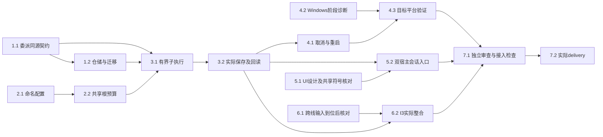

# 执行任务

用户随后明确要求“实现该change”。本线独立实施与Linux验证已执行，实际结果见[delivery](delivery.md)；未到位的跨线输入与目标平台验证继续保留未完成，不因CLI工件齐备而视为已交付。文件／符号范围以[design](design.md#文件变化)为准，原始失败与待输入见[investigation](investigation.md)。本线主Agent负责整合及最终接受。

图中E和D受外部输入影响，未闭合时其他独立分支可继续；Z可记录实际中途交接，最终验收仍需W及I。公共文件由本线提供者维护具体增量，dev接入者验证组合，不创建常驻协调Agent／DAG。

## 1. 工作包、可靠受理与所属仓储

- [x] 1.1 在`delegation-contracts.ts`落实工作包、角色、结果及有界操作声明；新增DTO与材料／输出边界复用ResourceEvidence。检查同身份同／异输入、不可伪造父身份和超限拒绝。完成依据：原schema运行时校验及派生类型覆盖实际调用；不把静态文案／字段顺序作为测试。本线独立增量已接线；原科研execute／Graph参数未改。与科研线共享符号的组合核对仍归6.1，不代表已收到对方结论。
- [x] 1.2 在harness schema/records新增委派表及查询，宿主容器v4→v5增量升级；受理／结果持久化先于效果和回传。扩展原迁移／备份验证，核对原信任、旧数据、升级失败／重试、恢复副本和未知实例保护；不重走v4信任迁移。完成依据：真实SQLite与文件样本，原记录及成果保留，无副本自动执行。此项为原单域稿证据；主线已发现与计算v5冲突，正式公共接入改由计算组合，本轮仅交DDL／restore事实，不改迁移入口或版本。
- [x] 1.3 随本线提供者接入broker操作、业务和内部映射、architecture消费列表及宿主注册；从schema生成并比对，不手工复制DTO。完成依据：生成器self-test、架构检查、实际handlers类型检查及合法／非法调用；缺提供者明确unavailable。本线注册已独立验证；共同执行DTO／注册组合交换及dev接入验证仍归6.1。

## 2. 命名模型与共同额度

- [x] 2.1 models实现命名配置的有界读取、按修订保存／移除与内部解析，沿当前MiniMax目录和私有原子文件保护。扩展已有模型配置测试覆盖修订冲突、损坏保留、非法能力组合、缺失显式引用、父继承和已受理配置钉入；公开状态无密钥。不增加供应商或安装依赖。
- [x] 2.2 提取宿主私有根请求预算，父、原科研能力子执行和不同模型通用子共享计数，每个执行保留自己descriptor、signal、authorize、lease集合。扩展`model-admission-integration.spec.ts`及`model-access.spec.ts`，覆盖不同模型共32次、压缩／安全重试计入、排队撤权、子取消不释放父租约和全局并发1。完成依据：受控HTTP实际请求数与资源释放，不能仅断言调用次数。

1.1与2.1可在明确写入范围下独立推进；共享`protocol/models.ts`和宿主装配由本线主Agent整合，不安排重叠写者。

## 3. 首个真实父子成果闭环

- [x] 3.1 `Delegations`沿RemoteAgent和原静态worker实现受理、角色解析、一层子执行、独立scratch及有效工具／Backend交集；父工具走原IPC与broker。源码注册通用角色，科研指导使用明确测试替身。新增`agent-delegation.spec.ts`的核心代表场景，复用现有模型夹具；实际父子PID／受管身份不同，父私有标记及兄弟scratch不进入子输入，容量不足在读材料／启动前即时拒绝。
- [x] 3.2 子通过真实资源提供者读指定材料、创建报告、提交结构化结果，父按实际ref/basis读回；保留实际读取、保存、缺项、障碍和association。覆盖旧依据／同路径替换、只读角色越权、只有口述完成、保存成功关联失败及回执丢失。完成依据：真实文件与仓储、原创建核查／reconcile，报告内容对照独立输入和预定标准，重复身份不重复写；不得用期望路径或scratch当成果。
- [x] 3.3 有限等待、get/list和结果持久化接入同一状态，工具消息保存结构化delegationId；到期不取消，重复查询不执行，列表／结果／在途等待不超协议边界。复用现有IPC校验和消息机制，检查超限拒绝及完整结果经ID重读，16KiB预览不替代完整恢复结果。

首批独立结果为1、2和3组：真实项目／资源／broker／受管worker，仅外部模型受控；不依赖任务提供者或具体科研Graph。它们完成不等于跨线I3或科研初审质量已验收。

## 4. 收尾、重启及基线故障证据

- [x] 4.1 扩展execution-isolation、capability-stop-unknown／harness-recovery中适用机制并补通用委派行为：子崩溃、父正常退出／失败、局部与父链取消、已受理保存未收尾、停止未知保占用、旧实例迟到。重启查询保原结果且无新模型请求；新父推进先核查旧效果，不重用旧ID重启，不从根PID消失释放保护。完成依据：实际进程及领域操作，不能以AbortSignal或RPC返回替代停止确认。
- [ ] 4.2 最新已完成完整CI基线为caf9025/40455958976：Linux743通过/1失败/26跳过，Windows687通过/41失败/42跳过，macOS人工UI13通过/1失败、fallback2/2、入口4/4。原日志与分组在`/tmp/scholoom-round9-acceptance-IER31D/ci-baseline-*`，不沿用旧4失败清单。4312262的Windows诊断40476577132已completed/failure；agent三例逐例均失败，实际为模型0请求、run queued/指令accepted且未到委派或reader，不能据用例名归取消/附件故障。原附件与初始化前后缺证见delivery。新Checks40476577071在2026-10-27 09:06:51 UTC查询仍运行，不推最终状态。当前增量仍需目标实跑；不改生产期限/停止/容量，跨域启动问题交主线/计算。
- [ ] 4.3 Linux与Windows真实验证两个受管执行、产物回读、取消和重启，按4.2诊断修复影响验收的基线失败后定向复验；macOS核对明确不可用与人工保留。复用`tests/execution-diagnostics.ts`并附阶段材料；同组基线仍失败时如实记录，不把Linux通过当三平台完整能力。

## 5. 现有会话内呈现与设置

- [x] 5.1 将委派工具详情和命名模型表单局部分节写入`docs/ui-design/README.md`，核对阅读线两份独立design及`ToolCall`、business-session、Workbench薄接线和设置区具体符号；不自行定义报告运行／批注修订。主线正式快照现已消费，逐项范围及路径见design公共对接。闭合的是设计／符号核对，未将阅读代码合入或独立UI通过当作公共组合验收。
- [x] 5.2 接`DelegationCall`、ToolCall、会话来源和现有模型设置，复用语义token和共同资源打开；dock仍最新tool、overlay展开父记录，局部停止只取消所属子。双宿主经composer启动真实父子、查看实际结果、打开文件并停止；覆盖会话切换、关窗重连、迟到查询／取消回执、草稿及命名配置冲突。完成依据：浏览器及真实Electron内部接线，模型仅HTTP边界受控；依赖缺失保留待验，不运行setup安装。
- [x] 5.3 在实施授权范围内按独立公共增量修正已证实的harness UI gate路径错位，保留迟到保存／草稿保护；对analysis.md为空取得实际创建／读取／工具阶段依据再决定修复。完成依据：原场景双宿主定向通过，不能删gate、隐藏读取异常或用更长timeout掩盖原因。更新开发说明中的实际委派／诊断入口与仍有限制。实际修复及原失败阶段记录见delivery；未改变产品超时或科研实现。

## 6. 跨线输入与I3整合

- [ ] 6.1 公共同步及真实TaskPort已随1026796进入本树，机械接入归10.2；仍缺科研委派角色ID、版本、guidance及原材料／标准。固定图及成果role不能代替实际科研角色，保留完整任务未完成，不再等待同一公共方案或TaskPort同步授权。
- [ ] 6.2 本线负责I3实际整合：无任务真实资源闭环已有3.2证据，真实TaskPort的通用worker机械子范围归10.2；科研实际角色及质量仍开放。初审提供原材料与独立标准，不注入其他审阅结论；分别保存结果及负责Agent判断，不把机械闭环或模型受控样本当真实科研验收。

## 7. 审查、接入与实际交付

- [x] 7.1 取得实施结果后独立核对权限／预算、迁移数据保护、父子收尾和真实结果；审查者取得原契约、材料及标准。主Agent完成必要修复和最小定向验证、生成映射及diff检查；dev接入验证由当次接入者负责，跨线任务未完成明确保留，不宣称全仓CI或科研质量通过。
- [x] 7.2 根据实际执行结果填写同一`delivery.md`，区分真实内部接线、模型／角色／关联替身、目标平台和未完成输入，逐项核对proposal判据后更新状态。已记录实际中途交接；剩余任务保持开放。提交、推送、PR及归档均须另有实际授权。

## 10. 共同领域接入后的真实整合

- [x] 10.1 基于1026796共同基线将executionFileFacts/fileOrigin改为可等待窄端口，默认经broker消费真实executionFacts；保存临界区前等待，等待后复核执行，保留同步注入及projects原CAS，不在SQLite事务等待。验证实际父子FileEdit/editId、unknown、旧实例、撤权与取消。完成依据：execution-facts与file-edit-origins实际内核回归，含不同父子来源、原edit读回和异步期间取消/撤权无发布。
- [x] 10.2 验证通用worker的TaskPort机械I3：父tasks.read取得入口及依据，以ResourceEvidence交子；子仅按原资源权限保存，父重读并tasks.save关联result/workItemId。覆盖材料变化、关联冲突和取消，保留成果及未完成项，不扩子tasks/program权限，不自动建任务。完成依据：delegation-task-port四场景真实内部接线；首次模型gate夹具失败及修复保留，机械范围不等于科研质量。
- [x] 10.3 先构建后运行最小内核组合及必要双宿主委派正例，记录首次失败、替身与最终结果；整理相对1026796的独立增量。完成依据：组合45/45、准确工具名补验1/1、双宿主正例2/2及静态检查；补丁/日志见delivery。6.1/6.2的科研角色/真实质量与4.2/4.3目标平台保持开放。

## 续做入口

本轮基线4312262c1a1f432ccd706dd1eb6ff6468765fd4e，公共增量已同步。第13组已接收，取消/excerpt不再沿旧设置失败描述；第14组只核第二个附件reader的首次失败与局部因果。保留导入段已完成的独立证据及全部既有授权/恢复。

## 14. 第二个附件reader的独立观察

- [x] 14.1 在readScope发送和首断言前复用独立observer，保留原首次失败、模型/工具/实例阶段与停止前末状态；导入与reader按实际session分开，不能借用已停止的导入observer推断reader。完成依据：reader-red两份独立scope附件，reader起点模型计数2、首次失败4027ms/最后实例stopping；原helper无新增机制。
- [x] 14.2 用原时限红测和必要隔离观察核对reader的模型请求、工具开始/回执及实际停止；局部因果闭合后先补设计再修最小夹具点，或交精确跨域/缺证方案；保留原字节和权限断言，不改生产期限。完成依据：临时reader-observed保留4022ms原失败，4390ms同run已completed/实例exited、实际模型字节匹配；设计补证后仅reader轮询改[100,250]，原5秒不变。正式组合reader4910ms完成且原字节断言通过；后续撤权新指令等待仍失败，不扩修。
- [x] 14.3 先构建后运行附件/cancel/excerpt最小组合及静态检查，核4312262新Windows诊断逐例结果；保留首次失败与最终结果，取delivery instructions更新同一交付记录并导出独立增量后停止，不关闭平台/科研整项。完成依据：组合2通过/1失败，最后失败在撤权后新指令等待failed（当前190行），原reader observer已完成，不能解释新阶段。类型/Biome/OpenSpec/diff及补丁检查通过；Windows原三例目标失败证据已消费，尚无本增量目标结果，见delivery当前节。

## 13. 父子启动后的真实取消

- [x] 13.1 保留原5秒失败及主线独立时间线，用现有有界诊断标记父模型/派发/受理/child onStart实例/running/取消/停止/重启；在隔离观察实验测得各阶段，不合并不同运行状态。完成依据：原红测、保留原失败的startup-probe与各自execution-stages；新增16条有界标记及显式afterEach安装，见delivery本轮记录。
- [x] 13.2 按当前契约与独立测量闭合特定夹具阶段预算，落实对应阶段等待，保留同工作包/childHold/真实父子、完整停止和持久化断言；原生产期限不变，无sleep/重试掩盖因果。完成依据：四阶段各5秒/累计名义20秒、原60秒用例上界；原取消确认及持久化断言保留，增加不同实例/PID断言，单项和相邻组合取消均通过。
- [x] 13.3 最小正例/相邻回归与静态/OpenSpec/diff检查，核对最新已完成CI的实际范围；取消稳定后仅按同一观察器核对Windows附件完成等待，能证明共同根因才修。更新原delivery并交相对0b78815独立增量后停止。完成依据：真实报告回读/父收尾通过，最后组合2通过/1失败；附件首轮在原5秒内完成并验证实际字节，局部采样间隔修正，后续reader等待仍失败且不扩修。类型/Biome/OpenSpec/diff通过；控制失败实验只在/tmp，平台及科研整项保持开放。

## 上一轮诊断范围（历史）

当前基线为8a2f0ce522dfbab4110e63e84e542f6660e6115e。第12组只做首次失败前的有界诊断及excerpt本机反例；context-session已验收不重做。报告授权/生态持续外发/可信FileEdit及原工具恢复保持共同状态，不改生产恢复、delegations白名单或bootstrap。

## 12. 首次断言前的诊断与excerpt反例

- [x] 12.1 在原execution-stages入口复用可提前安装的采集器，before send/首轮询订阅；缓存有界run/instance/modelRequests/工具与worker启动退出状态，finally停采、afterEach仍可附缓存，隔离并脱敏，不依赖expect之后才取证。仅接excerpt及委派取消代表场景。完成依据：真实首次失败附件、临时早期失败缓存及永不返回snapshot实验；固定失败边界，诊断错误不进入业务断言，超时停止新采样，详情见delivery。
- [x] 12.2 先构建后在原时限复现real worker excerpt，取得首次断言前的实际阻塞阶段；用受控临时失败证明附件存在且正式用例不留故意失败。有明确本域夹具根因才修，跨域/生产疑点交精确证据与最小方案。完成依据：原5秒轮询约4.03秒提前结束，而同一执行约4.46秒正常完成；仅缩短该用例采样间隔，原5秒期限及payload/checkpoint断言通过。取消用例末次仍accepted失败，保留具体阶段，不宣称其已修。
- [x] 12.3 核对39be889/40432749785旧CI与8a2f0ce自动CI已完成证据，运行必要最小回归及静态检查，更新原delivery并交独立增量。完成依据：最后正式组合2通过/1首次running等待失败及缓存JSON、此前3/3与单项结果分开保留，控制实验1/1、类型/Biome/OpenSpec/diff；新Windows定向证据与完整Checks查询状态分别记录。不把诊断新增当Windows已修，不推定四项context通过。

## 上一轮续做依据

本轮续做基线为4b13183f7489d3cae12fd0a7d1a9e83fb33d7384，M2/TaskPort及持续库外发授权已被主线接收，保留现有实现。下列第11组限定最新CI诊断与首个有证据修复；不重新等待公共同步。

## 11. 最新Windows证据与共同会话夹具

- [x] 11.1 核对6b22d60/Checks40315429083的实际日志及可取得artifact，分组agent-delegation取消/重启、harness-recovery和context-instructions，区分模型0请求、执行/成果/停止阶段；ownership16通过1跳过与完整49失败分别表达。完成依据：定向下载Windows diagnostic，157条目及16个失败trace，分组/精确缺证和两项生命周期输入见delivery；不推断queued即worker未启动，不并改bootstrap。
- [x] 11.2 原时限复现context-session双平台共同失败，依据页面错误核对实际会话选择/异步草稿夹具，只修已证缺口；保留拒绝、迟到和unknown回执保护，不force click或改生产授权/期限。完成依据：Linux原60秒红测与trace确认client.subscribe缺失导致挂载失败；仅补同步订阅/connected快照后原完整场景1/1、原草稿回归1/1通过，无新Windows通过结论。
- [x] 11.3 先构建后最小定向复验，保留首次失败和诊断；更新本delivery并交相对4b13183独立增量。完成依据：共享/内核构建、context-session红/绿及context-drafts回归、tools类型与Biome/OpenSpec/diff检查；补丁及证据包见delivery。没有新目标Windows结果不关闭4.2/4.3；完整科研角色/质量仍开放。

## 上一轮续做依据（历史）

本轮HEAD为1026796d854b8f568c3e819f13268a9638980bc1，七域正式源码已共同接入，用户明确授权第10组。公共历史／v6及真实TaskPort均已在本树，不再应用旧累计补丁、等待同步或复制/tmp源码组合。科研角色及真实质量和Windows仍开放，机械I3不关闭完整6.1/6.2。不自动同步其他树、递归／advisor／跨会话通信、推送或归档。

## 8. 主线第二阶段验收修复与对接

- [x] 8.1 A1沿session.send→delegate_agent真实受理复现：输出V1、只读材料V2时错误进入领域写入。修复首次精确输出ref+basis，保留最新确认回执链、同ref在途／未知意图和原领域CAS；新增代表性反例并复用合法连续保存及原竞态用例，保存首次失败与最终结果。
- [x] 8.2 消费本次正式快照并记录精确来源；完成阅读双design符号核对、TaskRef／四操作与执行来源／restore事实表，给计算DDL及v4升级保护条件，准备本线公共增量patch。Windows按现有日志分类并保留缺证，AgentUI首次装载失败和隔离4/4分别记录。该项仅准备／核对，不代表公共接入、迁移组合或I3验收。

## 9. 公共同步后的实际领域接入

- [x] 9.1 只读确认HEAD=2cb6aed4d0f3034ca2d1426858a64a0039e51ede、0519904祖先及起始clean，消费主线同步构建／34项内核证据；保留harness.executions、Graph来源、统一v6、资源叶及双窗口基础，不改迁移链。主线证据见同一delivery，不扩大平台／科研结论。
- [x] 9.2 提供内部harness.executionFacts：只从实际可信CallContext核对当前principal/session/run/instance及持久child-parent委派关系；参数为空、结果有界、无模型工具／公开入口。失效或无法证明返回unknown，instructionContext/tool明确unknown；不推断文本／配置作者，不增加FileEdit来源权威。经真实保存提供者取得父子上下文，验证根／委派／错误实例／重启失效及原history兼容。
- [x] 9.3 先构建再运行最小父子、A1／首次创建权限、父退出／取消、恢复及公共history组合；从最终schema生成映射。把公共执行事实端口与本线领域接线分别整理为可审查补丁，保留实际调用方、注册和测试；更新同一delivery后停止。任务引用保持可选，未同步真实任务提供者不强行引入TaskRef／workItemId或宣称I3。
