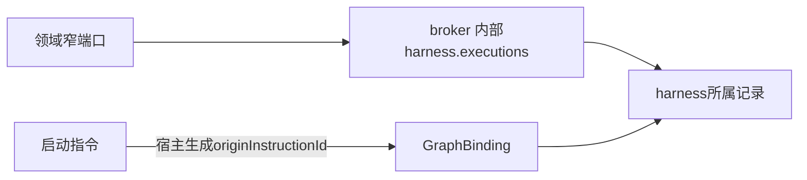

# 实现设计

## 变更总览

## 方案与接口

`harness.executions`输入projectId/sessionId，且runId、instructionId、originInstructionId三个选择器恰有一个；offset/limit默认0/25，最多100。返回`{runs: Run[], nextOffset?, instruction?: Message}`，按attempt升序及id稳定排序，整个响应最多512KiB，单条超限返回tooLarge。按指令查询复用instructions的runId并返回同会话原Message，供领域在回执未知时只读核对完整原输入；消息缺失明确unavailable。其余选择器不返回指令，没有该会话记录返回空页。入口只接受内部host/system，来源范围若已绑定须匹配请求。

GraphBinding增加可选originInstructionId；首次显式选择由输入instructionId建立，新显式选择强制新run，普通session.send沿原来源接续。宿主将来源放在registered execution.initialize根字段供节点稳定派生成果身份，不能由用户config自报。旧无来源记录不推断历史；checkpoint格式保持。宿主注册接线、architecture的实际消费声明和生成映射由父Agent整合，科研业务代码不属于本公共增量。

## 文件变化

本增量拥有protocol的graph-contracts.ts／harness-module-contracts.ts／execution-graph.ts、harness runtime.ts内查询及send来源绑定和worker根输入、派生harness-module-types.ts，以及独立execution-history测试。application.ts只新增同源提供者，architecture只新增实际消费边；不依赖未合入科研实现。开发说明增加本接口语义。

## 验证与风险

复用真实KernelApplication／broker／worker夹具，核对原指令、分页、跨会话隔离、取消后新run、同配置显式新启动及重启查询。类型／架构／生成检查及registered-graph回归由主Agent运行。来源只记录控制关联，不能扩大材料授权或代替研究事实。

## 公共切片与Agent符号组合

本轮正式交接输入为 `/tmp/scholoom-phase2-handoff-VZS5mS/manifest.json`、`acceptance.md`、`coordination-plan.md`，以及同包 `agent-delegation/` 下相对路径相同的源码；manifest标明基线e3d58fc。只读核对快照，没有操作其实际工作树。主线未发现本增量确证缺陷；A1属于Agent授权修复，不能据本线测试判定已修复。

公共代码补丁只包含9个文件：graph-contracts.ts、execution-graph.ts、harness-module-contracts.ts、harness-module-types.ts、harness/runtime.ts、kernel/application.ts、architecture.json、development.md、execution-history.spec.ts。application只增 `harness.executions` 提供者；architecture只在已有research模块增加此消费。测试中的已存在research宿主是最小消费者，不需要ResearchGraphRuntime。补丁不含科研Graph DTO／目录／记录／节点、research.startGraph、ResearchRuntime装配、业务映射、科研恢复改动或生产图注册。OpenSpec公共工件另为第二份补丁。

| 共享文件／符号 | 组合方式与验收要求 |
| --- | --- |
| harness-module-contracts.ts：harnessModuleOperations | 保留Agent的 `...delegationInternalOperations`，并增加本线 `harness.executions`；不得二选一。三方文本探针此处1个冲突 |
| harness/runtime.ts：protocol/harness命名导入 | 合并Agent的delegationInternalOperations／delegationReferenceSchema与本线harnessModuleOperations；三方探针此处1个冲突 |
| runtime.ts：executions／acceptedInstruction／send／registered初始化 | 本线新增只读查询、统一五个重放校验点、等待后的latestRun刷新、显式选择另起来源、普通接续继承来源及worker根字段；保留Agent的delegations／delegationRoles／delegate等方法、delegationOptions构造参数、委派取消与工具路径。文本自动合并不能证明生命周期相容；接入后复跑并发重放及委派取消／恢复 |
| kernel/application.ts：constructor／runtime-internal | 仅加本线harness.executions注册及范围检查，保留Agent的modelConfigs、delegationRoles、resolveProfile和全部委派提供者；本公共补丁不改constructor，不引入researchGraphs。三方探针无文本冲突 |
| architecture.json | 保留双方实际消费／导入声明；本补丁只增加research→harness.executions。不得用本树整个配置覆盖Agent／项目／计算增量；探针无文本冲突 |
| harness-module-types.ts及最终派生映射 | 接入最终共同schema后统一运行生成器，以apply_patch写回并格式化；不拼接两份生成结果 |

三方探针使用共同基线、Agent正式快照和公共切片，在临时文件中运行git merge-file，只用于定位上述符号；未把Agent私有实现复制到公共基线，更没有运行组合提供者。具体输出与补丁路径见delivery。先公共增量→主线dev接入及Agent符号组合验证→用户同步消费者→科研／项目真实I1、Agent I3各自验收；本轮停在公共补丁和消费设计，接入门见tasks 4.1。
