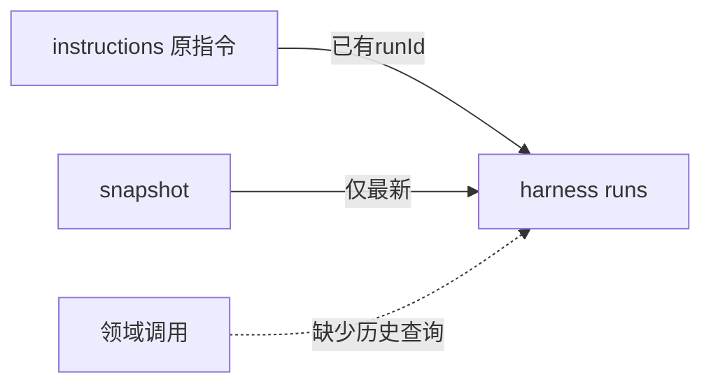

# 调查依据

## 当前事实与复用选择

源码基线e3d58fc：`Harness.snapshot`只返回latestRun；`instructions`已保存真实runId，`runs`保存Run和GraphBinding。`send`在取消或配置不兼容时新建尝试，当前没有稳定的来源字段。直接复用这些表及公开Run schema，不复制执行状态。

## 影响方案的未知项与实验

用户已选择G1方案A。来源字段由宿主从首次指令生成，不能由Graph或请求自报；普通接续继承，新的显式选择另起来源。历史无来源记录按已知run／指令读取，不猜测补链。无需实验决定架构，实际分页、幂等及真实worker边界交tasks验证。

## 结论与承接

采用内部`harness.executions`，只查询指定会话内一个明确选择器，返回现有Run及分页游标。科研按来源关联实际尝试，不改通用执行driver或checkpoint格式。
