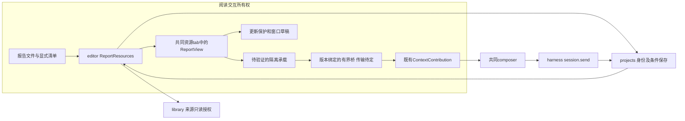
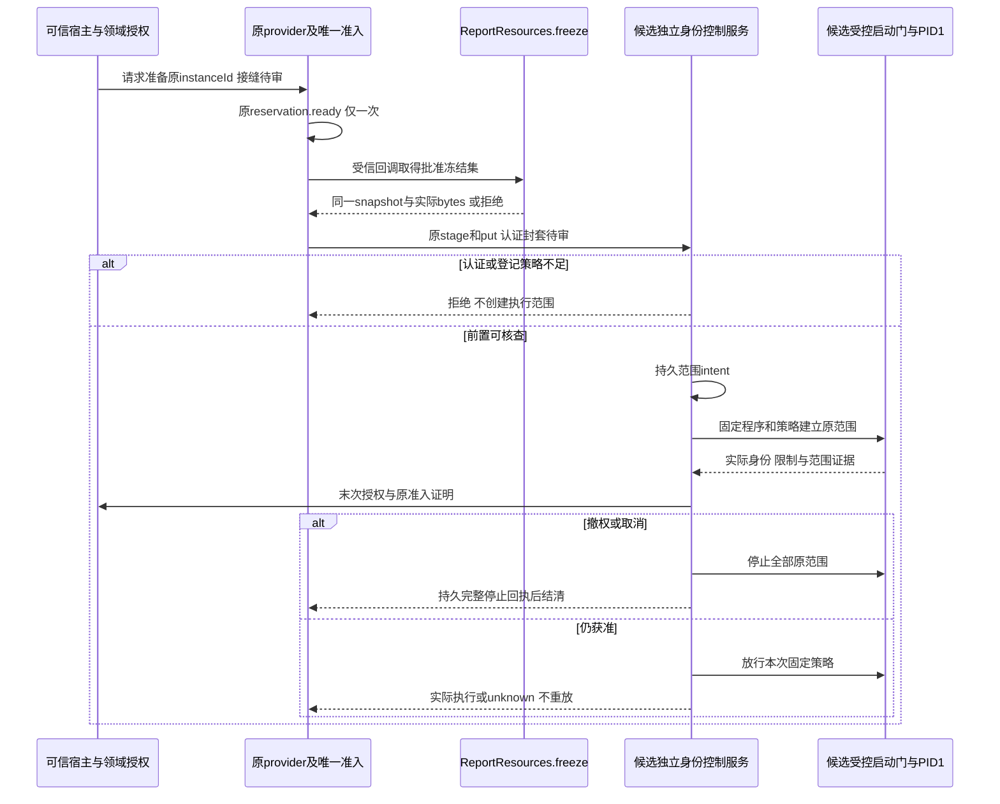
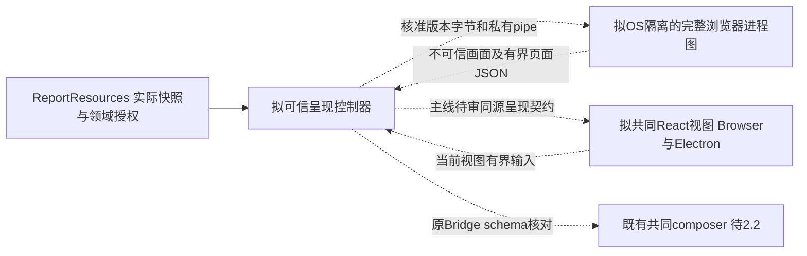
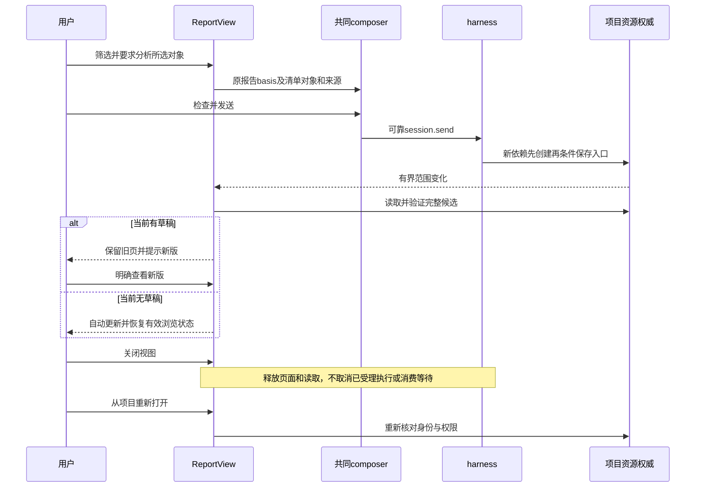

# 实现设计

## 变更总览

用户已采纳 [investigation](investigation.md#已获得本轮产品选择) 的项目内有界产品范围；资源及来源授权、冻结字节、历史与严格单目标读取现已接入，实际结果见delivery当前节。活动承载仍待完整隔离浏览器及呈现方案，不以原生样本或读取能力代替2.1b。下方候选A的高FD／SCM_RIGHTS／stdio及普通文件门为已执行调查，结果由investigation维护；既有资源限额保持，实验保护值不是产品执行／呈现预算。

ReportResources 是 `packages/editor` 内的 module，不新建包／数据库或进程。它通过小接口集中资源清单、版本核对和有界交付；真实 projects／library adapter 与隔离测试 adapter 构成实际 seam。ReportView 只消费已核对的快照，页面只见允许的本地字节和对象，不见 KernelClient。

## 方案与接口

### 第17轮主线接收与下一片

主线接收独立身份服务候选及`createReportContext`消费者；实际验收见delivery。本轮选定以下边界，替代候选研究中尚待主线决定的对应条目：

- **账户信任**：原登录用户及正常内核属于可信工作机；不可信报告及其后代处于独立受限身份。原spec限制的主体是报告脚本，不新增抵御已控制可信账户的任意同UID程序的承诺。peer UID只证明账户，不证明程序代码；正常接线仍从原真实reservation和实例建立授权，不能让页面自报ready、身份或容量。报告取得可信连接／FD／代理就是隔离失败，不能排除为宿主失陷。无需为这个候选迁移整个内核或复制准入权威。
- **执行方向**：继续独立非root控制身份、每实例受限身份及系统管理器固定启动门的候选；部署、账户、策略和管理权限只形成具体安装方案，本轮没有安装／加载许可。原同UID固定入口反例保留，不将账户信任当作该入口已安全的证明。
- **准备接缝**：批准provider内的可信准备方法；输入固定instance／program／policy及私有回调，回调在同一reservation.ready后产生入口路径与有界实际文件字节。排队仅保留最小内存意图，同实例复用同一准备Promise；尚未创建OS范围的准备不伪造完整stage记录或长度。实际清单形成后建立原持久intent、复用原文件／put逻辑并保持唯一租约，不能再调会reserve的公开stage。取消先封住后续效果，在途回调结清前不释放其准备容量；创建范围前没有持久intent不得start。创建可能已发生或停止回执未持久化时继续原unknown。旧六操作及恢复语义保持，不序列化回调、不新增wire操作或领域加载副本。方法命名、私有类型及局部重构由实现者按此契约决定。
- **共同动作**：已接收的`createReportContext`只消费已核查且实际加载的snapshot；调用方捕获原appendContextItems，在关闭、替换、撤权及接收者变更时dispose。queued仅表示共同草稿接收，不能表示发送或可靠磁盘落盘。
- **呈现校准**：先用固定可信文献对比页验证独立执行侧到双宿主共同tab的语义／输入接缝，保留文字选择、复制、查找、键盘／IME、焦点和辅助语义；不采纳位图作为完整呈现。试验不运行恶意或任意报告脚本、不改生产CSP／静态HtmlRenderView；仅证明所测模块接缝，不能声称OS隔离、T1/T2或通用HTML已可用。无法保持语义时交回具体反例，由主线选正式呈现方案。

并行所有权：计算树负责provider准备逻辑及窄测试，不写报告工件、renderer、native构建；科研树负责可信对比夹具及消费者测试，不改共享草稿权威；阅读交互树负责呈现试验和报告工件，不并写两者源码。Windows原生资源树由生态树负责，与准备接缝无依赖。新共享导出及架构登记由主线整合。

### 报告身份、封装与保存

项目 HTML 为入口，起始HTML注释承载一个不可执行的JSON清单（schema version 1）；普通 HTML 仍按 DocumentReader 打开，明确“打开交互报告”才运行本入口。清单采用已登记 ResourceRef 和 basis；入口 fileId 是报告身份，不另发 reportId，入口实际 basis 是该报告版本。

这是报告封装的明确格式：起始分隔为`<!--scholoom-report-v1`后接换行，清单以独立一行`-->`结束；序列化清单时将字符串中的`<`、`>`和`-`转为JSON Unicode转义，保证注释不被数据提前终止。内核只对有界头部做分隔提取、JSON.parse和同源schema校验，不解析其后HTML。渲染端使用浏览器DOMParser重新构造页面。当前editor未声明HTML parser；library的parse5不能跨私有包借用，此格式无需新增parser依赖。

| 拟新增同源字段 | 含义／约束 |
| --- | --- |
| `manifest.version` | 首批固定1；不支持版本明确失败 |
| `manifest.resources[]` | 最多32项 `{path,ref,basis,mediaType}`，本项目内普通文件，路径相对入口，不允许绝对路径、URL、私有目录或链接越界；path和ref必须指同一对象 |
| `manifest.sources[]` | 最多100个 `{ref,basis}`，声明实际研究来源；资源依赖与研究来源分开。库来源保留材料版本；不复制为库权威副本 |
| `manifest.objects[]` | 最多100项 `{objectId,name,semantics,sourceIndexes?}`，objectId在本版本唯一；只能引用本清单来源；semantics按既有8192 UTF-16容量 |
| `ReportSnapshot` | `{resource,manifest}`，resource为真实ResourceDescriptor；读取内容和依赖仍用现有分片，不在单帧塞整个报告 |
| `resources.report` 拟新增操作 | `{ref,basis}`→`ReportSnapshot`，只支持项目HTML；复用ResourceAccess所属授权及路径／身份核对，错误用原ErrorInfo，不另建错误框架 |

入口不超过现有256KiB文本保存范围，清单JSON总量最多128KiB；单个依赖最多8MiB、整个加载集最多32MiB、同时读取最多4项。字体／图片／CSS／JS／JSON只从清单交付；首批不执行远程module、worker、WASM、iframe或插件。图片使用栅格格式，不能用资源清单加载任意HTML/SVG文档绕过页面政策。资源读取前后核对ref/basis和权限；依赖发生变化则候选失败，不展示混合版本。

项目HTML正文 write 从现有 text 范围扩展到 html，仍核对大小、强resourceBasis、expectedFileId与有效执行；库和跨项目目标仍只读。首次保存用resources.create及原operationId核查；更新用resources.save。普通HTML阅读继续不运行脚本。

多文件更新先创建新依赖，再以一次入口条件保存发布完整清单；引用的版本文件不就地改写，旧页面可保留其已验证快照。入口发布前复查全部依赖。失败保留旧入口和实际创建文件，不做目录回滚／清理；入口已保存而关联unknown只核查原保存／补关联。外部程序直接改文件仍可能打断一致性，读取时明确失败，不声称跨文件事务。

首次创建入口和JS／CSS／JSON使用既有UTF-8创建能力；图像／字体使用已经存在的真实项目资源，本change不新增二进制写入或图件生成工具。需要新计算生成素材时消费所属计算能力，不能以文本create伪造二进制成果。

### 核准字节交付

`ReportResources.freeze(entry, access)`复用snapshot的同一次完整核查并保留该次实际读到的入口及依赖字节，返回`{snapshot, files: [{path, bytes}]}`；路径为已核对的项目内相对位置，显式来源只参与授权和版本核对，不隐式复制其正文。入口、依赖、路径绑定和read／send前后复查全部通过后才返回，失败不发布部分加载集。普通snapshot继续只返回原DTO，不持久缓存字节或建立第二材料权威。

该接口仅供可信宿主在隔离提供者取得准备资格后使用；自身不取得进程租约、不启动程序或授予报告权限。消费者按已登记原instanceId分片交付并封存，不能为重试改读同路径新版。现已实现并通过模块测试；实际platform消费、生产启动恢复和浏览器仍需各自整合验收。

### 历史与单目标报告的受控读取

历史读取沿文件权威已有FileEdit的before／after正文、对应Evidence和原path核查，缺原Evidence保持unavailable。ReportResources的历史Adapter只替换该入口的读取与描述，依赖、来源及read／send仍复用现有完整核查；不以当前入口basis或新清单补旧记录。files.edit／files.history及指令原版本核对在返回正文前完成授权，原同步保存／撤销回执保护不因此取消。

目标报告采用现有targetRead单目标限制：只有入口、依赖和声明来源全部属于原目标项目、且每项原身份／basis和路径对应可验证时才允许读取。库及其他项目来源继续在展开前unavailable，不借原会话权限解除targetRead。ProjectTargetReader增加有界的既有路径身份查询，不创建登记、不扫描目标树；宿主在原project.readTarget owner内用原始reader装配ReportResources，避免资源业务入口递归。读取前后复查报告及原执行授权，并将真实Evidence进入现有报告使用／模型准入链，不新增公共target DTO或写权限。

### 来源授权与共同动作

清单中的来源不授予权限。人工查看前沿所属读取授权，实际动作及Agent外发再检查来源read/send；sources只允许非报告资源，不递归遍历任意引用图。`ReportResources` 生产通过ResourceAccess的窄领域端口，不能从renderer传可信身份。报告引用的声明来源由资源层统一核查，实际执行的describe/read和模型前复查也必须使用同一检查，避免新会话读取报告绕过已声明库来源撤权。不能证明未声明、手工粘贴内容的完整来源归属；这与普通开放文件一样需要科研核查，不声称自动溯源。

页面动作只带本版本objectIds和request（<=4096 UTF-16），宿主按manifest取对象说明，不信页面提供新的ref/basis。转为既有 `ContextItem.object`（providerId固定为本报告提供者，objectId来自清单，ref/basis取报告入口）；对象的明确来源还作为原资源项加入同一批草稿。超过16项／64KiB时整批拒绝，不能只附半组对象与来源。复用贡献端口新增 `appendContextItems(items)` 的原子批量形状，由原会话一次合并／校验；单项append转用同一实现，不增加第二份草稿。

共同批量入口现沿ContextContribution／WorkbenchSession实现同步boolean结果：原useBusinessSession读取当前草稿一次、完整合并校验后单次写入，拒绝返回false并保留草稿；原单项仍返回void并委托批量路径。provider只有批量追加callback，不并存两套追加权威。接收会话／项目／配置键变化即更换该次接收者实例，旧callback即使切回同名键也拒绝，且不修改新错误状态。成功表示原草稿适配已接收，不扩大原writeDraft的磁盘持久性保证；桥不得把false当queued，报告版本／对象／receiver的最终检查仍归未来报告消费者。

共同草稿提交与订阅通知分别表达：writeDraft完成内存及原持久适配后，逐个通知订阅者；单个订阅异常经浏览器标准reportError报告并继续其余通知，不逆转提交或向调用者伪报拒绝。这是同一草稿适配的职责，不由每个追加调用方捕获异常后猜测是否保存。

页面要求写入选中对象的comment，原有composer展示并允许修改；用户经共同入口发送，遵循现有正文或非空批注的发送契约。页面消息本身不触发session.send。对象多选只贡献当前已加载清单，不读取文献表格DOM或全库投影。

### 隔离与页面桥

#### 独立执行身份与受控服务候选（8d8f339，待主线决定）

本片完整候选由[独立身份服务研究](../../../.scratch/scholoom-foundations/research/report-independent-identity-service.md)维护：系统管理器创建独立于原用户／浏览器的固定代码控制服务，受控启动门只允许登记的每实例浏览器及策略；认证、启动、只读字节、FD、全部进程范围、资源、unknown／恢复、分发和安装面均逐项列明。它替换的是被否定的同UID固定入口候选，不代表已经采用系统服务或获得安装许可。

复用原`freeze`与`stage/put/start/get/stop/check`，只在原reservation.ready后加载同一批准字节，来源和领域权限不移入服务。恢复仍由同一ProcessAdmission保留未知及持久停止后结清。现有静态native的ELF／user-manager／默认syscall假设不能直接当作浏览器或系统服务Adapter，具体新增公共接缝先由主线审；本轮不修改schema、platform、kernel、renderer或生产CSP。

主线决定点仅为R1受保护的请求者／准入证明、R2共同呈现surface及R3跨身份启动／部署权威。同UID客户端、可转交FD／token及profile名称stack反例必须先于T2；没有闭合R1，不接受“客户端说已reserve”。不采用画面流，也不把文本选择／复制／查找／IME／焦点和可访问性树移出首批保证。共同tab、语义token、草稿和composer沿现有UI设计，2.2可信选择模块由research-graph-runtime独立维护，本片只交版本绑定及原子附加的消费需求。

现有代码还有准备顺序缺口：stage自己reserve且要求精确清单，freeze才取得实际字节。推荐审原provider内部的受信准备回调，沿同一reservation.ready后freeze并建立stage／put数据；不能宿主先reserve再调用原stage造成第二预留，也不能排队前读取完整集。候选服务不再另建一个ProcessAdmission。以下仅为待审时序，认证及该私有回调未实现：

下一步是主线选择及另行授权的T1固定native／服务入口校准；通过后才做T2固定文献对比报告的完整浏览器／两宿主校准。条件不足保持unavailable，不创建新容量／材料权威、不回退旧launcher或降低OS／停止／体验保证。本文档规划已可审查，但上述决定未作出前不声称浏览器实施前置已闭合。

#### 下一片：独立Linux提供者的实施规格

用户委托主线选择方案后，主线采用候选A的Linux普通权限前置，先形成独立platform提供者的OpenSpec实施规格。它负责批准字节的有界只读交付、启动前FD／stdio策略、namespace及实际资源限额、完整归属／停止和重启unknown核查；ReportResources继续掌握ref／basis与read/send。已有普通权限不能履行保证时保持unavailable，不安装特权服务或静默降级。

独立[add-linux-isolated-report-provider](../add-linux-isolated-report-provider/delivery.md)已完成9/9并获主线接收，限定Linux x86_64静态native策略，真实预执行、scope停止、恢复及唯一准入已验。它尚未接入产品宿主或浏览器，不能据此启用活动报告。这里消费原六操作，不复制另一套准入／控制器；ReportResources.freeze已实现，按原ref／basis及来源授权消费冻结字节的生产Adapter仍需接入。

下一片止于apply所需规划工件齐备，不把临时C launcher复制成生产提供者。设计必须复用现有准入／归属与监督，明确控制器丢失、迟到能力和恶意样本下可独立验收的保证；不能另建容量计数或以根PID消失释放。Linux机制先独立交付，Windows另需目标校准，macOS继续不可用。完整浏览器、共同呈现／输入、分发及多视图预算尚未纳入本片，不以原生样本替代报告UI验收，2.1b／I5保持开放。

#### 高FD、接收通道及普通文件门（f4ab1e5，已执行的调查片）

本片只在`/home/joshua/.cache/scholoom-report-gate-round14-DocB5o/`创建有限native样本、可信launcher候选、控制器及结果，TMPDIR同根；不读现有/tmp，不接生产Adapter、浏览器或新协议。复用已有systemd用户scope／bwrap，启动前核工具、普通权限和实际20%CPU／64MiB／swap0／16tasks保护；前置不满足即停止，不修改委托或安装／提权。不重跑CPU／OOM负载。

固定对照分为：故意保留256／1024等高FD上的合成文件、目录、cgroup迁移句柄及带SCM_RIGHTS队列的自有socketpair；关闭非白名单FD后的相同动作；把接收通道误放到2的危险对照及stdio类型门明确拒绝启动。0只承载G／Q固定控制字节的单向FIFO，1／2为本轮指定的只写诊断文件，核fstat身份和访问方式，不将descriptor编号本身当信任。无通道时实际recvmsg的ENOTSOCK／EBADF与误暴露通道实际收到句柄分开记录；启动拒绝后的动作未执行，不能记成逐动作阻断。

普通文件门以O_PATH／NOFOLLOW取得真实对象、核类型和预期dev／ino，仅普通文件再打开其同一FD指向的只读对象；目录、socket、FIFO、symlink及身份不符单独拒绝。批准字节经bwrap已有ro-bind-data从核对后的FD交付，进入样本再核实际内容、只读性和内部FD是否已消耗；不是原ResourceRef／basis的生产Adapter或并发更新保证。只读socket映射不再作为候选的合法资源输入。

每个源scope及独立同限额目标scope唯一命名并登记；危险正例只迁入本轮目标。控制器分别核实际宿主PID的cgroup及源／目标成员，结束核本轮全部unit和cgroup，不能从源空／根PID消失推完整停止或释放生产容量。固定样本／合成文件是调查输入；FD传递、权限及归属使用真实OS。完整网络、syscall／控制器丢失恢复／双宿主／分发／OS与呈现决策仍缺证，活动报告unavailable和2.1b／I5开放保持。

本片唯一有限轮已完成：关闭门对被测高FD实际动作返回EBADF，可信0–2无SCM接收socket；误暴露2的危险对照却通过SCM传入句柄并实际迁移，stdio门另在进入前拒绝该配置。类型门拒绝socket／目录／FIFO／symlink，身份不符普通文件也拒绝；批准FD交付固定只读字节。具体原始数据、首次编译环境失败及收尾见investigation首节，不在本设计重复数值矩阵。

这给前片Adapter职责提供了有限策略依据：FD白名单包含类型／身份／方向及对端用途，不能只保留0–2；特殊文件必须在映射前拒绝，核对后从持有FD交付，不重开原路径；迁移能力不得通过遗留或SCM通道进入。下一步仍需主线决定是否在platform独立提供者中审查和校准剩余syscall、迟到能力及控制器丢失／unknown／容量组合。临时launcher／FIFO／诊断文件不是新的生产控制协议，普通文件dev／ino也不取代ReportResources的ref／basis及read/send权威。

#### 最小文件视图及继承句柄校准（ba29ee6，已执行的调查片）

本片仅调查：复用上一轮systemd用户scope＋显式bwrap及20%／64MiB／swap0／16tasks保护，先核工具、当前权限与实际限额；不重跑CPU／OOM／pids负载，不运行浏览器或产品UI。临时C样本／可信launcher／控制器及原始结果保留在自有`/home/joshua/.cache/scholoom-report-files-round13-*`，TMPDIR使用同根；仓库只改原四份工件。

批准文件只读映射到固定位置，未映射文件及凭据诱饵全部来自本轮合成目录；禁止读真实凭据或用户profile。正向控制先证明这些自有文件／socket在宿主可用，再分开运行：无多余继承FD的最小视图；显式保留文件／目录／已连接Unix及TCP socket的危险正例；将自有pathname Unix socket只读映射进视图的危险正例。不能以netns或只读mount属性自动宣称代理拒绝。

样本进入时核namespace、NoNewPrivs／capability和实际FD集合，策略必须先于测试动作。实际尝试原映射写打开、隐藏路径／proc路径、pathname及abstract Unix socket、继承FD／openat、直接及嵌套namespace挂载扩张。scope迁移只尝试本轮另一同样有限的自有目标scope及其cgroup.procs，不能迁入Orca／其他已有scope；若写句柄根本无法注入，应标缺证而非伪造拒绝。所有正负例如实记录，包括能扩展私人挂载但不能取得宿主数据的情况；不为通过另加隐藏的权限限制或新seccomp策略。

每个scope及服务唯一命名、有限运行，finally仅停止本轮所有源／目标unit并核整组回收。结果只作为独立platform Adapter的最小职责输入；组外／继承代理没有证明拒绝则保持unavailable。外部DNS、Windows／macOS、控制器丢失／恢复、呈现／部署／运行时分发及正式2.1b仍不在本片。

本片实际完成一次有限实验，精确根为`/home/joshua/.cache/scholoom-report-files-round13-Wfc0WT/`；完整矩阵、首次环境失败及边界只由investigation维护。关闭多余FD后，批准普通文件可读不可写、隐藏路径拒绝；故意保留FD时却可读取隐藏文件、调用宿主Unix／TCP代理并迁移到本轮同限额目标scope。只读映射的pathname socket也可调用宿主服务。活动报告继续unavailable，不能以netns、ro或源scope回收代替安全保证。原样本明确是调查工件，不接产品运行时。

独立platform Adapter的最小职责输入如下，尚不是新增公共接口或实施授权：

| 责任归属／现有入口 | 必须闭合的职责及下一窄校准 |
| --- | --- |
| platform预执行／原生启动门，复用ManagedNode监督语义 | 在不可信程序进入前核资源范围和FD白名单，关闭未授权FD；包含0–2控制I/O，不能把socketpair默认视为无权通道。核高FD、SCM_RIGHTS及迟到获取；本次0–15观察不足。明确可信launcher自身的宿主连接权限，无通用代理或可转移文件／cgroup控制句柄 |
| editor ReportResources／ResourceAccess继续掌握字节及read/send，platform负责受控映射 | 对实际批准ref/basis取到的字节作有界只读暂存及前后核对，映射普通文件并核真实类型／身份；拒绝目录、socket及其他特殊文件，不能只检查ro。沿原身份／basis，不新建ResourceRef、存储或来源表。字节暂存与发布接口须主线审查，本片未实现 |
| platform归属／controller，复用现有unknown及容量机制 | 不向样本暴露cgroup路径／迁移句柄或其他可扩大归属权威；完整停止核整个实际范围及泄漏／迁移可能，不以原scope空或根PID消失释放容量。先以本次继承FD迁移为反例，再校准控制器丢失、恢复／unknown及多代停止组合，不回退现有保证 |
| platform OS策略／部署条件，主线决定 | 解释当前nested EPERM的实际提供者，并核需要的syscall／nested namespace策略；本次后续动作未执行，不证明独立拒绝。Windows和Mac无新增证据，缺必要提供者保持unavailable；不借安装、提权或新服务补齐 |

下一片若获授权，先在平台所属边界审句柄／文件映射和归属机制，再独立校准，不能直接将此处临时控制器移入生产。生产接口、运行时分发／维护、OS权限、呈现与文本／无障碍体验及预算仍交用户／主线决定，不预设截图替代。当前总览图仍是目标，不表示ReportView或隔离桥已接入。

#### 本机普通权限前置校准（29cd728，前一调查片）

用户只授权候选A的平台前置，不采纳下方画面／输入承载。仓库写集仍为本change四份工件；临时原生样本、命令和原始结果保留在本次独立`/home/joshua/.cache/scholoom-report-platform-round12-*`，TMPDIR指向该根，避开本机/tmp的EDQUOT，不清理旧目录。

先核版本、用户manager、实际cgroup及namespace权限。独立transient user scope先启动可信的有限原生等待／读回样本，实验上限CPUQuota=20%、MemoryMax=64MiB、MemorySwapMax=0、TasksMax=16、RuntimeMaxSec=15秒；这些是夹具保护，不是产品预算，15秒只界定开始终止，不保证全部收尾恰在15秒内完成。原生样本读自身cgroup，控制端独立读scope属性及实际cpu／memory／pids文件，不能只检查属性请求、W_OK或当前Orca scope。

再以本机已有bwrap／unshare执行固定true核预执行namespace门，记录实际退出码、错误、是否进入样本。必要namespace／配额／归属条件不满足即停止，不运行busy／内存／fork／网络负载、浏览器、VM／容器服务。仅全部前置成立时才继续有限原生反例；网络目标仅为自有loopback，不能据此关闭外部DNS或全网络保证。scope使用唯一随机unit，finally仅停止该unit并查询状态／归属；没有完整后代样本时不将短进程退出记为完整停止证明。禁止sudo、改系统配置／权限、安装或启动新特权服务；Mac、Windows与浏览器／双宿主均未因此验收。

本轮已按该门槛执行，独立scope与显式bwrap门通过后，唯一完整负载轮取得CPU节流、pids拒绝、内存OOM和多代整组回收；实际数值及限制见investigation“本机前置机制实跑”。内存样本仅本次scope设OOMPolicy=continue以观察独立子OOM，不写生产政策。宿主loopback目标无送达不等于禁socket或外部DNS已隔离。可信bwrap启动包装器仍在宿主net namespace，不得执行报告或作网络broker。该结果仅供后续独立platform Adapter审查，不能替代句柄／syscall策略、持久unknown／容量、浏览器及双宿主验证。

#### 下一承载候选与待决范围（938c33f，仅调查设计）

机制事实、官方来源L／W／C索引及本机条件由investigation的实跑与前一轮承载调查维护。本片不修改正式规格／同源schema；既有“页面隔离与有界动作桥”的保证不变。新的物理承载未定，不将像素投影、OS新权限或新传输当已批准产品能力。

排除近路：只增加renderer／BrowserWindow／WebContentsView不能覆盖组外browser／network／GPU服务，也不自动限制CPU。WebContentsView仅属Electron main，普通Browser不能嵌入该原生视图。新窗口或开放CDP端口不保持共同UI，也可能泄露控制能力；DOM API覆盖、Electron HTTP过滤、禁摄像头不替代OS网络拒绝。

只保留两个承载候选；A完成的仅是本机原生前置，都还没有正式报告提供者：

| 候选 | 必需组合 | 权限、安装及不足 |
| --- | --- | --- |
| A：OS隔离的独立完整浏览器进程图＋可信呈现控制器 | Linux独立namespace／最小文件视图／受控FD与syscall策略，加实际委托的cpu／memory／pids cgroup；Windows无网络AppContainer／LPAC、ACL及受限句柄，加Job配额／归属。主browser、renderer、network、utility和崩溃进程都入范围；控制器通过私有pipe管理 | 复用现有监督语义，新增OS策略归platform／主线。29cd728本轮已证本机独立用户scope和namespace的有限原生组合，尚无生产Adapter或浏览器通过。Windows浏览器兼容性、DNS代理和句柄覆盖未验。需WFP／特权服务则另审，不自动安装。还需可维护的浏览器运行时／字体分发与许可，不能借用户profile或开发Playwright缓存冒充产品依赖 |
| B：无网络的容器／VM浏览器＋同一可信呈现控制器 | 容器仍需namespace／配额；VM另需guest镜像、hypervisor及guest／host资源与退出证明。Windows Sandbox／Hyper-V仅是机制候选，不是现成provider | 安装、磁盘、虚拟化、可能重启及镜像更新成本更大；Windows版本／Home边界、默认联网、共享目录／剪贴板必须收口。VM主进程退出不证明全部归属停止；本机未核KVM／Hyper-V可用，不承诺Mac。此候选也没有消除双宿主呈现问题 |

用户本轮已单独授权A的本机原生前置并取得有限结果；这不采纳完整浏览器／呈现架构。正式Adapter及浏览器下一片仍由主线按剩余保证决定；权限或平台不能兑现时继续unavailable，不自动回退B、无配额或受信项目执行。B只在明确接受更大安装／维护范围后推进。

**普通Browser的具体呈现候选：** 报告脚本在执行端独立浏览器运行；Browser／Electron共同React tab仅显示可信控制器输出的有界画面及宿主控件，转发当前视图的指针／键盘／滚动，不执行回传HTML／CSS／JS。Browser父工作台仍持既有认证连接，**报告进程**不持KernelClient、token、preload或通用broker方法。Electron走同一路径，不另做原生业务页。本片没有实现画面／输入流或新协议。

CDP截图／输入或独立Electron offscreen仅是控制器内部Adapter候选；不把CDP、任意evaluate或调试端口交给页面／工作台。私有pipe不继承宿主socket、terminal、D-Bus／X11／Wayland、凭据或共享profile；必要公开字体／运行时只读映射，scratch独立。画面不是M3 render ResourceRef或项目成果，临时视图句柄不是reportId／新来源表。MessagePort可留在报告浏览器内部，但对象不能直接跨OS进程／Browser网络传递；跨越处仍须重新核schema、方向、大小、viewId／generation／basis和当前对象集合。

图像投影缺少工作台原生DOM文本选择、查找和可访问性树，中文IME、复制、焦点、缩放及高DPI都须证明；CDP的screencast／IME相关项在本次上游源码标experimental。若需可信语义／可访问性投影，其输入必须来自同一核准报告，不将任意DOM注入父页。这些是产品和接口待决项，不能写作“后续优化”来降低首批体验；未采纳前不实现图像流、报告DSL或新schema。

控制器也不信任浏览器输出：画面尺寸／字节／帧率先核再解码，只保留最新候选帧，输入队列有界并明确拒绝；编码／解码不能把不受限工作转移到kernel主线程。具体预算及传输背压须校准后定，不把现有Bridge的64KiB限额挪作图像协议。

**深模块及未来写集。** 单一报告运行module集中“核快照→受管启动→有界呈现／JSON→失效／停止”；OS Adapter和浏览器控制Adapter是内部seam，不让双宿主调用方各自处理规则。外部Interface只需保证／可用性检查、打开已授权视图及关闭／取消，状态／失败沿原ErrorInfo及实际实例；帧／输入schema在选型后由主线确定。替换Adapter的测试只证明模块状态／授权逻辑，不证明OS安全。

| 文件／符号（拟新增均未创建） | 所有权及消费契约 |
| --- | --- |
| `packages/editor/src/report-resources.ts`、拟`report-execution.ts` | 阅读线掌握报告版本、对象／加载集及展示生命周期；消费scope Adapter，不直接调用原生OS、不另存正文或领域授权 |
| `packages/platform/src/processes.ts`／`process-controller.ts`、`native/process-scope.c`及拟隔离Adapter | platform／计算线与主线提供网络、文件、配额、预执行gate及完整stop；共享符号按独立公共增量审查，不修改programs权限或扩读managedExecution为新保证 |
| `apps/kernel/src/manual.ts::reportResources/reportSnapshot`、拟报告装配及`commands.ts::CommandWorkspace` | 主线统筹真实read／send、受管准入与私有资源绑定；Manual不要求harness。普通programStart的受信执行权限不能绕过报告隔离，页面不提供可信context |
| `packages/protocol/src/report-contracts.ts`及相关operations／派生映射 | 主线统一审查呈现／输入／保证发现的增量，复用Bridge JSON和既有ResourceRef／basis。画面不是64KiB桥JSON，需要独立有界分帧／背压设计；禁止两端私造DTO或无限通知 |
| 拟renderer `workbench/reports/ReportView.tsx`、现有资源tab窄接入 | 阅读线提供双宿主同一React消费及草稿／失败呈现；本片不创建该文件，不改Workbench／CSP／导航／composer或正式UI布局 |
| `packages/harness/src/runtime.ts`现有报告Evidence链 | 本轮不写；queue／final／restart及委派checkReadable继续保护实际来源。页面ready和画面不授予模型外发，不自选接收者；2.2才接明确附加 |

授权在打开／排队前、取版本字节及交付前再次核全部ref／basis和实际read范围；来源撤权／版本不符停止交付新字节／画面并使视图失效。用户发送仍经既有harness核read／send及子范围。OS范围只得到允许的资源字节，不见项目／library根或数据库；scratch／profile也不能访问本机代理。撤权后清除受保护展示／缓存，但不声称能回收用户已经看到的信息。

**最小校准设计（仅计划，选型后另授权实施）：**

1. 先由独立platform提供者以固定原生子程序校准网络／配额／完整stop，再接浏览器。查真实OS／版本／程序身份和预执行gate，必要策略先于不可信代码；现有Node bootstrap不能直接当浏览器gate，Windows不能先spawn再补token／Job／网络策略。权限缺失即unavailable，不自动提权／安装。
2. 自有正向控制与观察器覆盖IPv4／IPv6、loopback／LAN、TCP／UDP、STUN及独立无缓存域名的DNS；核系统DNS／代理broker、继承socket、UNIX socket或命名管道。HTTP计数或fetch失败不能代替DNS／UDP证据。缺自有DNS／目标平台条件就明确缺证，不改系统全局DNS或真实库。
3. 用真实ReportResources／项目／库装固定HTML与依赖，前后核basis；不齐、旧basis、path-ref变化、撤权、委派缺项及旧版本Adapter继续拒绝。复用`tests/fixtures/report.ts`与原生产／委派授权回归；窄端口替身不算生产授权。
4. 单独scope内有限忙循环、多worker、内存及后代样本，读实际CPU／memory／pids计数和宿主心跳，核子不能改配额或经GPU／组外服务绕过。预算／响应和画面吞吐需预先沿验证纪律定下，CPU配额不等于绝对实时保证，失败不加统一timeout。
5. 正常关闭、取消、根退出、控制器／浏览器崩溃、fork竞态及管道丢失分别核完整归属；ProcessAdmission继续保留unknown及占用，不能按根PID消失释放。关报告运行不取消已受理Agent，重开不自动重放动作。Mac继续无可用受管提供者，不借候选VM宣称恢复。
6. 机制通过后才用静态构建产品做真实Browser／Electron呈现校准：版本绑定、旧消息／帧、超量及背压、中文IME／焦点／选择／可访问性和撤权释放。内部broker／文件／worker／隔离提供者真实，模型仅外部可控。接口有增量先审schema及生成映射，不以普通HTML／PDF回归代替。

**须交用户／主线决定：**

- A的本机有限原生校准已获单独授权并完成；下一步是否形成独立platform Adapter及浏览器校准仍由主线决定。“共同UI可信画面＋输入／语义桥”未获采纳；若要求完整原生DOM体验，需可兑现的隔离方案，不能恢复已否定iframe。
- Linux委托scope／namespace如何提供；Windows先校准无网络AppContainer＋Job，还是承担WFP服务／VM的安装维护。权限不足不可用，不先承诺免安装或三平台覆盖。
- 浏览器随产品分发还是人工登记已安装版本；Node内核不依赖开发缓存，运行时更新、签名／许可及目标安全版本维护归谁。
- 中文IME、可访问性、查找／复制、WebGL的验收范围与单视图预算／多视图容量；不能靠禁用功能或只保留截图降低报告保证。

上述决定未到，不固化新协议或开始OS实现；2.1b保持未实施，2.2／3.x、目标报告／旧版本Adapter及完整I5继续开放。

#### 第九轮隔离机制原型（当前共同基线4312262）

写集仅`tests/fixtures/report-frame.ts`候选隔离模块、`tests/ui/report-isolation.spec.ts`、必要测试输入／构建夹具与本change工件／UI设计分节。模块归类为调查夹具，不是第二份生产业务实现；不接ReportView／Workbench／composer、不注册tab或页面，不改harness白名单及生产CSP。后续若采纳必须将经验证模块迁入唯一生产实现并移除夹具定义，不能两处维护。

续做的必要入口为`report-isolation-entry.ts`，恶意页面样本为`report-probes.ts`，网络观测复用`report-network-trap.ts`；只保留前32条HTTP／UDP样本及总数、最多16个自有连接。导航等待实际CSP事件或frame生命周期，不能以初始Blob地址已存在判断尝试结束。测试正向资源读取、nonce泄露反例及交集策略分别记录，HTTP与UDP结论分开。选择回调仅为可受控的待完成Promise，不连接composer或内核写动作。

真实kernel的ReportResources返回snapshot，测试按其ref／basis取得实际字节再复查snapshot；候选模块只接收这份已授权的窄字节集合。HTML用惰性template解析并重建受控头部，显式清单资源转本轮Blob；不在父DOM挂原HTML。首次nonce策略作校准，另测nonce与仅Blob脚本策略的交集，防页面读取nonce后加载任意远程script；不把单个nonce或frame-src blob解释成精确资源白名单。父策略仅施于专用夹具页，生产策略变更须主线另评估HTML/PDF。

两宿主沿既有真实Browser／Electron主窗口及静态已构建承载，测试路由提供已打包的专用父页模块，不用DEV示例入口。自有HTTP服务在解析前开始计数，正向请求证明计数有效，所有攻击目标是本轮端口；必要UDP/STUN探针补充HTTP计数看不到的WebRTC路径。先证明合法脚本／图片／字体确实运行，再核多通道零外部请求、opaque DOM／preload／Node／内核访问隔离、导航／blob继承、桥版本／generation／basis、旧port、过量和关闭释放。忙循环只用有界样本诊断父响应，不以等待或重试隐藏失败。

输出是逐宿主、逐保证的实际结论。只要确认的保证失败，生产仍unavailable，保留反例及最小可审查替代方案，不把设置sandbox属性或请求被测试拦截算作安全，不把HTTP零计数扩大为所有网络保证。

续做实跑已确认两宿主的交集CSP仍允许WebRTC数据通道向本轮STUN端口发UDP；`camera/microphone 'none'`不阻止该通道。Electron中仅nonce策略还实际加载远程脚本，Browser相同校准被Local Network Access拦下，不能归功于CSP。当前结论是生产保持unavailable，HTTP样本零请求仅是被测通道结果。250ms忙循环期间Browser父页心跳出现251–258ms间隔；Electron样本17–18ms也不构成强CPU隔离保证。精确版本、原始包计数与各轮失败见同一delivery。

主线接收调查，维持已有不执行脚本的HTML阅读器，活动报告继续不可用。下一片仅调查能提供UDP／DNS／HTTP拒绝、CPU及完整停止权威的独立执行承载与双宿主呈现接法，列明现有资源／桥的复用、跨平台可用条件、最小反例及待选架构；候选齐备后再定2.1b实施，不在本轮选择新产品承载或改生产CSP。Browser普通iframe和Electron仅HTTP拦截均不能凭本片兑现这些保证，覆盖页面API也不构成可靠隔离。

以下是2.1a已实跑的iframe候选，不作为正式ReportView承载：opaque-origin sandbox只allow-scripts，无allow-same-origin、popups、forms、downloads、top-navigation或宿主preload。加载器重建头部和资源引用，移除base、外部URL、嵌入文档、原meta及主动导航；CSP限制nonce／Blob资源、connect／worker／frame／object／form／base，父frame-src约束Blob目标。它仍有上述STUN及CPU反例；正式承载和普通HTML／PDF影响由2.1b另行验证。

首次握手仅向当前iframe.contentWindow传一次MessagePort，不把origin:'null'作为身份。每次加载持有新的viewId、generation、basis，关闭／更新立即关闭旧port和Blob URL。后续消息仅在该port接收，不能监听任意window消息执行动作。

| 桥接消息候选 | 作用与响应 |
| --- | --- |
| `ready` | 确认当前页面可呈现，不发送指令或恢复Graph |
| `state` | `{browse,draft,dirty}`；JSON最多64KiB，由宿主保存窗口草稿，不能借此读取其他视图 |
| `select` | `{objectIds,request}`；宿主核对当前清单与接收者，原子加入共同草稿，返回queued或原结构化错误 |
| `restore`（宿主→页） | 恢复同版本草稿或新版仍支持的浏览状态；不承诺跨版本对象位置重绑 |

消息使用protocol同源schema，拒绝额外字段、未知版本、超大字符串及不在清单的对象。每视图仅一项附加请求在处理，state仅保留最新一份，动作速率首批每秒最多10项；过量明确拒绝，没有无界队列。页面加载、端口失效和拒绝有本地诊断。标准iframe的sandbox不提供任意恶意CPU强隔离，忙循环样本先核对浏览器／Electron实际影响；若目标保证不能满足，停止报告启用并返回调查，不削弱“无网络／无内核访问”约束。

### 更新、草稿和关闭后接续

资源变更订阅只覆盖报告入口与清单资源／声明来源，不扫描项目或全库。只允许一份载入中候选，连续变更合并到最新；入口和依赖全部核对完成才可切换。旧请求通过generation拒绝，不覆盖新版。

页面dirty、未完成批注及相关共同草稿任一存在则保护旧页；用户明确“查看新版”后，原草稿另存，显式ContextItem保留原basis。浏览状态是可丢弃的展示状态；新版支持时按对象身份恢复，否则显示新状态并保留原摘录。窗口草稿按配置、工作台实例、报告ref、basis隔离，复用现有storage adapter，保存草稿状态及<=256KiB旧入口和受限清单；不保存依赖字节或构建永久历史库。关闭时同步保存最新state，不依赖卸载后的异步回调。

重开优先核对权限，原版本仍可核查则恢复旧页草稿并提示新版；原版本不可得只展示已保存草稿／摘录及不可用原因，不能把旧basis内容伪装成当前材料。存储不可用时明确不能持久恢复页面草稿，保留内存中的内容供复制，不悄悄丢弃。撤权时隐藏受保护的旧页面／缓存，不能以草稿保护绕过。

工作台关闭后，普通已受理执行继续沿产品内核生命周期，调试入口仍遵循最后调试宿主退出时的受管停机规则；不承诺跨宿主退出持续运行。图等待用既有GraphWait／checkpoint，用户新session.send经原resume映射接续；不用report.ready唤醒，不新增会话类型。首批生产科研图无需存在，等待机制验收复用固定registered图，仅替换外部模型。

### UI与文件／符号所有权

沿UI设计的中间tab、当前选择与显式附加、状态栏贡献，先更新设计分节再实施。报告工具栏提供当前版本、筛选／排序／展开和“加入当前指令”；待更新提示贴近报告，有草稿时保留页面。来源打开走共同资源入口，错误可区分载入／动作／发送／执行／保存／刷新。只使用语义token，新增token同时映射浅深主题，不改变三区或dock/overlay。

| 未来文件变化 | 本change拥有的符号／职责 |
| --- | --- |
| 新protocol/report-contracts.ts及导出、派生业务映射 | 清单、快照、resources.report与桥消息schema；由本线维护，类型／校验同源 |
| protocol/resources.ts、editor/resource-access.ts | HTML条件保存、报告清单及声明来源的实际授权复查；图片格式由材料change拥有，不复制 |
| 新editor/report-resources.ts | 依赖路径／身份核对、有界完整快照，消费原项目／库端口；不是新存储权威 |
| kernel/manual.ts及architecture.json | 注册resources.report和必要消费范围，保持ManualApplication无需harness；生成映射从schema生成 |
| 新workbench/reports/ReportView.tsx、report-frame.ts、report-drafts.ts | 隔离加载、受限桥、版本更新与窗口草稿，集中为一个module内部实现 |
| workbench/ResourceView.tsx、resource-controller.ts、tab-state.ts | 明确报告视图分派与目标模式；不替换普通HTML阅读；不依赖材料change |
| workbench/context-contributions.tsx、business-session.tsx、session.ts、Workbench.tsx | 仅原子批量附加符号、WorkbenchSession类型及provider接线；复用原草稿、pending、回执及session.send，禁止私有report发送 |
| kernel/application.ts的executionResources／contextResources、harness/instruction-context.ts | 仅实际报告来源授权的接线与模型前复查，必要补充沿公共增量独立验收；不改Graph、委派或执行生命周期 |
| renderer/index.html及必要宿主安全入口 | 父frame-src与报告navigation限制，保留其他真实视图安全；Electron main仅在实测需要时补窄导航拒绝，不能靠Electron单独保证浏览器 |
| tests/kernel/resource-access.spec.ts、resource-identity.spec.ts、context-contributions.spec.ts | HTML保存与强依据、清单／来源授权、原子附加边界；新report模块测试仅覆盖现有测试不具备的有价值行为 |
| 新tests/ui/interactive-reports.spec.ts及固定合成报告夹具 | 双宿主真实页面、composer、harness、保存刷新与攻击样本；不新增产品业务图 |
| docs/ui-design/README.md、docs/development.md、docs/initial-spec/workbench.md | 报告内部视图、诊断入口及初设转正式契约链接；本轮不修改这些文件 |

根路径同项目既有目录。正式实施时公共HTML保存与批量附加增量先独立验证，不能依赖本树私有报告代码才能使用；共享Workbench只通过既有tab分派和少量符号接入，不重写骨架。两个change的资源文件分区写入，按实际接入顺序整合，不互相设强制依赖。

## 验证与风险

1. 独立module：清单资源的稳定身份／版本、缺失／越界、并发变化／撤权、来源read/send、过量消息和旧port。依赖adapter可替换，只证明本模块，不替代项目保存。
2. 内核沿真实ManualApplication／ResourceAccess／projects/library验证HTML条件保存和读取授权；扩展resource-access、resource-identity，不重建创建回执测试矩阵。新报告清单／快照分片覆盖的是稳定接口，不锁定内部调用顺序。
3. I5由本线主Agent负责，真实报告→共同composer→真实harness worker→真实文件保存→有界刷新→关闭重开；模型用现有受控HTTP。固定文献对比样本直接核对人工定义的筛选／排序对象集合和保存后正文，不以实现输出作唯一oracle。
4. 双宿主均核对有草稿/无草稿、来源撤权、迟到候选、失效对象、关闭重开、发送未知及保存关联unknown。安全样本包含fetch/XHR/WebSocket、外部图片／CSS／字体、form、location导航、popup、frame、worker、原型污染载荷和跨代消息；使用受控网络陷阱证明无请求而非只查DOM属性。
5. 固定图只验无工作台等待和session.send接续；沿既有registered-context，不要求科研线开放真实综合图。关窗与调试内核退出分别验证，不宣称完整科研质量。
6. 未来运行入口为已安装Playwright CLI的kernel相关文件及`playwright.ui.config.ts tests/ui/interactive-reports.spec.ts tests/ui/context-bridge.spec.ts tests/ui/resource-opening.spec.ts`；UI预留端口5643、`/tmp/scholoom-reports-*`配置／库／项目／输出，启动前核对占用，只收尾本轮进程。避免根test:ui触发安装。
7. 协议生成自检、受影响类型、架构与宿主构建；共享HTML加载／父CSP变化另回归现有writing-editor与PDF读取，诊断既有PDF失败不放宽超时。初始规划只做OpenSpec／diff验证；第四轮独立模块的实际检查见本change delivery，不能算生产报告链路通过。

无需新依赖或数据库迁移。多文件候选、浏览状态兼容及iframe网络／CPU边界是实际验收重点；未通过则保留受阻能力，不能把页面可显示等同隔离或科研质量通过。

## 待办边界

联网报告、库／全局报告的新建保存权威、任意一步执行按钮、程序计算、用户自定义Graph、自动研究质量判断、跨版本精确定位均不属于本change。生态／材料写回结果不是本首批报告前置，后续动作若依赖它们需另核对正式契约。真实Windows／macOS及三平台分发结果单独记录，macOS当前受管执行不可用契约保持。

## 第二阶段接口交接与下一批范围

### 第八轮：委派报告来源（8a2f0ce）

主线已合入并验收普通根报告、真实M2及旧摘录／save／undo授权保护。本轮仅1.2b.2a：写集为`harness/delegations.ts::checkReadable/resources`、`runtime.ts::checkReportContext/recordReportUse/instructionEvidence`及子模型evidence／confirm、`kernel/application.ts`及`manual.ts`报告hook，和所属测试。无协议DTO或存储表变更，无UI／iframe／页面运行；不改父子调度、工具白名单、FileEdit、TaskPort或其他根工具。

调用链为共同报告describe／read → ReportResources有界入口及清单 → 宿主报告hook → Harness核对实际executionFacts → Delegations.checkReadable逐一核入口／依赖／声明来源ref及basis。checkReadable只使用原workPackage.materials、实际artifacts和outputs.save的同一个可读集合，原resources.describe/read/document改调该方法；取消、失活子身份仍拒绝。报告清单不扩大该集合，父有权不等于子有权。整批核对先于来源／依赖正文读取，最后授权核对也复用此方法。

成功完整snapshot才经原recordReportUse保存实际核准的ResourceEvidence。原session instruction-resource-context继续用于父和重启复查；同一仓储／序列化方法增加按session＋childInstance的使用记录键，子模型只合并本实例的报告使用事实，不消费父的全部Evidence。该记录不是可读集合，也不复制委派材料表；每次使用及准入仍向Delegations唯一规则核查。原delegation.reads只记录原资源工具实际read／document结果，不把来源describe或声明当作子阅读全文。

子模型异步授权读取本工作包、实际reads及本实例报告Evidence，复查真实库read/send、项目授权及原basis语义；排队后的最终同步confirm读取最新同一记录，先检查活动子／唯一可读范围，再经原resources.check复核全部来源。父仍沿原session记录独立准入。重启不重放子工作包、不复活旧context；持久session来源仍阻止撤权后的新模型请求，实例使用事实留作原记录核查。目标报告和旧报告版本仍不可用，不用当前普通HTML替换旧版本来源。

最小验收复用独立手写报告与外部模型loopback夹具：真实父子worker／库／broker／文件，全部Evidence获准才取用，漏来源／旧basis在展开前拒绝；撤权分别放在后续模型队列与最终同步边界，重启仍拒绝并保持实际read记录。普通委派、根报告、旧历史／目标拒绝回归；先构建再测试，不重复无改动UI，不给unknown／停止／容量或平台时限加例外。跨域语义不明时保留受阻分支并交回，不据CLI完成关闭整change。

### 第六轮接入：1.1b／1.2b写集和验收

共同源码为4b13183，已包含manifest／codec／ReportResources及两项边界修复；不再等待公共同步。本轮公开`resources.report`，身份仍为`{ref,basis}`，返回原ReportSnapshot，不增加ResourceRef类别。写集为protocol的resources／index及生成映射、editor的node导出和ResourceAccess项目HTML条件保存、architecture中报告操作、kernel的manual／application报告装配，以及harness/runtime中仅报告来源记录符号。保留既有构造参数、工具、来源记录与所有领域恢复。

ReportResources的生产Adapter复用原ResourceAccess的有界describe／read；这些内部读取经可信editor领域端口，外部入口统一检查报告，避免递归装配。实际`resources.describe/read/document/report`及Agent原`files.read/readBytes`在交付内容前核对入口和声明来源；普通HTML仍只读快照，不执行页面。人工仅要求所属read，执行仍沿原项目及库read/send；跨项目声明来源按原targetRead范围，不扩大写权。项目HTML沿原256KiB、strong basis及expectedFileId条件保存，库及target不增加write。

报告读取成功后，将入口、依赖及声明来源的真实ResourceEvidence记入原instruction-resource-context，并复用现有库／跨项目使用记录。模型异步准入会重新describe报告，最后同步check检查刚核对的全部来源；指令受理阶段的报告来源也进入该次端口的同步复查。旧会话、排队及重启继续从原持久记录核对read/send，不增第二份来源表。声明来源不等于未声明粘贴内容的完整溯源，跨文件变化仍明确拒绝而非承诺事务。

验收分别记录独立codec／module、真实Manual保存及权限、真实Kernel来源撤权与重启／最后准入、双宿主最小回归。外部模型可受控，内部broker／仓储／文件及worker真实；模块替身不计生产验收。1.1b／1.2b只勾实际完成子项；本轮不启用iframe／MessagePort、ReportView、发布或2.x／3.x，不将机械资源通过写成I5。

独立审查发现尚缺委派展开授权seam：`DelegationManager.resources`只核对外层材料，内部readable规则未公开；子模型confirm仅消费工作包和reads，并不消费session的instructionEvidence。不能复制该私有白名单或把父会话已读视作子授权。本轮以真实executionFacts核对普通根执行；委派及不能证明根身份的报告读取返回unavailable，发生在展开来源之前。需要主线审查的最小增量是将原readable提取为同一个可调用检查，报告Adapter逐项核对实际展开集合，并把该实例的展开依据交现有子模型最终check；不改变工具白名单或新增科研角色。

`project.readTarget`自行读文件，不能靠files.read守卫覆盖。它现已在原授权范围内有界核查HTML头部，识别报告则unavailable；普通跨项目HTML仍可只读。目标报告是否允许沿原会话分别取得声明库／其他项目来源权限尚无定案：保持当前targetRead单目标限制，或明确增加报告声明来源的独立授权组合。此选择不能由本线移除targetRead或扩大权限代替。本轮不交付目标报告／委派报告可读，1.2b的相应子项保持开放。

旧报告也可能从原read_file_edit／files.history取得整段HTML，而当前basis不能证明旧清单。kernel的历史消费者识别HTML记录任一正文的约定头部（含BOM）后返回unavailable；files.changes摘要及普通材料历史保持原路径，不改FileEdit存储。历史版本来源读取须另审查使用原beforeEvidence／afterEvidence与实际保留正文的Adapter；不以当前源码ref解释旧报告，也不新建历史身份或存储。此入口只读保护纳入本轮写集，旧报告历史正文可读仍列1.2b.2。

主线本轮正式交接`/tmp/scholoom-phase2-handoff-VZS5mS/manifest.json`所列快照，材料／报告两份design已作为六线可读输入，接口不再因“未收到设计”整体等待。材料同源位置／region／对象草稿字段和资源叶抽取的具体文件及补丁顺序见`../add-material-annotation-interactions/design.md`“主线第二阶段交接与公共增量”；这里继续拥有报告清单、隔离及更新，不与材料change合并。生态`zotero-ecosystem/openspec/changes/connect-zotero-host-bbt/investigation.md:69–74`也明确报告运行不依赖Reader写回；本次接收该调查不能宣称ReportResources已实现。

| 下一批可独立准备／实施任务 | 是否等待新增公共基线及验收限制 |
| --- | --- |
| 1.1的清单／snapshot／桥schema及有界头部codec | 不依赖材料位置字段、库修订或任务业务；以原ResourceRef/Evidence为唯一身份源。可独立建立report-contracts及解析回归，不注册resources.report、不扩展全局ResourceRef。公开操作及导出接点先接受主线审查 |
| 1.2的ReportResources深模块 | 仅注入当前资源describe/read及路径解析窄端口；完整清单、path与ref对应、basis一致、来源read/send及容量／撤权由模块测试。无需先接Workbench/harness；替身不证明生产取材和模型准入已接通。生产组合依赖1.1及经审查的资源／授权公共增量 |
| 2.1的report-frame隔离模块 | 可用独立合成HTML、DOMParser及MessagePort验证清单资源重写、旧generation／过量消息、关闭释放；不等待材料change。安全测试使用受控网络陷阱；父frame-src与Electron导航的实际宿主保证必须另对接，模块夹具通过不能代表产品无网络 |
| HTML条件保存公共增量 | 沿原ResourceAccess只给项目HTML增加write，仍限制256KiB、expectedFileId和strong basis，库及跨项目目标只读。需要先审查资源叶模块上的准确符号及真实资源保存回归；不能为ReportResources夹带复制projects私有源码 |
| 原子appendContextItems公共增量 | 沿现有会话一次校验与合并，保留16项／64KiB、pending及迟到回执保护；既有单项附加委托同一实现。列context-contributions、session、business-session及Workbench provider精确符号，审查后再接报告2.2，不增加私有发送通道 |
| 声明来源的执行／模型前复查、父CSP及实际tab入口 | 需要公共审查和最终schema接入，分别核对kernel装配、harness/instruction-context、renderer父策略、ResourceView／tab联合。与其他线按符号合并，不能在U1修复同时大改这些位置 |

第二阶段建议先准备前3项；第四轮只实施前2项模块，不展开2.1隔离夹具。后续按公共增量接入顺序完成生产组合和原任务2.2–4.2。图等待仍沿已有registered-context，无需新的科研Graph或第八条editor线；资源读取与模型外发复查不能由页面清单授权替代。

第二阶段仅复核设计及公共触点；第四轮用户已直接授权以下两个模块子范围，不再等待材料位置字段、额外公共同步或重复实施授权。

### 第四轮有界实施文件与停止点

1. `packages/protocol/src/report-contracts.ts`集中manifest、snapshot及带version/viewId/generation/basis的桥消息schema、FromSchema类型、容量与跨字段校验。`packages/editor/src/report-codec.ts`实现约定起始注释的有界解码及Unicode转义编码，不解析HTML正文。新增protocol的`./reports`叶导出只供模块消费，并在architecture的editor允许依赖中列该准确路径；不加入根聚合或操作映射，不注册resources.report。
2. `packages/editor/src/report-resources.ts::ReportResources.snapshot`仅注入既有ResourcePort的describe/read及`authorize(evidence, 'read'|'send')`窄端口。入口／依赖沿共同base64分片，重用relativeFile做项目内相对解析；path解析、私有目录及真实链接范围最终仍由describe所属领域保证，模块不读取nativePath、不复制项目私有策略。完整快照发布前后核对入口、每项依赖／来源ref/basis、path→ref同一对象与read/send，拒绝混合版本和报告来源递归。返回原`{resource,manifest}`，不新建DTO或缓存权威。
3. `tests/kernel/report-resources.spec.ts`以独立手写头部和固定描述／字节adapter验证codec、来源read/send、路径／身份、前后依据、容量和撤权，注入端口并发不超过4；单个依赖8MiB、入口256KiB、入口及依赖总32MiB。来源只读取识别是否另一个报告所需的HTML前缀，不读取整本来源。资源mediaType仅沿已采纳字体／栅格／CSS／JS／JSON类别，HTML／SVG依赖拒绝；不承诺字节内容或脚本安全已验收。

桥state/restore的browse、draft保留JSON展示数据，其业务内部形状由报告页面掌握，整个消息64KiB；select只允许清单objectIds与4096 UTF-16 request。schema本身不启用消息端口、限速、原子附加或页面执行。来源非报告检查只识别已约定起始头部，不遍历引用图。

本轮不导出editor/node生产入口、不注册resources.report、不改ResourceAccess的HTML写权限／来源准入、不接Workbench／composer／iframe／CSP／导航。相应公开根导出、真实授权Adapter、实际保存及模型前复查仍需主线审核接入，模块替身不证明这些条件。最小验证为先shared构建，再protocol/editor/tools类型、架构、生成器一致性及上述模块回归；不改UI不重复双宿主。本change真实执行后才创建delivery。
