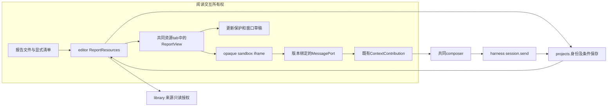
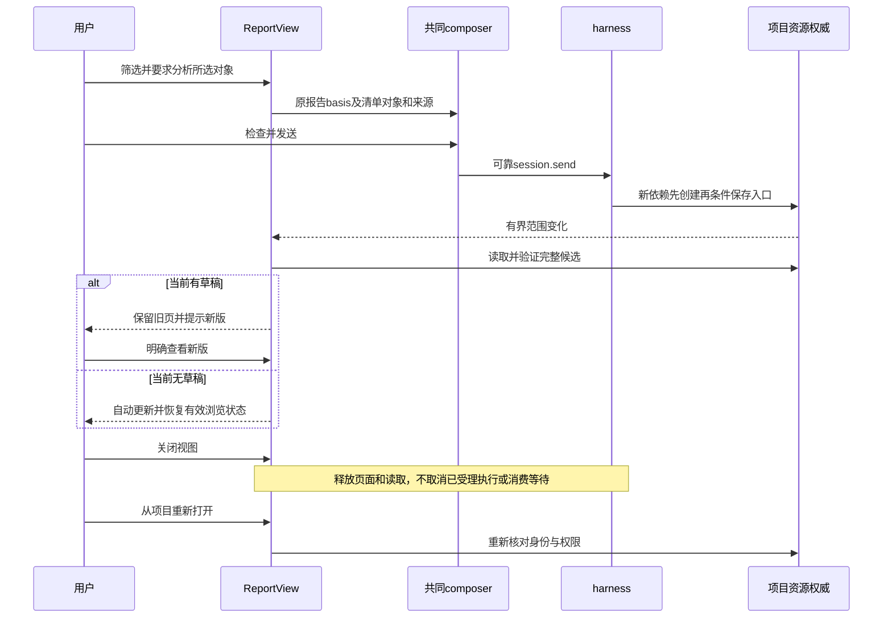

# 实现设计

## 变更总览

用户已采纳 [investigation](investigation.md#已获得本轮产品选择) 的项目内有界方案。无阻塞问题，基于该首批范围制定方案；下面的限额是实现起点，需用固定场景校准，不表示已经测得性能。

ReportResources 是 `packages/editor` 内的 module，不新建包／数据库或进程。它通过小接口集中资源清单、版本核对和有界交付；真实 projects／library adapter 与隔离测试 adapter 构成实际 seam。ReportView 只消费已核对的快照，页面只见允许的本地字节和对象，不见 KernelClient。

## 方案与接口

### 报告身份、封装与保存

项目 HTML 为入口，起始HTML注释承载一个不可执行的JSON清单（schema version 1）；普通 HTML 仍按 DocumentReader 打开，明确“打开交互报告”才运行本入口。清单采用已登记 ResourceRef 和 basis；入口 fileId 是报告身份，不另发 reportId，入口实际 basis 是该报告版本。

这是报告封装的明确格式：起始分隔为`<!--scholoom-report-v1`后接换行，清单以独立一行`-->`结束；序列化清单时将字符串中的`<`、`>`和`-`转为JSON Unicode转义，保证注释不被数据提前终止。内核只对有界头部做分隔提取、JSON.parse和同源schema校验，不解析其后HTML。渲染端使用浏览器DOMParser重新构造页面。当前editor未声明HTML parser；library的parse5不能跨私有包借用，此格式无需新增parser依赖。

| 拟新增同源字段 | 含义／约束 |
| --- | --- |
| `manifest.version` | 首批固定1；不支持版本明确失败 |
| `manifest.resources[]` | 最多32项 `{path,ref,basis,mediaType}`，本项目内普通文件，路径相对入口，不允许绝对路径、URL、私有目录或链接越界；path和ref必须指同一对象 |
| `manifest.sources[]` | 最多100个 `{ref,basis}`，声明实际研究来源；资源依赖与研究来源分开。库来源保留材料版本；不复制为库权威副本 |
| `manifest.objects[]` | 最多100项 `{objectId,name,semantics,sourceIndexes?}`，objectId在本版本唯一；只能引用本清单来源；semantics按既有8192 UTF-16容量 |
| `ReportSnapshot` | `{resource,manifest}`，resource为真实ResourceDescriptor；读取内容和依赖仍用现有分片，不在单帧塞整个报告 |
| `resources.report` 拟新增操作 | `{ref,basis}`→`ReportSnapshot`，只支持项目HTML；复用ResourceAccess所属授权及路径／身份核对，错误用原ErrorInfo，不另建错误框架 |

入口不超过现有256KiB文本保存范围，清单JSON总量最多128KiB；单个依赖最多8MiB、整个加载集最多32MiB、同时读取最多4项。字体／图片／CSS／JS／JSON只从清单交付；首批不执行远程module、worker、WASM、iframe或插件。图片使用栅格格式，不能用资源清单加载任意HTML/SVG文档绕过页面政策。资源读取前后核对ref/basis和权限；依赖发生变化则候选失败，不展示混合版本。

项目HTML正文 write 从现有 text 范围扩展到 html，仍核对大小、强resourceBasis、expectedFileId与有效执行；库和跨项目目标仍只读。首次保存用resources.create及原operationId核查；更新用resources.save。普通HTML阅读继续不运行脚本。

多文件更新先创建新依赖，再以一次入口条件保存发布完整清单；引用的版本文件不就地改写，旧页面可保留其已验证快照。入口发布前复查全部依赖。失败保留旧入口和实际创建文件，不做目录回滚／清理；入口已保存而关联unknown只核查原保存／补关联。外部程序直接改文件仍可能打断一致性，读取时明确失败，不声称跨文件事务。

首次创建入口和JS／CSS／JSON使用既有UTF-8创建能力；图像／字体使用已经存在的真实项目资源，本change不新增二进制写入或图件生成工具。需要新计算生成素材时消费所属计算能力，不能以文本create伪造二进制成果。

### 来源授权与共同动作

清单中的来源不授予权限。人工查看前沿所属读取授权，实际动作及Agent外发再检查来源read/send；sources只允许非报告资源，不递归遍历任意引用图。`ReportResources` 生产通过ResourceAccess的窄领域端口，不能从renderer传可信身份。报告引用的声明来源由资源层统一核查，实际执行的describe/read和模型前复查也必须使用同一检查，避免新会话读取报告绕过已声明库来源撤权。不能证明未声明、手工粘贴内容的完整来源归属；这与普通开放文件一样需要科研核查，不声称自动溯源。

页面动作只带本版本objectIds和request（<=4096 UTF-16），宿主按manifest取对象说明，不信页面提供新的ref/basis。转为既有 `ContextItem.object`（providerId固定为本报告提供者，objectId来自清单，ref/basis取报告入口）；对象的明确来源还作为原资源项加入同一批草稿。超过16项／64KiB时整批拒绝，不能只附半组对象与来源。复用贡献端口新增 `appendContextItems(items)` 的原子批量形状，由原会话一次合并／校验；单项append转用同一实现，不增加第二份草稿。

页面要求写入选中对象的comment，原有composer展示并允许修改；输入框正文继续由用户填写／检查，发送仍满足现有非空文字契约。本变更不自动替用户填充或发送“继续分析”。对象多选只贡献当前已加载清单，不读取文献表格DOM或全库投影。

### 隔离与页面桥

ReportView 使用 opaque-origin sandbox iframe，仅 allow-scripts；没有 allow-same-origin、popups、forms、downloads、top-navigation 或宿主preload。加载器重新构造文档头和资源引用，移除base、外部URL、嵌入文档、原meta策略及主动导航。应用控制的CSP默认禁止所有来源，只放行本次nonce脚本、明确Blob资源及必要样式；connect、worker、frame/object、form-action、base-uri均禁止。父文档的frame-src同时限定报告允许的Blob目标，防止脚本通过自身导航绕过frame内connect限制；这会影响共享入口，必须实测普通排版／PDF视图不受损。不能只加sandbox属性即声称“无网络”。

首次握手仅向当前iframe.contentWindow传一次MessagePort，不把origin:'null'作为身份。每次加载持有新的viewId、generation、basis，关闭／更新立即关闭旧port和Blob URL。后续消息仅在该port接收，不能监听任意window消息执行动作。

| 桥接消息候选 | 作用与响应 |
| --- | --- |
| `ready` | 确认当前页面可呈现，不发送指令或恢复Graph |
| `state` | `{browse,draft,dirty}`；JSON最多64KiB，由宿主保存窗口草稿，不能借此读取其他视图 |
| `select` | `{objectIds,request}`；宿主核对当前清单与接收者，原子加入共同草稿，返回queued或原结构化错误 |
| `restore`（宿主→页） | 恢复同版本草稿或新版仍支持的浏览状态；不承诺跨版本对象位置重绑 |

消息使用protocol同源schema，拒绝额外字段、未知版本、超大字符串及不在清单的对象。每视图仅一项附加请求在处理，state仅保留最新一份，动作速率首批每秒最多10项；过量明确拒绝，没有无界队列。页面加载、端口失效和拒绝有本地诊断。标准iframe的sandbox不提供任意恶意CPU强隔离，忙循环样本先核对浏览器／Electron实际影响；若目标保证不能满足，停止报告启用并返回调查，不削弱“无网络／无内核访问”约束。

### 更新、草稿和关闭后接续

资源变更订阅只覆盖报告入口与清单资源／声明来源，不扫描项目或全库。只允许一份载入中候选，连续变更合并到最新；入口和依赖全部核对完成才可切换。旧请求通过generation拒绝，不覆盖新版。

页面dirty、未完成批注及相关共同草稿任一存在则保护旧页；用户明确“查看新版”后，原草稿另存，显式ContextItem保留原basis。浏览状态是可丢弃的展示状态；新版支持时按对象身份恢复，否则显示新状态并保留原摘录。窗口草稿按配置、工作台实例、报告ref、basis隔离，复用现有storage adapter，保存草稿状态及<=256KiB旧入口和受限清单；不保存依赖字节或构建永久历史库。关闭时同步保存最新state，不依赖卸载后的异步回调。

重开优先核对权限，原版本仍可核查则恢复旧页草稿并提示新版；原版本不可得只展示已保存草稿／摘录及不可用原因，不能把旧basis内容伪装成当前材料。存储不可用时明确不能持久恢复页面草稿，保留内存中的内容供复制，不悄悄丢弃。撤权时隐藏受保护的旧页面／缓存，不能以草稿保护绕过。

工作台关闭后，普通已受理执行继续沿产品内核生命周期，调试入口仍遵循最后调试宿主退出时的受管停机规则；不承诺跨宿主退出持续运行。图等待用既有GraphWait／checkpoint，用户新session.send经原resume映射接续；不用report.ready唤醒，不新增会话类型。首批生产科研图无需存在，等待机制验收复用固定registered图，仅替换外部模型。

### UI与文件／符号所有权

沿UI设计的中间tab、当前选择与显式附加、状态栏贡献，先更新设计分节再实施。报告工具栏提供当前版本、筛选／排序／展开和“加入当前指令”；待更新提示贴近报告，有草稿时保留页面。来源打开走共同资源入口，错误可区分载入／动作／发送／执行／保存／刷新。只使用语义token，新增token同时映射浅深主题，不改变三区或dock/overlay。

| 未来文件变化 | 本change拥有的符号／职责 |
| --- | --- |
| 新protocol/report-contracts.ts及导出、派生业务映射 | 清单、快照、resources.report与桥消息schema；由本线维护，类型／校验同源 |
| protocol/resources.ts、editor/resource-access.ts | HTML条件保存、报告清单及声明来源的实际授权复查；图片格式由材料change拥有，不复制 |
| 新editor/report-resources.ts | 依赖路径／身份核对、有界完整快照，消费原项目／库端口；不是新存储权威 |
| kernel/manual.ts及architecture.json | 注册resources.report和必要消费范围，保持ManualApplication无需harness；生成映射从schema生成 |
| 新workbench/reports/ReportView.tsx、report-frame.ts、report-drafts.ts | 隔离加载、受限桥、版本更新与窗口草稿，集中为一个module内部实现 |
| workbench/ResourceView.tsx、resource-controller.ts、tab-state.ts | 明确报告视图分派与目标模式；不替换普通HTML阅读；不依赖材料change |
| workbench/context-contributions.tsx、business-session.tsx、session.ts、Workbench.tsx | 仅原子批量附加符号、WorkbenchSession类型及provider接线；复用原草稿、pending、回执及session.send，禁止私有report发送 |
| kernel/application.ts的executionResources／contextResources、harness/instruction-context.ts | 仅实际报告来源授权的接线与模型前复查，必要补充沿公共增量独立验收；不改Graph、委派或执行生命周期 |
| renderer/index.html及必要宿主安全入口 | 父frame-src与报告navigation限制，保留其他真实视图安全；Electron main仅在实测需要时补窄导航拒绝，不能靠Electron单独保证浏览器 |
| tests/kernel/resource-access.spec.ts、resource-identity.spec.ts、context-contributions.spec.ts | HTML保存与强依据、清单／来源授权、原子附加边界；新report模块测试仅覆盖现有测试不具备的有价值行为 |
| 新tests/ui/interactive-reports.spec.ts及固定合成报告夹具 | 双宿主真实页面、composer、harness、保存刷新与攻击样本；不新增产品业务图 |
| docs/ui-design/README.md、docs/development.md、docs/initial-spec/workbench.md | 报告内部视图、诊断入口及初设转正式契约链接；本轮不修改这些文件 |

根路径同项目既有目录。正式实施时公共HTML保存与批量附加增量先独立验证，不能依赖本树私有报告代码才能使用；共享Workbench只通过既有tab分派和少量符号接入，不重写骨架。两个change的资源文件分区写入，按实际接入顺序整合，不互相设强制依赖。

## 验证与风险

1. 独立module：清单资源的稳定身份／版本、缺失／越界、并发变化／撤权、来源read/send、过量消息和旧port。依赖adapter可替换，只证明本模块，不替代项目保存。
2. 内核沿真实ManualApplication／ResourceAccess／projects/library验证HTML条件保存和读取授权；扩展resource-access、resource-identity，不重建创建回执测试矩阵。新报告清单／快照分片覆盖的是稳定接口，不锁定内部调用顺序。
3. I5由本线主Agent负责，真实报告→共同composer→真实harness worker→真实文件保存→有界刷新→关闭重开；模型用现有受控HTTP。固定文献对比样本直接核对人工定义的筛选／排序对象集合和保存后正文，不以实现输出作唯一oracle。
4. 双宿主均核对有草稿/无草稿、来源撤权、迟到候选、失效对象、关闭重开、发送未知及保存关联unknown。安全样本包含fetch/XHR/WebSocket、外部图片／CSS／字体、form、location导航、popup、frame、worker、原型污染载荷和跨代消息；使用受控网络陷阱证明无请求而非只查DOM属性。
5. 固定图只验无工作台等待和session.send接续；沿既有registered-context，不要求科研线开放真实综合图。关窗与调试内核退出分别验证，不宣称完整科研质量。
6. 未来运行入口为已安装Playwright CLI的kernel相关文件及`playwright.ui.config.ts tests/ui/interactive-reports.spec.ts tests/ui/context-bridge.spec.ts tests/ui/resource-opening.spec.ts`；UI预留端口5643、`/tmp/scholoom-reports-*`配置／库／项目／输出，启动前核对占用，只收尾本轮进程。避免根test:ui触发安装。
7. 协议生成自检、受影响类型、架构与宿主构建；共享HTML加载／父CSP变化另回归现有writing-editor与PDF读取，诊断既有PDF失败不放宽超时。初始规划只做OpenSpec／diff验证；第四轮独立模块的实际检查见本change delivery，不能算生产报告链路通过。

无需新依赖或数据库迁移。多文件候选、浏览状态兼容及iframe网络／CPU边界是实际验收重点；未通过则保留受阻能力，不能把页面可显示等同隔离或科研质量通过。

## 待办边界

联网报告、库／全局报告的新建保存权威、任意一步执行按钮、程序计算、用户自定义Graph、自动研究质量判断、跨版本精确定位均不属于本change。生态／材料写回结果不是本首批报告前置，后续动作若依赖它们需另核对正式契约。真实Windows／macOS及三平台分发结果单独记录，macOS当前受管执行不可用契约保持。

## 第二阶段接口交接与下一批范围

主线本轮正式交接`/tmp/scholoom-phase2-handoff-VZS5mS/manifest.json`所列快照，材料／报告两份design已作为六线可读输入，接口不再因“未收到设计”整体等待。材料同源位置／region／对象草稿字段和资源叶抽取的具体文件及补丁顺序见`../add-material-annotation-interactions/design.md`“主线第二阶段交接与公共增量”；这里继续拥有报告清单、隔离及更新，不与材料change合并。生态`zotero-ecosystem/openspec/changes/connect-zotero-host-bbt/investigation.md:69–74`也明确报告运行不依赖Reader写回；本次接收该调查不能宣称ReportResources已实现。

| 下一批可独立准备／实施任务 | 是否等待新增公共基线及验收限制 |
| --- | --- |
| 1.1的清单／snapshot／桥schema及有界头部codec | 不依赖材料位置字段、库修订或任务业务；以原ResourceRef/Evidence为唯一身份源。可独立建立report-contracts及解析回归，不注册resources.report、不扩展全局ResourceRef。公开操作及导出接点先接受主线审查 |
| 1.2的ReportResources深模块 | 仅注入当前资源describe/read及路径解析窄端口；完整清单、path与ref对应、basis一致、来源read/send及容量／撤权由模块测试。无需先接Workbench/harness；替身不证明生产取材和模型准入已接通。生产组合依赖1.1及经审查的资源／授权公共增量 |
| 2.1的report-frame隔离模块 | 可用独立合成HTML、DOMParser及MessagePort验证清单资源重写、旧generation／过量消息、关闭释放；不等待材料change。安全测试使用受控网络陷阱；父frame-src与Electron导航的实际宿主保证必须另对接，模块夹具通过不能代表产品无网络 |
| HTML条件保存公共增量 | 沿原ResourceAccess只给项目HTML增加write，仍限制256KiB、expectedFileId和strong basis，库及跨项目目标只读。需要先审查资源叶模块上的准确符号及真实资源保存回归；不能为ReportResources夹带复制projects私有源码 |
| 原子appendContextItems公共增量 | 沿现有会话一次校验与合并，保留16项／64KiB、pending及迟到回执保护；既有单项附加委托同一实现。列context-contributions、session、business-session及Workbench provider精确符号，审查后再接报告2.2，不增加私有发送通道 |
| 声明来源的执行／模型前复查、父CSP及实际tab入口 | 需要公共审查和最终schema接入，分别核对kernel装配、harness/instruction-context、renderer父策略、ResourceView／tab联合。与其他线按符号合并，不能在U1修复同时大改这些位置 |

第二阶段建议先准备前3项；第四轮只实施前2项模块，不展开2.1隔离夹具。后续按公共增量接入顺序完成生产组合和原任务2.2–4.2。图等待仍沿已有registered-context，无需新的科研Graph或第八条editor线；资源读取与模型外发复查不能由页面清单授权替代。

第二阶段仅复核设计及公共触点；第四轮用户已直接授权以下两个模块子范围，不再等待材料位置字段、额外公共同步或重复实施授权。

### 第四轮有界实施文件与停止点

1. `packages/protocol/src/report-contracts.ts`集中manifest、snapshot及带version/viewId/generation/basis的桥消息schema、FromSchema类型、容量与跨字段校验。`packages/editor/src/report-codec.ts`实现约定起始注释的有界解码及Unicode转义编码，不解析HTML正文。新增protocol的`./reports`叶导出只供模块消费，并在architecture的editor允许依赖中列该准确路径；不加入根聚合或操作映射，不注册resources.report。
2. `packages/editor/src/report-resources.ts::ReportResources.snapshot`仅注入既有ResourcePort的describe/read及`authorize(evidence, 'read'|'send')`窄端口。入口／依赖沿共同base64分片，重用relativeFile做项目内相对解析；path解析、私有目录及真实链接范围最终仍由describe所属领域保证，模块不读取nativePath、不复制项目私有策略。完整快照发布前后核对入口、每项依赖／来源ref/basis、path→ref同一对象与read/send，拒绝混合版本和报告来源递归。返回原`{resource,manifest}`，不新建DTO或缓存权威。
3. `tests/kernel/report-resources.spec.ts`以独立手写头部和固定描述／字节adapter验证codec、来源read/send、路径／身份、前后依据、容量和撤权，注入端口并发不超过4；单个依赖8MiB、入口256KiB、入口及依赖总32MiB。来源只读取识别是否另一个报告所需的HTML前缀，不读取整本来源。资源mediaType仅沿已采纳字体／栅格／CSS／JS／JSON类别，HTML／SVG依赖拒绝；不承诺字节内容或脚本安全已验收。

桥state/restore的browse、draft保留JSON展示数据，其业务内部形状由报告页面掌握，整个消息64KiB；select只允许清单objectIds与4096 UTF-16 request。schema本身不启用消息端口、限速、原子附加或页面执行。来源非报告检查只识别已约定起始头部，不遍历引用图。

本轮不导出editor/node生产入口、不注册resources.report、不改ResourceAccess的HTML写权限／来源准入、不接Workbench／composer／iframe／CSP／导航。相应公开根导出、真实授权Adapter、实际保存及模型前复查仍需主线审核接入，模块替身不证明这些条件。最小验证为先shared构建，再protocol/editor/tools类型、架构、生成器一致性及上述模块回归；不改UI不重复双宿主。本change真实执行后才创建delivery。
