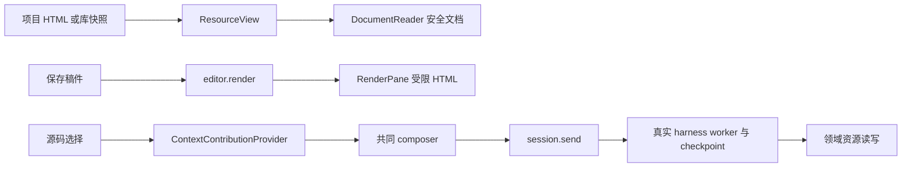

# 调查依据

## 本机前置机制实跑（2026-10-28，29cd728）

本轮先确认HEAD为`29cd7283388dfd752911eacb9c3bf8416031db15`、工作区干净，无`.codegraph/`。消费`/tmp/scholoom-round11-acceptance-Jx5Oez/`的本线冻结／接收记录与本树正式工件，不重放source.patch。用户只授权候选A的普通权限前置校准，不采纳像素／画面UI，不写生产platform／协议／ReportView。以下不是浏览器或双宿主通过结论。

证据与可复跑临时样本完整保留在`/home/joshua/.cache/scholoom-report-platform-round12-fNGQLv/`；TMPDIR指向该根，沿本轮/tmp EDQUOT安排使用自有cache空间。关键原始文件为`prerequisites.json`、`scope-{probe.c,calibration.mjs,result.json}`、`namespace-{calibration.mjs,result.json}`、`native-{mechanisms.c,calibration-first.mjs,result.json,first.log}`及修正后的`native-network-final.mjs`／`network-final-result.json`。仅编译已有cc可构建的固定C样本，没有依赖安装／下载、sudo、系统配置文件／权限修改或新特权服务。

### 实际条件矩阵

| 条件 | 实际观察与反例 | 结论边界 |
| --- | --- | --- |
| 普通权限入口 | uid1000、Linux7.0.0-38-generic，systemd259.5用户manager可达；bwrap0.11.1非setuid，unshare2.41.3已存在 | 本机有入口，不推断其他Linux发行／启动方式可用；没有以W_OK代替执行 |
| 独立user scope及限额 | 唯一transient unit，可信C读自身cgroup；控制端独立读回cpu.max=`20000 100000`、memory.max=`67108864`、swap.max=`0`、pids.max=`16`。原Orca scope仍无cpu.max，但新scope有cpu controller | **已证**普通权限可取得该独立scope；上一轮“当前Orca scope无CPU”不能扩大为独立用户scope不可用。systemd可按需启用父层controller，本片不手改或回滚父层配置，也不承诺启用状态全部复原 |
| 必要namespace／预执行门 | 固定true使用显式user／net／pid／ipc／uts／cgroup参数，bwrap同时构造mount视图，退出0；原生样本main进入时七类namespace句柄均异于外部控制端，NoNewPrivs=1、CapEff=0，readErrno=0 | **有限样本通过**，没有用unshare-all的try路径或可选参数跳过。仅映射公开/usr／lib、样本及私有proc／dev／tmp，未读取真实profile；不是任意浏览器启动／syscall策略的完整安全证明 |
| 宿主loopback TCP／UDP | 经独立审查修正TCP按data计数的缺口，最终TCP在accept计数，正向控制同为无payload连接；IPv4及IPv6的TCP、UDP各1次控制送达。隔离样本尝试后，直到整组停止／服务器关闭四计数均未增加，另明确核TCP结果失败；样本仅见lo、无外部路由 | **仅被测宿主端口无送达**。TCP均ECONNREFUSED(111)，UDP sendto均返回21字节成功：独立namespace内仍可使用loopback，不是禁用socket系统调用。未测外部DNS／LAN／HTTP浏览器／STUN协议，不据此宣布全网络零外发 |
| CPU上限 | 2.065410823秒墙钟内消耗0.403976464秒进程CPU；同scope独立cpu.stat的nr_throttled从0到21，throttled_usec增加1661001 | **该公平调度类有限样本的实际节流成立**，不等于绝对UI延迟、任意调度类／GPU或浏览器完整进程图预算 |
| pids上限 | 上限16时创建13名等待子进程后fork返回EAGAIN(11)；pids.events max从0到1，pipe／wait错误均0；样本全部回收后才报告完成 | **该scope进程／线程计数上限有实际反例**，没有无界fork或只凭返回码猜归因 |
| 内存上限 | scope64MiB／swap0，一名子进程尝试96MiB逐页触碰；内核memory.events oom_kill从0到1、oom从0到1；该子SIGKILL，样本forcedKill=false | **该内存反例成立**。本次unit设OOMPolicy=continue以保留观察父进程，仅是夹具策略；不选择产品OOM政策，不把memory.max描述为无瞬时超额的绝对上限 |
| 整组停止归属 | T阶段孙进程setsid后经pipe ACK再报告；外部cgroup.procs记录5名成员。仅stop原唯一unit，控制端收到systemd-run close(SIGTERM)，scope inactive／unloaded且整个cgroup目录移除，父控制端未换scope | **该多代／detached样本整组回收成立**，依据整组cgroup而非根PID。未测控制器丢失、持续fork／逃逸迁移、重启核查、持久unknown／容量接线或既有ManagedNode组合 |

本轮四个unit的精确名称由各原始JSON的unit字段维护：scope读回、namespace门、首轮native和最终network窄项各一。前两项自然结束，后两项明确stop；最终均not-found／inactive，只处理本次唯一随机unit。自有TCP／UDP服务全部关闭，原生源码／二进制和原始结果保留，不删除旧轮目录。bwrap可信启动包装进程仍处宿主net namespace，固定样本及其子孙处新net namespace；包装器不是不可信报告，也不能被扩充为网络代理。

### 实跑与缺证边界

先只读查权限／版本，再独立scope读回，再固定true namespace门，全部通过后才执行有限CPU／pids／memory／loopback／tree反例。`native-first.log`是唯一完整负载轮，控制器退出0；独立复核指出TCP只connect不发data、旧观察器可能漏计accept，不能以首轮计数器证明TCP零送达，虽然保存的connect实际均被拒绝。保留原代码快照`native-calibration-first.mjs`及原结果；修正accept计数和TCP结果断言后，只补跑网络／namespace／限额窄项，`network-final.log`退出0，未重复已绿CPU／内存／pids／tree负载，不写成首轮观测无缺口。

没有运行重试、延长期限或无约束浏览器。启动负载前`node --check`首次因临时控制器缺一个闭括号失败，`controller-syntax-first.log`保留；补正后syntax-final通过，该失败未启动样本或监听器。编译日志保留scope-probe一条read返回值和native-mechanisms两条write返回值warning；树ACK还由接收端长度及errno核对，不将warning抹去或按零warning交付。

被测实际提供者是systemd用户manager、Linux cgroup、bwrap及固定C程序；未以注入替身证明OS。没有自定义完整seccomp过滤／继承句柄攻击校准，不证明通用文件访问隔离、浏览器兼容性或产品harness／授权接线。Windows／macOS、外部DNS、运行时分发及双宿主呈现均缺证，Mac原受管执行不可用不变。

CI仍沿主线明确的938c33f／Checks40540362614：Linux内核748通过26跳过、UI125通过33失败6跳过，Windows内核677通过55失败42跳过、macOS job成功。新29cd728的40591705558／40591705520在post-integration-ci交接截点仅已启动；本片没有查询或后台等待，不把它们计通过，不按不同运行数目猜因果。

**本机结论：普通权限的独立user scope与bwrap组合，在本次有限原生样本可以同时取得上述前置与观察到的保护。** 这推翻的是“继承Orca scope没有cpu所以候选A本机必不可用”的外推，不是2.1b已经可交付。最小下一步为主线审独立platform Adapter的预执行、句柄／syscall策略、完整停止与unknown／容量组合校准；不据此启动浏览器或选择画面流。正式呈现、安装／部署、运行时维护与产品预算仍待决定。

## 前一轮承载调查（2026-10-28，938c33f）

当前HEAD为`938c33f2c9fcafb2cce11b0c165b2fb1e9a818c3`，开始时工作区干净；无`.codegraph/`。本片授权只有下一承载的调查／可审查设计，写集为本change的investigation、design、tasks、delivery，不实现跨系统沙箱、图像流或协议。原2.1a调查已接收，2.1b尚未实施。项目HTML＋显式本地资源、无网络／任意文件／内核直连、双宿主共同UI的产品保证不降低。

### 已消费的实际证据

- `/tmp/scholoom-round10-acceptance-j1MosP/acceptance.md`、`synchronized.json`与本树HEAD证明公共代码已同步；没有重放旧source.patch或操作其他树。`main-ui-final-result.json`的stats为expected=2、unexpected=0；`report-probe-ui-{browser,electron}.json`分别记录STUN 1包20字节。Browser父心跳最大间隔258ms，Electron样本不证明强CPU隔离。该结果是**失败候选调查通过**，不是报告隔离通过。
- 当前`tests/ui/report-isolation.spec.ts`已要求`SCHOOLOOM_REPORT_ISOLATION_PROBE=1`；trap取得后所有初始化在try内，finally收尾。保留主线P2修复，不重跑已否定候选、不把默认skip记为新通过。
- 最新已完成Checks40479176954／8c2fd24：Linux内核746通过26跳过、UI126通过32失败4跳过；Windows内核688通过42失败42跳过，macOS job成功。4312262／40476577071的Windows727通过3失败42跳过只是另一轮结果；`ci-same-source-failures.log`和`ci-failure-matrix.json`作为归因边界，不将差额当新增缺陷。938c33f的40540362546／40540362614在交接截点为运行中；本片未查询或等待其结论。下方首次规划的CI信息仅为历史，不再用374项旧基线判断现状。

### 本树已有机制及明确缺口

| 事实源／符号 | 可复用与限制 |
| --- | --- |
| `apps/kernel/src/commands.ts:18,31`的CommandWorkspace／ManagedCommands | 宿主登记程序和workspace、绑定主体／项目／实例、排队后复查授权；不是客户端任意argv或任意路径入口。不能把报告浏览器当原受信programs.start直接放行 |
| `packages/platform/src/processes.ts:64,119,275`、`process-controller.ts:59,150`、`native/process-scope.c:18,105` | ManagedNode及controller持有实际instance、Linux subreaper／Windows Job后代归属；只有完整停止证据才释放。Windows现有Job只设KILL_ON_JOB_CLOSE；业务加载前有Node bootstrap gate，但不是任意浏览器的安全启动门。保留unknown及原生诊断，不能从根PID或renderer退出推断范围空 |
| `packages/platform/src/admission.ts:11`、`command-deadline.ts`、`command.ts:6` | ProcessAdmission控制名额／等待；墙钟期限不是CPU配额，输出上限不是内存上限。现有CommandRequest没有网络／CPU／内存策略；runCommand还继承HOME等环境，不能直接作为不可信报告环境 |
| `packages/protocol/src/platform.ts:44`、`core.ts` | platform.command／programStart／programCancel和managedExecution只表达现有受管执行；没有新的隔离保证声明。Linux／Windows原available不代表报告沙箱available；Mac当前仍不可用 |
| `packages/platform/src/resources.ts::ResourceAccess` | 对经端口的真实路径／身份做范围校验；不限制原生浏览器的系统调用。OS文件视图和句柄白名单仍缺提供者 |
| `packages/editor/src/report-resources.ts::ReportResources`、`manual.ts:1178,1219` | 已有完整snapshot、ref／basis、path-ref及read／send核查，可作为唯一资源输入。它不提供冻结的进程文件系统，取字节与交付仍须再核查，不新建reportId／来源表 |
| `packages/protocol/src/report-contracts.ts`、`packages/harness/src/runtime.ts::recordReportUse/checkReportContext` | 复用有界JSON消息及ResourceEvidence的委派／模型准入权威。页面没有模型准入权；新承载不能将展示ready当发送授权或绕过queue／final／restart |
| `apps/kernel/package.json`、根`package.json`、`apps/desktop` | Node内核未声明生产Chromium运行时或图像／输入桥；开发Playwright缓存不等于可分发产品依赖。Electron外壳已有浏览器，但复用它的UI主进程／共享network service不能提供独立OS范围 |

本机只读核对：Linux `7.0.0-38-generic`；`unprivileged_userns_clone=1`且AppArmor的unprivileged_userns限制为1，未试建namespace。`/usr/bin/bwrap`为0.11.1、root:root、0755，无setuid／setgid；PATH有unshare、systemd-run、prlimit，无nsjail／firejail。当前Orca所属cgroup v2的`cgroup.controllers`只有`memory pids`，没有cpu；`cpu.max/cpu.weight`不存在。目录和subtree_control的W_OK为true、subtree_control为空，memory.max为max；这些仅是权限／配置读取，未创建或写任何cgroup。**本scope没有已证明可用的CPU控制提供者**，不能因系统根暴露cpu或bwrap存在便宣称候选可运行。需要可委托的独立scope，或有明确安装／权限决定的替代提供者。

### 官方机制核对（2026-10-28，只读资料）

以下是机制依据，未在目标OS创建沙箱；平台可用性必须按选定版本重新校准。官方明确能力与Scholoom候选组合的推断分开：

| 来源 | 官方事实与本片推断边界 |
| --- | --- |
| [L1 network_namespaces(7)](https://man7.org/linux/man-pages/man7/network_namespaces.7.html) | 网络namespace隔离设备、协议栈／路由及抽象UNIX socket。候选使用无外部接口／路由且不接宿主网络的独立namespace；这不自动关闭继承socket或文件路径上的本地代理 |
| [L2 cgroup v2](https://cdn.kernel.org/doc/html/latest/admin-guide/cgroup-v2.html) | cpu.max为周期带宽限制，memory.max为内存限制（可短暂超额），pids.max约束进程数；cgroup.kill处理子树及并发fork。委托需实际权限，CPU控制有调度类条件；不能据文件存在保证延迟或退出已完成 |
| [L3 seccomp(2)](https://man7.org/linux/man-pages/man2/seccomp.2.html)、[L4 unix(7)](https://man7.org/linux/man-pages/man7/unix.7.html) | 系统调用过滤可继承，须满足no_new_privs或对应权限；pathname UNIX socket依赖文件权限且可传FD。候选还需最小文件视图、关闭多余FD和限制可转发代理，单独netns不是全部保证 |
| [L5 bubblewrap上游安全政策](https://github.com/containers/bubblewrap/security/policy) | bwrap是构建工具，保护取决于调用者策略；不把默认运行或工具存在当完整沙箱。采用现有工具与否仍需核版本、策略和维护责任 |
| [W1 AppContainer](https://learn.microsoft.com/en-us/windows/win32/secauthz/implementing-an-appcontainer) | 无network capability时不授予网络访问；token、capability及DACL共同限定资源。候选还须核全浏览器进程图的实际身份、loopback豁免、继承句柄及不受限broker；“仅renderer在AppContainer”不足 |
| [W2 Job Objects](https://learn.microsoft.com/en-us/windows/win32/procthread/job-objects)、[W3 CPU rate](https://learn.microsoft.com/en-us/windows/win32/api/winnt/ns-winnt-jobobject_cpu_rate_control_information) | Job后代归属／kill-on-last-handle-close与CPU hard cap是独立机制；CPU按调度区间限制，内存另配。须排除breakaway／组外服务，不能用completion事件代替最终空范围证明 |
| [W4 WFP权限](https://learn.microsoft.com/en-us/windows/win32/fwp/access-control) | 添加规则需要ADD／关联权限；默认普通用户OPEN／CLASSIFY不表示可安装过滤器。若AppContainer校准不足，WFP只能作为另审的特权候选，精确scope、代理DNS覆盖及策略丢失时拒绝尚无提供者 |
| [W5 Windows Sandbox](https://learn.microsoft.com/en-us/windows/security/application-security/application-isolation/windows-sandbox/)、[安装条件](https://learn.microsoft.com/en-us/windows/security/application-security/application-isolation/windows-sandbox/windows-sandbox-install)、[W6 Windows容器条件](https://learn.microsoft.com/en-us/virtualization/windowscontainers/deploy-containers/system-requirements) | Sandbox使用独立内核，默认联网、Home不支持，安装需管理员并可能重启；Hyper-V容器另需相关功能／虚拟化。都不是本项目已安装的浏览器提供者，也不自带共同UI桥或完整停止证明 |
| [C1 Chromium多进程](https://www.chromium.org/developers/design-documents/multi-process-architecture/)、[C2 WebContentsView](https://www.electronjs.org/docs/latest/api/web-contents-view)、[C3 offscreen](https://www.electronjs.org/docs/latest/tutorial/offscreen-rendering) | 浏览器／renderer／network职责分开；WebContentsView是Electron main能力，offscreen可取位图。推断：只隔离renderer或增加原生子视图既不覆盖全网络，也不能直接嵌入普通Browser；共享GPU／外壳会扩大隔离及资源核算范围 |
| [C4 Chrome调试pipe](https://developer.chrome.com/blog/remote-debugging-port)、[C5 DevTools同源协议源码](https://github.com/ChromeDevTools/devtools-protocol/blob/master/json/browser_protocol.json) | pipe应使用独立profile而非真实用户profile。上游声明captureScreenshot／输入派发，screencast、insertText／imeSetComposition在此次源码中标experimental。它们只证明存在机制；图像、输入法及可访问性桥尚未实现或获产品采纳 |

DevTools网页只返回导航壳，改为只读抓取官方JSON并提取字段，结果在`/tmp/scholoom-report-carrier-round11/cdp-source-extract.json`；master不是已安装运行时的承诺。本片没有运行浏览器、VM／容器、网络探针或CPU实验，没有安装／下载依赖、启动服务或改变权限。

### 当前结论

原iframe候选已被实际STUN和CPU样本否定。下一步不是继续补DOM覆盖，而是先决定独立OS执行与双宿主呈现的组合。design“下一承载候选与待决范围”列最少候选、关键反例、接口所有权及最小校准；架构／产品选择尚未闭合，活动页继续unavailable，不宣称2.1b可实施或三平台可用。

## 首次规划事实与复用选择（历史）

2026-10-25首次规划，基线 `e3d58fc807827a78493dcd16e38de28c8d02766e`，无 `.codegraph/`，初始工作区干净。主 Agent 及原生只读子 Agent 核对源码、测试定义、决议和归档记录；当时没有运行应用、测试、编译或模型。后续材料change已取得依赖／隔离授权，第四轮公共0519904已具备，用户直接授权报告schema／codec与注入端口模块。以下表格保留初始差距，实际模块范围见design第四轮及本change delivery；不将规划阅读或材料UI测试当作报告生产接线。

| 能力 | 核对事实／来源 | 设计影响 |
| --- | --- | --- |
| HTML 附件／项目文件 | `ResourceView → DocumentReader → resources.document`，library/document-parser.ts 提供安全结构，不执行脚本 | 不改变已有 HTML 阅读安全契约；报告需要明确入口，不能对全部 HTML 放开脚本 |
| HTML 排版预览 | `editor/render-output.ts:69` 移除 script／事件属性；`RenderPane.tsx:288` iframe 无脚本权限，CSP 禁止脚本和 connect | 可以复用资源释放经验，不能直接复用为运行报告或削弱普通预览 |
| Electron 外壳 | main/index.ts:95 的 sandbox／contextIsolation 为 true，nodeIntegration 为 false；preload 只有窄 bootstrap／外链／目录选择 | 报告不接 preload、认证 token 或 KernelClient |
| 共同选择 | `context-contributions.tsx` 有 contributeSelection、appendContextItem、updateContextComment | 真实对象生成 ContextItem；该端口没有追加指令正文方法。首批将页面要求作为 comment，用户在既有 composer 填写或检查正文后发送 |
| 可靠发送及草稿 | `business-session.tsx:439` 保存 pending；`context-drafts.ts` 保护后加／已编辑批注；dock／overlay 共用 InstructionContextItems | 不新建 report.send 或自动执行按钮；对象附加后不绕过现有非空正文要求 |
| 资源能力 | `resources.ts` 仅项目和库 Ref；create/creation/save/read 与真实保存结果已交付 | 报告身份沿项目 fileId，版本沿 basis，不引入报告数据库、第三类 Ref 或反向引用表 |
| HTML 保存差距 | `ResourceAccess` 的 write 当前仅给 <=256 KiB 的项目 text；HTML 被分类为 html，resources.save 不接受其正文更新 | 首次 create 不代表后续 HTML 能 save，必须在同一资源保存 seam 补 HTML 的条件写入能力并保留安全阅读 |
| HTML parser 依赖 | editor/package.json没有Node HTML parser，library声明parse5@8.0.1但不能借私有实现跨包使用 | 清单采用入口起始注释中的有界JSON头部，内核用标准JSON解析；页面重构用浏览器DOMParser，不新增依赖 |
| 关闭重开 | ResourceView.cancelPending 只取消所属读取；tab／阅读位置主要为组件内状态；普通关窗不取消已受理 harness | 报告持久文件与浏览状态分开；显式项沿共同草稿，不靠 iframe 内存接续 |
| 等待恢复 | `GraphWait` 已有 attemptId/waitId/nodeKey/inputSchemaRef/prompt/checkpointRef；resume 得到完整 InstructionContext；InstructionSaver 保存后才确认消费 | 不新增页面唤醒、报告轮询等待或私有恢复机制；生产 executionGraphs 当前为空 |

图中没有页面到 C 的报告动作桥，也没有报告状态／更新提供者，属于待建能力。报告不复用 research 中 `artifactRole:'report'` 就假定已有报告运行权威。

### 必须复用的精确契约

- 项目 ResourceRef 为 `{source:'project',projectId,fileId}`。报告入口和每个已加载资源均需自己的 ref/basis；路径只用于解析显示，不能替代已登记身份。
- ContextItem.object 为 `kind,itemId,ref,basis,providerId,objectId,name,semantics,comment?`，semantics 是字符串，不是任意结构化对象。每批16项、semantics8192 UTF-16单元、comment4096、整体64KiB；所有对象拒绝额外字段。
- `session.send` 必填 projectId/sessionId/instructionId/text/materials，可选 materialFileIds/contextItems；返回 instructionId/runId。source.connectionId 来自真实宿主，不接受页面自报。
- 当前快照只属于认证连接；断线删除快照，历史显式项仍持久。`read_workbench_context` 可返回 noSource/disconnected/receiverMismatch/noSnapshot 或 ambiguous，不借其他窗口恢复来源。
- `resources.create/creation` 保存并查询原 operationId；执行 save 返回 resource 与可选 association（confirmed/pending/unknown）。文件已保存和关系已关联分别核对，不能刷新即重放创建。
- 资源读取按现有分片；项目／库 read 与 Agent send 仍由所属提供者核验，页面对象和历史摘录不是授权凭证。跨项目目标只读，首批报告不能借全局会话保存到目标项目。

相关正式规格完整核对：workbench-agent-context、workbench-resources、manuscript-rendering、workspace-editor、domain-execution-handoffs、execution-work-domains、agent-harness。复用[上下文归档](../archive/2026-10-24-establish-workbench-context-bridge/delivery.md)、[领域交接](../archive/2026-10-24-establish-domain-execution-handoffs/delivery.md)、[共同资源](../archive/2026-10-20-unify-workbench-resource-opening/delivery.md)、[写作编辑](../archive/2026-10-20-add-research-writing-editor/delivery.md)，历史实跑范围不当作本轮重验。

## 影响方案的未知项与实验

### 已获得本轮产品选择

[职责 Q6](../../../.scratch/domain-development/issues/07-research-interaction-scope.md#answer)要求详细设计闭合隔离、资源、保存和无工作台接续，但没有预选 SDK 或封装。向用户提交三个选项：项目 HTML＋显式本地资源清单；单文件 HTML；保持待定。用户明确回复“采纳该有界方案”，选择第一项：

- 页面脚本只操作当前页面，无网络、文件系统或内核直连；需要 Agent 的动作进入共同输入框。
- 项目内保存入口及显式本地资源；关闭工作台后成果保留，等待沿 session.send 接续。
- 不包含联网报告、库／全局报告的新建权威。这一首批范围不影响只读引用库材料作为报告来源。

首次候选采用浏览器标准sandbox iframe与受限MessagePort；该实现选择已被2.1a实跑否定，不再作为生产方案。产品无网络及无关领域可用的保证保持，下一承载见当前调查和design。

### 基线失败与证据边界

首次规划Checks40100596838只作历史输入；当前CI见本文件当前承载调查及共同计划“第十轮验收后的收敛安排”。写作PDF首次unknown的旧记录沿[材料调查](../add-material-annotation-interactions/investigation.md#ci-输入写作-pdf-预览)，诊断已交计算线，不在报告本片无目标重跑；报告独立验证不以PDF编译为前置。

### 尚需跨线输入

首批选用现有项目文件保存和普通 harness，不等待任务模型、科研生产图、通用委派、程序环境或生态宿主。文献对比数据可以通过已授权 library 只读取得，题录表格／任务详情不在本线所有权内。需要新增库材料修订的后续报告动作，沿文献／生态输入另行核对，本变更不实现。

报告多文件更新的完整发布与更新旧页保留尚未实跑；第四轮清单模块测试只证明独立模块，不替代这些生产验收。复用本树已有依赖，不安装、不启动UI服务；模块测试仅替换领域窄端口。

## 结论与承接

首次规划在当时调查范围内进入首批设计；后续HTML条件保存、清单和真实来源授权已沿本change交付，不能重复等待它们。当前真正阻塞是活动页面的可靠隔离承载与双宿主呈现选择，见本轮调查；共同composer及harness接入仍待后续整合。科研质量、生产Graph和三平台分发均另验。
