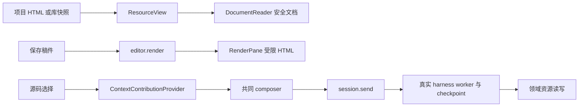

# 调查依据

## 当前事实与复用选择

2026-10-25首次规划，基线 `e3d58fc807827a78493dcd16e38de28c8d02766e`，无 `.codegraph/`，初始工作区干净。主 Agent 及原生只读子 Agent 核对源码、测试定义、决议和归档记录；当时没有运行应用、测试、编译或模型。后续材料change已获锁定依赖和隔离验证授权并完成相应准备；本次主线交接仅复核报告设计、独立任务及公共触点，见design末节，未实施或验证报告业务。

| 能力 | 核对事实／来源 | 设计影响 |
| --- | --- | --- |
| HTML 附件／项目文件 | `ResourceView → DocumentReader → resources.document`，library/document-parser.ts 提供安全结构，不执行脚本 | 不改变已有 HTML 阅读安全契约；报告需要明确入口，不能对全部 HTML 放开脚本 |
| HTML 排版预览 | `editor/render-output.ts:69` 移除 script／事件属性；`RenderPane.tsx:288` iframe 无脚本权限，CSP 禁止脚本和 connect | 可以复用资源释放经验，不能直接复用为运行报告或削弱普通预览 |
| Electron 外壳 | main/index.ts:95 的 sandbox／contextIsolation 为 true，nodeIntegration 为 false；preload 只有窄 bootstrap／外链／目录选择 | 报告不接 preload、认证 token 或 KernelClient |
| 共同选择 | `context-contributions.tsx` 有 contributeSelection、appendContextItem、updateContextComment | 真实对象生成 ContextItem；该端口没有追加指令正文方法。首批将页面要求作为 comment，用户在既有 composer 填写或检查正文后发送 |
| 可靠发送及草稿 | `business-session.tsx:439` 保存 pending；`context-drafts.ts` 保护后加／已编辑批注；dock／overlay 共用 InstructionContextItems | 不新建 report.send 或自动执行按钮；对象附加后不绕过现有非空正文要求 |
| 资源能力 | `resources.ts` 仅项目和库 Ref；create/creation/save/read 与真实保存结果已交付 | 报告身份沿项目 fileId，版本沿 basis，不引入报告数据库、第三类 Ref 或反向引用表 |
| HTML 保存差距 | `ResourceAccess` 的 write 当前仅给 <=256 KiB 的项目 text；HTML 被分类为 html，resources.save 不接受其正文更新 | 首次 create 不代表后续 HTML 能 save，必须在同一资源保存 seam 补 HTML 的条件写入能力并保留安全阅读 |
| HTML parser 依赖 | editor/package.json没有Node HTML parser，library声明parse5@8.0.1但不能借私有实现跨包使用 | 清单采用入口起始注释中的有界JSON头部，内核用标准JSON解析；页面重构用浏览器DOMParser，不新增依赖 |
| 关闭重开 | ResourceView.cancelPending 只取消所属读取；tab／阅读位置主要为组件内状态；普通关窗不取消已受理 harness | 报告持久文件与浏览状态分开；显式项沿共同草稿，不靠 iframe 内存接续 |
| 等待恢复 | `GraphWait` 已有 attemptId/waitId/nodeKey/inputSchemaRef/prompt/checkpointRef；resume 得到完整 InstructionContext；InstructionSaver 保存后才确认消费 | 不新增页面唤醒、报告轮询等待或私有恢复机制；生产 executionGraphs 当前为空 |

图中没有页面到 C 的报告动作桥，也没有报告状态／更新提供者，属于待建能力。报告不复用 research 中 `artifactRole:'report'` 就假定已有报告运行权威。

### 必须复用的精确契约

- 项目 ResourceRef 为 `{source:'project',projectId,fileId}`。报告入口和每个已加载资源均需自己的 ref/basis；路径只用于解析显示，不能替代已登记身份。
- ContextItem.object 为 `kind,itemId,ref,basis,providerId,objectId,name,semantics,comment?`，semantics 是字符串，不是任意结构化对象。每批16项、semantics8192 UTF-16单元、comment4096、整体64KiB；所有对象拒绝额外字段。
- `session.send` 必填 projectId/sessionId/instructionId/text/materials，可选 materialFileIds/contextItems；返回 instructionId/runId。source.connectionId 来自真实宿主，不接受页面自报。
- 当前快照只属于认证连接；断线删除快照，历史显式项仍持久。`read_workbench_context` 可返回 noSource/disconnected/receiverMismatch/noSnapshot 或 ambiguous，不借其他窗口恢复来源。
- `resources.create/creation` 保存并查询原 operationId；执行 save 返回 resource 与可选 association（confirmed/pending/unknown）。文件已保存和关系已关联分别核对，不能刷新即重放创建。
- 资源读取按现有分片；项目／库 read 与 Agent send 仍由所属提供者核验，页面对象和历史摘录不是授权凭证。跨项目目标只读，首批报告不能借全局会话保存到目标项目。

相关正式规格完整核对：workbench-agent-context、workbench-resources、manuscript-rendering、workspace-editor、domain-execution-handoffs、execution-work-domains、agent-harness。复用[上下文归档](../archive/2026-10-24-establish-workbench-context-bridge/delivery.md)、[领域交接](../archive/2026-10-24-establish-domain-execution-handoffs/delivery.md)、[共同资源](../archive/2026-10-20-unify-workbench-resource-opening/delivery.md)、[写作编辑](../archive/2026-10-20-add-research-writing-editor/delivery.md)，历史实跑范围不当作本轮重验。

## 影响方案的未知项与实验

### 已获得本轮产品选择

[职责 Q6](../../../.scratch/domain-development/issues/07-research-interaction-scope.md#answer)要求详细设计闭合隔离、资源、保存和无工作台接续，但没有预选 SDK 或封装。向用户提交三个选项：项目 HTML＋显式本地资源清单；单文件 HTML；保持待定。用户明确回复“采纳该有界方案”，选择第一项：

- 页面脚本只操作当前页面，无网络、文件系统或内核直连；需要 Agent 的动作进入共同输入框。
- 项目内保存入口及显式本地资源；关闭工作台后成果保留，等待沿 session.send 接续。
- 不包含联网报告、库／全局报告的新建权威。这一首批范围不影响只读引用库材料作为报告来源。

基于此采用浏览器标准 sandbox iframe 与受限 MessagePort，不引入报告 SDK。脚本耗尽 renderer 资源的故障隔离不能由 sandbox 属性证明；首批限制文件／消息／资源大小，独立验证真实双宿主隔离，任意恶意 CPU 强隔离不作为浏览器 iframe 的承诺。

### 基线失败与证据边界

当前 CI 不全绿，固定 Checks 40100596838 的 Linux UI 101／9／2、Windows kernel 374／15／12 见[共同计划](../../../.scratch/domain-development/parallel-development-plan.md#当前-ci-基线的处理)。写作 PDF 挂载超时的直接日志、未知根因与诊断入口由[材料调查](../add-material-annotation-interactions/investigation.md#ci-输入写作-pdf-预览)维护；该链接只是调查复用，报告模块不依赖另一 change 交付。报告独立验收不使用 PDF 编译作为前置；影响实际报告路径的 composer/RPC gate 失败需沿发送、受理、worker、保存、刷新分段核查。

### 尚需跨线输入

首批选用现有项目文件保存和普通 harness，不等待任务模型、科研生产图、通用委派、程序环境或生态宿主。文献对比数据可以通过已授权 library 只读取得，题录表格／任务详情不在本线所有权内。需要新增库材料修订的后续报告动作，沿文献／生态输入另行核对，本变更不实现。

报告多文件更新的完整发布、资源清单安全与更新旧页保留尚未实跑；是本方案明确的实现验收任务，而非已验证结论。现有依赖缺失不以安装补齐，本轮无需启动隔离实验。

## 结论与承接

无阻塞问题，基于用户已采纳的项目内有界报告方案制定本 change 的首批设计。可复用真实项目、共同资源、共同 composer、harness 和等待；补 HTML 条件保存、报告资源清单、隔离页面与更新控制。独立验收仅证明固定文献对比的机械闭环；科研质量、迁入真实业务 Graph、三平台分发均另验。
