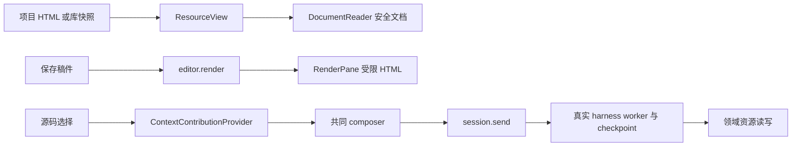

# 调查依据

## R2c固定可信输入事务校准（第20轮续做，825f3fac）

新`tests/fixtures/report-input/`只读复用原源页与report-structure控制器；R2／R2b源码和反例未改。首次保留原禁脚本文档，之后仅在独立源确认最新输入后以原生DOM替换固定table／count，活动文档和输入节点不替换、筛选框不赋值。私有事务分别绑定view／合成basis及接收者、原文档token和源请求代次，只有一次在途、一个最新输入意图和一个最新回包，长度／数量与诊断有界；不是通用HTML镜像、生产授权或新的存储。

真实Browser／Electron的透明回包门控中：已发空筛选后，连续输入“随”“随机”被合并；开始组合“队列”，旧回包到达时源已是空筛选，但UI仍保留原2/3、文字“队列”、焦点及同一document／input，readOnly和disabled实际均false。提交“队列”确实送达独立源、源成为1/3；新确认回包仍被门控时UI不先采用，放行后才显示1/3，光标保持2。CDP清除另一段组合后的实际DOM值为空、光标0；该空值另送源确认，放行后UI与源同为3/3且节点／焦点／光标不变。不将该行为猜为系统IME的Escape或候选取消。

版本／接收者替换和关闭各在一次真实请求后保留一个新缓冲输入；迟到成功回包只结清原请求，不采用旧结果、不再发缓冲意图。两个真实源各只有initial read及原已受理filter两条观察，旧源保留自己的实际结果，未写入新源。数学mfrac／MathML namespace、原文表格、实际选字复制、可见正文查找及MathMLFraction辅助结构的一个代表保持。合成接收者未接真实composer或Agent授权，不能据此声称产品动作权限通过。

只读复核发现P2：排序冲突虽拒绝，本地select却显示未受理值。父在桥接处恢复最近实际采用的排序并显示冲突反馈；新的真实held回包例核排序恢复、源未收到排序和原pending文字保持。辅助静态复核确认该问题闭合，未代跑测试。首轮4/4，修正后仅受影响的输入场景双宿主2/2，不混算成一次6项全绿；生命周期场景使用修正前bundle、事务模块未变，未重复该组。实际命令、源／回包／UI证据及源码／产物对应见R2c delivery与cache RESULT。

本片cache为`/home/joshua/.cache/scholoom-round20-acceptance-INWZnx/next/research-interaction/`；短TMPDIR为`/home/joshua/.cache/r2c-ycpMSD`，无当前/tmp输入。手动Browser／Electron均打开并退出0；Electron的userData／sessionData／storagePath实际同指本次cache的独立profile，复用主线已修共享fixture，不再加XDG或unsafe参数。系统IME候选窗／读屏、任意HTML／CSS／canvas、自主脚本更新、跨控件并发UX、reload／跨tab恢复、失败恢复、OS强隔离、目标平台及科研质量均未验。所测有限候选不关闭正式R2／2.1b／T1／T2／I5。

## R2b保留原结构的可信对照（第19轮本片，0d27cff）

新夹具`tests/fixtures/report-structure/`只读复用原report-surface源页及其真实独立Chromium控制器，原失败代码／断言未改。源页在一次同步读取中给出实际状态及文档克隆，input.value／option.selected按当时实际属性补齐；移除固定唯一脚本后，以保留HTML／MathML命名空间的srcdoc放入Workbench共同资源tab的禁脚本frame。不是任意HTML清洗器、公共DSL或不可信DOM镜像，没有改生产CSP／HtmlRenderView或接OS隔离。

实际Browser／Electron均保留mfrac与MathML namespace；分子bottom在分母top以上，实际布局与源页一致，源／frame辅助树各有两个MathMLFraction。筛选随机、降序赵在林前、键盘展开赵的状态与源页相同，表格innerText逐次对照源页一致；原生文字选择／Control+C读回“比较”，可见正文查找命中“剂量20与30”并拒绝隐藏详情文字。无在途回包时，CDP组合“队列”不先交源页，提交后1/3且焦点／光标保持。旧代及第二个并行动作实际拒绝；文档上限256元素／64KiB、最多128代、一次在途无等待队列，未为验证上限循环刷满128次。

**原结构仍不足以满足输入保持。** 只读复核指出整文档替换与组合的竞争。父Agent用透明传输门控保留真实请求／源执行／回包，只在源动作已完成后暂缓交付；旧frame开始组合“队列”，放行原回包后srcdoc替换，未提交文字实际从“队列”变为空串。两宿主同次重现，证据为r2b-evidence.json的compositionDuringUpdate。该失败不依赖系统IME；它是CDP实际浏览器组合事件的反例，不能据此冒称真实IME已验。另一焦点竞争已局部修正为仅在父焦点仍属于frame时恢复；晚回包期间移到父查找框，最终双宿主实际保持父焦点。没有为了通过而禁输入／加等待／重试或扩成通用增量镜像；正式方案仍须主线解决活动文档、组合事务与选区稳定性。

短TMPDIR记录于本片cache的`final/short-tmpdir.txt`，实际为`/home/joshua/.cache/r2b-5coaTM`；手动Browser和Electron均打开同一固定原型并退出0，不再遇旧长socket路径失败。首次手动入口在进入页面前报Node `.js`模块不存在，原manual-first-results.json保留；修正新控制器的原生TS加载后才有该结果。后续补齐本夹具Linux XDG_CONFIG_HOME，实际Electron userData／storagePath读回均在自有cache，证据为manual-profile-electron/host-profile.json；早期沿共享fixture的Electron结果只证明内核配置隔离，不计其Chromium profile隔离。未手工查看或清理默认profile内容，未访问真实用户库。

证据根`/home/joshua/.cache/scholoom-round19-acceptance-XBzzNC/next/research-interaction/`；本片原型、控制器、来源与动作／响应边界及复建入口见新README／RESULT。系统IME候选窗／取消、真实读屏、数学复制语义、源页自主变化、高频输入、canvas、任意HTML／CSS、跨tab恢复、OS／独立身份服务、Windows／macOS与科研质量未验。固定可信样本有脚本去除，不证明恶意页隔离；2.1b／T1／T2／I5及正式R2架构保持开放。

## R2有限可信语义投影的双宿主校准（第18轮，e4c4e422）

本轮已实际执行，取代第17／18轮派发时尚无成果的状态。源码在`tests/fixtures/report-surface/`，可重建／手动入口见其README；证据根为`/home/joshua/.cache/scholoom-round18-acceptance-tkEm2H/next/research-interaction/`。现有Workbench的`session.renderResource`及TabGroups足以挂载夹具，无需修改生产renderer／CSP；普通HTML的DocumentReader和无脚本HtmlRenderView不提供独立报告执行或呈现传输。Electron main／preload也没有现成通用findInPage接线，不能假定宿主Ctrl+F可用。

执行侧为测试拥有的独立Chromium进程及固定源码，实际处理3条合成文献；可信控制器对真实源页表单／details操作，从当前DOM读取有界字段交工作台React投影。工作台没有第二份筛选／排序结果或执行源页脚本。实际Browser与Electron各一条组合观察用例通过（最终2/2），核对“随机”筛选、降序赵在林前、键盘展开后的源页／呈现状态完全一致；正文双击选区“比较”经Control+C后实际剪贴板读回相同，可见正文查找“剂量20与30”形成同文选区，Tab往返及展开后的焦点保持。CDP组合“队列”期间源页filter仍空，提交后真实源页及投影均只剩队列研究。

**候选未满足完整语义：** 源页原生MathML的`mfrac(1,2)`视觉为分数1/2，源辅助树含`MathMLMath／MathMLFraction／MathMLNumber`；本投影的textContent字段实际显示`12`，对应辅助角色全部缺失。两宿主都保留该反例的实际DOM文本、辅助树及截图。此结果否定本次纯文本字段投影对完整报告的充分性，不证明所有有限语义方案都不可能，也不授权扩成通用DOM镜像／DSL。仅位图同样不能补齐可选文本和辅助结构；正式呈现架构仍交主线选择。

真实系统IME候选窗／取消、读屏器、宿主Ctrl+F、源页自主计时变化、跨tab恢复和高频／迟到输入未验；CDP事件与AX树只证明所测浏览器接缝。未运行恶意页、OS服务／独立身份／完整浏览器政策、Windows／macOS或真实科研。HTTP控制器与资源／会话身份是明确替身，不是安全通道、领域授权或容量权威，不能用于活动报告。下一步需先决定如何从执行侧保留数学／结构语义、文本范围映射、输入焦点与辅助树，并完成系统IME／读屏目标验证；ReportResources.freeze及唯一provider／准入仍沿原权威。2.1b／T1／T2／I5保持开放。

## 独立身份服务候选的规划核查（2026-10-29，8d8f339）

本轮从指定共同HEAD、起始clean开展仅文档调查；不重放已整合实现，不运行被否定launcher、服务、namespace或浏览器。具体候选、官方事实／假设矩阵、未来文件／Interface、安装面及最小T1/T2集中于[独立身份服务研究](../../../.scratch/scholoom-foundations/research/report-independent-identity-service.md)。该文引用下方两份既有精确研究，不以新的入口mode、dumpable或sysctl重试旧方案。

一手核查基于本机systemd259.5／man-pages6.17、已给Ubuntu定版源码及Electron三份官方文档：PID1能在exec前选择服务身份；peer UID不认证可信程序，socket activation两个方向的凭据也不能混用；Delegate／ProtectControlGroups／PID1管理授权各有独立语义。候选是独立非root控制身份、受控固定启动门与每实例运行身份，不是现成配置。请求者与唯一准入证明R1、双宿主原生文本／输入／可访问性R2、跨身份部署／范围控制R3都仍待主线选择和真实环境证明。

现有`ReportResources.freeze`、六个隔离叶操作、静态native provider及唯一ProcessAdmission均已在本树；本片不再等待这些公共源码。它们没有提供系统服务认证、Chromium策略或共同呈现。仅同UID／用户token／客户端自报租约的服务方案存在可解释反例，不能通过服务自建执行计数器修补。研究完成只满足本轮可审查规划，不关闭2.1b或I5，不编造新服务实跑／安装许可。必要输入和本轮命令／来源在`/home/joshua/.cache/scholoom-parallel-resume-20261029-A5WuXN/research-interaction/work/`，无现有/tmp前置。

## 固定入口的部署候选被排除（2026-10-29）

为避免修改stock bwrap域，本轮准备了root管理固定launcher、独立enforce profile及可信T1／T2的候选，保存于`/home/joshua/.cache/scholoom-finish-active/report-browser-deployment/`。静态审查先修了复制后chmod跟随链接、宽base执行／跟踪授权、T1退出早于采证、父UID0映射及renderer跨PID层级匹配问题。当前C编译、策略仅编译、脚本语法及无系统操作自检通过，但没有安装、加载策略或运行该候选。

精确本机Ubuntu7.0.0-38.38源码核查发现：自动附着前已存在unconfined tracer时，AppArmor在exec-stop前不评估目标域的tracedby deny；静态链接、main禁dump或新增TracerPid检查都不能替代exec前保证。依据及固定commit见[入口研究](../../../.scratch/scholoom-foundations/research/apparmor-fixed-launcher-ptrace.md)；bwrap实际mount／pivot分支见[挂载研究](../../../.scratch/scholoom-foundations/research/bwrap-fixed-launch-mounts.md)。原同UID／0755入口候选因此不能作为固定代码保证，不向用户申请安装它。

独立系统身份的受控服务是后续需完整规划和审查的候选，不是已交付的替代：0750限制与服务UID不会阻止按profile名称请求stack，但在本机sysctl条件下stack保留原unconfined的userns处理；是否有实际有效的受限成员仍要读回已加载策略。服务请求、独立身份、资源交付／观察、控制器丢失与恢复及安装范围尚未闭合，不用增加服务名或规则掩盖这些未知。本片不改全局sysctl、发行版profile、SUID或活动报告门，2.1b／I5等任务保持开放。

## 完整浏览器前置校准（2026-10-29）

主线证据根`/home/joshua/.cache/scholoom-finish-active/report-browser-calibration/`，最新事实以`report-current.md`、`facts-current.json`及`run-prpZRU/`为准。首次`MemoryMax=512MiB`被systemd参数解析拒绝，未启动scope／浏览器；改为等值536870912后才有以下两次实际执行，首败保留而不计浏览器尝试。

同一Electron44.5.1、固定可信HTML、systemd用户scope＋bwrap受限文件视图，两次均在启动前读回CPU20%（20000／100000）、512MiB、swap0、128tasks及30秒期限。默认sandbox在SUID helper初始化报配置错误；唯一后续对照仅增加`--disable-setuid-sandbox`，报`No usable sandbox!`。均退出133，未到应用main、renderer、页面动作或截图。没有借宿主显示／DBus、关闭sandbox、安装、提权或改系统策略；最终原unit／cgroup不存在、已见PID出生身份退出，仅证明本样本收尾，不能替代完整浏览器归属／逃逸验收。

主线另只读核到`apparmor_restrict_unprivileged_userns=1`，宿主`unshare --user --map-root-user true`实际在写uid_map返回EPERM；本机`/etc/apparmor.d/bwrap-userns-restrict`的子profile声明`audit deny capability`。随后以相同`bwrap --unshare-all --cap-drop ALL`和只读/usr、私有proc/dev运行可信shell作有限机制探针，实际子label为`bwrap//&unpriv_bwrap (enforce)`、uid_map为1000→0的一项映射，内层unshare也在写uid_map返回EPERM；原输出保存在`userns-policy-probe.log`。这补充了实际子域及嵌套限制，不等于捕获了原浏览器失败处的完整syscall／audit因果。显示与呈现尚未达到可评估阶段。此前静态native提供者绿色不能补充这些未执行阶段，2.1b及完整报告I5保持开放。

## 高FD、SCM_RIGHTS与普通文件门实跑（2026-10-28，f4ab1e5）

本片开始HEAD=`f4ab1e5f1ed17ae9af656c1f9945005a2786d911`、工作区干净，无`.codegraph/`。已读AGENTS、共同计划“第十三轮验收后的安排”、原四工件、scholoom-dev及apply；实际执行后取delivery instructions。正式交接消费`/home/joshua/.cache/scholoom-round13-acceptance/{source-preservation.json,sync-directed-summary.json}`及共同计划的主线回执，未重放旧累计patch或操作其他树。该目录没有acceptance.md，未假定存在；精确来源以上述实际文件为准。

新证据根为`/home/joshua/.cache/scholoom-report-gate-round14-DocB5o/`。本轮native源码`gate-{launcher,payload}.c`、临时控制器`gate-calibration.mjs`、合成文件、FIFO／Unix socket、二进制和日志全在该根。`prerequisites.json`核uid1000、systemd259.5用户manager、bwrap0.11.1和cc15.2.0可用；未安装／提权、修改系统配置或cgroup委托。实际动作前，launcher在所属scope内读取cpu.max=`20000 100000`、memory.max=`67108864`、memory.swap.max=`0`、pids.max=`16`；控制端另读实际源／目标限额。样本进入时NNP=1、CapEff=0及被测namespace与外部不同。没有重跑CPU／OOM等压力负载。

### 有限条件矩阵

唯一原生轮`gate-first-result.json`及对应stdout／stderr为原始证据；`gate-conditions-matrix.json`由`check-gate-evidence.mjs`对既有结果和固定独立预期作一致性复核产生，不是第二轮实跑。所有marker／目录／迁移目标为本轮自有合成数据或自有限额scope，没有用户凭据、profile、项目库或外部网络。

| 对照 | 实际观察 | 可信结论／限制 |
| --- | --- | --- |
| unsafe高FD正例 | 256与1024实际保留同一合成文件FD，各读到`credential-gate-decoy-v1`；257的openat读得同一诱饵；258写PID成功。259的recvmsg实际接收2个SCM_RIGHTS句柄，分别可读诱饵／写本轮目标cgroup | 高FD及跨namespace句柄传递均是真实权威。直接258已经迁入目标，此case后续收到的迁移FD写入只是同组写；不将它单独当作跨组迁移证明 |
| closed关闭门 | 可信launcher关闭非白名单FD后，仅为bwrap保留已批准只读字节FD3；进入样本时3已消耗，256／257／258／259／1024均EBADF(9)。样本实际pread、openat、写PID及259 recvmsg均返回EBADF | 被测高FD读／目录／迁移及接收入口在进入前已移除；不是“未执行所以阻断”。未枚举每个可能FD或校准所有迟到获取路径 |
| closed无接收通道 | 0为指定身份的O_RDONLY FIFO，仅控制器写G／Q；1／2为指定身份的O_WRONLY普通诊断文件。0／1／2实际recvmsg均ENOTSOCK(88)，收到FD数0；259实际EBADF，无SCM动作记录 | 本次控制I/O没有可用SCM接收socket，未用“尚无消息”的EAGAIN冒充拒绝。不等于任意业务控制器／语义代理均安全 |
| stdio-leak通道误暴露 | 高FD已全关，但故意在2保留queued socketpair。recvmsg(2)实际收到诱饵／迁移句柄，读得诱饵并写PID成功；宿主PID1881258从本轮源scope进入同限额目标 | 单凭编号0–2或close_range(3,…)不足；本case没有直接高FD迁移路径，独立证明SCM传入句柄可跨组迁移 |
| stdio-reject启动拒绝 | 同样在2误放socket，类型／身份／访问模式门拒绝，实际exit77，未出现payload ready或action | 证明候选在进入前拒绝该配置；payload动作没有执行，不能写成每个动作被OS拒绝 |
| 普通文件类型／身份 | approved.txt核真实regular及预期dev／ino后接受；自有socket、目录、FIFO和symlink以type／EINVAL(22)拒绝，另一个真实普通文件以identity／ESTALE(116)拒绝 | 类型来自O_PATH／NOFOLLOW句柄的fstat，不因路径后缀或ro标志放行；非法对象均未交给bwrap，不是已运行后的网络／文件攻击结果 |
| 实际批准字节交付 | 从已核对FD经ro-bind-data交付，三个进入的样本都读得`approved-gate-v1`，写打开EROFS(30)；宿主未映射文件／诱饵及直接cgroup路径均ENOENT(2) | 批准固定字节的只读交付成立，消费FD3未留到样本；没有生产ref／basis或并发编辑校准，dev／ino不等于内容版本 |
| 迁移与全部scope收尾 | unsafe宿主PID1881210、stdio-leak宿主PID1881258分别由源／目标成员和宿主完整`/proc/PID/cgroup`核对迁入本轮target；closed的1881239仍在原scope。三者Q后自然退出0，stdio-reject退出77；最后目标仅余guardian1881202，再明确stop目标，回执0、systemd-run SIGTERM。全部6个unit inactive／not-found、各已知cgroup目录消失，控制器原cgroup未变，自有socket服务关闭 | 收尾核mapping／三个源／拒绝源及目标全部范围，未凭源空或根PID消失推完整停止。目标SIGTERM为主动实验停止；未接生产容量、unknown或控制器丢失恢复 |

本轮目标unit为`scholoom-report-gate-target-18509824-37c6-463e-b19c-e042745bb631.scope`，迁移只向该已读回同限额目标，未打开其他scope控制文件。payload中的cgroup字符串最多64字节，迁移后的路径明确truncated=true；归因使用外部宿主完整路径与成员，没有用截断文本比较目标。内核可以复用已经退出的namespace编号，不将不同case间相同编号推断为共享namespace。

### 首次失败、保留与边界

辅助首编译未设置TMPDIR，编译器写/tmp遇EDQUOT；`gate-payload.build.log`保留，未启动样本。明确TMPDIR到新cache后编译通过，无warning。launcher首编译退出0但有两处misleading-indentation warning，保存`gate-launcher.compile-first.c`及`launcher-compile-first.log`；加括号／分行后才执行。唯一原生轮内两项正式编译均退出0、stderr为空，控制器语法检查及原生轮退出0；没有重试、加期限或第二轮native实跑。证据一致性复核通过并只读复查六unit仍inactive／已知cgroup不存在。原始运行源码／输入／结果未作事后修改。

独立只读审查确认unsafe的两次迁移写不可分别归因，故以上只以stdio-leak隔离证明SCM迁移；并指出首轮控制器对五个已卸载unit的`cgroupExists:false`来自空ControlGroup默认值，不是旧路径实查。原字段／代码保持原样，不把它计完整路径证据。一致性复核另从每个unit原`preflight.cgroup`取得六条已知路径逐一实查不存在，结果及实际六unit查询收据保留在`gate-conditions-matrix.json.cleanup`；这是观察补核，没有再运行样本或改停止行为。

0–2的检查核本轮预先打开的真实身份／类型／方向；stdout／stderr只作有限诊断，launcher另设64KiB硬RLIMIT_FSIZE，单轮最大stdout7575字节。控制器只解析有界JSON，向FIFO写固定G／Q，不提供请求解释器／任意路径代理。本次不证明恶意样本无法篡改自己的诊断文件、不证明硬链接／并发内容变化、所有特殊文件、syscall／后续socket取得或可信控制器的完整可恢复设计。未运行任意浏览器、双宿主、外部DNS／联网反例或Windows／Mac；macOS受管执行不可用保持。

必要接续代码已在Git工件或上面新cache；前片原生源码仍在`/home/joshua/.cache/scholoom-report-platform-round12-fNGQLv/`及`/home/joshua/.cache/scholoom-report-files-round13-Wfc0WT/`只读保留，本轮执行不引用其中二进制或现有/tmp。旧/tmp路径只作历史证据。没有安装／下载或新特权服务，仓库仍只改原四工件。活动报告继续unavailable，正式2.1b／I5及OS／呈现／分发决定开放；最小下一步是主线审该有限launcher策略与独立platform Adapter的剩余syscall／归属恢复组合，不把调查代码接生产。

CI只消费共同计划第十三轮已完成回执：e3c815b／40613967267的Linux内核754通过26跳过、UI134通过24失败6跳过，Windows内核692通过46失败42跳过；Mac人工UI13通过1失败，Windows专项40613967285成功仅按实际专项范围。未新查询、轮询或触发CI，未将这些别场景回执当本轮隔离通过。

## 最小文件视图与继承句柄实跑（2026-10-28，ba29ee6）

本片开始核HEAD=`ba29ee61ac6f8700cfe6a9fbaa529a8a7a75aad1`且clean，无`.codegraph/`；已读AGENTS、共同计划“第十二轮验收后的安排”、本change原工件、scholoom-dev及当前apply。只消费本树正式源码和`/home/joshua/.cache/scholoom-round12-acceptance-NagGbw/`交接证据，不重放旧补丁。用户直接授权有限文件／FD原生调查；仓库写集只有本change四工件，未改platform、协议、UI、CSP或生产期限／unknown／容量保护。

全部临时原生源码、控制器和原始结果保留在`/home/joshua/.cache/scholoom-report-files-round13-Wfc0WT/`，TMPDIR同根。实际工具为systemd259.5用户manager、bwrap0.11.1、cc15.2.0，已有普通权限入口可用；未提权、安装或修改全局配置／用户权限。复用上一轮scope-probe只作可信目标scope读回／等待，不重复已绿CPU／OOM／pids压力或停止负载。

### 实际条件矩阵

`file-first-result.json`保存编译、启动参数、样本消息、宿主PID核对、内核限额及收尾；`file-conditions-matrix.json`是其一致性复核索引，不是另一轮OS实跑。以下全部文件内容和代理响应都是本轮固定合成数据，没有真实凭据、项目、库或profile。

| 条件／有限反例 | 实际观察 | 可支持的结论 |
| --- | --- | --- |
| 宿主正向控制 | 批准文件、未映射文件和凭据诱饵分别读得18／16／24字节；自有pathname／abstract Unix服务均返回19字节固定响应 | 文件及服务确实可用，不能以样本不存在解释后面的拒绝 |
| 预执行／限额 | 三case进入main时user／mount／pid／net／cgroup句柄异于控制端，NoNewPrivs=1、CapEff=0；外部在G动作前读回源及目标scope的cpu.max=`20000 100000`、memory.max=`67108864`、swap.max=`0`、pids.max=`16` | 有限样本在策略及限额下执行；不把属性请求当兑现，不重复资源压力试验 |
| closed：只读批准文件及隐藏路径 | 可信launcher先close_range关闭FD≥3；main首次fstat的FD3–15均EBADF。批准文件可读，写打开EROFS(30)；隐藏文件、诱饵、`/proc/1/root`诱饵及未映射pathname均ENOENT(2)，宿主abstract socket连接ECONNREFUSED(111) | 此最小视图对被测路径／句柄拒绝成立；不是通用文件／代理隔离证明 |
| inherit：文件／目录FD | 故意保留FD3–7穿过bwrap；FD3直接读得24字节诱饵，FD4通过openat读得16字节未映射文件 | namespace和路径不可见不能撤销已继承文件／目录权威 |
| inherit：已连接Unix／TCP FD | FD5／6各发送9字节固定请求、收到19字节自有宿主代理响应，服务各记录1次请求 | 新netns不能撤销已连接socket；无网络策略必须审可信launcher及继承代理 |
| socket：只读映射pathname socket | 即使FD3–15全关，`/approved/relay.sock`的只读bind仍完成同样请求／响应，服务记录1次请求 | 只读文件挂载不把socket IPC变成只读或取消其宿主能力；资源映射不能只检查ro标志 |
| inherit：迁移范围反例 | FD7对本轮目标scope的cgroup.procs写入`2\n`返回2；宿主PID1442151从源成员消失并进入目标成员，宿主`/proc/1442151/cgroup`也指向目标。源原成员1442149／1442150仍在；目标原guardian1442135仍在 | cgroup namespace、NNP和零CapEff不能撤销继承迁移句柄。不能把原scope空／退出视为全部执行已停止；本片只迁入同样有限的自有scope，未迁入Orca／他人或无约束scope |
| 无迁移句柄及挂载扩张 | closed／socket的FD7为EBADF，直接cgroup路径ENOENT，宿主PID留在原scope；三个case的直接bind／remount均EPERM(1)，有限子进程nested unshare亦EPERM，无forcedKill | 此环境拒绝了被测入口；nested后续tmpfs／remount／隐藏文件读取为null，即未执行，不能分别记作拒绝。未确证EPERM来自哪一宿主策略 |
| 收尾 | 宿主正向控制、目标guardian及三个case共五个唯一unit均自然退出0，最终inactive／not-found；源及目标cgroup移除、控制器原cgroup未变。控制器等待自有服务器关闭；一致性复核另只读查询这五unit仍inactive | 本次有限样本和服务已收尾，不等于控制器丢失／并发逃逸或生产完整停止已验 |

迁移精确源unit为`scholoom-report-fd-inherit-703ed07c-7276-498d-8858-f09967835dfd.scope`，目标为`scholoom-report-fd-target-494d5b71-908c-4e7f-9b32-fa260b9d72b7.scope`。没有打开其他scope的迁移文件；目标上限在保留FD前已由独立读回证明，与源相同。

计数将trusted launcher连接与payload请求分开：closed的Unix／TCP各accept1但requests0；inherit各accept1／requests1；socket的Unix accept2／requests1、TCP accept1／requests0。launcher为构造正反例在隔离前建立自有连接，故不能说整条启动链零连接。两项宿主Unix正向控制各accept1／requests1。原始计数无推算、无外部目标。

### 可信边界与仍缺证部分

`file-launcher.c`只读映射公开系统运行库、固定样本及批准文件，私有proc／dev／tmp，清空环境；socket case额外映射自有socket。三个case没有为通过添加自定义seccomp或disable-userns选项。继承FD测试在首次打开文件前记录fstat身份，后续核身份，避免把重复使用FD误认为继承。FD0–2实际是Node控制I/O的socketpair，不是FIFO；它们的通用代理／SCM_RIGHTS行为未校准。样本只枚举0–15，未实测高FD、迟到获取、FD转移或恶意输出；控制器只服务固定有限native程序，不能作为不可信报告控制器交付。其输出超额分支仍会追加缓冲区，不能据本片最大3026字节输出宣称恶意输出有硬内存上限。

文件视图、cgroup及socket为真实OS机制；数据／服务／程序为合成校准样本，没有生产ResourceRef、ReportResources授权或harness替身冒充真实接入。反例足以要求先闭合句柄、特殊文件和迁移权威；closed正例不足以证明全部代理已拒绝，故活动报告保持unavailable。外部DNS／LAN、Windows／macOS、浏览器完整进程图、控制器丢失／恢复、unknown／容量组合与双宿主呈现仍缺证。Mac受管执行不可用不变。

首次大payload因bash here-doc仍使用/tmp而EDQUOT失败，`payload-first-failure.log`保留，当时未启动样本或监听器。改用内置apply_patch写控制器，node语法检查通过；两个C程序以`cc -O2 -Wall -Wextra -std=c11`编译退出0且无warning。唯一有限实验为`file-calibration.mjs`，退出0只表示调查完成；没有重试或重跑。随后`check-file-evidence.mjs`读取既有结果并独立核对宿主PID迁移、样本控制／拒绝、服务计数和五unit收尾，通过。独立只读复核未发现确证的假阳性、越权目标或收尾遗漏，未新增OS实跑。

当前CI沿主线已完成29cd728／40591705520：Linux内核750通过26跳过、UI126通过32失败6跳过；Windows723通过11失败42跳过；Mac人工UI13通过1失败、fallback4／入口4通过。新e3c815b的40613967285／40613967267只保留交接截点运行中，本片未查询、轮询或计通过。没有新的目标平台结论。

最小下一步是主线审独立platform Adapter的预执行FD白名单、普通文件映射、不可转移的控制通道和迁移防护，职责输入见design同名节。浏览器维护／分发、OS部署权限、呈现体验和预算仍待决定；本片没有降低产品保证、采纳画面流或实施2.1b。

## 前一轮本机前置机制实跑（2026-10-28，29cd728）

本轮先确认HEAD为`29cd7283388dfd752911eacb9c3bf8416031db15`、工作区干净，无`.codegraph/`。消费`/tmp/scholoom-round11-acceptance-Jx5Oez/`的本线冻结／接收记录与本树正式工件，不重放source.patch。用户只授权候选A的普通权限前置校准，不采纳像素／画面UI，不写生产platform／协议／ReportView。以下不是浏览器或双宿主通过结论。

证据与可复跑临时样本完整保留在`/home/joshua/.cache/scholoom-report-platform-round12-fNGQLv/`；TMPDIR指向该根，沿本轮/tmp EDQUOT安排使用自有cache空间。关键原始文件为`prerequisites.json`、`scope-{probe.c,calibration.mjs,result.json}`、`namespace-{calibration.mjs,result.json}`、`native-{mechanisms.c,calibration-first.mjs,result.json,first.log}`及修正后的`native-network-final.mjs`／`network-final-result.json`。仅编译已有cc可构建的固定C样本，没有依赖安装／下载、sudo、系统配置文件／权限修改或新特权服务。

### 实际条件矩阵

| 条件 | 实际观察与反例 | 结论边界 |
| --- | --- | --- |
| 普通权限入口 | uid1000、Linux7.0.0-38-generic，systemd259.5用户manager可达；bwrap0.11.1非setuid，unshare2.41.3已存在 | 本机有入口，不推断其他Linux发行／启动方式可用；没有以W_OK代替执行 |
| 独立user scope及限额 | 唯一transient unit，可信C读自身cgroup；控制端独立读回cpu.max=`20000 100000`、memory.max=`67108864`、swap.max=`0`、pids.max=`16`。原Orca scope仍无cpu.max，但新scope有cpu controller | **已证**普通权限可取得该独立scope；上一轮“当前Orca scope无CPU”不能扩大为独立用户scope不可用。systemd可按需启用父层controller，本片不手改或回滚父层配置，也不承诺启用状态全部复原 |
| 必要namespace／预执行门 | 固定true使用显式user／net／pid／ipc／uts／cgroup参数，bwrap同时构造mount视图，退出0；原生样本main进入时七类namespace句柄均异于外部控制端，NoNewPrivs=1、CapEff=0，readErrno=0 | **有限样本通过**，没有用unshare-all的try路径或可选参数跳过。仅映射公开/usr／lib、样本及私有proc／dev／tmp，未读取真实profile；不是任意浏览器启动／syscall策略的完整安全证明 |
| 宿主loopback TCP／UDP | 经独立审查修正TCP按data计数的缺口，最终TCP在accept计数，正向控制同为无payload连接；IPv4及IPv6的TCP、UDP各1次控制送达。隔离样本尝试后，直到整组停止／服务器关闭四计数均未增加，另明确核TCP结果失败；样本仅见lo、无外部路由 | **仅被测宿主端口无送达**。TCP均ECONNREFUSED(111)，UDP sendto均返回21字节成功：独立namespace内仍可使用loopback，不是禁用socket系统调用。未测外部DNS／LAN／HTTP浏览器／STUN协议，不据此宣布全网络零外发 |
| CPU上限 | 2.065410823秒墙钟内消耗0.403976464秒进程CPU；同scope独立cpu.stat的nr_throttled从0到21，throttled_usec增加1661001 | **该公平调度类有限样本的实际节流成立**，不等于绝对UI延迟、任意调度类／GPU或浏览器完整进程图预算 |
| pids上限 | 上限16时创建13名等待子进程后fork返回EAGAIN(11)；pids.events max从0到1，pipe／wait错误均0；样本全部回收后才报告完成 | **该scope进程／线程计数上限有实际反例**，没有无界fork或只凭返回码猜归因 |
| 内存上限 | scope64MiB／swap0，一名子进程尝试96MiB逐页触碰；内核memory.events oom_kill从0到1、oom从0到1；该子SIGKILL，样本forcedKill=false | **该内存反例成立**。本次unit设OOMPolicy=continue以保留观察父进程，仅是夹具策略；不选择产品OOM政策，不把memory.max描述为无瞬时超额的绝对上限 |
| 整组停止归属 | T阶段孙进程setsid后经pipe ACK再报告；外部cgroup.procs记录5名成员。仅stop原唯一unit，控制端收到systemd-run close(SIGTERM)，scope inactive／unloaded且整个cgroup目录移除，父控制端未换scope | **该多代／detached样本整组回收成立**，依据整组cgroup而非根PID。未测控制器丢失、持续fork／逃逸迁移、重启核查、持久unknown／容量接线或既有ManagedNode组合 |

本轮四个unit的精确名称由各原始JSON的unit字段维护：scope读回、namespace门、首轮native和最终network窄项各一。前两项自然结束，后两项明确stop；最终均not-found／inactive，只处理本次唯一随机unit。自有TCP／UDP服务全部关闭，原生源码／二进制和原始结果保留，不删除旧轮目录。bwrap可信启动包装进程仍处宿主net namespace，固定样本及其子孙处新net namespace；包装器不是不可信报告，也不能被扩充为网络代理。

### 实跑与缺证边界

先只读查权限／版本，再独立scope读回，再固定true namespace门，全部通过后才执行有限CPU／pids／memory／loopback／tree反例。`native-first.log`是唯一完整负载轮，控制器退出0；独立复核指出TCP只connect不发data、旧观察器可能漏计accept，不能以首轮计数器证明TCP零送达，虽然保存的connect实际均被拒绝。保留原代码快照`native-calibration-first.mjs`及原结果；修正accept计数和TCP结果断言后，只补跑网络／namespace／限额窄项，`network-final.log`退出0，未重复已绿CPU／内存／pids／tree负载，不写成首轮观测无缺口。

没有运行重试、延长期限或无约束浏览器。启动负载前`node --check`首次因临时控制器缺一个闭括号失败，`controller-syntax-first.log`保留；补正后syntax-final通过，该失败未启动样本或监听器。编译日志保留scope-probe一条read返回值和native-mechanisms两条write返回值warning；树ACK还由接收端长度及errno核对，不将warning抹去或按零warning交付。

被测实际提供者是systemd用户manager、Linux cgroup、bwrap及固定C程序；未以注入替身证明OS。没有自定义完整seccomp过滤／继承句柄攻击校准，不证明通用文件访问隔离、浏览器兼容性或产品harness／授权接线。Windows／macOS、外部DNS、运行时分发及双宿主呈现均缺证，Mac原受管执行不可用不变。

CI仍沿主线明确的938c33f／Checks40540362614：Linux内核748通过26跳过、UI125通过33失败6跳过，Windows内核677通过55失败42跳过、macOS job成功。新29cd728的40591705558／40591705520在post-integration-ci交接截点仅已启动；本片没有查询或后台等待，不把它们计通过，不按不同运行数目猜因果。

**本机结论：普通权限的独立user scope与bwrap组合，在本次有限原生样本可以同时取得上述前置与观察到的保护。** 这推翻的是“继承Orca scope没有cpu所以候选A本机必不可用”的外推，不是2.1b已经可交付。最小下一步为主线审独立platform Adapter的预执行、句柄／syscall策略、完整停止与unknown／容量组合校准；不据此启动浏览器或选择画面流。正式呈现、安装／部署、运行时维护与产品预算仍待决定。

## 前一轮承载调查（2026-10-28，938c33f）

当前HEAD为`938c33f2c9fcafb2cce11b0c165b2fb1e9a818c3`，开始时工作区干净；无`.codegraph/`。本片授权只有下一承载的调查／可审查设计，写集为本change的investigation、design、tasks、delivery，不实现跨系统沙箱、图像流或协议。原2.1a调查已接收，2.1b尚未实施。项目HTML＋显式本地资源、无网络／任意文件／内核直连、双宿主共同UI的产品保证不降低。

### 已消费的实际证据

- `/tmp/scholoom-round10-acceptance-j1MosP/acceptance.md`、`synchronized.json`与本树HEAD证明公共代码已同步；没有重放旧source.patch或操作其他树。`main-ui-final-result.json`的stats为expected=2、unexpected=0；`report-probe-ui-{browser,electron}.json`分别记录STUN 1包20字节。Browser父心跳最大间隔258ms，Electron样本不证明强CPU隔离。该结果是**失败候选调查通过**，不是报告隔离通过。
- 当前`tests/ui/report-isolation.spec.ts`已要求`SCHOOLOOM_REPORT_ISOLATION_PROBE=1`；trap取得后所有初始化在try内，finally收尾。保留主线P2修复，不重跑已否定候选、不把默认skip记为新通过。
- 最新已完成Checks40479176954／8c2fd24：Linux内核746通过26跳过、UI126通过32失败4跳过；Windows内核688通过42失败42跳过，macOS job成功。4312262／40476577071的Windows727通过3失败42跳过只是另一轮结果；`ci-same-source-failures.log`和`ci-failure-matrix.json`作为归因边界，不将差额当新增缺陷。938c33f的40540362546／40540362614在交接截点为运行中；本片未查询或等待其结论。下方首次规划的CI信息仅为历史，不再用374项旧基线判断现状。

### 本树已有机制及明确缺口

| 事实源／符号 | 可复用与限制 |
| --- | --- |
| `apps/kernel/src/commands.ts:18,31`的CommandWorkspace／ManagedCommands | 宿主登记程序和workspace、绑定主体／项目／实例、排队后复查授权；不是客户端任意argv或任意路径入口。不能把报告浏览器当原受信programs.start直接放行 |
| `packages/platform/src/processes.ts:64,119,275`、`process-controller.ts:59,150`、`native/process-scope.c:18,105` | ManagedNode及controller持有实际instance、Linux subreaper／Windows Job后代归属；只有完整停止证据才释放。Windows现有Job只设KILL_ON_JOB_CLOSE；业务加载前有Node bootstrap gate，但不是任意浏览器的安全启动门。保留unknown及原生诊断，不能从根PID或renderer退出推断范围空 |
| `packages/platform/src/admission.ts:11`、`command-deadline.ts`、`command.ts:6` | ProcessAdmission控制名额／等待；墙钟期限不是CPU配额，输出上限不是内存上限。现有CommandRequest没有网络／CPU／内存策略；runCommand还继承HOME等环境，不能直接作为不可信报告环境 |
| `packages/protocol/src/platform.ts:44`、`core.ts` | platform.command／programStart／programCancel和managedExecution只表达现有受管执行；没有新的隔离保证声明。Linux／Windows原available不代表报告沙箱available；Mac当前仍不可用 |
| `packages/platform/src/resources.ts::ResourceAccess` | 对经端口的真实路径／身份做范围校验；不限制原生浏览器的系统调用。OS文件视图和句柄白名单仍缺提供者 |
| `packages/editor/src/report-resources.ts::ReportResources`、`manual.ts:1178,1219` | 已有完整snapshot、ref／basis、path-ref及read／send核查，可作为唯一资源输入。它不提供冻结的进程文件系统，取字节与交付仍须再核查，不新建reportId／来源表 |
| `packages/protocol/src/report-contracts.ts`、`packages/harness/src/runtime.ts::recordReportUse/checkReportContext` | 复用有界JSON消息及ResourceEvidence的委派／模型准入权威。页面没有模型准入权；新承载不能将展示ready当发送授权或绕过queue／final／restart |
| `apps/kernel/package.json`、根`package.json`、`apps/desktop` | Node内核未声明生产Chromium运行时或图像／输入桥；开发Playwright缓存不等于可分发产品依赖。Electron外壳已有浏览器，但复用它的UI主进程／共享network service不能提供独立OS范围 |

本机只读核对：Linux `7.0.0-38-generic`；`unprivileged_userns_clone=1`且AppArmor的unprivileged_userns限制为1，未试建namespace。`/usr/bin/bwrap`为0.11.1、root:root、0755，无setuid／setgid；PATH有unshare、systemd-run、prlimit，无nsjail／firejail。当前Orca所属cgroup v2的`cgroup.controllers`只有`memory pids`，没有cpu；`cpu.max/cpu.weight`不存在。目录和subtree_control的W_OK为true、subtree_control为空，memory.max为max；这些仅是权限／配置读取，未创建或写任何cgroup。**本scope没有已证明可用的CPU控制提供者**，不能因系统根暴露cpu或bwrap存在便宣称候选可运行。需要可委托的独立scope，或有明确安装／权限决定的替代提供者。

### 官方机制核对（2026-10-28，只读资料）

以下是机制依据，未在目标OS创建沙箱；平台可用性必须按选定版本重新校准。官方明确能力与Scholoom候选组合的推断分开：

| 来源 | 官方事实与本片推断边界 |
| --- | --- |
| [L1 network_namespaces(7)](https://man7.org/linux/man-pages/man7/network_namespaces.7.html) | 网络namespace隔离设备、协议栈／路由及抽象UNIX socket。候选使用无外部接口／路由且不接宿主网络的独立namespace；这不自动关闭继承socket或文件路径上的本地代理 |
| [L2 cgroup v2](https://cdn.kernel.org/doc/html/latest/admin-guide/cgroup-v2.html) | cpu.max为周期带宽限制，memory.max为内存限制（可短暂超额），pids.max约束进程数；cgroup.kill处理子树及并发fork。委托需实际权限，CPU控制有调度类条件；不能据文件存在保证延迟或退出已完成 |
| [L3 seccomp(2)](https://man7.org/linux/man-pages/man2/seccomp.2.html)、[L4 unix(7)](https://man7.org/linux/man-pages/man7/unix.7.html) | 系统调用过滤可继承，须满足no_new_privs或对应权限；pathname UNIX socket依赖文件权限且可传FD。候选还需最小文件视图、关闭多余FD和限制可转发代理，单独netns不是全部保证 |
| [L5 bubblewrap上游安全政策](https://github.com/containers/bubblewrap/security/policy) | bwrap是构建工具，保护取决于调用者策略；不把默认运行或工具存在当完整沙箱。采用现有工具与否仍需核版本、策略和维护责任 |
| [W1 AppContainer](https://learn.microsoft.com/en-us/windows/win32/secauthz/implementing-an-appcontainer) | 无network capability时不授予网络访问；token、capability及DACL共同限定资源。候选还须核全浏览器进程图的实际身份、loopback豁免、继承句柄及不受限broker；“仅renderer在AppContainer”不足 |
| [W2 Job Objects](https://learn.microsoft.com/en-us/windows/win32/procthread/job-objects)、[W3 CPU rate](https://learn.microsoft.com/en-us/windows/win32/api/winnt/ns-winnt-jobobject_cpu_rate_control_information) | Job后代归属／kill-on-last-handle-close与CPU hard cap是独立机制；CPU按调度区间限制，内存另配。须排除breakaway／组外服务，不能用completion事件代替最终空范围证明 |
| [W4 WFP权限](https://learn.microsoft.com/en-us/windows/win32/fwp/access-control) | 添加规则需要ADD／关联权限；默认普通用户OPEN／CLASSIFY不表示可安装过滤器。若AppContainer校准不足，WFP只能作为另审的特权候选，精确scope、代理DNS覆盖及策略丢失时拒绝尚无提供者 |
| [W5 Windows Sandbox](https://learn.microsoft.com/en-us/windows/security/application-security/application-isolation/windows-sandbox/)、[安装条件](https://learn.microsoft.com/en-us/windows/security/application-security/application-isolation/windows-sandbox/windows-sandbox-install)、[W6 Windows容器条件](https://learn.microsoft.com/en-us/virtualization/windowscontainers/deploy-containers/system-requirements) | Sandbox使用独立内核，默认联网、Home不支持，安装需管理员并可能重启；Hyper-V容器另需相关功能／虚拟化。都不是本项目已安装的浏览器提供者，也不自带共同UI桥或完整停止证明 |
| [C1 Chromium多进程](https://www.chromium.org/developers/design-documents/multi-process-architecture/)、[C2 WebContentsView](https://www.electronjs.org/docs/latest/api/web-contents-view)、[C3 offscreen](https://www.electronjs.org/docs/latest/tutorial/offscreen-rendering) | 浏览器／renderer／network职责分开；WebContentsView是Electron main能力，offscreen可取位图。推断：只隔离renderer或增加原生子视图既不覆盖全网络，也不能直接嵌入普通Browser；共享GPU／外壳会扩大隔离及资源核算范围 |
| [C4 Chrome调试pipe](https://developer.chrome.com/blog/remote-debugging-port)、[C5 DevTools同源协议源码](https://github.com/ChromeDevTools/devtools-protocol/blob/master/json/browser_protocol.json) | pipe应使用独立profile而非真实用户profile。上游声明captureScreenshot／输入派发，screencast、insertText／imeSetComposition在此次源码中标experimental。它们只证明存在机制；图像、输入法及可访问性桥尚未实现或获产品采纳 |

DevTools网页只返回导航壳，改为只读抓取官方JSON并提取字段，结果在`/tmp/scholoom-report-carrier-round11/cdp-source-extract.json`；master不是已安装运行时的承诺。本片没有运行浏览器、VM／容器、网络探针或CPU实验，没有安装／下载依赖、启动服务或改变权限。

### 当前结论

原iframe候选已被实际STUN和CPU样本否定。下一步不是继续补DOM覆盖，而是先决定独立OS执行与双宿主呈现的组合。design“下一承载候选与待决范围”列最少候选、关键反例、接口所有权及最小校准；架构／产品选择尚未闭合，活动页继续unavailable，不宣称2.1b可实施或三平台可用。

## 首次规划事实与复用选择（历史）

2026-10-25首次规划，基线 `e3d58fc807827a78493dcd16e38de28c8d02766e`，无 `.codegraph/`，初始工作区干净。主 Agent 及原生只读子 Agent 核对源码、测试定义、决议和归档记录；当时没有运行应用、测试、编译或模型。后续材料change已取得依赖／隔离授权，第四轮公共0519904已具备，用户直接授权报告schema／codec与注入端口模块。以下表格保留初始差距，实际模块范围见design第四轮及本change delivery；不将规划阅读或材料UI测试当作报告生产接线。

| 能力 | 核对事实／来源 | 设计影响 |
| --- | --- | --- |
| HTML 附件／项目文件 | `ResourceView → DocumentReader → resources.document`，library/document-parser.ts 提供安全结构，不执行脚本 | 不改变已有 HTML 阅读安全契约；报告需要明确入口，不能对全部 HTML 放开脚本 |
| HTML 排版预览 | `editor/render-output.ts:69` 移除 script／事件属性；`RenderPane.tsx:288` iframe 无脚本权限，CSP 禁止脚本和 connect | 可以复用资源释放经验，不能直接复用为运行报告或削弱普通预览 |
| Electron 外壳 | main/index.ts:95 的 sandbox／contextIsolation 为 true，nodeIntegration 为 false；preload 只有窄 bootstrap／外链／目录选择 | 报告不接 preload、认证 token 或 KernelClient |
| 共同选择 | `context-contributions.tsx` 有 contributeSelection、appendContextItem、updateContextComment | 真实对象生成 ContextItem；该端口没有追加指令正文方法。首批将页面要求作为 comment，用户在既有 composer 填写或检查正文后发送 |
| 可靠发送及草稿 | `business-session.tsx:439` 保存 pending；`context-drafts.ts` 保护后加／已编辑批注；dock／overlay 共用 InstructionContextItems | 不新建 report.send 或自动执行按钮；对象附加后不绕过现有非空正文要求 |
| 资源能力 | `resources.ts` 仅项目和库 Ref；create/creation/save/read 与真实保存结果已交付 | 报告身份沿项目 fileId，版本沿 basis，不引入报告数据库、第三类 Ref 或反向引用表 |
| HTML 保存差距 | `ResourceAccess` 的 write 当前仅给 <=256 KiB 的项目 text；HTML 被分类为 html，resources.save 不接受其正文更新 | 首次 create 不代表后续 HTML 能 save，必须在同一资源保存 seam 补 HTML 的条件写入能力并保留安全阅读 |
| HTML parser 依赖 | editor/package.json没有Node HTML parser，library声明parse5@8.0.1但不能借私有实现跨包使用 | 清单采用入口起始注释中的有界JSON头部，内核用标准JSON解析；页面重构用浏览器DOMParser，不新增依赖 |
| 关闭重开 | ResourceView.cancelPending 只取消所属读取；tab／阅读位置主要为组件内状态；普通关窗不取消已受理 harness | 报告持久文件与浏览状态分开；显式项沿共同草稿，不靠 iframe 内存接续 |
| 等待恢复 | `GraphWait` 已有 attemptId/waitId/nodeKey/inputSchemaRef/prompt/checkpointRef；resume 得到完整 InstructionContext；InstructionSaver 保存后才确认消费 | 不新增页面唤醒、报告轮询等待或私有恢复机制；生产 executionGraphs 当前为空 |

图中没有页面到 C 的报告动作桥，也没有报告状态／更新提供者，属于待建能力。报告不复用 research 中 `artifactRole:'report'` 就假定已有报告运行权威。

### 必须复用的精确契约

- 项目 ResourceRef 为 `{source:'project',projectId,fileId}`。报告入口和每个已加载资源均需自己的 ref/basis；路径只用于解析显示，不能替代已登记身份。
- ContextItem.object 为 `kind,itemId,ref,basis,providerId,objectId,name,semantics,comment?`，semantics 是字符串，不是任意结构化对象。每批16项、semantics8192 UTF-16单元、comment4096、整体64KiB；所有对象拒绝额外字段。
- `session.send` 必填 projectId/sessionId/instructionId/text/materials，可选 materialFileIds/contextItems；返回 instructionId/runId。source.connectionId 来自真实宿主，不接受页面自报。
- 当前快照只属于认证连接；断线删除快照，历史显式项仍持久。`read_workbench_context` 可返回 noSource/disconnected/receiverMismatch/noSnapshot 或 ambiguous，不借其他窗口恢复来源。
- `resources.create/creation` 保存并查询原 operationId；执行 save 返回 resource 与可选 association（confirmed/pending/unknown）。文件已保存和关系已关联分别核对，不能刷新即重放创建。
- 资源读取按现有分片；项目／库 read 与 Agent send 仍由所属提供者核验，页面对象和历史摘录不是授权凭证。跨项目目标只读，首批报告不能借全局会话保存到目标项目。

相关正式规格完整核对：workbench-agent-context、workbench-resources、manuscript-rendering、workspace-editor、domain-execution-handoffs、execution-work-domains、agent-harness。复用[上下文归档](../archive/2026-10-24-establish-workbench-context-bridge/delivery.md)、[领域交接](../archive/2026-10-24-establish-domain-execution-handoffs/delivery.md)、[共同资源](../archive/2026-10-20-unify-workbench-resource-opening/delivery.md)、[写作编辑](../archive/2026-10-20-add-research-writing-editor/delivery.md)，历史实跑范围不当作本轮重验。

## 影响方案的未知项与实验

### 已获得本轮产品选择

[职责 Q6](../../../.scratch/domain-development/issues/07-research-interaction-scope.md#answer)要求详细设计闭合隔离、资源、保存和无工作台接续，但没有预选 SDK 或封装。向用户提交三个选项：项目 HTML＋显式本地资源清单；单文件 HTML；保持待定。用户明确回复“采纳该有界方案”，选择第一项：

- 页面脚本只操作当前页面，无网络、文件系统或内核直连；需要 Agent 的动作进入共同输入框。
- 项目内保存入口及显式本地资源；关闭工作台后成果保留，等待沿 session.send 接续。
- 不包含联网报告、库／全局报告的新建权威。这一首批范围不影响只读引用库材料作为报告来源。

首次候选采用浏览器标准sandbox iframe与受限MessagePort；该实现选择已被2.1a实跑否定，不再作为生产方案。产品无网络及无关领域可用的保证保持，下一承载见当前调查和design。

### 基线失败与证据边界

首次规划Checks40100596838只作历史输入；当前CI见本文件当前承载调查及共同计划“第十轮验收后的收敛安排”。写作PDF首次unknown的旧记录沿[材料调查](../add-material-annotation-interactions/investigation.md#ci-输入写作-pdf-预览)，诊断已交计算线，不在报告本片无目标重跑；报告独立验证不以PDF编译为前置。

### 尚需跨线输入

首批选用现有项目文件保存和普通 harness，不等待任务模型、科研生产图、通用委派、程序环境或生态宿主。文献对比数据可以通过已授权 library 只读取得，题录表格／任务详情不在本线所有权内。需要新增库材料修订的后续报告动作，沿文献／生态输入另行核对，本变更不实现。

报告多文件更新的完整发布与更新旧页保留尚未实跑；第四轮清单模块测试只证明独立模块，不替代这些生产验收。复用本树已有依赖，不安装、不启动UI服务；模块测试仅替换领域窄端口。

## 结论与承接

首次规划在当时调查范围内进入首批设计；后续HTML条件保存、清单和真实来源授权已沿本change交付，不能重复等待它们。当前真正阻塞是活动页面的可靠隔离承载与双宿主呈现选择，见本轮调查；共同composer及harness接入仍待后续整合。科研质量、生产Graph和三平台分发均另验。
