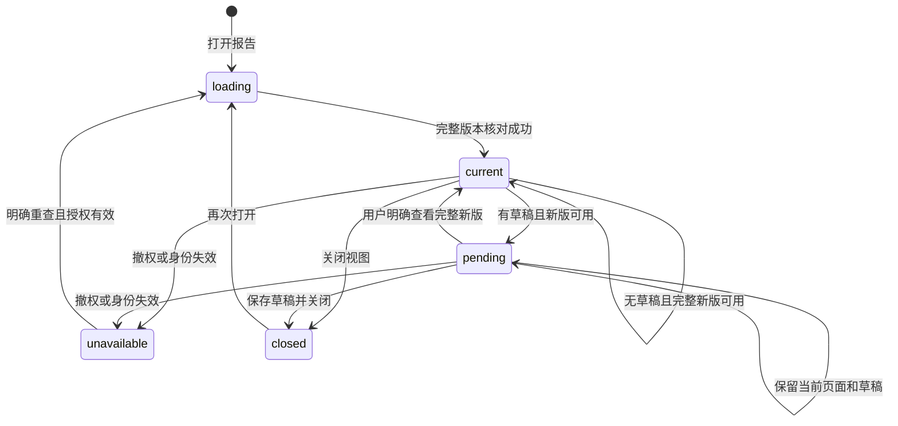

# interactive-research-reports Specification

## Purpose

为 Agent、科研 Graph 和人工调用方提供共同的原生报告呈现与交互入口，使项目中保存的 HTML 文献对比报告可浏览、附加选择、更新和重开。报告操作复用共同输入与领域授权，页面运行不取得文件、网络或内核访问权，报告及科研依据不依赖某个会话或窗口内存。

## ADDED Requirements

### Requirement: 同源有界报告头部与清单

报告入口 SHALL 以`<!--scholoom-report-v1`及换行起始，JSON清单后用独立一行`-->`结束；清单字符串中的`<`、`>`、`-` SHALL 使用JSON Unicode转义，头部解码不解析后续HTML。清单version固定1，资源最多32项、来源100项、对象100项，清单JSON最多128KiB；对象身份在本版本唯一、semantics最多8192 UTF-16单元，sourceIndexes只能指向本清单来源。依赖复用本项目ResourceRef／basis及相对路径／mediaType，来源复用既有ResourceRef／basis，不另建报告身份或存储。未知字段、版本、HTML／SVG依赖及递归报告来源 SHALL 拒绝。

#### Scenario: 头部与正文独立

- **WHEN** 读取已保存HTML入口的约定清单头部
- **THEN** 按版本、结构和容量核对JSON，不解析后续HTML；结束符须独占一行或位于文件末尾

### Requirement: 完整报告快照核对身份与授权

完整快照 SHALL 返回既有ResourceDescriptor及原清单；入口最多256KiB、单依赖8MiB、入口及依赖加载集最多32MiB，同时读取最多4项。路径解析与ref必须在核查前后指向同一对象；入口位置变化、依据变化、权限撤回、缺失或混合版本不得发布快照。人工读取及Agent外发分别沿所属read／send授权，模块测试的注入端口不授予生产权限。

#### Scenario: 独立固定报告完整核查

- **WHEN** 模块通过授权端口读取有界入口、声明依赖及来源
- **THEN** 返回原入口身份／依据和完整清单，不解析HTML或建立新存储，前后核对所有依据及path-ref对应

#### Scenario: 生产读取及后续模型准入

- **WHEN** 人工或Agent通过报告操作、共同资源describe／read／document或Agent原文件读取取得项目报告
- **THEN** 沿实际项目与库权威核对声明来源；Agent沿原ResourceEvidence持久记录实际使用来源，排队、下一轮及重启后的模型准入重新核查read／send，最后同步准入仍检查实际来源，不因页面ready或报告本身可读而放行

#### Scenario: 委派或目标报告缺少展开授权提供者

- **WHEN** 报告读取不能逐项核对委派材料范围及子模型最后准入，或目标报告无法在原targetRead范围内核对声明来源
- **THEN** 在展开来源前明确返回unavailable，普通目标HTML仍只读；不将父会话已用来源当作子权限，也不移除targetRead扩大访问

#### Scenario: 子执行读取已逐项授权的报告

- **WHEN** 实际活动子执行取得报告清单，入口及每项依赖／来源的ref及basis均在该子原可读范围
- **THEN** 复用Delegations唯一规则核对后才展开正文，仍核库read/send及目标授权；缺项或旧basis整批拒绝，报告声明和父权限不增加子权限

#### Scenario: 子报告来源在排队、最后准入或重启时撤权

- **WHEN** 子报告已成功核查，而来源在后续模型排队、最后同步准入或重启后的新请求前撤权
- **THEN** 从现有仓储保存的本实例报告Evidence及session来源重新核查，拒绝模型外发；声明核查不伪装实际全文read，旧子context不恢复权限或自动重放工作包

#### Scenario: 报告旧版本历史尚无来源核查Adapter

- **WHEN** 读取HTML的FileEdit全文或旧历史，任一正文带约定报告头部而不能按其原Evidence核查声明来源
- **THEN** 返回unavailable而不外发旧报告正文，保留changes摘要与普通材料历史；不将当前文件basis代替旧版本，不修改FileEdit存储权威

#### Scenario: 有原版本依据的报告历史

- **WHEN** 文件权威保留报告历史正文、原path及对应的before或after ResourceEvidence
- **THEN** 按该原版本完整核查依赖及声明来源的read／send后才返回历史正文，当前入口不能替代原basis；无依据或来源无法核查时继续明确失败，普通历史和变化摘要保持

#### Scenario: 单目标范围内的报告

- **WHEN** 目标报告的入口、依赖和声明来源均在原targetRead目标项目，调用方具有有效的原执行和目标读取资格
- **THEN** 使用既有登记身份和有界只读端口前后核查完整清单，原目标与源工作域保持，使用事实进入原模型准入核对；库或其他项目声明来源仍在展开前unavailable，不移除targetRead扩大范围

#### Scenario: 项目HTML有条件保存

- **WHEN** 调用方保存不超过256KiB的项目HTML
- **THEN** 复用原strong basis及expectedFileId核对后保存；同内容替换仍拒绝，库材料及跨项目目标不取得写权限，普通HTML不执行脚本

#### Scenario: 短分片、入口移动或来源撤权

- **WHEN** 来源HTML头部跨多个短分片，入口同basis移动影响相对依赖，或任何声明来源已撤权
- **THEN** 分片累计到所需前缀或真实EOF，拒绝递归报告、失效路径绑定或无权限候选，不返回部分成功快照

### Requirement: 桥消息仅携带有界JSON

桥消息 SHALL 带version、viewId、generation、basis，且只接受约定ready／state／select／restore／queued／error形状，不超过64KiB。select最多100个唯一对象身份及4096 UTF-16单元要求；state／restore仅携带JSON展示数据。校验不执行页面动作，不授予资源或接收者选择权。

#### Scenario: 桥数据必须有界且属于JSON

- **WHEN** 带version、viewId、generation、basis的页面桥消息进入schema校验
- **THEN** 只接受约定ready／state／select／restore／queued／error形状和不超过64KiB的JSON数据，select只携带最多100个唯一对象身份及4096 UTF-16单元要求；非JSON值、伪造资源／接收者及额外字段被拒绝，schema不执行页面动作

### Requirement: 项目报告与显式资源依赖

系统 SHALL 通过明确报告入口打开项目内 HTML 及显式本地资源清单，以稳定资源身份和实际内容依据核对入口及所有声明依赖。报告文件保存在所属项目，既有库材料可只读引用，页面不得自行解析任意路径、获取网络依赖或读取未声明文件。保存、更新及成果关联 SHALL 继续由所属领域管理，完整候选验证成功后才替换当前展示；依赖缺失、版本不符、权限撤回或保存部分成功须可辨，旧成果和草稿保留。普通 HTML 快照阅读及无脚本排版预览保持其原安全行为。

#### Scenario: 文件保存后关闭重开

- **WHEN** Agent 保存了报告和所需本地资源，用户关闭报告再从项目资源入口打开
- **THEN** 通过真实身份和版本重新读取已保存报告，无需原会话或旧页面内存，不把缺失依赖报告为完整成功

#### Scenario: 更新只保存部分文件

- **WHEN** 新资源已创建而报告入口尚未确认发布，或实际文件已保存但成果关联未知
- **THEN** 保留实际文件及原操作核查依据，当前完整报告保持，保存与关联状态分别显示，不重新创建成果或自动清理归属不明文件

### Requirement: 页面内浏览与共同指令动作

筛选、排序、展开等浏览操作 SHALL 在报告页面内完成，不启动 Agent。请求分析或修改所选对象 SHALL 将原报告版本、对象身份／说明、明确来源及用户要求加入当前会话的共同输入框，供检查、编辑与移除后发送；页面不能自选接收会话、伪造可信执行身份或直接调用工具。对象必须来自当前报告实际声明和加载的集合，区域／对象本身不授予读写及模型外发权限，超限请求明确拒绝且不丢草稿。

#### Scenario: 筛选后请求分析

- **WHEN** 用户筛选、排序并展开论文，再请求进一步分析所选对象
- **THEN** 浏览不产生执行；明确要求进入原会话共同草稿，只有用户发送后才沿正常指令可靠受理，库来源仍核对库读与外发授权

#### Scenario: 页面伪造对象或接收者

- **WHEN** 页面动作声明未知对象、其他报告版本、任意文件或其他会话
- **THEN** 请求被拒绝并有可诊断原因，不查询额外资源、不切会话，也不启动执行

### Requirement: 报告更新保护未完成工作

没有未提交编辑或批注时系统 SHALL 自动显示完整新报告，尽量保留新版仍支持的筛选、排序和展开状态。有页面草稿或相关共同输入草稿时 SHALL 保留旧页面与全部草稿并提示更新，由用户决定何时查看。显式项保留附加时的摘录和版本，不随更新重写或自动重定位；只读权限失效优先停止受保护内容展示，不能以草稿保护继续展示缓存。重复和迟到的更新不能覆盖较新结果。

#### Scenario: 已附加对象期间报告更新

- **WHEN** 已有页面批注或共同输入框显式项，Agent 保存完整新版
- **THEN** 旧页及草稿保持并出现更新提示，用户选择查看新版后仍保留原显式摘录及依据

#### Scenario: 关闭后带草稿重开

- **WHEN** 用户关闭有未提交工作且有待查看更新的报告，再次打开
- **THEN** 恢复可取得的原版本草稿并保留更新提示；原版本不可得则展示已保存摘录／草稿与原因，不假装草稿属于新版

#### Scenario: 新版已移除原来源时恢复旧草稿

- **WHEN** 旧草稿绑定R1，当前R2已移除R1声明的来源，而视图关闭后再次核查R1
- **THEN** 使用文件权威的原版本正文与Evidence确定R1完整来源集合，并按当前领域权限核读；R2可读不能批准R1，原来源明确拒绝则禁止恢复，原来源身份或权限不明则保留未核状态及原草稿

#### Scenario: 原版权限与字节可得性分别核查

- **WHEN** 原FileEdit依据仍可核查，原入口／依赖／来源当前稳定身份及读取权限均已肯定核准，但完整原版因内容变化或资源不可得不能取得
- **THEN** 仅在失败后再次完成原集合的当前身份／权限复核才返回可供草稿副本判定的不可用结果及结构化原因；不伪造完整快照、不把旧草稿迁入新版。坏清单、矛盾依据、撤权、身份或权限无法核实及无关失败不能自动降为草稿副本资格

#### Scenario: 原版本只保留在FileEdit的before侧

- **WHEN** 需要恢复的准确fileId／basis在文件权威的某条FileEdit.beforeEvidence及原正文中保留，而没有对应after侧记录
- **THEN** 使用该准确匹配侧的原path、正文和Evidence核查；不改用当前正文、其他fileId或近似basis。找不到或依据矛盾时保留原草稿及未核状态，不新建历史索引或假定原版有权可读

#### Scenario: 显式核查准确报告版本

- **WHEN** 调用方以原ref／basis请求resources.reportVersion
- **THEN** 经原资源或文件版本权威取得该准确正文和依据，核完整原集合后只返回完整快照或已肯定资格的字节不可用原因；返回前再次沿原Evidence复核所属read／send及调用范围，不返回内部授权凭据或未选择的另一侧正文，不改变普通报告及整条FileEdit读取语义

#### Scenario: 库登记可核但物理字节不可读

- **WHEN** 原报告所指库附件仍登记为同一材料版本，当前库read及必要send均有效，但其物理文件缺失
- **THEN** 将原版本身份／授权与字节不可读分别核查；完整肯定原集合资格后可返回字节unavailable，不将物理缺失误报成撤权。登记版本变化、元数据未知或实际授权拒绝时不批准草稿副本资格

### Requirement: 准入后准备报告字节

可信宿主准备报告执行所需字节时 SHALL 使用原进程准入权威的一次租约，在该租约ready后才调用完整冻结加载；排队期间只保留最小准备意图，不读取完整报告集。相同实例的重复准备 SHALL 复用原准备，不取得第二名额或重读同路径新版。实际清单形成后、创建任何OS执行范围前 SHALL 持久化原执行intent；私有准备回调不进入公共传输契约，不授予报告新的文件、网络或执行能力。

#### Scenario: 满额等待后取得唯一准备资格

- **WHEN** 可信宿主开始准备且原ProcessAdmission容量已满，随后名额释放
- **THEN** 等待阶段不读取完整报告集，ready后才冻结实际字节并形成真实清单，整个准备沿同一租约推进；不会为接公开stage再取得第二预留

#### Scenario: 准备取消或失败

- **WHEN** 准备期间取消、来源撤权、版本变化或冻结失败，或者迟到回调在取消后才返回
- **THEN** 拒绝后续准备／启动且不采用迟到结果；在途准备结清前保留其容量。没有创建OS范围的失败准确收尾，可能已经创建或持久停止未确认时仍沿原unknown核查，不伪造完整停止

### Requirement: 控制记录显式初始化

控制记录模块 SHALL 区分打开已知配置与准备新配置，复用原持久记录、根身份、完整库存和writer锁；既有配置读取失败不得隐式成为新配置。配置身份以原记录为准，不由调用方项目目录或连接身份替代。

#### Scenario: 打开已知控制配置不得隐式新建
- **WHEN** 控制记录模块按可信装配提供的准确configId打开既有配置
- **THEN** 系统只在原根身份、所属权限及完整库存均可核对时返回原配置与库存；缺失、复制、身份不符或异常库存均失败，不创建根、替换配置或把失败解释为新配置

#### Scenario: 控制配置只在显式空根准备中创建
- **WHEN** 可信装配明确请求准备新控制配置
- **THEN** 系统仅在持有原writer锁且原根除锁文件外完全为空时生成原配置身份；已有配置或残留数据不被覆盖，不因连接或调用方身份重新生成记录

#### Scenario: 同一配置的并发新建不能重绑定
- **WHEN** 同一记录对象在持有原writer锁时收到并发的显式新建请求
- **THEN** 只有一个请求可以建立原配置，其余拒绝；成功回执中的身份与实际持久配置一致，不通过并发检查重复生成或覆盖身份

### Requirement: 页面隔离与有界动作桥

报告脚本 SHALL 只能操作自己的页面，通过受限桥接提出浏览状态和附加对象请求；不得读取工作台 DOM、preload、凭据、认证连接、任意文件或网络，也不得自行启动程序或导航绕过隔离。桥接 SHALL 绑定实际视图和加载版本，验证消息结构、对象和容量，关闭或替换后旧页面请求失效。资源及请求过量或不支持脚本能力 SHALL 返回相关失败，不扩大权限或阻断无关领域操作。

#### Scenario: 脚本依赖跨进程同步取消默认输入

- **WHEN** 报告脚本请求在异步呈现宿主的原生默认动作之前同步取消该动作，例如对真实输入调用beforeinput.preventDefault
- **THEN** 系统明确将此能力报告为不支持并停止该报告的后续动作，保留已确认成果和未提交草稿，不将已经发生的默认输入或文字回滚包装为取消成功；浏览器与Electron采用相同边界，不影响无关材料和会话

#### Scenario: 原生控件及异步浏览操作

- **WHEN** 报告通过自身HTML／JS进行筛选、排序、展开或处理不依赖同步取消默认动作的原生控件输入
- **THEN** 继续沿通用页面布局和有界异步事件更新，不替换为固定科研业务模板，文本／数学、焦点／选区、草稿、辅助语义和明确来源仍按各自契约核验

#### Scenario: 恶意资源与导航

- **WHEN** 报告尝试外部fetch、图片／脚本／字体加载、表单、嵌入页面、窗口打开或导航外发
- **THEN** 无外部资源请求、凭据或内核能力被交付，报告保留可诊断失败，普通材料阅读继续可用

#### Scenario: 旧页面迟到消息和消息洪泛

- **WHEN** 报告版本已替换或关闭后仍有旧消息，或当前页面超过桥接容量
- **THEN** 旧消息不能进入草稿，过量请求被有界拒绝，不形成无界待发送队列

### Requirement: 无工作台等待与可诊断接续

报告关闭、工作台断线或页面销毁 SHALL 不取消已受理的 Agent 工作、不自动消费等待或启动新工作。需要用户输入的执行继续使用既有可持久查询等待和共同消息接续；重开报告不冒充输入。新会话 SHALL 能从项目报告和明确来源继续研究，旧会话仅作为可选关联。诊断 SHALL 区分报告载入、页面动作、草稿附加、发送受理、执行、实际保存及刷新。

#### Scenario: 执行等待时关闭窗口

- **WHEN** 已受理执行到达持久等待而用户关闭工作台，之后重新连接
- **THEN** 已保存报告及等待仍可查询，用户发送合法新消息后沿原机制核查接续，页面ready事件不能恢复执行

#### Scenario: 受理回执未知或保存刷新失败

- **WHEN** 共同发送回执未知，或实际保存完成后报告刷新失败
- **THEN** 前者保留原指令身份核查，后者保留实际成果并诊断刷新失败，两者都不通过重复页面动作重放工作
