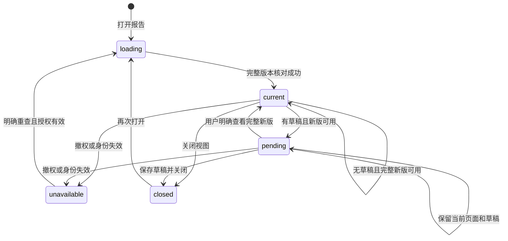

# interactive-research-reports Specification

## Purpose

为 Agent、科研 Graph 和人工调用方提供共同的原生报告呈现与交互入口，使项目中保存的 HTML 文献对比报告可浏览、附加选择、更新和重开。报告操作复用共同输入与领域授权，页面运行不取得文件、网络或内核访问权，报告及科研依据不依赖某个会话或窗口内存。

## ADDED Requirements

### Requirement: 项目报告与显式资源依赖

系统 SHALL 通过明确报告入口打开项目内 HTML 及显式本地资源清单，以稳定资源身份和实际内容依据核对入口及所有声明依赖。报告文件保存在所属项目，既有库材料可只读引用，页面不得自行解析任意路径、获取网络依赖或读取未声明文件。保存、更新及成果关联 SHALL 继续由所属领域管理，完整候选验证成功后才替换当前展示；依赖缺失、版本不符、权限撤回或保存部分成功须可辨，旧成果和草稿保留。普通 HTML 快照阅读及无脚本排版预览保持其原安全行为。

#### Scenario: 文件保存后关闭重开

- **WHEN** Agent 保存了报告和所需本地资源，用户关闭报告再从项目资源入口打开
- **THEN** 通过真实身份和版本重新读取已保存报告，无需原会话或旧页面内存，不把缺失依赖报告为完整成功

#### Scenario: 更新只保存部分文件

- **WHEN** 新资源已创建而报告入口尚未确认发布，或实际文件已保存但成果关联未知
- **THEN** 保留实际文件及原操作核查依据，当前完整报告保持，保存与关联状态分别显示，不重新创建成果或自动清理归属不明文件

### Requirement: 页面内浏览与共同指令动作

筛选、排序、展开等浏览操作 SHALL 在报告页面内完成，不启动 Agent。请求分析或修改所选对象 SHALL 将原报告版本、对象身份／说明、明确来源及用户要求加入当前会话的共同输入框，供检查、编辑与移除后发送；页面不能自选接收会话、伪造可信执行身份或直接调用工具。对象必须来自当前报告实际声明和加载的集合，区域／对象本身不授予读写及模型外发权限，超限请求明确拒绝且不丢草稿。

#### Scenario: 筛选后请求分析

- **WHEN** 用户筛选、排序并展开论文，再请求进一步分析所选对象
- **THEN** 浏览不产生执行；明确要求进入原会话共同草稿，只有用户发送后才沿正常指令可靠受理，库来源仍核对库读与外发授权

#### Scenario: 页面伪造对象或接收者

- **WHEN** 页面动作声明未知对象、其他报告版本、任意文件或其他会话
- **THEN** 请求被拒绝并有可诊断原因，不查询额外资源、不切会话，也不启动执行

### Requirement: 报告更新保护未完成工作

没有未提交编辑或批注时系统 SHALL 自动显示完整新报告，尽量保留新版仍支持的筛选、排序和展开状态。有页面草稿或相关共同输入草稿时 SHALL 保留旧页面与全部草稿并提示更新，由用户决定何时查看。显式项保留附加时的摘录和版本，不随更新重写或自动重定位；只读权限失效优先停止受保护内容展示，不能以草稿保护继续展示缓存。重复和迟到的更新不能覆盖较新结果。

#### Scenario: 已附加对象期间报告更新

- **WHEN** 已有页面批注或共同输入框显式项，Agent 保存完整新版
- **THEN** 旧页及草稿保持并出现更新提示，用户选择查看新版后仍保留原显式摘录及依据

#### Scenario: 关闭后带草稿重开

- **WHEN** 用户关闭有未提交工作且有待查看更新的报告，再次打开
- **THEN** 恢复可取得的原版本草稿并保留更新提示；原版本不可得则展示已保存摘录／草稿与原因，不假装草稿属于新版

### Requirement: 页面隔离与有界动作桥

报告脚本 SHALL 只能操作自己的页面，通过受限桥接提出浏览状态和附加对象请求；不得读取工作台 DOM、preload、凭据、认证连接、任意文件或网络，也不得自行启动程序或导航绕过隔离。桥接 SHALL 绑定实际视图和加载版本，验证消息结构、对象和容量，关闭或替换后旧页面请求失效。资源及请求过量或不支持脚本能力 SHALL 返回相关失败，不扩大权限或阻断无关领域操作。

#### Scenario: 恶意资源与导航

- **WHEN** 报告尝试外部fetch、图片／脚本／字体加载、表单、嵌入页面、窗口打开或导航外发
- **THEN** 无外部资源请求、凭据或内核能力被交付，报告保留可诊断失败，普通材料阅读继续可用

#### Scenario: 旧页面迟到消息和消息洪泛

- **WHEN** 报告版本已替换或关闭后仍有旧消息，或当前页面超过桥接容量
- **THEN** 旧消息不能进入草稿，过量请求被有界拒绝，不形成无界待发送队列

### Requirement: 无工作台等待与可诊断接续

报告关闭、工作台断线或页面销毁 SHALL 不取消已受理的 Agent 工作、不自动消费等待或启动新工作。需要用户输入的执行继续使用既有可持久查询等待和共同消息接续；重开报告不冒充输入。新会话 SHALL 能从项目报告和明确来源继续研究，旧会话仅作为可选关联。诊断 SHALL 区分报告载入、页面动作、草稿附加、发送受理、执行、实际保存及刷新。

#### Scenario: 执行等待时关闭窗口

- **WHEN** 已受理执行到达持久等待而用户关闭工作台，之后重新连接
- **THEN** 已保存报告及等待仍可查询，用户发送合法新消息后沿原机制核查接续，页面ready事件不能恢复执行

#### Scenario: 受理回执未知或保存刷新失败

- **WHEN** 共同发送回执未知，或实际保存完成后报告刷新失败
- **THEN** 前者保留原指令身份核查，后者保留实际成果并诊断刷新失败，两者都不通过重复页面动作重放工作
