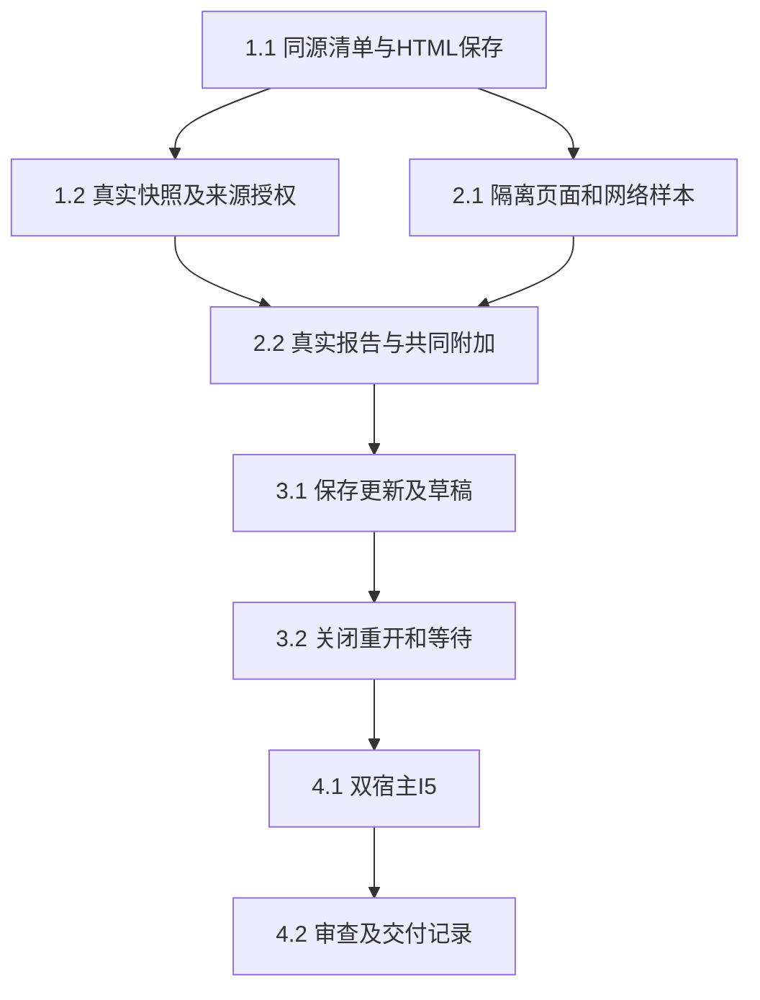

# 执行任务

当前共同源码58eda140已包含主线接收的有限原生调查。本片只规划独立[Linux隔离提供者](../add-linux-isolated-report-provider/tasks.md)并链接前置，没有新生产实现或重跑原生样本。原高FD／SCM证据在`/home/joshua/.cache/scholoom-report-gate-round14-DocB5o/`，本轮规划证据在`/home/joshua/.cache/scholoom-linux-provider-plan-round15-7V4Vot/`，不依赖现有/tmp。报告仍6/13，2.1b／I5及目标／旧版本Adapter继续开放，活动报告unavailable。

## 1. 同源报告及真实项目保存

- [x] 1.1a 本轮：protocol/report-contracts同源manifest／snapshot／桥schema及容量／跨字段校验，editor/report-codec有界头部解析和转义编码；必要protocol叶导出／架构声明，不注册操作、不扩ResourceRef。以独立固定样本验证格式、UTF-16／字节边界及额外字段拒绝；先构建再模块测试。
- [x] 1.1b 生产接入：UI设计报告分节、公开根导出及resources.report注册、HTML条件保存、派生映射；真实ManualApplication验证保存重开、同内容替换拒绝、只读目标和库权限不扩大。
- [x] 1.2a 本轮：editor/report-resources的注入窄端口ReportResources深模块，复用共同describe/read及相对路径解析；核对入口／依赖／来源、path-ref一致、前后basis、read/send、容量、撤权和混合版本拒绝。测试adapter可替换，不新建存储／DTO，手工粘贴来源不作完整溯源承诺。
- [x] 1.2b.1 已验收：真实项目／库授权Adapter及editor公开入口，Manual及普通根执行的报告describe/read和模型准入复用声明来源授权，经真实broker及所属存储验证queue／final／restart；target和旧报告历史正文继续不可用，委派沿1.2b.2a推进。
- [x] 1.2b.2a 本轮：从Delegations.resources提取唯一checkReadable，普通describe/read/document及报告入口／展开Evidence复用；成功展开的来源沿现有Evidence仓储按子实例保存，子模型queue／最终同步准入核查范围与领域read/send，session记录继续保护父及重启。真实父子worker／库／报告验证全部允许、缺项／旧basis／撤权拒绝、取消及恢复，不把声明核查记为实际正文read。
- [ ] 1.2b.2b 保持开放：目标报告的声明来源授权组合、旧报告历史版本Adapter。旧报告历史及目标报告继续明确不可用，保留摘要与普通材料；不因委派子片完成关闭完整1.2b.2或I5。

## 2. 页面内浏览与共同动作

- [x] 2.1a 调查原型已交付：tests/fixtures/report-frame专用候选模块及真实Browser／Electron静态夹具，消费实际ReportResources快照与有版本的资源字节，复用Bridge schema；合法脚本及清单资源、HTTP／UDP探针、CSP／父frame-src／导航／资源通道、宿主访问及有界桥生命周期已有代表性证据。两宿主实际STUN外发、Browser忙循环阻塞反例见delivery；只关闭调查，不算生产已隔离，生产保持unavailable。
- [ ] 2.1b 未实施正式承载：有限原生对照已接收，独立platform前置见[提供者规划](../add-linux-isolated-report-provider/design.md)，尚未实施／接入。真实冻结字节消费者、完整网络／syscall／迟到能力、unknown／容量／恢复及浏览器仍需实际证据。呈现／分发另片决定，不能凭临时launcher接生产；2.2／3.x和完整I5不在本片。
- [ ] 2.2 实际文献对比页面支持筛选／排序／展开，已加载对象通过原子appendContextItems进入同一composer，用户检查正文后沿原session.send；核对objectIds、报告basis、明确来源、comment与接收者不变。超限整批拒绝保留草稿。1.2与2.1可分离实现，本线主Agent整合共同贡献及共享资源符号，禁止并行写同一文件。

## 3. 完整更新、草稿与接续

- [ ] 3.1 经真实harness保存新资源后条件发布HTML入口，范围订阅合并最新候选，完整验证后自动更新；有页面／composer草稿时保留原页提示，明确查看新版仍保留原显式项。扩展真实机械链路，覆盖发布前失败、保存关联unknown、迟到候选、来源撤权和旧资源不可得，保留旧成果而不重放写入。
- [ ] 3.2 按窗口／配置／报告版本保存有界浏览状态和草稿，关闭／重开核对身份权限及原版本不可得提示；工作台关闭不取消普通已受理执行，调试内核仍按原生命周期退出。复用固定registered图核对持久等待和新session.send接续，页面ready不消费等待、重启不自动推进；新会话可从实际报告／来源继续，不依赖原session。

## 4. 整合与交付

- [ ] 4.1 本线主Agent负责报告I5，使用真实报告文件、库来源、共同composer、broker／harness worker／保存／刷新，模型仅在外部边界受控；浏览器和真实Electron均检查2／3组行为及诊断阶段。运行design列最小kernel／UI／协议生成／类型／架构与必要构建，父CSP改动回归普通HTML／PDF预览。既有CI失败按原证据定位、未通过部分保持未完成，不加全仓无关测试或超时补丁。
- [ ] 4.2 安排独立审查核对页面隔离、来源授权、完整发布、并发与草稿；根据实际结果更新UI和开发入口，初设改为正式契约链接。实际执行后获取delivery instructions创建delivery.md，逐项说明真实接线、替身、科研质量／平台未验收范围，再决定任务完成；规划阶段不创建该文件。

## 续做入口

本片只更新原investigation／design／tasks／delivery，停止于实际条件矩阵交回；任务仍6/13，不把原生校准算2.1b正式实施。呈现方向、部署／安装、运行时分发维护及交互／资源预算仍待决，不再等待已合入的来源授权／schema。

最小下一步为主线审[独立提供者公共签名与任务](../add-linux-isolated-report-provider/tasks.md)，报告侧待其真实交付后再实现按原ref／basis冻结字节Adapter及核权。浏览器、目标OS校准、呈现契约／共同UI接入未执行；本片到规划停止，不自动进入实施。接续源码和输入已在Git／cache，无旧/tmp前置，Mac或目标证据不足保持unavailable。
