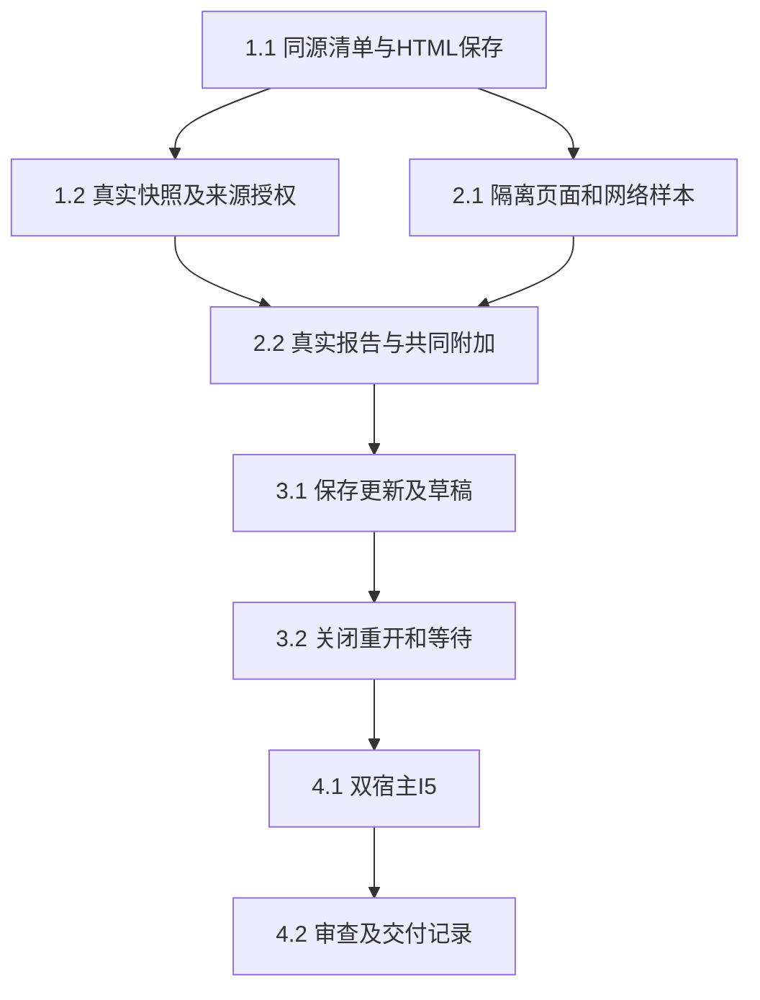

# 执行任务

用户已采纳项目内有界报告方案；本轮主线正式交接两份设计和各线源码快照，授权复核独立模块任务及公共补丁方案。报告业务任务尚未实施，所有复选框保持未完成；已接收输入、独立模块范围和仍需审查的公共触点见design末节，不再将“未收到设计”作为全线前置。

## 1. 同源报告及真实项目保存

- [ ] 1.1 实施前更新UI设计报告分节；protocol/report-contracts定义manifest／snapshot／桥消息与resources.report，扩展原项目HTML条件保存，派生类型／映射／校验同源。resource-access／resource-identity复用真实ManualApplication验证保存重开、同内容替换拒绝、只读目标和库权限不扩大；本线拥有schema与宿主注册，不等待材料位置增量。
- [ ] 1.2 在editor内实现ReportResources，通过原项目／库窄端口校验本项目依赖、来源、版本和容量；实际执行describe/read及模型准入复用声明来源授权。核对缺失／越界／撤权／混合版本拒绝及手工粘贴来源不作完整溯源承诺。独立module允许替换窄端口，生产组合必须走真实broker和所属存储。

## 2. 页面内浏览与共同动作

- [ ] 2.1 实现受限iframe／CSP／父导航限制与版本绑定MessagePort，用现有浏览器工具和合成报告核对外部fetch、资源、导航、popup、表单、嵌入、worker无网络请求及无preload／DOM／内核访问；测试消息过量、关闭释放及旧port。任一宿主无法保证已确认隔离时停止启用并返回证据，不弱化约束。
- [ ] 2.2 实际文献对比页面支持筛选／排序／展开，已加载对象通过原子appendContextItems进入同一composer，用户检查正文后沿原session.send；核对objectIds、报告basis、明确来源、comment与接收者不变。超限整批拒绝保留草稿。1.2与2.1可分离实现，本线主Agent整合共同贡献及共享资源符号，禁止并行写同一文件。

## 3. 完整更新、草稿与接续

- [ ] 3.1 经真实harness保存新资源后条件发布HTML入口，范围订阅合并最新候选，完整验证后自动更新；有页面／composer草稿时保留原页提示，明确查看新版仍保留原显式项。扩展真实机械链路，覆盖发布前失败、保存关联unknown、迟到候选、来源撤权和旧资源不可得，保留旧成果而不重放写入。
- [ ] 3.2 按窗口／配置／报告版本保存有界浏览状态和草稿，关闭／重开核对身份权限及原版本不可得提示；工作台关闭不取消普通已受理执行，调试内核仍按原生命周期退出。复用固定registered图核对持久等待和新session.send接续，页面ready不消费等待、重启不自动推进；新会话可从实际报告／来源继续，不依赖原session。

## 4. 整合与交付

- [ ] 4.1 本线主Agent负责报告I5，使用真实报告文件、库来源、共同composer、broker／harness worker／保存／刷新，模型仅在外部边界受控；浏览器和真实Electron均检查2／3组行为及诊断阶段。运行design列最小kernel／UI／协议生成／类型／架构与必要构建，父CSP改动回归普通HTML／PDF预览。既有CI失败按原证据定位、未通过部分保持未完成，不加全仓无关测试或超时补丁。
- [ ] 4.2 安排独立审查核对页面隔离、来源授权、完整发布、并发与草稿；根据实际结果更新UI和开发入口，初设改为正式契约链接。实际执行后获取delivery instructions创建delivery.md，逐项说明真实接线、替身、科研质量／平台未验收范围，再决定任务完成；规划阶段不创建该文件。

## 续做入口

当前停在公共对接方案。本轮没有实施报告；下一批优先1.1的独立schema／codec、1.2的注入端口模块及2.1的隔离夹具，它们不等待材料位置增量、库修订、任务UI或科研Graph。HTML条件保存、原子附加、来源授权复查及父CSP／宿主装配分别审查后再接生产组合；精确范围见design。已有依赖可复用，不安装新依赖；隔离验证沿本树用户已取得的具体授权，5643方案启动前核对实际占用，不能推定为允许日常开发服务器。
