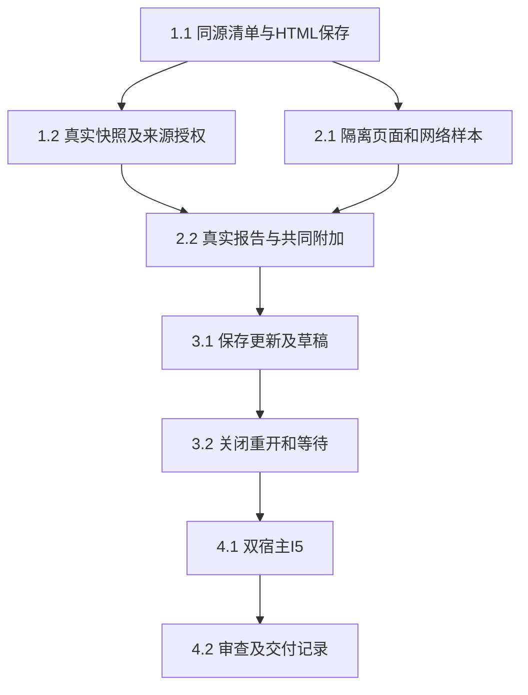

# 执行任务

2026-10-29第19轮主线接收2.1d真实Linux准备接线，当前12/22（新增3.1a／b与3.2a／b独立片）。主线内核组合8通过／3个Windows跳过、R2观测双宿主2/2；独审Linux与Windows整改无确证P1/P2。R2纯文本投影有数学语义丢失，候选不采纳为正式呈现；活动承载及完整I5继续开放。依据见design第19轮及delivery，不依赖/tmp。

## 1. 同源报告及真实项目保存

- [x] 1.1a 本轮：protocol/report-contracts同源manifest／snapshot／桥schema及容量／跨字段校验，editor/report-codec有界头部解析和转义编码；必要protocol叶导出／架构声明，不注册操作、不扩ResourceRef。以独立固定样本验证格式、UTF-16／字节边界及额外字段拒绝；先构建再模块测试。
- [x] 1.1b 生产接入：UI设计报告分节、公开根导出及resources.report注册、HTML条件保存、派生映射；真实ManualApplication验证保存重开、同内容替换拒绝、只读目标和库权限不扩大。
- [x] 1.2a 本轮：editor/report-resources的注入窄端口ReportResources深模块，复用共同describe/read及相对路径解析；核对入口／依赖／来源、path-ref一致、前后basis、read/send、容量、撤权和混合版本拒绝。测试adapter可替换，不新建存储／DTO，手工粘贴来源不作完整溯源承诺。
- [x] 1.2b.1 已验收：真实项目／库授权Adapter及editor公开入口，Manual及普通根执行的报告describe/read和模型准入复用声明来源授权，经真实broker及所属存储验证queue／final／restart；target和旧报告历史沿1.2b.2b交付，委派沿1.2b.2a交付。
- [x] 1.2b.2a 本轮：从Delegations.resources提取唯一checkReadable，普通describe/read/document及报告入口／展开Evidence复用；成功展开的来源沿现有Evidence仓储按子实例保存，子模型queue／最终同步准入核查范围与领域read/send，session记录继续保护父及重启。真实父子worker／库／报告验证全部允许、缺项／旧basis／撤权拒绝、取消及恢复，不把声明核查记为实际正文read。
- [x] 1.2b.2b 目标报告及旧报告历史版本Adapter完成：历史使用可信FileEdit原正文／Evidence／path，整组返回前同步复核全部声明来源；原版本摘录进入受理末次及持久模型复查。单目标入口／依赖／来源只允许原目标内既有身份，不登记或扩大授权，库／第三项目来源拒绝；当前坏清单不阻断合法原版本。真实host指令受理及执行读取、历史跨段撤权和现有目标／委派竞争联合59/59；独审发现已修复复核，完整I5仍开放。

## 2. 页面内浏览与共同动作

- [x] 2.1a 调查原型已交付：tests/fixtures/report-frame专用候选模块及真实Browser／Electron静态夹具，消费实际ReportResources快照与有版本的资源字节，复用Bridge schema；合法脚本及清单资源、HTTP／UDP探针、CSP／父frame-src／导航／资源通道、宿主访问及有界桥生命周期已有代表性证据。两宿主实际STUN外发、Browser忙循环阻塞反例见delivery；只关闭调查，不算生产已隔离，生产保持unavailable。
- [ ] 2.1b 正式承载仍未完成：独立[platform提供者](../add-linux-isolated-report-provider/delivery.md)9/9已由主线真实Linux固定静态native组接收，网络／syscall／迟到能力、unknown／容量／恢复已有其限定策略证据。该提供者仅内部六操作，未接产品宿主或完整浏览器；真实冻结字节消费者、浏览器完整进程图及呈现／分发仍需实施与实际验证，不能把native样本或临时launcher当活动报告。2.2／3.x及完整I5继续开放。

  本片已形成[独立身份服务候选](../../../.scratch/scholoom-foundations/research/report-independent-identity-service.md)；主线选择的账户信任、准备接缝及本轮呈现校准范围见design“第17轮主线接收与下一片”。服务部署／安装及完整呈现尚未通过，不再试同UID固定launcher。T2依赖T1且须证明完整浏览器、双宿主文本／输入／可访问性及实际停止。

  R2本片已有`tests/fixtures/report-surface/`可运行可信调查夹具，实际双宿主2/2观测通过；纯文本投影将原MathML分数1/2变成12并丢失数学辅助结构，故完整呈现未达判据，2.1b不勾。系统IME／读屏器及正式架构仍待主线；详见investigation首节／delivery。本行仅记录R2，不改变2.1d／2.2c进度。
- [x] 2.1c 独立准备接缝：在现有provider内部沿同一真实ProcessAdmission租约，ready后才调用可信freeze准备回调，复用原记录／分片及失败收尾，不新增wire操作、第二次reserve或假assets。同实例重复准备合并，取消／撤权／失败及迟到结果不得启动或提前释放在途准备；创建OS范围前先持久原intent。实际ReportResources消费者与可替换OS端口独立验证，服务／浏览器仍不启用。
- [x] 2.1d 真实Linux准备接线：默认OS提供者与实际ReportResources.freeze经prepare完成真实字节／准入／启动／停止，覆盖满槽后延迟读取及冻结期间取消。复用已登记固定静态native探针及原policy，在自有scope验证持久intent、实际字节、完整停止及容量；不复制原17项原生矩阵，不启用服务／浏览器或改公共wire，前置不满足准确交回。
- [ ] 2.2 实际文献对比页面支持筛选／排序／展开，已加载对象通过原子appendContextItems进入同一composer，用户检查正文后沿原session.send；核对objectIds、报告basis、明确来源、comment与接收者不变。超限整批拒绝保留草稿。1.2与2.1可分离实现，本线主Agent整合共同贡献及共享资源符号，禁止并行写同一文件。
- [x] 2.2a 独立共同增量：appendContextItems同步返回成功／失败，一次完整合并校验后单次写回，16项／64KiB或非法项整批拒绝且原草稿不变；原单项委托同一实现，失效接收者及往返切换旧回调拒绝。复用真实useBusinessSession／草稿与贡献测试，补图片夹具消费者，运行必要类型／构建及双宿主单项／迟到回执保护；独立审查整改后只关闭本子项，不据此关闭完整2.2／报告I5。
- [x] 2.2b 可信报告选择消费者：createReportContext捕获已核snapshot、视图／版本和原接收者，将实际对象、明确来源及comment原子交原共同草稿；关闭／往返失效、非法／未知／超限整批拒绝。主线消费者与共同贡献9/9、独审5/5及六组有界探针通过；只关闭独立模块，不声称真实资源授权、浏览器或I5接通。
- [x] 2.2c 可操作的可信模块夹具：在既有UI harness中以实际消费者、共同草稿及检查／编辑／移除入口承接固定文献对比样本的筛选／排序／展开和显式附加。实际内部草稿、版本／接收者和容量保持，client／来源快照与控制器替身明确；禁止执行任意报告脚本或新增产品工作台，不以夹具通过关闭完整2.2。

## 3. 完整更新、草稿与接续

- [ ] 3.1 经真实harness保存新资源后条件发布HTML入口，范围订阅合并最新候选，完整验证后自动更新；有页面／composer草稿时保留原页提示，明确查看新版仍保留原显式项。扩展真实机械链路，覆盖发布前失败、保存关联unknown、迟到候选、来源撤权和旧资源不可得，保留旧成果而不重放写入。
- [ ] 3.1a 真实普通harness报告发布片：经产品session.send及受控外部模型，由真实worker工具创建新依赖后条件保存入口，核实际文件／关联及失败／unknown不重放；复用现有报告fixture与资源操作，不新增发布wire／业务Graph。只验证保存发布，不关闭刷新／浏览器。
- [ ] 3.1b 候选更新Module：沿真实ResourceEvidence／ReportSnapshot和实际授权加载端口，有界合并候选、拒绝迟到／坏版本／撤权；完整核查后无草稿可切换，有页面草稿或原显式项则保留原页及待看新版，明确查看新版不改共同草稿。仅metadata生命周期，不运行页面或拥有OS范围，不改共享ResourceView。
- [ ] 3.2 按窗口／配置／报告版本保存有界浏览状态和草稿，关闭／重开核对身份权限及原版本不可得提示；工作台关闭不取消普通已受理执行，调试内核仍按原生命周期退出。复用固定registered图核对持久等待和新session.send接续，页面ready不消费等待、重启不自动推进；新会话可从实际报告／来源继续，不依赖原session。
- [ ] 3.2a 有界报告状态保管：复用原drafts及既有桥JSON／64KiB限制，按可信配置／窗口／项目入口身份／basis读写原browse／draft／dirty；只读取准确key，损坏／超限／错版本可辨，不迁草稿到新版、不另建存储。独立测试真实适配，内存降级不说磁盘可靠保存。
- [ ] 3.2b 真实registered图报告接续片：固定测试Graph沿真实保存／等待／checkpoint与重启，重连及读取报告不消费等待，合法新session.send才继续；新会话能从实际报告及明确来源读回接续。只验机械链路，无生产业务Graph／真实模型或科研质量，不以单内核例关闭双宿主。

## 4. 整合与交付

- [ ] 4.1 本线主Agent负责报告I5，使用真实报告文件、库来源、共同composer、broker／harness worker／保存／刷新，模型仅在外部边界受控；浏览器和真实Electron均检查2／3组行为及诊断阶段。运行design列最小kernel／UI／协议生成／类型／架构与必要构建，父CSP改动回归普通HTML／PDF预览。既有CI失败按原证据定位、未通过部分保持未完成，不加全仓无关测试或超时补丁。
- [ ] 4.2 安排独立审查核对页面隔离、来源授权、完整发布、并发与草稿；根据实际结果更新UI和开发入口，初设改为正式契约链接。实际执行后获取delivery instructions创建delivery.md，逐项说明真实接线、替身、科研质量／平台未验收范围，再决定任务完成；规划阶段不创建该文件。

## 续做入口

当前12/22。下一轮五线并行：3.1a普通harness发布、3.1b候选更新、3.2a状态保管、3.2b真实Graph接续及R2b保留原结构的可信呈现对照。确切接口与写集见design第19轮；共享report-context／drafts／protocol不并写，工件由主线接收。完整2.1b／2.2／3.x／I5仍未通过。

下一步由主线按design候选节决定受保护身份／认证、系统部署与共同呈现方案，再明确T1许可；通过后才接完整浏览器与T2。当前不改生产或启用报告，后续不从旧缓存整体应用实现。固定native绿色、只读资料或CLI状态均不代替浏览器通过；macOS及其他目标证据不足保持unavailable。
