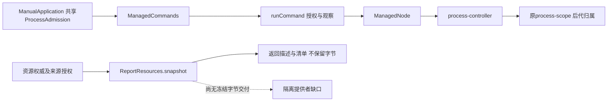

# 调查依据

## 当前事实与复用选择

2026-10-28起点`58eda1404fcc60036ce0e0f3ce30d5453ce1ee30`、工作区clean、无`.codegraph/`。`openspec list --json`核repo-local根，13个已有change没有同名／等价独立提供者；已读正式platform-access、module-runtime、kernel-lifecycle及原报告delta，创建本change使用scholoom-dev。新工件／校验根为`/home/joshua/.cache/scholoom-linux-provider-plan-round15-7V4Vot/`，命令显式TMPDIR同根。当前仅静态复核及规划，没有运行新native或生产路径。

### 本树代码事实

| 事实源 | 当前行为及可复用职责 | 本change需要补足 |
| --- | --- | --- |
| `packages/editor/src/report-resources.ts::ReportResources.snapshot`及`apps/kernel/src/manual.ts::reportResources/reportSnapshot` | 已沿真实describe／read／authorize核入口、依赖、来源、ref／basis、path-ref及前后授权；返回`{resource,manifest}`，内部读取的依赖字节被丢弃 | 不存在可交付platform的冻结字节包；必须在所属端口按原basis重新取字节并前后核对。平台不从ref／路径自行读库或复制权限 |
| `packages/protocol/src/report-contracts.ts::reportLimits`、`core.ts::limits` | 报告入口256KiB、依赖8MiB、加载集32MiB、依赖32项；公共frameBytes为2MiB | 32MiB整包不能塞进单帧。design建议按原instanceId分阶段、有界分片准备并封存，不能新增reportId或扩大frame限额 |
| `packages/platform/src/admission.ts::ProcessAdmission` | 同一宿主实例共享的reserve／ready／retainUntil／release；拒绝停止确认保留容量，retainUnknown按instanceId去重且可在满额恢复占用 | 无解除recovered集合的接口；新提供者恢复确认不能另维护一份容量表。最小公共签名在design提交主线 |
| `apps/kernel/src/manual.ts:221,271,293`、`application.ts` | 一个应用实例的this.processes注入ManagedCommands、harness及原生消费者；broker绑定可信上下文与平台命令 | 新提供者复用同一实例，在宿主初始化准入前核查自身遗留；不是每个报告／模块new ProcessAdmission |
| `packages/platform/src/processes.ts::ManagedNode`及`process-controller.ts` | 活动child handle＋instanceId核身份；controller独立响应停止；未收stopped即outcomeUnknown，reservation.retainUntil(stopped) | Node bootstrap及原生后代监督不是任意浏览器的网络／文件／配额隔离门。不能把fork已发生解释为目标受限代码已可执行 |
| `packages/platform/native/process-scope.c` | 正确路径是platform/native，Linux subreaper收养并清理后代，Windows Job仅KILL_ON_JOB_CLOSE；已有原生控制通道与退出确认 | 不提供网络namespace、CPU/memory/pids实际配额、系统调用策略或systemd重启范围凭据。现有worker内部FD不能直接暴露给不可信样本 |
| `packages/platform/src/command.ts::runCommand` | 原reservation贯穿controller，排队后授权，started／exited／stopped分开；finally完整stop，原环境会保留HOME等 | 复用监督契约及诊断，不调用它来继承环境运行不可信报告；不增加普通commands的全局隔离开关 |
| `apps/kernel/src/host-connection.ts::initialize/retainUnknownScope/save` | 启动前读私有监督记录，停止回执保存成功后才resolve；旧PID或连接断开不授予接管权 | 复用记录次序／恢复原则，不复用插件DTO或复制插件权威。当前没有通用隔离范围恢复服务 |
| `packages/platform/src/private-files.ts`、`build-process-scope.mjs`、`architecture.json` | 私有目录／原子临时文件、已有C构建和平台系统访问守卫可复用；atomicPrivateFile对文件sync后rename | 不能据此假定目录项已抗崩溃持久化；新范围intent需同目录身份核对及目录同步的可验证保证，失败不spawn |

只读辅助核对调用链及既有测试；主会话补读正确native路径。两次探索中猜测的execution-processes／execution-persistence规格和docs/architecture-policy.json不存在，已改用实际platform-access／kernel-lifecycle和根architecture.json；不存在路径没有成为依赖或“已读”证据。

图中实线为现有调用，虚线为缺失路径；普通命令与ReportResources目前没有隔离承载连接。

### 复用的原生证据与时效

以下是已被主线接收的真实本机有限样本，本轮仅读取JSON／源码，没有重跑：

| 精确cache入口 | 已证事实及保留反例 |
| --- | --- |
| `/home/joshua/.cache/scholoom-report-platform-round12-fNGQLv/{scope-probe.c,native-mechanisms.c,scope-result.json,namespace-result.json,native-result.json,network-final-result.json}` | systemd259.5／bwrap0.11.1、uid1000；独立普通user scope读回20%CPU／64MiB／swap0／16tasks；显式namespace及实际CPU节流、OOM／pids拒绝、多代停止。首轮TCP只计data缺口保留，后仅补accept／失败结果核查；只证自有loopback目标，没有外部DNS／浏览器结论 |
| `/home/joshua/.cache/scholoom-report-files-round13-Wfc0WT/{file-probe.c,file-launcher.c,file-calibration.mjs,file-first-result.json,file-conditions-matrix.json}` | 隐藏路径仍可经继承文件／目录FD读取；已连接Unix／TCP与只读pathname socket保留宿主代理；cgroup写FD可迁入另一自有限额scope。netns／ro／NNP不撤销已持权威 |
| `/home/joshua/.cache/scholoom-report-gate-round14-DocB5o/{gate-launcher.c,gate-payload.c,gate-calibration.mjs,gate-first-result.json,gate-conditions-matrix.json,independent-review.md}` | 高256／1024及SCM危险控制成立；关闭后实际EBADF，可信stdio实际ENOTSOCK；误暴露2能传入迁移FD，另以启动exit77拒绝配置。类型／身份门拒绝特殊文件及替代inode。unsafe直接先迁移，SCM跨组依据用独立stdio-leak。原cgroupExists默认值缺口以六条原preflight路径只读补核，不篡改首轮结果 |

原EDQUOT、编译warning和观察缺口均由原报告[investigation](../add-interactive-research-reports/investigation.md)／[delivery](../add-interactive-research-reports/delivery.md)维护，不重建另一份原生账本。本轮不把历史“原生轮退出0”提升为生产安全、重启或完整浏览器通过。cache是接续输入；现有/tmp内容不在必要输入集合。

## 影响方案的未知项与实验

本轮不新增实验。以下是明确阻断相应保证／分支的未知项，不能由规划文件或模块替身闭合：

| 阻断 | 已有反例／缺证 | 最小下一校准与停止条件 |
| --- | --- | --- |
| 完整网络／迟到能力／syscall策略 | 没有全面deny策略；nested unshare的EPERM未确定提供者，继承和pathname代理反例已证 | 主线审首个原生程序策略后，以真实seccomp／namespace和自有端点核socket、SCM、namespace／mount／进程与句柄旁路；策略或架构不受支持立即unavailable。不泛化到浏览器 |
| 完整范围身份与控制器失联 | 临时systemd样本没有持久intent／unit InvocationID／boot及遗留核查闭环 | 故障注入精确卡在intent、scope建立、gate及stopped落盘，真实kill自有controller，重启只核原范围；不匹配／缺证保持unknown，不杀复用PID／unit，不释放容量 |
| 统一恢复占用结清 | retainUnknown没有结清方法，且旧live停止promise可能已拒绝 | 先审design最小settleRecovered签名；新提供者unknown用仍待确认的内部stopped promise保留live租约，恢复后只由确认回执结清。分别验证满额、重复和持久化失败 |
| 冻结字节及内容版本 | snapshot不交字节；dev／ino仅文件身份 | ReportResources所属端口按原basis取完整分片、前后核权；封存后交只读字节。替换同inode内容、撤权及中途变更必须拒绝。该领域消费者另片接入，本模块可替换批准字节提供者 |
| 浏览器完整进程图／运行时 | 没有批准的分发程序／策略、子进程清单或呈现方案 | 浏览器、network／GPU／utility／crash等全部受同范围、配额／网络和停止后才能注册其策略为available；本change原生验收不满足此条件，保持报告unavailable |

另外静态发现`manual.ts::ProgramRuns.retainUnknown`目前用独立Set及有空位时匿名永久reservation，不同于HostConnection的retainUnknown；该旧消费者不在本change修复写集。提交主线核对，提供者不能借用该回调作为恢复权威，也不覆盖programs／v6／TaskPort的现有装配。

主线已接收独立platform深模块、六操作及共享准入恢复的接口方向，决定见design第1节；普通ManagedCommands权限保持原契约。下一片先校准native策略／失联恢复，领域冻结字节和浏览器注册分别依赖其真正提供者。未知不阻止写出规划，但阻止相应任务进入生产可用。

## 结论与承接

采用已定Linux普通权限方向；本轮只形成实施所需工件。没有新生产接线、模型、库、UI／浏览器或OS实跑。目标Windows／Mac及浏览器分发／呈现决策保持开放，原报告6/13、2.1b／I5不变。CI只消费共同计划第十四轮已有回执：f4ab1e5／40622631905的Linux758通过1失败26跳过（显示预检127，业务未进入）、Windows688通过53失败44跳过，Mac人工入口／UI等job成功；这些不证明隔离提供者。本轮未查询／等待／触发CI或重建已验产物。

design列明确签名、所有权及独立验收；接口审查已完成，tasks下一片只推进1.2真正OS前置校准，后实施机制／恢复。验收不能用未执行项或模拟OS关闭保证；规划轮没有创建delivery，后续按实际执行记录。
