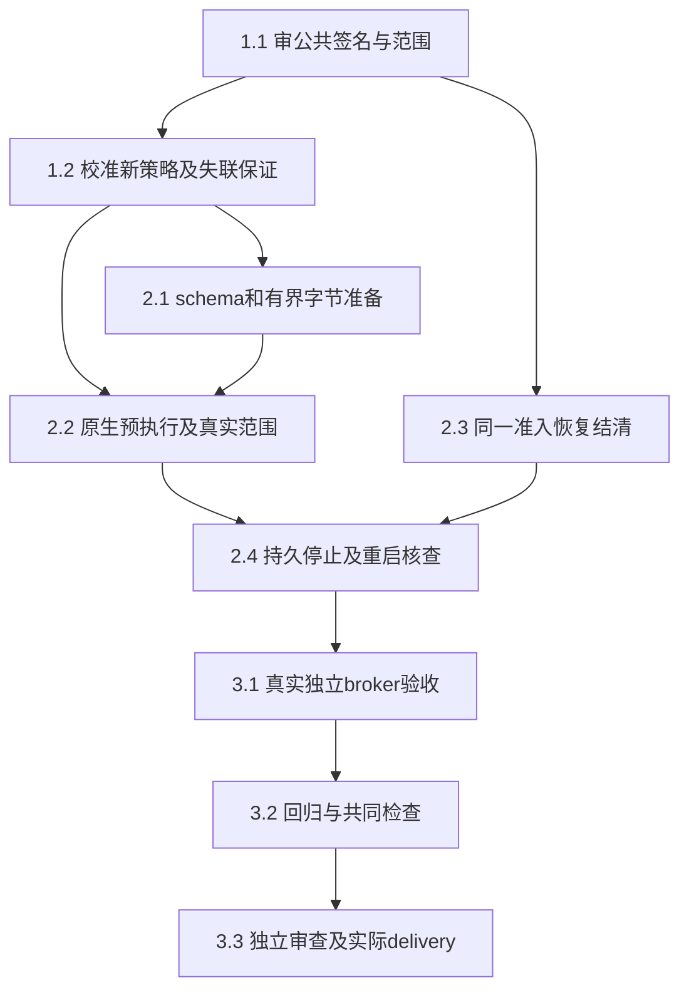

# 执行任务

规划轮没有执行生产任务或提前创建delivery。第十五轮主线已审接口方向及共享符号归属，下一片只推进1.2：固定原生程序、已核架构、默认拒绝的syscall白名单与失联收尾校准；2.x须等实际证明后再实施。报告change仍6/13、2.1b／I5及活动页unavailable。

## 1. 接口与真正前置

- [x] 1.1 主线审定design的六个同源窄操作／分片封存、instanceId关联及仅宿主消费范围，审定`settleRecovered`恢复结清和最小宿主恢复屏障；确定protocol／platform／计算线共享符号归属。第十五轮审查决定及实施前置见design，不表示schema／生产接线已实现。
- [ ] 1.2 在已审首个固定native程序策略下，校准旧样本未证明的syscall／迟到能力与控制器／宿主丢失收尾。先核普通权限、scope实际限额、namespace和持久记录前置；真实限制失败立即unavailable，输出具体阶段及部署缺证，不安装／改委托。用自有端点／scope和既有固定反例作最少新校准，不机械重跑CPU／OOM绿例。完整网络或失联保证未证不得放行该策略，浏览器不进入本任务。

## 2. 独立深模块及其验证

- [ ] 2.1 依赖1.2真实校准及后续实施安排，新增protocol同源schema／派生叶导出和platform深模块的有界字节准备路径，引用reportLimits及frameBytes，沿同一reservation限制准备／排队。验证规范相对路径、分片offset／非法base64／容量／封存后变更／重入／撤销，失败不放行；领域批准字节及授权可替换，明确不等于生产ref／basis／库授权接入。完成前先build再跑协议及纯模块关键回归。
- [ ] 2.2 在1.2通过的范围实现platform原生controller／启动门、普通文件FD固定字节交付、完整stdio／高FD／SCM策略及namespace／真实配额读回；复用既有监督职责和构建，不复制临时程序或改普通ManagedNode／Windows分支。经新模块真实运行最少高FD／误暴露stdio／特殊文件／只读字节对照，区分进入前拒绝与实际动作拒绝；校准失败保留unavailable，原生源码／诊断随成果交付。
- [ ] 2.3 在唯一ProcessAdmission实现已审恢复结清；live未知保持未确认承诺，重启retainUnknown后仅按持久完整停止证据结清recovered。扩现有process-admission代表例验证满额、重复／同内核owner、排队唤醒、失败承诺及晚到确认，不能复制计数／提前释放，不改ProgramRuns旧回调。
- [ ] 2.4 实现私有范围intent、配置／boot／unit InvocationID／cgroup身份及停止回执；创建范围前和gate前分别持久确认，记录目录替换／sync失败阻止启动或保留unknown。真实kill自有controller／宿主、重启先核遗留再准入，验证身份不符不杀、原范围缺证不结清、停止落盘失败保留占用、恢复副本不控制原配置；不自动重放。完整停止须核所有登记范围及后代，不能只看根PID／原unit卸载。

## 3. 整合、审查与交付

- [ ] 3.1 本线主Agent以真实broker＋platform模块＋controller／OS／私有文件＋同一ProcessAdmission运行独立固定native链：批准字节→有界准备→排队／撤权→gate→执行→查询／停止→重启核查。只有领域字节／授权端口可替换；列每个替身和真实接线。补必要detached后代／失联／全范围停止反例；所有scope／服务归本轮，原失败和补核均保全，不以mock控制器或实验退出0算保证通过。
- [ ] 3.2 先构建受影响shared／platform及必要kernel产物，再冻结产物，跑protocol／platform／tools必要类型、architecture、同源生成器自检／最终映射；复用managed-commands控制器丢失和HostConnection恢复／停止落盘失败最少代表回归。没有UI变化不重复UI，不运行全仓CI；Windows／Mac／浏览器／分发及科研质量未验单列。
- [ ] 3.3 安排独立审查核对公共签名、预执行策略、字节版本／授权、范围持久身份、unknown及容量；完成实际实现后获取本change delivery instructions，创建真实delivery记录命令、首次失败、修正／最终结果、真接线／替身和未验。按实际验收再勾任务，不因CLI齐备关闭原报告2.1b／I5。

## 续做入口

主线已接收design“权威与最小公共签名”，下一片先取当前apply instructions并完成1.2；实际校准结果交回后再安排2.x。公共增量由主线接入后消费者同步，不操作其他树。生产ReportResources冻结字节Adapter、浏览器全进程图／runtime、共同呈现／文本／可访问性及分发属于后续明确任务；本change没有这些提供者时不开放报告。

必要独立输入见investigation的三cache精确入口，新的规划与检查工件在`/home/joshua/.cache/scholoom-linux-provider-plan-round15-7V4Vot/`，没有现有/tmp内容前置。
