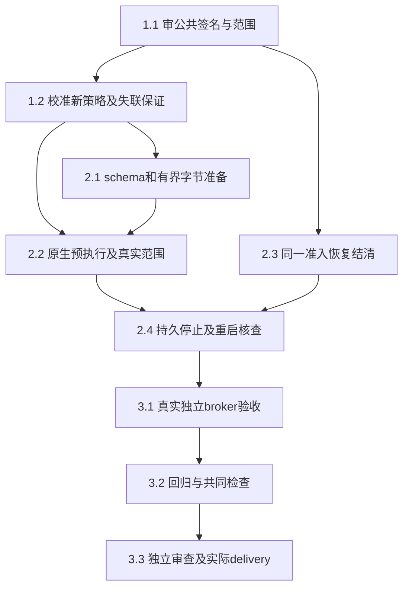

# 执行任务

1.1／1.2已由主线接收；本次从`cb5f7ed3`直接实施2.1–3.3的独立提供者，具体exec事件与持久身份细化见design首节。校准原失败继续保留；没有报告UI／浏览器或领域冻结字节Adapter授权，原报告2.1b／I5及活动页仍unavailable。

## 1. 接口与真正前置

- [x] 1.1 主线审定design的六个同源窄操作／分片封存、instanceId关联及仅宿主消费范围，审定`settleRecovered`恢复结清和最小宿主恢复屏障；确定protocol／platform／计算线共享符号归属。第十五轮审查决定及实施前置见design，不表示schema／生产接线已实现。
- [x] 1.2 固定x86_64 native本机校准完成：默认拒绝BPF补可信reaper必要wait4后，已进入样本的危险syscall实际EACCES；SCM在ready后／动作G前入队，无filter危险控制真实读取，过滤及组合对照拒绝。独立controller／宿主SIGKILL及三代setsid、持久身份匹配／失配、完整登记范围收尾与后续只读核查成立，详见investigation／delivery。首启动失败和观察失败原位保留；没有G后SCM、浏览器／外部DNS协议、生产恢复或容量释放结论，不扩大本片完成范围，2.x仍须后续安排。

## 2. 独立深模块及其验证

- [x] 2.1 依赖1.2真实校准及后续实施安排，新增protocol同源schema／派生叶导出和platform深模块的有界字节准备路径，引用reportLimits及frameBytes，沿同一reservation限制准备／排队。验证规范相对路径、分片offset／非法base64／容量／封存后变更／重入／撤销，失败不放行；领域批准字节及授权可替换，明确不等于生产ref／basis／库授权接入。完成前先build再跑协议及纯模块关键回归。
- [x] 2.2 在1.2通过的范围实现platform原生controller／启动门、普通文件FD固定字节交付、完整stdio／高FD／SCM策略及namespace／真实配额读回；复用既有监督职责和构建，不复制临时程序或改普通ManagedNode／Windows分支。经新模块真实运行最少高FD／误暴露stdio／特殊文件／只读字节对照，区分进入前拒绝与实际动作拒绝；校准失败保留unavailable，原生源码／诊断随成果交付。
- [x] 2.3 在唯一ProcessAdmission实现已审恢复结清；live未知保持未确认承诺，重启retainUnknown后仅按持久完整停止证据结清recovered。扩现有process-admission代表例验证满额、重复／同内核owner、排队唤醒、失败承诺及晚到确认，不能复制计数／提前释放，不改ProgramRuns旧回调。
- [x] 2.4 实现私有范围intent、配置／boot／unit InvocationID／cgroup身份及停止回执；创建范围前和gate前分别持久确认，记录目录替换／sync失败阻止启动或保留unknown。真实kill自有controller／宿主、重启先核遗留再准入，验证身份不符不杀、原范围缺证不结清、停止落盘失败保留占用、恢复副本不控制原配置；不自动重放。完整停止须核所有登记范围及后代，不能只看根PID／原unit卸载。

## 3. 整合、审查与交付

- [x] 3.1 本线主Agent以真实broker＋platform模块＋controller／OS／私有文件＋同一ProcessAdmission运行独立固定native链：批准字节→有界准备→排队／撤权→gate→执行→查询／停止→重启核查。只有领域字节／授权端口可替换；列每个替身和真实接线。补必要detached后代／失联／全范围停止反例；所有scope／服务归本轮，原失败和补核均保全，不以mock控制器或实验退出0算保证通过。
- [x] 3.2 先构建受影响shared／platform及必要kernel产物，再冻结产物，跑protocol／platform／tools必要类型、architecture、同源生成器自检／最终映射；复用managed-commands控制器丢失和HostConnection恢复／停止落盘失败最少代表回归。没有UI变化不重复UI，不运行全仓CI；Windows／Mac／浏览器／分发及科研质量未验单列。
- [x] 3.3 安排独立审查核对公共签名、预执行策略、字节版本／授权、范围持久身份、unknown及容量；完成实际实现后获取本change delivery instructions，创建真实delivery记录命令、首次失败、修正／最终结果、真接线／替身和未验。按实际验收再勾任务，不因CLI齐备关闭原报告2.1b／I5。

## 续做入口

第22轮IO调查发现已有config时仅遍历index，未核根中未索引对象。第23轮修复已由主线8/8及独审接收，当前10/10；原9项的限定交付与未验边界保持，具体见delivery首节。

- [x] 4.1 在原IsolationRecords.load沿已持锁／pinned根有界核查根成员与已验证index；未索引目录、未知／残留对象或枚举失败拒绝初始化且保全原数据。只改原records及相邻代表回归，正常恢复与已知预算失败不产生新遗留仍成立；不清理／认领／重建index、不扩为系统服务或全宿主准入屏障。主线5e62200实际8/8及独审已接收，host-loss两份调查JSON移出根，原生命周期断言保持；结果见delivery。

- [x] 4.2 补原“运行后撤权”的真实Linux代表：原detached默认提供者确认running且后代属于原scope后，由原宿主AbortSignal撤权，核整范围停止、原instance持久stopConfirmed和唯一准入释放；不以排队／gate前取消代替。只扩原provider测试及交付证据，保留check预检／start逐次兑现的既定两阶段语义；无生产API或预算变化，主线独立接收后再完成。

本次按明确授权实施2.x／3.x并交主线独立验收，保留校准原失败和实际新失败。公共增量只在本树完成，生产ReportResources冻结字节Adapter、浏览器全进程图／runtime、共同呈现／文本／可访问性及分发仍是后续范围，本片不开放活动报告。

必要独立输入见investigation的三cache精确入口，新的规划与检查工件在`/home/joshua/.cache/scholoom-linux-provider-plan-round15-7V4Vot/`，没有现有/tmp内容前置。
