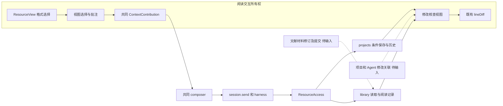
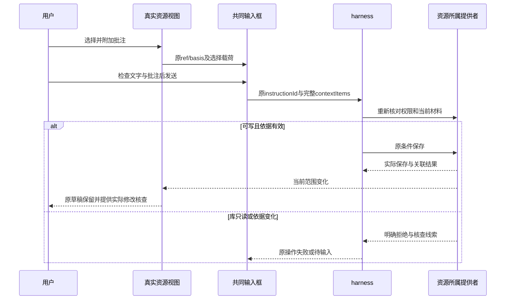

# 实现设计

## 变更总览

基于 [investigation](investigation.md)，可独立部分采用既有资源／上下文 seam。当前M1已消费生态调查、仍缺文献提交提供者，M2等待可靠归因／消费契约，M3由本线完成产物方案并待公共审查。真实材料选择与共同附加部分按现有资源能力和同版本位置实施，实际结果见delivery；受阻分支只保留候选和所需输入，不将整个change宣称已交付。

## 方案与接口

### 复用与模块深度

不新增 package、进程、上下文仓储或第二个 composer。真实变化有两个 adapter：PDF／规范化文档的 SDK 选择，以及源码／可视编辑的编辑器选择；共同 seam 仍是 `ContextContribution`。把格式坐标转换、清理和容量检查留在视图内，调用方只接收 schema 派生 ContextItem。持久批注仍由原 ReadingRecordPort 保存。

Markdown公式从同一TeX annotation生成一次摘录，表格语义沿同一规则。无法表达部分公式时拒绝整次选择并提示重新选择完整公式，不发送省略公式后的正文前缀；原生文字选择失效时清除实时贡献，显式对象选择独立保留。

图片读取通过已有 ResourcePort 分片，新增格式 image 和共同 ImageResourceView，首批仅 PNG/JPEG/GIF/WebP，拒绝 SVG／HTML 可执行内容；保留既有字节限额，不新增解码依赖。使用浏览器图片解码，限制文件最多8MiB、解码面积不超过1600万像素，超限明确失败。框选在图像内容坐标内归一化，旋转先反算坐标；键盘提供区域位置／尺寸编辑，不能只有拖拽。

### 提供与消费字段

| 接口／字段 | 语义与唯一事实源 | 所有者 |
| --- | --- | --- |
| `ContextItem` 既有公共及 kind 字段 | 原 `workbench-context-contracts.ts`，保留16项／64KiB等限制 | 本线维护增量，harness消费 |
| 拟增 `text.location?` | PDF 复用 pdfLocationSchema；规范化文档复用 textLocationSchema；源码只需 quote，不另设持续段落ID | 本线贡献；引用 library 位置声明，不复制schema |
| 拟增 `region.target` | 判别整图、PDF页、已加载结构图片对象；页提供pageIndex及未旋转页面尺寸，对象提供providerId/objectId；矩形仍归一化到该目标内容框 | 本线；通用原 region 样本必须显式声明目标，不能默认解释为某页 |
| `object.contentState?` | saved／draft，实际可视转换未完成或父文稿尚未保存时标记draft；对象身份只指当次结构 | 本线，沿原ContextItem持久化和模型编码 |
| `contributeSelection(viewId,{selections})` | 仅实时线索；卸载调用同方法移除。资源打开和选择不切接收者 | 既有工作台 |
| `appendContextItem(item)`／`comment` | 明确附加，批注在共同检查器中修改；不自行调用session.send | 既有工作台 |
| `ResourceRef/basis` | 项目fileId／库材料版本和实际读取依据；产物不能使用当前源码basis冒充 | projects／library／editor提供，本线消费 |
| `ResourcePort`／`ReadingRecordPort` | 原读取、条件保存、记录修订、可信作者和未知结果核查 | 所属领域 |
| `FileEdit`／`files.history/undo` | 实际before/after、editId及现有冲突保护，不另存历史副本 | projects |
| 修改核查关联候选 | `editId`＋`resource ref`＋可靠原`instructionId/runId/toolCallId`，理由引用真实指令或记录；不接受页面自报执行者 | M2待项目／Agent核对，不在本线定案 |

region 目标字段影响既有固定 provider、检查器、SDK编码及持久指令；变更时必须同步所有当前 region 构造者与消费者。历史无目标 region 保持可读且明确基准未知，不猜页号；不把其作为新格式选择输出。与另一报告 change 的对象项保持独立，其 object 不需要本次位置增量。

完整排版选择需要实际产物身份。目前 RenderOutput 不是 ResourceRef，不能直接附源码ref加产物quote。可先将显式导出的真实项目PDF沿共同资源打开后选择；嵌入式 RenderedPdf 的直接贡献由本线负责，公共产物证据方案见末节M3，审查前不实施。首批任务明确区分这个缺口，不能把导出绕行称为原位预览接通。

### 交互和保存

已附加选区是快照；旧版本还可读时打开原版，可核对页码才导航。原版缺失显示原摘录／说明及缺失原因，新版不能借旧位置导航。撤权隐藏受保护缓存，读取和模型外发仍由原领域核查。

差异优先复用 lineDiff 与实际 FileEdit；大于400行使用两份有依据全文对照。候选、落盘、关联unknown分别显示。局部撤销复用 files.undo，失败不覆盖后续编辑。M2到位前只展示文件历史，不声称可信执行归因、可靠变化消费或“意见已解决”。

### UI 设计落点

沿 `docs/ui-design/README.md` 的“当前选择与显式附加”“PDF阅读与共同记录”“科研写作编辑器”更新对应分节：选区旁只有附加／批注入口，仍由共同composer检查发送；差异在资源tab内展开，状态贴近对象。PDF附加与原记录操作共用工具行，避免挤压阅读空间。保留三区、dock／overlay和既有可访问名。样式只引用现有语义token。

## 文件变化

以下为本change写入所有权清单，实际已实现／受阻范围由tasks及delivery核对。无计划删除业务文件。

| 文件／符号 | 变化／所有权 |
| --- | --- |
| protocol/workbench-context-contracts.ts、workbench-context.ts | text位置与region目标的同源声明及几何容量校验；不改可靠发送语义 |
| protocol/resources.ts、editor/resource-access.ts | image分类与有界读取能力；正文写入仍只沿已声明能力，不实现库修订 |
| workbench/ResourceView.tsx | 传viewId给reader，接ImageResourceView；报告change只占独立report分派符号 |
| workbench/PdfReader.tsx、DocumentReader.tsx | 原SDK／规范化选区贡献、清理及明确附加；不改库记录身份 |
| workbench/editor/VisualEditor.tsx、project-ui.tsx及MarkdownPreview所在文件 | 基于已有编辑结构／当前预览贡献；不跨DOM读取；源码行为复用 |
| 新workbench/ImageResourceView.tsx | 真实图片展示、受控区域选择和Blob释放 |
| 新workbench/MaterialChangeView.tsx、既有line-diff.ts调用方 | 差异呈现与所属历史／撤销适配，不增加历史权威 |
| editor/RenderPane.tsx、PdfReader.RenderedPdf | 产物证据和选区适配待明确；先承接CI诊断，保持最后成功预览 |
| kernel/manual.ts、harness/instruction-context.ts及SDK编码 | 仅位置增量实际校验／保留必要调用方；M2变化消费待提供者确认 |
| tests/kernel/context-contributions.spec.ts、context-instructions.spec.ts、resource-access.spec.ts | 扩展真实格式适配、保存依据及位置序列化的稳定边界 |
| tests/ui/pdf-reading.spec.ts、document-reading.spec.ts、context-bridge.spec.ts、resource-lifecycle.spec.ts、writing-editor-pdf.spec.ts | 真实选择／共同发送／撤权／重开及必要失败诊断；仅缺乏图片链路时新增该场景 |
| docs/ui-design/README.md、docs/development.md | 上述设计分节和实际运行／诊断入口；修正UI文档中“共同资源接口仍待实施”的旧描述，不改无关文献方案 |

完整路径分别以 `packages/`、`apps/desktop/src/renderer/src/`、`apps/kernel/src/`为根。共享文件只改表中符号；文献表格、任务详情、library版本创建与projects保存实现不属于本线可单方修改范围。

## 验证与风险

- 首批独立选择模块：真实PDF SDK、DocumentReader、CodeMirror／可视结构、图片，资源端口可用明确替身；核对本线纯选择输出、目标基准和关闭释放，不能据此声称生产保存通过。
- 最小内核组合复用 context-contributions、context-instructions、resource-access、resource-identity；M2闭合后加真实编辑历史／撤销及相应变化线索，不重测所有公共生命周期。
- I5由本线主Agent负责，真实工作台→composer→harness worker→项目条件保存→重读差异；库使用真实只读材料和已有阅读记录，正文写回等待M1。模型用`tests/model-server.ts`受控HTTP，不能替代内部保存权威。
- 双宿主复用既有UI config，覆盖草稿、迟到更新／回执、撤权、版本失效和关闭一个分屏。现有 PDF 失败先按 investigation 分段诊断，保持最后成功产物。
- 已获锁定依赖及隔离UI验证授权。直接使用已安装CLI：`node node_modules/@playwright/test/cli.js test --config playwright.kernel.config.ts <上述相关spec>`；UI同CLI用`playwright.ui.config.ts`，使用`SCHOOLOOM_UI_PORT=5641`，配置／库／项目／输出由既有fixture隔离。启动前检查占用，结束按fixture收尾；实际命令与证据见delivery。
- 协议改动后运行已有契约生成／自检、受影响类型及架构守卫，并核对desktop构建、OpenSpec和diff。依赖始终沿原锁文件，不运行日常开发服务。

## 待办边界

M1、M2以及嵌入排版产物证据适配仍为明确前置。M1选项为由文献域提供新材料版本提交，或继续只读；不能在本线选择覆盖旧字节。M2优先扩展既有FileEdit与工具结果的关联，替代新建审查数据库；实际字段和消费方式交提供者确认。对应任务阻塞，已明确选择模块可独立实施。跨版本持续精确定位、图像语义推断、完整科研意见状态机、Mac受管执行和三平台发布不在本change范围。

## 主线第二阶段交接与公共增量

本节消费用户正式转交的`/tmp/scholoom-phase2-handoff-VZS5mS/`，清单以该目录`manifest.json`为准，各树来源基线均为`e3d58fc807827a78493dcd16e38de28c8d02766e`。只读快照不等于代码进入本树或dev。主线验收`acceptance.md`的U1是本轮修复输入，`coordination-plan.md`“独立实施之后的公共对接阶段”规定先独立补充、dev接入验证、再由用户同步消费者。

### 提供给六线的接口交接

材料设计为本文件，报告设计独立保存在`../add-interactive-research-reports/design.md`；对应正式交接快照分别位于包内`research-interaction/openspec/changes/<change>/design.md`。本次授权已完成设计交接，不再等待用户逐线转述；接收方实现和dev整合仍分别验收。

| 提供文件／符号 | 消费与字段语义 |
| --- | --- |
| `packages/protocol/src/workbench-context-contracts.ts::contextItemSchema` | `text.location?`沿既有PDF页矩形或文档规范化UTF-16位置，绑定同一`ref/basis`；不表示跨版本定位。文献／项目／生态贡献实际对象，科研／Agent消费完整显式项 |
| 同文件`region.target?` | `image`指整幅图内容框；`pdf`声明页及原页面宽高；`object`声明providerId/objectId。region始终为对应目标的归一化矩形；旧无target记录基准未知。计算输出图片沿实际项目资源打开，不新增另一种ref |
| 同文件`object.contentState?`及既有`text.contentState` | 草稿对象／摘录不代表保存；旧object缺字段仍可读。任务详情与文献表格由所属域维护，只消费共同贡献端口，不跨DOM取数据 |
| `workbench-context.ts::isContextItems`、`harness/instruction-context.ts::contextItemContent` | 派生校验、容量、位置编码为同一事实源；SDK和持久消息保留载荷。所有实际读取／外发仍走所属授权，页面不能赋予权限 |
| 报告设计中的manifest／`ReportResources`／页面桥 | 项目内HTML、本地显式资源及来源、共同composer动作和草稿更新约束已采纳；报告schema和生产模块尚未实施，不能当作可调用提供者 |

### 资源叶模块与图片补丁顺序

已消费项目快照`research-task-workspace/packages/protocol/src/resource-contracts.ts`、`resources.ts`及`openspec/changes/establish-file-backed-research-tasks/{design,delivery}.md`。其叶模块只导入core／schema，集中原ResourceRef／Evidence／Locator／Descriptor／保存创建schema，原`resources.ts`重导出；图片尚在unsupported。该快照还含任务业务聚合，不能整文件覆盖本树。

1. 项目线先交不依赖`task-contracts.ts`或任务业务的叶模块抽取；由主线核对原字段／行为不变及原入口重导出，独立接入dev。
2. 阅读线的`/tmp/scholoom-reading-public-CUURdN/image-after-resource-leaf.patch`仅改叶模块的image枚举和原`resources.ts::resourceFormatForName`判断，不定义第二套ResourceRef，不覆盖项目／任务schema。此补丁已在只含项目快照两文件的临时目录通过`git apply --check`，未宣称在dev构建。
3. `/tmp/scholoom-reading-public-CUURdN/material-context-evidence.patch`为位置／region目标／对象草稿同源声明、派生校验、模型编码及原契约测试的5文件增量；对e3d58fc临时基线通过apply检查。它与叶抽取可独立排序，若先抽取则继续从原resources重导出消费，不改身份。最终映射从合并后的schema重生，不能拼接生成文件。
4. 主线接入上述增量并验证后，用户同步消费者；各域只调整自己拥有的构造者和消费点。真实图片视图、阅读器、composer检查器仍随材料change交付，不能据协议补丁可应用就称I5已接通。

### M2：实际可用事实与消费者需求

项目快照design“来源取用与跨线Interface”提供CallContext和任务入口材料，不含FileEdit归因DTO；其delivery所称“关联字段草稿”指任务关联表单，不等于修改归因候选已发布。包内`research-task-workspace/packages/protocol/src/projects.ts`仍从原`project-file-contracts.ts`派生FileEdit。本树`protocol/core.ts::CallContext`只有可信principal、projectId、sessionId、runId、instanceId等，没有instructionId／toolCallId；`harness/runtime.ts`一次推进可消费多个instructionIds，不能任选一个归因。

本线向项目／Agent交接以下**待提供者确认的需求**，不在本轮发布新字段：

- FileEdit以editId＋fileId＋实际before/after及basis为根；可信执行者从宿主CallContext随保存进入项目实际记录，不能接受renderer或模型自报作者。候选与真正发布分别返回。
- 若保存确有Agent执行，保留实际sessionId／runId／instanceId；对应指令若非唯一则给出有依据的instructionIds集合或明确关联不可得。toolCallId只有harness真实绑定并贯穿保存时才能展示，缺失不猜。
- 理由／依据应为可查询的原指令或工具记录引用，不自动将相邻消息当作原因。对历史无来源记录保持未知。
- 撤销结果需提供原editId、实际新修改或冲突候选、当前basis和可分页查询的变化线索；Agent读取／确认消费的权威由Agent线确定。撤销不自动运行Agent，界面通知不等于消费。

最小联合验证为人工与Agent各一项保存、同路径并发两run、一次推进多指令、候选未发布、撤销和后续重叠编辑、重启查询；必须核对实际记录，不能只测试UI显示。现阶段MaterialChangeView继续显示执行者／理由未知，4.2／4.5保持开放。

### M3：本线editor产物依据方案，待公共审查

本线负责此方案及后续实现。源码依据：`protocol/editor.ts`的RenderOutput只有id/jobId/name/format/byteLength，RenderJob保留fileId、basis、dependencies及output／lastSuccess；`editor/runtime.ts::execute`在快照后固定输入basis并核查依赖再发布，`saved/output/export`按outputId读取不可变缓存；`RenderPane`用`job.output ?? job.lastSuccess`，RenderedPdf当前只有url。**失败新job的basis不能解释旧lastSuccess**，旧产物必须沿自己的jobId查询生产记录。缓存会淘汰，outputId不是永久存档承诺。

| 选项 | 依据、成本与限制 |
| --- | --- |
| A 显式导出项目文件再打开 | 复用editor.export／原文件传输与project ResourceRef，不需新ref；导出文件的字节版本即选择依据。当前已有真实双宿主预览／导出证据。需要项目写权限和用户动作，不能完成嵌入预览直接附加，也不能凭导出名称宣称输入溯源 |
| B 只读产物资源（建议公共审查） | 新增判别`source:render`、projectId、outputId的ResourceRef／Locator；产物basis为编辑器签发的不可变输出版本令牌，绝不使用源码basis。editor提供生产job的输入ResourceEvidence及依赖快照；能直接附加嵌入页，但需扩展共同资源与执行授权分派，不能本轮私自合入 |
| C 仅给ContextItem加outputId，仍附源码ref | 拒绝：资源重新读取、位置和版本会落到稿件，绕过共同资源身份事实源 |

B的有界候选：首批只开放排版PDF、同项目只读，不新增产物写入／持久历史／跨项目取材能力。editor通过自身窄端口提供产物describe/read/pdfInfo/readPdfPage；共同ResourceAccess消费该端口，生产仍由宿主装配，不调用harness私有仓储。`RenderInputEvidence`候选含`jobId`、输入project ref＋basis及既有`dependencies[{path,basis}]`；依赖路径不冒充稳定资源身份，不承诺自动追溯手工粘贴的库来源。outputId的生产记录、产物文件和输入依据须匹配；旧记录缺证据时可保持原预览／导出，直接附加明确不可用，不取当前稿件补证据。

人工读取沿项目read；Agent实际取用和模型前仍要求相符工作域／项目信任及有效执行，不能凭浏览器已加载或旧缓存绕过撤权。产物分片沿原256KiB和现有容量；读取前后核对产物身份／依据，淘汰或生产记录缺失返回明确notFound／不可核查，不借最新同名输出回退。旧页显式项保留原outputId及原摘录。产物只读，阅读记录和库修订不随此方案获得权限。

公共改动拥有者及审查集：本线`protocol/resource-contracts.ts`（在项目抽取接入之后扩展ref）、`resources.ts`的派生端口、`protocol/editor.ts`产物依据schema、`editor/runtime.ts`不可变依据保存及适配、`editor/resource-access.ts`分派；宿主仅装配该窄端口。随后分别适配context／harness的资源分派和RenderPane／RenderedPdf选择。须先列全所有project/library穷尽分支并由项目／Agent核对，不能只给协议加枚举而遗漏授权消费。

拟验收测试：真实Quarto PDF带生产job输入basis；先成功V1再失败V2而选区仍引用V1；源码被替换／改名、输出淘汰、撤权和重启缺证据；原`editor-runtime`缓存／目录保护继续通过；两宿主从嵌入PDF明确附加、共同composer发送，真实harness重新读取同一产物。端口可替换的独立测试仅证明editor证据生成，不能代替上述生产接线。**本轮只交设计和测试边界，没有新增ref或产物提供者；4.3可结束方案调查，4.6仍等待B或A范围的明确审查结论。**
