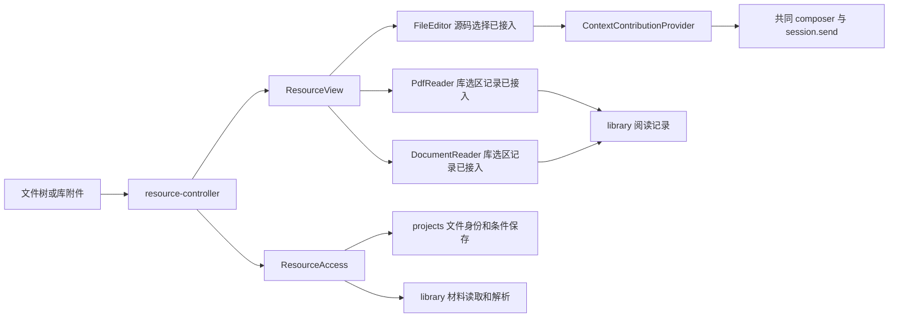

# 调查依据

## 当前事实与复用选择

调查日期 2026-10-25，源码固定为 `e3d58fc807827a78493dcd16e38de28c8d02766e`，初始工作区干净，无 `.codegraph/`。本轮证据为源码／测试定义／历史日志阅读，没有运行业务、UI、模型或编译。本树没有 `node_modules`，不安装依赖。

### 已有能力与差距

| 材料／入口 | 当前源码事实 | 本变更差距 |
| --- | --- | --- |
| 普通文本、MD／QMD、TeX／BibTeX 源码 | `SourceEditor.tsx:138` 的主选区经 `FileEditor` 贡献 ContextItem；项目可保存，库只读 | 直接复用，补其他实际视图，不能重建源码发送 |
| PDF | `PdfReader.tsx:287` 按页取得摘录和矩形，库高亮／书签／笔记经共同记录保存 | 没有共同上下文贡献；项目 PDF 不具备持久阅读记录；没有 PDF 原字节写回 |
| EPUB／HTML | `DocumentReader.tsx:403` 的 capture 得到规范化章节 UTF-16 区间，prepare 进入库记录草稿 | 没有共同上下文贡献；HTML 安全文档视图不执行原脚本 |
| MD／QMD 可视编辑 | `VisualEditor.tsx` 通过既有 Quarto／ProseMirror 编辑，转换保护原源码 | 未向共同上下文提供文字或结构对象；可只使用实际编辑结构，不能从截图推断语义 |
| MD 轻预览 | `project-ui.tsx` 使用 `MarkdownPreview`，图片按受控资源读取 | 缺文字／对象／图片区域贡献 |
| 完整 HTML／PDF 排版 | `RenderPane.tsx` 基于保存稿件编译，`RenderedPdf` 只接收 URL；HTML iframe 无脚本权限 | 产物与稿件不是同一内容依据，不能把产物选区标为源码位置 |
| 独立 PNG/JPEG/GIF/WebP | `resourceFormatForName` 返回 unsupported，`ResourceView` 没有图片分派 | 缺实际图片视图、字节能力与区域坐标基准，不可把固定 provider 测试称为真实框选 |

相关源码根为 [workbench](../../../apps/desktop/src/renderer/src/workbench/)、[ResourceAccess](../../../packages/editor/src/resource-access.ts)、[资源契约](../../../packages/protocol/src/resources.ts)。共同资源链路已经存在：

图中没有 PDF／DocumentReader 到 X 的边，是已核对的缺口。新增交互不得绕过 C、R 或 RR。

### 契约和所有权事实

- `resources.ts`：`ResourceRef` 项目为 `source/projectId/fileId`，库为 `source/attachmentId/materialVersionId`；`basis` 是读取依据，不是库修订授权。`ResourceDescriptor.capabilities` 分别为 read、write、readingRecords、render。
- `resources.read`：`ref,basis,encoding,offset?,limit?`，单片不超过 262144；UTF-8 位置为 UTF-16，base64 为字节。`document` 消费同源 pdfInfo／readPdfPage／documentInfo／readDocumentSection／searchDocument／readDocumentResource。
- `ResourceAccess.save` 只保存项目 UTF-8 文本，将强 `resourceBasis`、文本 basis 及 expectedFileId 传进所属 projects 保存临界区。库 write 授权不等于可改附件正文。
- `workbench-context-contracts.ts`：ContextItem 公共字段 `kind,itemId,ref,basis,comment?`；text 增加 `quote,contentState`；region 增加归一化矩形；object 增加 `providerId,objectId,name,semantics`。现有 text 无位置字段，region 无页号／图片对象基准。上限 16 项、摘录 8192 UTF-16 单元、批注 4096 单元、总载荷 65536 字节。
- `library.ts:136` 已有 `pdfLocationSchema`（pageIndex、rects）和 `textLocationSchema`（kind、normalizationVersion、sectionId、start、end）。阅读记录坐标与 region 归一化坐标不能混用；前者只描述同版本位置。
- `ReadingRecordPort`／`ReadingRecordsPanel` 共用 library 的记录身份、expectedRevision、可信作者及创建重试。`saveReadingRecord` 不改变附件正文，历史批注也不因新材料自动重绑。
- `line-diff.ts` 已有行级差异，任一侧超过 400 行返回 undefined，由调用方提供整段对照；`FileEditor` 已提供冲突差异、`files.history/undo`。`FileEdit` 现有 `id,fileId?,basis?,path,before,after,createdAt,created?`，没有可信执行者／instructionId。不能从同路径或时间猜某次 Agent 修改。

### 规格与交付复用

完整核对当前 workbench-resources、workbench-agent-context、literature-reading、literature-attachments、workspace-editor、manuscript-rendering，以及 domain-execution-handoffs、execution-work-domains；本次增量只补视图贡献和修改核查，不重做 driver、可靠指令、创建回执、条件保存或库记录。

历史依据：[共同资源交付](../archive/2026-10-20-unify-workbench-resource-opening/delivery.md)、[写作交付](../archive/2026-10-20-add-research-writing-editor/delivery.md)、[EPUB／HTML 交付](../archive/2026-10-19-extend-shared-epub-html-reading/delivery.md)、[上下文交付](../archive/2026-10-24-establish-workbench-context-bridge/delivery.md)、[领域交接](../archive/2026-10-24-establish-domain-execution-handoffs/delivery.md)。记录中的历史“未启动七域”等段落按当时范围理解；当前起点与授权以本轮用户及七线计划为准。

## 影响方案的未知项与实验

### CI 输入：写作 PDF 预览

[七线基线](../../../.scratch/domain-development/parallel-development-plan.md#当前-ci-基线的处理)固定 [Checks 40100596838](https://github.com/leike0813/Scholoom/actions/runs/40100596838)，提交 `55d020c696407c3d80b984a9f1535054c311ae2c`。Linux UI 101 通过／9 失败／2 跳过；Windows kernel 374／15／12；macOS job 成功但受管执行明确不可用。

已直接读取本机 `/tmp/scholoom-next-parallel-baseline-failures.log:4779`、`:4901`：双宿主 `writing-editor-pdf.spec.ts:43` 等待“完整排版预览／排版 PDF”60 秒后元素不存在。断言在 paper.qmd／main.tex 循环中，日志未标明失败轮次。`RenderPane` 必须取得 output 或 lastSuccess 并读取 URL 后才挂载该区域，因而没有证据将失败归因于 SDK、工具缺失或单纯等待不足。历史 kernel 工具测试通过不能证明该次 UI 编译成功。

后续最小诊断须采集失败 path、文件身份及保存 basis、editor.tools、jobId／state／diagnostics／log、output／lastSuccess 输入依据、editor.output 读取结果、renderer 错误和 trace，再定位“受理—编译—产物读取—挂载”。本轮未运行实验，原 trace/error-context 不在本树；不修改超时、跳过或产品时限。

### 明确等待输入

| 编号 | 提供者及所需输入 | 影响及处理 |
| --- | --- | --- |
| M1 | 生态线 Zotero 10 Reader／PDF 写回、插件保存／SQL／通知及固定键保护证据；文献线材料修订／提交结果契约 | 生态调查已通过主线包收到并消费，证据级别见下节；仍缺实际文献提交提供者与sidecar转换契约，生产写回继续受阻 |
| M2 | 项目线 FileEdit 与实际执行／指令的可靠关联字段；Agent 线既有文件变化／撤销线索的消费方式 | 已收到项目CallContext与任务接口快照，但未提供FileEdit归因DTO。design列精确消费者需求，等待项目／Agent确认可靠字段；不推断执行者、理由或已消费 |
| M3 | 本线editor的RenderOutput与可供显式项使用的产物资源证据 | 本线已完成显式导出与新增只读render ref的方案／测试边界，待公共审查；不能将产物摘录贴到源码basis。方案调查完成不代表直接附加已实现 |

区域坐标和格式贡献属于本线职责，可基于现有视图／schema 设计；不依赖 M1。材料缺失时保留原摘录，撤权时停止展示受保护缓存，不能把摘录当成当前许可。

## 主线正式输入消费（第二阶段）

用户本轮正式转交`/tmp/scholoom-phase2-handoff-VZS5mS/`；`manifest.json`记录七树来源及共同e3d58fc基线，只读消费该包，未操作其他工作树。主线`acceptance.md`的U1提供独立反例及验收结果，`coordination-plan.md`明确公共增量接入顺序。下列结论替代前文“尚未收到”状态，不把历史交付回写成当时已接收。

| 输入精确路径（相对交接包根） | 核对结论与证据边界 |
| --- | --- |
| `zotero-ecosystem/openspec/changes/connect-zotero-host-bbt/investigation.md:54–74` | BBT的saveTx／executeTransaction、缓存先行、通知反例及键替换偏好调查已接收。Reader历史实验写sidecar而非PDF字节；Node＋Chromium未证明等价。此处为上游源码复核记录／历史实跑转述，链接原始Reader／mutation报告未附入包，未在本轮重跑上游 |
| 同change的`evidence/zotero-10.0.5-mapping.json`及`delivery.md:25–51` | 固定schema摘取不代表运行；H1宿主／原包／SQLite实跑在交付记录中为9项，领域Adapter仍为替身，原始运行产物未在包中。固定键必须由最终共同写入端保护；不能把fill默认稳定、shadow key或偏好配置当作文献正式键契约 |
| `research-task-workspace/packages/protocol/src/resource-contracts.ts`及`resources.ts` | 叶schema抽取及重导出确实存在于项目源码快照，尚未进入本树。图片枚举应后接该叶模块，不复制ResourceRef；项目任务聚合不能整文件复制。独立补丁与顺序见design |
| `research-task-workspace/openspec/changes/establish-file-backed-research-tasks/{design,delivery,investigation}.md`、该树`packages/protocol/src/projects.ts` | 接收到任务材料／CallContext事实；本包没有新FileEdit归因字段或M2归因候选DTO。其“关联字段草稿”为任务链接表单。现有FileEdit与本树CallContext不足以建立instruction/toolCall唯一归因，消费者需求已列design，不虚称候选已接线 |
| `research-interaction/openspec/changes/add-material-annotation-interactions/design.md`、`add-interactive-research-reports/design.md`及本树同名工件 | 两份独立设计已由主线授权交接六线；位置／region／对象草稿字段是材料已实现同源增量，报告模块仍只设计。消费者可核对触点，不再等待重复同步通知，但实际dev接入／跨域验收仍缺 |

M1只关闭“未收到生态阅读写回调查”，仍等待文献实际材料提交提供者：目标附件与预期旧materialVersionId、新字节的受控来源、稳定操作身份、真实新版本及结果查询、原版保留、冲突／撤权／未知结果、可信操作者；sidecar→共同记录的身份／修订／作者转换尚未定。它们不是BBT替身可以提供的事实，4.1／4.4继续开放。

M3由本线editor负责，不存在需要等待的第八条开发线。本树RenderOutput的jobId可追查生产输入，最新失败job的basis不能用于旧lastSuccess。已完成显式导出与只读产物ref的比较、公共文件集和测试边界，见design的M3小节；新增ref方案待主线审查，尚无产物资源实施。

## 结论与承接

真实格式贡献、共同发送、图片区域、已有结构对象及实际项目差异已完成局部实施，实际证据见delivery。M1等待文献提交提供者，M2等待可靠归因／消费契约，M3方案已形成但新增ref尚待审查；受影响的生产路径及完整I5保持开放。基础综合和独立报告change不以这些写回／归因前置为整体依赖。
