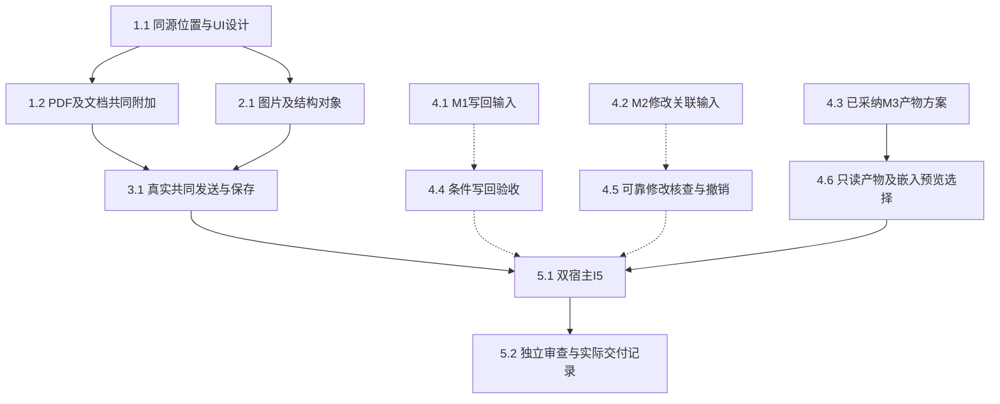

# 执行任务

本轮用户直接授权M2真实消费者。当前已只读核对HEAD为1026796d854b8f568c3e819f13268a9638980bc1，工作区起始干净，七域源码及本线成果已接入；主线证据见`/tmp/scholoom-round5-acceptance-WBreMJ/{acceptance.md,synchronized.json}`。旧等待同步和旧累计补丁失效。本轮消费FileEdit粗粒度来源／Evidence、有界changes/edit及整次undo已完成验证，不改提供者；未知指令／工具／委派及科研理由不推断。当前11/15项，任务以下列复选框为准，实际结果见[delivery](delivery.md)。

第四轮主线接受M3局部成果，但独立内核首轮为34通过／1失败，失败项单独原时限复验1通过，不能合并称一次全绿。首个nativeTeX job unknown的控制进程退出根因仍开放；本轮最多一次有界观察已结束，不改停止保证、容量或时限。诊断证据及下一窄公共方案见investigation／delivery第四轮；4.6的局部交付不关闭5.2的该限制。

## 1. 真实材料选区进入共同草稿

- [x] 1.1 按design更新UI设计对应分节，落实同源text位置／region目标和派生校验；逐项核对当前ContextItem构造者、检查器、SDK编码及持久上下文消费，复用位置schema。扩展context-contributions／context-instructions的实际选择与序列化边界，旧记录可读且不猜位置。
- [x] 1.2 为ResourceView传递viewId，PdfReader／DocumentReader直接贡献真实SDK或章节选择并明确附加，保持原库记录独立；已有pdf-reading／document-reading场景扩展到共同composer，可核对原材料版本、页／章节和摘录，关闭与撤权清除本视图贡献。

## 2. 图片及已有结构对象

- [x] 2.1 在原resources／ResourceAccess与ResourceView接入栅格图片，真实有界读取、缩放／旋转区域及键盘操作；现有资源测试核对身份／容量／撤权，新增UI场景只覆盖现有固定provider未证明的真实框选。
- [x] 2.2 VisualEditor与MarkdownPreview使用已有结构和当前加载内容贡献文字／对象，标记saved／draft；验证切模式、分屏、刷新和转换失败保护。只改本线格式adapter，不触碰文献列表／任务详情；与1.2可并行，protocol和ResourceView由本线主Agent整合。

## 3. 项目修改首个机械闭环与诊断

- [x] 3.1 真实资源选择→共同composer发送→真实harness→projects条件保存→实际文件读回，受控模型处理固定批注。复用context-bridge／resource-access／resource-identity，核对实际保存与association，后续草稿及迟到回执保持；此任务不冒充M2的单次修改归因已完成。
- [x] 3.2 复用lineDiff／files.history／files.undo呈现真实文件差异及冲突候选；大稿回退全文对照。核对只读库正文、阅读记录保存及原版本不可得提示，不为M1伪造正文保存能力。
- [x] 3.3 对既有writing-editor-pdf双宿主失败取得最小隔离诊断：失败path、保存basis、工具、job／log／diagnostics、output／lastSuccess、读取与挂载。依已有用例真实定位；必要修复另获实施范围后处理，不加超时、不修改产品时限，未解决则保留失败及其影响范围。

## 4. 受阻输入及其条件实施

- [ ] 4.1 【M1部分闭合】已消费主线正式转交的生态Reader／sidecar／PDF字节及保存／SQL／通知／固定键调查，关闭“未收到调查”；精确路径及证据边界见investigation第二阶段小节。仍等待文献材料修订／实际提交结果提供者及sidecar转换契约；不代文献域定案，不以H1替身关闭写回前置。
- [x] 4.2 【M2实际输入复核】消费1026796中的files.changes/files.edit、origin、beforeEvidence/afterEvidence、revertsEditId及可选editId，复核真实Manual／普通Kernel执行的保存与整次undo；明确人工资源回执和执行资源回执差别、coverage缺口及指令／工具／委派未知范围，不等待新同步或推断归因。
- [x] 4.3 【M3方案已采纳】完成生产job／lastSuccess及缓存依据调查和A／B比较；主线2026-10-26已确认新增只读render ref的B方案，实施沿4.6，不以方案确认代替真实接线。
- [ ] 4.4 【依赖4.1】仅在正式库修订能力实际可用且获授权时接入阅读写回；核对旧记录、原版本和实际新版本／提交状态。若提供者决定本批继续只读，同步scope及规格并显式排除该生产任务，不伪装已实现。
- [x] 4.5 【M2当前可证明消费者】MaterialHistory按稳定fileId每页10条changes摘要，选择editId才读全文；MaterialChangeView显示实际human/system/execution、前后Evidence及撤销关系，理由／未知指令工具委派如实未知。真实双宿主核对人工与普通执行保存、草稿、coverage、重叠人工修改拒绝旧undo、正确整次undo及负责session用get_file_changes查询撤销；不伪造候选DTO，不将消费提示当对方已读取。
- [x] 4.6 实施只读render资源的独立协议／editor提供者、ResourceAccess与harness解析／字节／权限消费；嵌入RenderPane复用真实PdfReader直接附加，保留原成功job的input及产物basis，核对只读、撤权、替换、缺证据、淘汰和刷新。公共切片与阅读器消费者分开交补丁，真实双宿主共同composer／harness验收；导出不替代该入口。

## 5. 整合与交付

- [ ] 5.1 本线主Agent负责材料I5，双宿主真实阅读器、composer、harness、保存与刷新覆盖草稿、迟到更新、撤权、失效位置、关闭重开及部分保存。M3及本轮M2粗粒度子范围已验证，M1与真实委派细分联合的未验证判据保留开放；明确隔离配置与端口，协议生成、受影响类型／架构及必要构建通过，不追加全仓无关测试。
- [ ] 5.2 对资源授权、修改关联、并发和撤销安排独立审查，处理发现并核对实际结果；更新实际UI／开发文档。实际执行后才获取delivery instructions并创建delivery.md，对照proposal判据及未完成项记录交付／交接，未验收分支不归档。

本轮5.x的M2审查已处理面板关闭及临时断线丢失撤销保护的P2，静态源复核关闭，6项组件／两宿主真实路径复验通过。原首轮UI2失败及后续结果保留；不能据此勾完整5.1／5.2或宣称全部I5完成。

## 续做入口

1026796实际共同基线已具备历史提供者与M3／图片和报告独立模块；本轮只推进4.2／4.5及5.x的M2子范围。M1库提交、报告生产／HTML写／iframe和完整I5仍开放；真实委派来源由Agent线随后联合，未同步字段不作前置。先构建再测试、既有静态UI承载、项目按结果目录保留；不安装、不启动开发服务、不改其他树、不自动归档或展开下一阶段。
