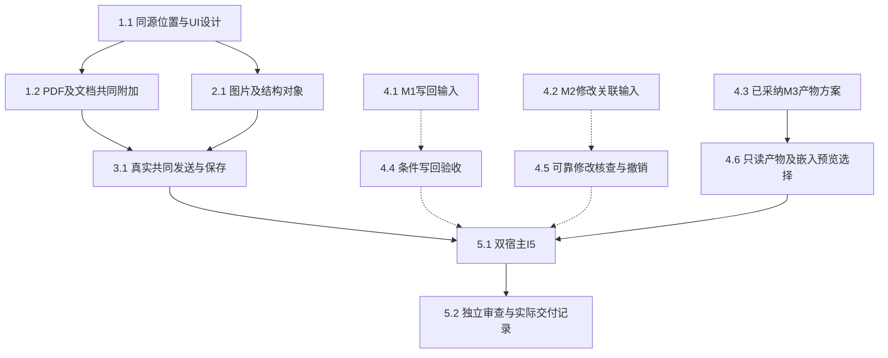

# 执行任务

当前已核对共同HEAD为cb5f7ed30f69b45301c83f296268578051b84e0b。本次授权完成现有材料契约的真实消费者验收；主线已明确采纳4.4的本批库正文只读分支，scope／design／delta同步排除正文写回和sidecar转正文。M2消费正式真实委派来源，保留粗粒度执行及整次undo、未知指令／工具精度；报告隔离仍归独立change，不增加生产Graph或科研角色。

第四轮主线接受M3局部成果，但独立内核首轮为34通过／1失败，失败项单独原时限复验1通过，不能合并称一次全绿。首个nativeTeX job unknown的控制进程退出根因仍开放；本轮最多一次有界观察已结束，不改停止保证、容量或时限。诊断证据及下一窄公共方案见investigation／delivery第四轮；4.6的局部交付不关闭5.2的该限制。

## 1. 真实材料选区进入共同草稿

- [x] 1.1 按design更新UI设计对应分节，落实同源text位置／region目标和派生校验；逐项核对当前ContextItem构造者、检查器、SDK编码及持久上下文消费，复用位置schema。扩展context-contributions／context-instructions的实际选择与序列化边界，旧记录可读且不猜位置。
- [x] 1.2 为ResourceView传递viewId，PdfReader／DocumentReader直接贡献真实SDK或章节选择并明确附加，保持原库记录独立；已有pdf-reading／document-reading场景扩展到共同composer，可核对原材料版本、页／章节和摘录，关闭与撤权清除本视图贡献。

## 2. 图片及已有结构对象

- [x] 2.1 在原resources／ResourceAccess与ResourceView接入栅格图片，真实有界读取、缩放／旋转区域及键盘操作；现有资源测试核对身份／容量／撤权，新增UI场景只覆盖现有固定provider未证明的真实框选。
- [x] 2.2 VisualEditor与MarkdownPreview使用已有结构和当前加载内容贡献文字／对象，标记saved／draft；验证切模式、分屏、刷新和转换失败保护。只改本线格式adapter，不触碰文献列表／任务详情；与1.2可并行，protocol和ResourceView由本线主Agent整合。

## 3. 项目修改首个机械闭环与诊断

- [x] 3.1 真实资源选择→共同composer发送→真实harness→projects条件保存→实际文件读回，受控模型处理固定批注。复用context-bridge／resource-access／resource-identity，核对实际保存与association，后续草稿及迟到回执保持；此任务不冒充M2的单次修改归因已完成。
- [x] 3.2 复用lineDiff／files.history／files.undo呈现真实文件差异及冲突候选；大稿回退全文对照。核对只读库正文、阅读记录保存及原版本不可得提示，不为M1伪造正文保存能力。
- [x] 3.3 对既有writing-editor-pdf双宿主失败取得最小隔离诊断：失败path、保存basis、工具、job／log／diagnostics、output／lastSuccess、读取与挂载。依已有用例真实定位；必要修复另获实施范围后处理，不加超时、不修改产品时限，未解决则保留失败及其影响范围。

## 4. 受阻输入及其条件实施

- [x] 4.1 【M1本批只读】核正式workbench-resources及实际ResourceAccess／ReadingRecordPort，按主线决定保持库正文只读；真实验证正文修订被拒、原材料版本／字节与阅读记录独立，不将题录提交或摄取私有函数当正文修订提供者。未来写回／sidecar转换契约保留在本批范围外。
- [x] 4.2 【M2实际输入复核】消费4b13183中的files.changes/files.edit、真实委派origin、beforeEvidence/afterEvidence、revertsEditId及可选editId，复核真实Manual／普通Kernel及父子worker的保存与整次undo；明确人工资源回执和执行资源回执差别、coverage缺口及单次指令／工具未知范围，不等待新同步或推断归因。
- [x] 4.3 【M3方案已采纳】完成生产job／lastSuccess及缓存依据调查和A／B比较；主线2026-10-26已确认新增只读render ref的B方案，实施沿4.6，不以方案确认代替真实接线。
- [x] 4.4 【依赖4.1，只读分支】落实主线本批只读决定，同步scope／design／规格排除库正文写回与sidecar转正文；沿真实库附件描述、阅读记录及原保存拒绝验证没有正文改写或自动项目替代。只读分支完成不表示库正文写回已实现。
- [x] 4.5 【M2当前可证明消费者】MaterialHistory按稳定fileId每页10条changes摘要，选择editId才读全文；MaterialChangeView显示实际human/system/execution、前后Evidence及撤销关系；真实origin带委派时显示delegationId／parentRunId／parentInstanceId，缺失字段及科研理由保持未知。真实双宿主核对人工与普通执行及同文件父子修改、草稿、coverage、重叠人工修改拒绝旧undo、正确整次undo；保留原负责session用get_file_changes查询撤销场景，不伪造候选DTO或因果。
- [x] 4.6 实施只读render资源的独立协议／editor提供者、ResourceAccess与harness解析／字节／权限消费；嵌入RenderPane复用真实PdfReader直接附加，保留原成功job的input及产物basis，核对只读、撤权、替换、缺证据、淘汰和刷新。公共切片与阅读器消费者分开交补丁，真实双宿主共同composer／harness验收；导出不替代该入口。

## 5. 整合与交付

- [x] 5.1 本线主Agent负责材料I5，双宿主真实阅读器、composer、harness、保存与刷新覆盖草稿、迟到更新、撤权、失效位置、关闭重开及部分保存。M1采用本批只读分支，M2验证真实委派／父读改／人工重叠拒绝／整次undo及后续真实工具读回；精确指令／工具token另列后续。明确隔离配置与端口，协议生成、受影响类型／架构及必要构建通过，不追加全仓无关测试。
- [x] 5.2 对资源授权、修改关联、并发和撤销安排独立审查，处理发现并核对实际结果；更新实际UI／开发文档。实际执行后获取delivery instructions并更新原delivery.md，对照proposal判据及未完成项记录交付／交接，未验收分支不归档。

前轮M2面板关闭及临时断线保护的审查和首轮UI失败仍保留为历史证据；本次按主线采纳的M1只读范围完成真实材料I5及粗粒度委派消费者，结果分轮记录在delivery，不合并成一次全绿或真实科研质量通过。

## 续做入口

从cb5f7ed正式源码继续，不等待已接入的真实委派或复用旧累计补丁。本批验收只读M1、既有材料I5和真实粗粒度M2消费；未来库正文提交、报告生产承载、精确工具token及科研质量不在本批。本次仅DocumentReader图片串行优先为生产局部修正，已先构建desktop再冻结验证，其他共享产物复用；项目保留到所属配置退役，不启动开发服务、不改其他树或自动归档。
