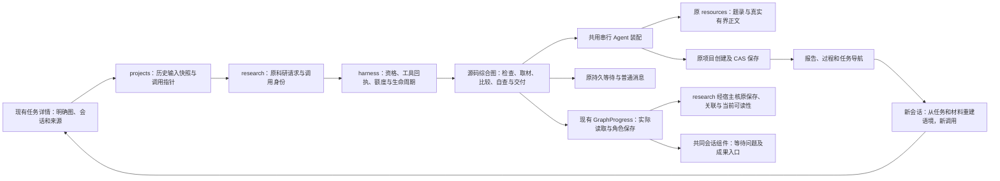
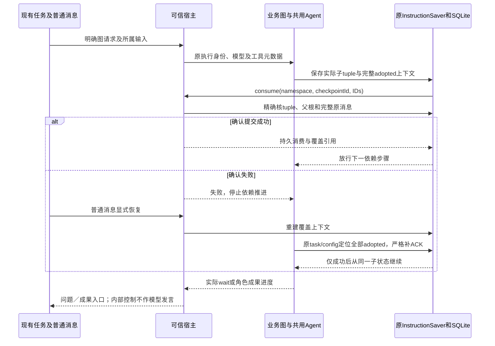

# 实现设计

## 变更总览

本方案由主线在用户授权代选必要决策的范围内选定；D04 Q7没有采纳，下面的节点与接线是本次设计。依据见 [investigation](investigation.md)，范围及可观察契约见 proposal 与三份 delta。

## 方案与接口

### 业务图与自主范围

增加 `scholoom.project-literature-synthesis`，整体版本与状态格式首版均为 `1`，`requiresModel: true`。内核目录与 worker 入口消费同一源码登记；旧 `scholoom.material-analysis` 不迁入、不改参数或历史。

图按以下职责串行推进，各 Agent 节点使用真实 DeepAgent 子图；状态、条件路由和等待由外层 StateGraph 承载，不用一份完整流程提示代替图。

1. **准备**：确定当前任务输入快照、研究问题、来源和成果目标；核原身份、范围与授权，读取明确关联的既有过程／报告。缺失目标或无法判定关系时保存问题并等待。
2. **取材**：Agent 结合题录和实际可取得的正文决定所需页、章或文本片段；比较依据及纳入／排除理由在形成时写入过程。允许在当前授权范围渐进取用新材料；正常仅题录与引用故障分开。
3. **综合**：Agent 沿问题比较已取得的证据，保存报告草稿和解释，不以目录／搜索／字节或原调用清单代替正文。需要更多材料时回到取材；所需用户选择未明时进入真实等待。
4. **自查及修订**：Agent 重新核报告与实际来源、冲突、条件、三层局限及未决事项，保存修订理由。它是同一执行的自查；明确要求独立复核而没有实际复核时，交付保持不完整并等待选择。
5. **交付检查**：确定性节点核真实读取记录、报告／过程的实际保存和任务导航；缺项回到对应职责，未知效果先核原身份而不重放保存。模型预算、节点迭代和既有资源上限共同约束回路；耗尽保留部分成果并结束为未完成。

图开放参数限研究问题／约束、报告与过程目标（新路径或明确项目文件 Evidence）、可选既有成果导航和独立复核要求。不允许配置提示代码、工具集合、角色权限或执行模型。实际TaskRef、工作项、历史入口依据和所选来源从独立任务快照取得；调用记录不存第二份任务权威。图可用于没有绑定任务的显式科研请求，但首条产品路径及本次整合验收使用现有任务入口。

新会话由用户在任务详情明确选择该图和目标会话，再以普通消息提出补材料后的要求；改变会话／目标／材料建立新调用。首片不增加普通 Agent 自主发起科研图的工具，也不伪造 human 身份。等待中的普通消息沿原 wait schema／完整上下文映射，含糊的输入继续等待。

### 共用 Agent 与精确消费恢复

复用 `execution-driver.ts` 原普通 Agent 的模型、backend、middleware、工具 token／回执、输出截断保护及同步 InstructionSaver，提取一个由普通 Agent 和 registered 节点立即消费的 worker 本地装配。宿主也共用原 Agent 工具／middleware 装配，registered 输入只增加由可信宿主提供的工具描述与 middleware 元数据；模型仍来自所属执行。不得复制第二 Agent loop、默认模型、执行池或进程额度。

首片限定一个活动 Agent consumer；三个职责节点顺序调用同一共享装配。内部 consumer 接口封装原 RunnableConfig 下的首次调用／原子状态接续，输出须将完整 instruction channels 合入外层状态。GraphFactory 的源码选择工具子集／节点指导，配置数据不能自授权限。最终 TypeScript 本地接口随这两个真实消费者一起交付，业务图在主线接收该接口之后实施。

`execution.consume` 增可选 `checkpointNamespace`，缺省表示根 namespace。保存后仍同步确认；宿主按同一所属DB、thread、有效执行实例、精确 namespace／checkpointId、完整原消息核对。子 tuple 的真实 `metadata.parents['']` 必须指向当前根；原 graphResume 仍在根控制位置校验，不从 namespace 字符串猜 task。

原 consumption meta 保存累计确认 IDs及覆盖它们的精确 tuple 引用，和消费事务一同持久化。仅实际覆盖原累计集合与新确认的引用才能替换；重启时旧根的子集确认不可降级引用。宿主恢复先核覆盖引用、原完整消息及当前 read／send 资格，再恢复 known／allowed。

即使累计确认只有A，也须在继续 SDK **实际选中的原子任务**之前读取该原 config 下的子 tuple，核全部 adopted 上下文（含保存后尚未确认的B），严格补确认。失败阻止下一模型／工具；成功才 `invoke(null, 原config)`，无原子状态才给首次输入。保留原根、pending writes和工具回执；不重建 task、不把子状态当替代根，也不将子节点结束作为确认边界。探针A／B只证明该接缝可行，真实宿主验证仍是必做任务。

若新根已持久保存完整累计上下文而其消费ACK尚未提交，宿主可从同run准确根、完整原消息及全部confirmed覆盖构造恢复上下文，再由worker的原根confirmLatest严格补ACK。当前根只含子集时仍核原覆盖tuple；后续每次child确认的当前父根约束不变，恢复上下文不等于提交消费。源码factory首次初始化须同时seed原instruction channels及对应`HumanMessage({id: instructionId, content: text})`；后续节点继承实际messages，恢复交null及原config，不能只存instructions却遗漏模型输入。原宿主middleware继续按持久原消息补材料／context内容。

### 实际取材与长文本

原 ResourceRef／basis、题录身份、权限、材料版本与解析进程保持事实源。PDF 使用真实页文本，EPUB／HTML 使用原规范化章节；不扩展OCR或任意大文档解析。长纯文本沿 `resources.read` 改正“只取得前缀再切片”的共享根因：在 **8MiB原始字节上限**内取得同依据快照，严格UTF-8解码后按原UTF16 offset／limit返回，真实 size／nextOffset／truncated。每次响应仍不超过原范围上限；超限明确失败，base64原字节路径不变。不为纯文本新建HTML转换或另一解析接口。内部读取、撤权／变化复核及取消复用原领域接点；内存和IO上限显式验证。

GraphProgress 的原 inputs／reads／results／creations保留；增加可选有界 `contentReads` 和 `roleResults`，由 protocol 派生类型。`contentReads` 每项保原 ResourceEvidence、成功返回的内容形式、实际 offset／length、可选 nextOffset／truncated／size；PDF保pageIndex／hasText，章节保sectionId／normalizationVersion。形式只包括实际返回的原文本、字节、PDF页文本、规范化章节、目录及搜索，不存正文副本。条目表示内容已交给该节点，不能表示模型理解充分。

新综合节点的取材响应须明确限幅并原样交给节点。用于正文依据的工具响应在共享装配中限制到SDK不会offload的小片，实际未交正文或仅offload路径时不登记正文消费；超限调用要求缩小范围，不静默截掉结果后登记完整。已安装SDK默认按80,000字符启用大结果转存，本片的正文小片上限为4,096 UTF16、完整序列化响应上限32KiB；响应长度核验与成功登记集中在真实返回接点，不能靠节点自述补造。

研究取材深度及未读范围由图和过程声明。交付核对同身份／basis的实际所需范围、正常仅题录和实际新增来源，不再将查询时UTF8重读当消费。当前可读性仍从领域复查；旧完整文本校准图继续原 `completeTextRead`，报告／过程仍要求完整非空读回。新事实不得放宽旧检查。

### 题录来源、任务快照与接续

TaskLink.target 增 `library-source`，字段为 `libraryId`／`sourceId`；原可选 basis用于明确所选题录依据，不伪造 attachmentId／materialVersionId。TaskGraphs通过注入的题录读取端口核实际source.version／revision、当前read／send资格与附件条件，不能由projects读取library仓储。

原v1输入快照保持可读。新增v2快照供含题录来源的输入，`sources`每项为 `{linkId,evidence}` 或 `{linkId,catalog:{libraryId,sourceId,version,revision}}`，不保存第二份题录正文；材料条件由图按原题录及当前附件实际核查。纯旧材料输入继续v1。TaskGraphs只把真实资源Evidence和快照交给原科研请求。

题录核查须持续到真实科研受理的同步事务边界，不能只在调用research.start前异步复核。TaskResearchPort.start的私有TypeScript接缝另接原v2 schema派生的题录指针数组；它不进入公共wire或materials。可信宿主为本次调用创建独立signal，把按原libraryId／sourceId核read/send及准确version／revision的同步guard绑定到原graphAdmissions，request.authorize捕获并与资源检查组合，最终沿既有harness.send事务前guard执行。各层finally仅清理自己的signal键，取消继续传播；没有第二份题录、权限缓存或可恢复许可。人工仍保原product／human身份，原库权威负责同步检查。

图读取快照及当前入口，使用现有Agent任务read／save工具和CAS关联报告／真实过程。调用指针继续保留其原职责；不能充当研究过程。入口冲突不回滚文件、不自动完成任务，明确留待补关系；新会话先读导航、原文件和当前来源，不能依赖旧聊天／临时区。元数据任务来源的人工增加及导航接入原任务详情，不另设科研布局。

### 精确保存、关联与会话呈现

`roleResults` 每项为 `{role,result:ResourceSaveResult}`，角色由本图定义为 `report`／`process`；保留真实editId和after Evidence，不从路径、正文或旧creation推更新成功。科研模块的窄宿主核查端口接原run和角色保存，内核沿现有files.edit核after Evidence及可信project／session／run／instance来源；projects按原run／fileId键读取单项artifact，避开列表100条截断，保持所属session校验。单项查询复用内部`project.artifacts`：原projectId／sessionId不变，增加可选`item: {runId,fileId}`；未给item继续原列表，给定则按原键只返回0或1项，不能从截断列表筛选。返回仍用原Artifact数组，不另增公共操作／DTO或扩大权限。项目线在同一提交中实现该最小schema、实际提供者和科研核查消费者。保存、run关联及当前旧basis读回分别表达，缺证据为unknown／不完整，不新建历史表或通用因果账本。

原creation路径与原校准行为保留，新图角色更新走同一交付职责。查询不save／reconcile，不自动补关系；已知原回执只经原核查／补关联入口处理。用户后改文件时，本次历史保存可成立而当前读回失败，分别诊断。

浏览器和Electron共用现有session、消息流及composer：展示当前真实 `graph.wait.prompt` 和本run的成果入口／未完成原因。内部阶段JSON、模型节点控制结果不变成聊天发言，不新建会话或另一消息权威；视图从已有run／GraphProgress有界投影，旧run不覆盖当前等待，普通消息继续走原send。设计及实现遵循现有dock／overlay及语义token，等待问题在两形态均可读；不扩大为所有节点模型流的完整展示。

## 文件变化

| 所有者／文件 | 实际变化与消费者 |
| --- | --- |
| 主线：`protocol/src/graph-contracts.ts`、`execution.ts`；新契约测试 | 实际读取／角色保存 schema及导出，立即供科研交付与业务图消费；仅增可选进度，不造平行日志 |
| Agent线：`protocol/src/harness.ts`、`execution-graph.ts`、`harness/src/checkpoint.ts`、`records.ts`、`execution-driver.ts`、`runtime.ts`、`remote-agent.ts`及必要私有装配文件 | 精确namespace、消费覆盖恢复、共用宿主／worker Agent装配与串行consumer；普通Agent和registered同时使用，原真实执行测试回归 |
| 文献线：`editor/src/resource-access.ts`及其现有窄读取帮助文件、`protocol/src/resources.ts`、`tests/kernel/resource-access.spec.ts` | 8MiB内真实长UTF8范围，严格解码、版本及授权检查；不改Graph合同、保存、PDF／EPUB引擎 |
| 任务线：`protocol/src/task-contracts.ts`、`task-graph-contracts.ts`、`projects/src/task-graphs.ts`、必要task解析／导航调用方、`kernel/src/manual.ts`中TaskGraphs装配及`application.ts`中科研启动适配、原Task详情和任务测试 | 题录target、v1/v2快照、实际元数据与任务导航；不改harness运行装配或科研交付port |
| 项目线：`research/src/graph-runtime.ts`、`graph-delivery.ts`、`projects`原artifact读取及`kernel/src/application.ts`科研port局部 | 沿本次roleResults验证精确保存、单项run关联、当前读回；不改Graph业务或通用权限 |
| 交互线：原business-session、session／消息组件和会话UI测试；必要`docs/ui-design`相关文档 | 同一dock／overlay呈现真实等待及成果入口；不改Task表单／TaskLink或harness事实 |
| 图线：`research/src/builtin/project-literature-synthesis/`、共享源码登记、`kernel/src/execution-graphs.ts`及受影响入口／fixtures | 共用Agent consumer接入后实现职责节点、工具小片与进度、wait映射、真实项目成果和接续 |
| 主线：`docs/development.md`、必要架构声明及本change tasks／delivery | 修正原“无生产图”描述，记录新诊断／限制／实际验收；delivery只记执行事实，归属冲突由主线收回整合 |

上表是所有权，不允许两树并写同一装配区。Task与科研port需同时改application.ts时由两线提供独立局部patch，主线顺序整合；shared protocol文件由列明所有者独占。业务图、真实取材小片 collector和最终跨模块接线由主线在接口合入后统筹，不能让节点凭空实现尚不存在的helper。

## 验证与风险

- 沿原resource-access代表样本扩长UTF8：独立已知尾段／多字节、超限／非法编码和续读变化；只核稳定字段与原字符，不断言文案。
- 沿registered-context及真实KernelApplication／worker／SQLite核精确子ACK、未确认adopted恢复门、已成功task skip与覆盖不降级；原ordinary Agent的中间消费、工具unknown、取消／撤权及真实wait接续保留。跨模块恢复与保存归属由主线安排独立审查，不用cache镜像代替。
- 沿file-research-tasks／task-graphs核v1旧文件及v2题录候选；补附件后原身份、新调用、新会话、真实过程和成果可发现，入口CAS失败不毁文件。
- 沿research-graphs／report-publication核既有报告同fileId真实更新、精确FileEdit、run关联、人工后改及未知效果；不重跑无变化的全矩阵。
- 业务路径采用隔离配置／库／项目，模型边界受控，内部broker、进程、解析、文件、记录和双宿主真实。代表输入含可独立核对的PDF／EPUB或HTML章节、长纯文本及仅题录条目；加入新材料后确实改变或有理由保留比较判断。机械通过不判科研内容合格。
- 真实科研评价另选至少两份可独立核对来源的材料和补充材料，研究问题聚焦“计算研究复现中，过程记录、数据／代码公开与实际复现保证的关系”。可复用已保存在cache、保留来源与许可的Sandve等2013公开全文；当前缓存多份副本仍是一篇，不能算多个独立来源。主线在实现可用后补齐其余真实材料、预先写内容核查依据并取得新的实际模型调用授权；不重跑旧MiniMax runner或把其旧授权转给本次。此项是未完成验收任务，不能以规划齐备关闭change。

调用与持久文件不做破坏迁移；新增可选进度和v2快照保留旧读法，老checkpoint未能验证时明确不可接续、保留原件。长文本单请求至多8MiB快照且不全库预读；慢读取、撤权与取消保留原有范围。全局系统会话的Shell限制、平台不可用、实际目标平台及既有HTML活动报告缺口保持各自契约。

## 待办边界

本change不吸收活动报告C／M服务和WorkerDOM引入、远程部署、在线发现、库知识写回、多Agent及自定义Graph；沿各自change／决议承接。Windows／macOS目标环境及CI仍不据本机Linux结果宣称通过。实际科研评价完成前保留 `researchAssessment: notAssessed`，自查也不作为独立复核。
