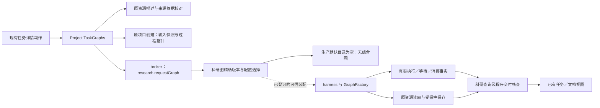

# 调查依据

## 当前事实与复用选择

本次服务 [proposal](proposal.md) 已选定的 D01 路径，只调查／规划，不实现图或公共接口。源码基线为 `c3d5684b5b62dcc51c294b4ae58bfa19a616defe`，开工 HEAD 一致且工作区干净，无 `.codegraph`。已读当前 AGENTS、开发说明、完整 `research-capabilities`／`research-tasks` 正式规格及 D01／D04 相关决定；旧材料分析 method/invoke 保持原行为。D04 Q7 的五段候选、节点顺序与回路未采纳，本工件不据其定图。

复用上一份调查 `/home/joshua/.cache/scholoom-round27-acceptance-O1IWSr/next/research-graph-next/RESULT.md` 与同目录 `source-index.json`，没有重做全仓发现。该索引固定了 `012ef08eaf8539b794afad75cffef30208733866` 的相关本仓文件与旧项目来源版本；本轮逐文件核对索引中的本仓 blob，所核文件与新基线全部一致，结果在 `/home/joshua/.cache/scholoom-round27-acceptance-O1IWSr/next/synthesis-proposal/source-recheck.json`。因此下面的调用链沿用已核来源，并定点重读影响本次选择的源码。全部是静态事实；不使用旧运行产物，不读取凭据，不运行旧 research-live runner、模型、构建、测试、CI 或服务。

### 现有职责与缺口

下列源码路径均相对仓库根；行号针对上述基线。

| 职责与实际入口 | 已核事实／可复用部分 | 本次业务仍缺的内容 |
| --- | --- | --- |
| 科研目录与执行注册：`packages/research/src/graphs.ts:19–77`、`runtime.ts:64–76`；`apps/kernel/src/execution-graphs.ts:3`、`execution-worker.ts:1–4`、`application.ts:194,212` | 描述校验、整体版本及开放配置、有界发现、宿主／worker 共用注册接点已存在；默认描述数组及生产 ExecutionGraphs 为空，测试可经可信构造注入固定图。 | 没有已注册的项目文献综合业务图或对应节点素材。不能直接把校准图移为生产图，也不能用旧 Skill 正文作新流程权威。 |
| 可信请求与记录：`apps/kernel/src/application.ts:130–158,333–345`、`packages/research/src/graph-runtime.ts:71–118` | 原 `research.requestGraph` 保持 product/human 入口，经 broker 复核所属会话、项目、材料身份／依据、read/send；调用身份与原真实执行关联，不自造 run。 | 新业务的开放配置、目的和交付角色须后续规格／设计确定。普通消息接续不能被解释为执行 Agent 可自行调用人工请求入口或扩大身份。 |
| Graph 与模型：`packages/harness/src/graph-registry.ts:23–42`；`tests/fixtures/domain-execution-worker/graphs.mjs:108–124` | 有 GraphFactory、create/resume、可信 peer／signal／checkpointer；现有夹具用 `createExecutionModel` 与原 model.acquire/release 接模型额度。 | 夹具一次模型调用不等于带研究指导、工具访问和实际保存的科研 Agent 节点；必须由 Agent 节点调查确认最小复用接法、实际指令消费及停止／恢复责任，不复制通用执行循环。 |
| 材料引用与读取：`packages/projects/src/task-graphs.ts:92–110,150–168`、`packages/research/src/graph-runtime.ts:343–367` | 任务链接按项目 fileId 或库 attachmentId/materialVersionId 定位，核当前 basis/read，再交真实 Evidence；输入清单不等于实际读取。原资源端口保留领域授权与错误。 | 任务选定的初始来源不自动覆盖之后新增的实际采用材料；解析结果、分片范围、材料深度与采用依据怎样进入共同核查尚需材料报告。不得把库原文复制到项目以绕开来源或授权。 |
| 当前程序交付检查：`packages/research/src/graph-delivery.ts:17–65`、`graph-runtime.ts:343–385` | `completeTextRead` 要求 unit=utf16、offset=0、无 truncated／nextOffset、长度等于 size 且非空；查询对每个材料／成果各发一次原 ref/basis 的 utf8 read，再结合 progress、真实创建结果与 confirmed association 检查。科研评价固定 notAssessed。 | 该检查没有累积多次分片，也不核对 PDF／EPUB 等文档解析消费，不能证明真实论文已按所需深度阅读。仅降低检查、报告文件存在，或把范围改成 text-only，都不能关闭 D01 交付。 |
| 项目保存与任务：`packages/harness/src/task-tools.ts:37–87`、`packages/projects/src/task-graphs.ts:55–117,150–253` | 当前项目任务工具前后检查资格；TaskRef／入口依据、独立输入快照、原调用指针、过程创建及入口关联已有分工，部分成功分别表达。项目文件及原保存／FileEdit 保有权威。 | 现有过程文件主要记录调用／快照指针，不会自动形成充分的科研比较、采用理由与续做安排；新业务须在形成时保存这些实际内容，再经原入口关联。补材料后的身份、来源变化与同一次等待／新调用关系需任务续做报告厘清。 |
| 旧方法及呈现：`packages/research/src/content.ts:5–25`、`runtime.ts:185–228`、`packages/protocol/src/research-contracts.ts:8–29`；`docs/development.md:118–128` | 旧材料分析只收项目路径／目标／输出路径，继续沿原方法发现和调用。已有任务详情、来源导航及共同文件视图可承接保存后的成果。 | 本变更不改旧方法输入或把旧历史补成图记录；不为综合另造工作台或以活动报告为前置。现有视图可打开结果不等于科研综合／续做已实现。 |

### 当前调用链

图中实线表示已读代码接点，非一次已成功运行的业务；虚线表示只有可信装配／测试注入满足登记后才可走通。生产目录仍为空，图中没有假定新的业务节点或 DTO。

来源为上表 TaskGraphs、application、graphs、graph-registry 及 graph-runtime。任务过程保存与入口关联分别核查，不由图示推定原子成功。科研比较、内容评价和新会话补材料后的业务路径尚未装配，未画成现状已实现关系。

### 方法素材与许可

- 复用本项目现有材料读取、来源区分、保存保护及交付检查职责，维护自己的综合节点指导。`packages/research/src/builtin/material-analysis/SOURCE.md:3–5` 记录旧 zotero-agents 提交 `f47a04849a26aec63a2ff08bcbce5ef7bf63caba` 和 AGPL3；其节点素材可核，但本次不改变该旧方法，也不继承旧 Python／SQLite 阶段机。
- 上一固定索引曾核本地 zotero-agents `e4f712479633ef02fbc2085d9cb750dcd489ff36` 的文献分析 playbook:3–53，用于辨认材料证据层级、作者陈述／解释、矛盾及逐项交付的职责。这是静态参考，不是本轮迁入或实跑 oracle；不把宿主队列、Zotero 写回或许可不明的新内容直接引入。
- 上一索引曾核 ResearchSpec `62e442d07acb078c91fabe7e8f96da8e13033e8e` 的 `analysis-evidence-synthesis/manifest.yaml:11–19,28–43`、`SKILL.md:49–100` 和 `research-main.yaml:72–112`。它们可帮助核对输入／综合职责差异，不能成为已批准的本图结构；manifest 的 ars-derived／CC BY-NC 素材沿[既有源码取舍](../../../.scratch/scholoom-foundations/issues/19-existing-source-and-rust-reuse.md#python-与第三方内容)不作默认内置依赖。本轮不重新读取旧仓库或下载内容，不以旧静态调查和 operational 声明当科研质量结果。

## 影响方案的未知项与实验

本次不运行实验。材料解析、Agent 节点及任务接续三份并行报告尚未由主线汇合；它们影响公共契约、图设计和任务拆分，是进入本 change specs／design 定案前的明确待核项。

| 待核问题 | 已知约束与需要报告回答的具体内容 | 汇合责任与后续可观察核对 |
| --- | --- | --- |
| M：实际取材与解析 | 对选定的真实论文格式，现有资源／文档读取能交出哪些带原身份／版本的实际内容？多分片、解析范围、截断／部分可用和撤权怎样区分，如何在原容量与授权下证明被节点采用？当前单次完整文本检查怎样接纳可靠解析／分片消费事实而不放宽输入未读保护？初始清单以外的实际采用来源如何核查？ | 材料解析报告提供现有端口／失败边界与最窄缺口；主线决定是否需要共同契约补充。之后以真实解析、长材料和在途撤权／版本变化核对，不用成功 mock 或全库扫描。不得在本调查先定“只支持文本”。 |
| A：科研 Agent 节点 | 如何在现有 GraphFactory 内复用 Agent／工具与模型额度，而不是再造执行循环、把全文塞进单次模型调用或绕过受管进程？材料引用怎样进入有效工具范围，模型读／存结果怎样被核查，等待普通消息、持久消费、取消和已受理操作的收尾由谁负责？ | Agent 节点报告给出实际可复用函数／控制端口和缺口；主线定节点适配边界。之后经真实内部执行与受控外部模型证明机械链，真实模型内容另验，不以本地 Promise 完成声称远端停止。 |
| T：新会话补材料续做 | 新会话怎样明确找到原 TaskRef、当前入口、原报告／过程及实际来源，判断新增材料并保存影响？现有同调用身份异参拒绝与 session 归属下，哪些情况可继续原等待，哪些须核查后建新调用／尝试，如何保留原历史输入且关联新成果？人工修改／旧引用失效／关联未知如何保留候选与原结果？ | 任务接续报告核对原任务／图记录接点；主线决定关系表达，不在本片增加 DTO、全局反向表或新状态权威。之后从新会话普通消息实际读取原材料并保存修改／保留判断的理由及新关系，不能只测打开旧报告。 |
| S：样本、科研内容与图流程 | D01／D04 Q3 已规定可观察交付，Q7 拓扑未定。真实研究问题、授权库材料、读取深度、纳入理由、内容评价以及是否要求独立复核尚未选定；不能把旧 ResearchSpec 规程直接转成节点或固定质量评分。 | 主线选择有界样本并明确内容判据，再据 M／A／T 结论定 specs／design。科研内容核查与机械保护分别验，缺必要独立复核如实未完成；本轮没有真实模型结果。 |

### 有界样本建议与证据等级

可以复用当前 `tests/task-graph-integration-fixture.ts:27–43` 的合成样本作为机械对照：项目 `source.md` 写“结果42、样本数1”，隔离库 `library.txt` 写“对照组结果17”，随后由夹具明确加入第三份带不同条件的合成库材料。需要观察的是原引用／版本、真实取材、项目报告／过程保存、新会话读回及后续成果关联；不得将模型机械输出与夹具预设比较文字当成真实研究的正确结论。该样本没有真实论文解析、研究覆盖或外部科研效度，不能据其限制 D01 的材料范围。

本仓当前已核输入尚未提供本次获选的真实论文语料与研究问题。本片因此不指定想当然的论文结论、不下载公开样本，也不运行旧付费 runner。真实科研样本由主线在汇合时选定，至少应能对比实际研究条件／冲突，并有可在新会话加入或补齐的材料；具体篇数、主题及格式不在本片定案。旧调查／测试定义仅作候选 oracle 入口，本次没有新的机械实跑或科研质量评价。

## 结论与承接

足以继续的结论是：本次沿 D01 做项目定向综合，保留旧 method/invoke，复用已有可信科研请求、任务文件、实际资源、模型／执行生命周期和文档视图；缺的是业务图及其可靠取材／Agent／接续接线，不能以重跑校准图填补。没有理由为这一路径先建设线上检索、活动报告、多 Agent 或库知识写回。

M／A／T 报告和 S 的样本／流程选择仍待主线汇合；本片不能单独宣称 investigation 的方案未知已全部解决，更不能视为 apply-ready。后续由主线把报告中的确证接口缺口与范围选择落实为同一 change 的 specs／design，再拆 tasks，保持授权、停止、容量、领域权威及未知结果保护；实际实施后才填写 delivery。本次交回的只有元数据和前两工件，不生成其他工件，不开始实现。
