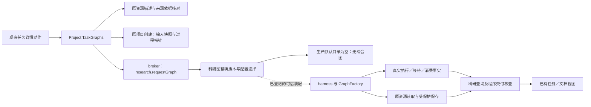

# 调查依据

## 2026-10-31：MiniMax上下文元数据接入

用户要求补齐元数据后重新验收。当前官方[模型调用指南](https://platform.minimax.io/docs/guides/text-generation.md)确认正式Flash与M3均为1,000,000-token窗口；[Messages OpenAPI](https://platform.minimax.io/docs/api-reference/text/api/openapi-chat-anthropic.json)对二者列最大输出524,288，且整体请求体上限64MB。已匿名读取官方正文与JSON，不调用计数或模型接口探测能力。旧ID及Preview当前窗口未核实，不按供应商别名路由猜测。

已装ChatAnthropic 1.5.12的profile只有只读getter，按内置PROFILES查询；二者不在表中，原返回空对象。deepagents 1.15.0默认摘要中间件从实际request.model.profile.maxInputTokens读取窗口，有元数据则85%触发、10%保留；否则170k tokens触发。沿models既有工厂使用薄子类补缺即可，不需要新增依赖、公共DTO、第二套压缩器或按字节限制LLM正文。SDK已有profile字段优先，原测试夹具的小窗口仍可独立验证压缩与历史恢复。近似计数覆盖消息、system及tools，输出16384相对于默认阈值仍有预留；不据此声称供应商精确token计数。

### 正式版重验发现的既有成果版本缺口

本轮第二Graph的prepare先按update目标读回旧过程，再将新阶段开始信息追加保存；原settings.prior仍带保存前basis交给Agent。实际FileEdit证明55,840字节旧过程先变为57,503字节，随后read_context_resource按旧basis返回contentChanged，图进入source-wait。先前只修排除输出文件作为文献来源，未解决“同文件兼作本轮输出和历史prior”的版本时序。需要在写入前保全并实际交付所需prior版本，后续读取指针只随本次已确认保存推进；不得查询当前同文补证、静默重绑定或把程序预检冒充模型已消费。真实证据与尚未通过的内容评价沿delivery首节，修复及回归仍待实施。

## 当前事实与复用选择

本次服务 [proposal](proposal.md) 已选定的 D01 路径，只调查／规划，不实现图或公共接口。源码基线为 `c3d5684b5b62dcc51c294b4ae58bfa19a616defe`，开工 HEAD 一致且工作区干净，无 `.codegraph`。已读当前 AGENTS、开发说明、完整 `research-capabilities`／`research-tasks` 正式规格及 D01／D04 相关决定；旧材料分析 method/invoke 保持原行为。D04 Q7 的五段候选、节点顺序与回路未采纳，本工件不据其定图。

复用上一份调查 `/home/joshua/.cache/scholoom-round27-acceptance-O1IWSr/next/research-graph-next/RESULT.md` 与同目录 `source-index.json`，没有重做全仓发现。该索引固定了 `012ef08eaf8539b794afad75cffef30208733866` 的相关本仓文件与旧项目来源版本；本轮逐文件核对索引中的本仓 blob，所核文件与新基线全部一致，结果在 `/home/joshua/.cache/scholoom-round27-acceptance-O1IWSr/next/synthesis-proposal/source-recheck.json`。因此下面的调用链沿用已核来源，并定点重读影响本次选择的源码。全部是静态事实；不使用旧运行产物，不读取凭据，不运行旧 research-live runner、模型、构建、测试、CI 或服务。

### 现有职责与缺口

下列源码路径均相对仓库根；行号针对上述基线。

| 职责与实际入口 | 已核事实／可复用部分 | 本次业务仍缺的内容 |
| --- | --- | --- |
| 科研目录与执行注册：`packages/research/src/graphs.ts:19–77`、`runtime.ts:64–76`；`apps/kernel/src/execution-graphs.ts:3`、`execution-worker.ts:1–4`、`application.ts:194,212` | 描述校验、整体版本及开放配置、有界发现、宿主／worker 共用注册接点已存在；默认描述数组及生产 ExecutionGraphs 为空，测试可经可信构造注入固定图。 | 没有已注册的项目文献综合业务图或对应节点素材。不能直接把校准图移为生产图，也不能用旧 Skill 正文作新流程权威。 |
| 可信请求与记录：`apps/kernel/src/application.ts:130–158,333–345`、`packages/research/src/graph-runtime.ts:71–118` | 原 `research.requestGraph` 保持 product/human 入口，经 broker 复核所属会话、项目、材料身份／依据、read/send；调用身份与原真实执行关联，不自造 run。 | 新业务的开放配置、目的和交付角色须后续规格／设计确定。普通消息接续不能被解释为执行 Agent 可自行调用人工请求入口或扩大身份。 |
| Graph 与模型：`packages/harness/src/graph-registry.ts:23–42`；`tests/fixtures/domain-execution-worker/graphs.mjs:108–124` | 有 GraphFactory、create/resume、可信 peer／signal／checkpointer；现有夹具用 `createExecutionModel` 与原 model.acquire/release 接模型额度。 | 夹具一次模型调用不等于带研究指导、工具访问和实际保存的科研 Agent 节点；必须由 Agent 节点调查确认最小复用接法、实际指令消费及停止／恢复责任，不复制通用执行循环。 |
| 材料引用与读取：`packages/projects/src/task-graphs.ts:92–110,150–168`、`packages/research/src/graph-runtime.ts:343–367` | 任务链接按项目 fileId 或库 attachmentId/materialVersionId 定位，核当前 basis/read，再交真实 Evidence；输入清单不等于实际读取。原资源端口保留领域授权与错误。 | 任务选定的初始来源不自动覆盖之后新增的实际采用材料；解析结果、分片范围、材料深度与采用依据怎样进入共同核查尚需材料报告。不得把库原文复制到项目以绕开来源或授权。 |
| 当前程序交付检查：`packages/research/src/graph-delivery.ts:17–65`、`graph-runtime.ts:343–385` | `completeTextRead` 要求 unit=utf16、offset=0、无 truncated／nextOffset、长度等于 size 且非空；查询对每个材料／成果各发一次原 ref/basis 的 utf8 read，再结合 progress、真实创建结果与 confirmed association 检查。科研评价固定 notAssessed。 | 该检查没有累积多次分片，也不核对 PDF／EPUB 等文档解析消费，不能证明真实论文已按所需深度阅读。仅降低检查、报告文件存在，或把范围改成 text-only，都不能关闭 D01 交付。 |
| 项目保存与任务：`packages/harness/src/task-tools.ts:37–87`、`packages/projects/src/task-graphs.ts:55–117,150–253` | 当前项目任务工具前后检查资格；TaskRef／入口依据、独立输入快照、原调用指针、过程创建及入口关联已有分工，部分成功分别表达。项目文件及原保存／FileEdit 保有权威。 | 现有过程文件主要记录调用／快照指针，不会自动形成充分的科研比较、采用理由与续做安排；新业务须在形成时保存这些实际内容，再经原入口关联。补材料后的身份、来源变化与同一次等待／新调用关系需任务续做报告厘清。 |
| 旧方法及呈现：`packages/research/src/content.ts:5–25`、`runtime.ts:185–228`、`packages/protocol/src/research-contracts.ts:8–29`；`docs/development.md:118–128` | 旧材料分析只收项目路径／目标／输出路径，继续沿原方法发现和调用。已有任务详情、来源导航及共同文件视图可承接保存后的成果。 | 本变更不改旧方法输入或把旧历史补成图记录；不为综合另造工作台或以活动报告为前置。现有视图可打开结果不等于科研综合／续做已实现。 |

### 当前调用链

图中实线表示已读代码接点，非一次已成功运行的业务；虚线表示只有可信装配／测试注入满足登记后才可走通。生产目录仍为空，图中没有假定新的业务节点或 DTO。

来源为上表 TaskGraphs、application、graphs、graph-registry 及 graph-runtime。任务过程保存与入口关联分别核查，不由图示推定原子成功。科研比较、内容评价和新会话补材料后的业务路径尚未装配，未画成现状已实现关系。

### 方法素材与许可

- 复用本项目现有材料读取、来源区分、保存保护及交付检查职责，维护自己的综合节点指导。`packages/research/src/builtin/material-analysis/SOURCE.md:3–5` 记录旧 zotero-agents 提交 `f47a04849a26aec63a2ff08bcbce5ef7bf63caba` 和 AGPL3；其节点素材可核，但本次不改变该旧方法，也不继承旧 Python／SQLite 阶段机。
- 上一固定索引曾核本地 zotero-agents `e4f712479633ef02fbc2085d9cb750dcd489ff36` 的文献分析 playbook:3–53，用于辨认材料证据层级、作者陈述／解释、矛盾及逐项交付的职责。这是静态参考，不是本轮迁入或实跑 oracle；不把宿主队列、Zotero 写回或许可不明的新内容直接引入。
- 上一索引曾核 ResearchSpec `62e442d07acb078c91fabe7e8f96da8e13033e8e` 的 `analysis-evidence-synthesis/manifest.yaml:11–19,28–43`、`SKILL.md:49–100` 和 `research-main.yaml:72–112`。它们可帮助核对输入／综合职责差异，不能成为已批准的本图结构；manifest 的 ars-derived／CC BY-NC 素材沿[既有源码取舍](../../../.scratch/scholoom-foundations/issues/19-existing-source-and-rust-reuse.md#python-与第三方内容)不作默认内置依赖。本轮不重新读取旧仓库或下载内容，不以旧静态调查和 operational 声明当科研质量结果。

## 影响方案的未知项与实验

材料解析、Agent 节点及任务接续三份只读报告已由主线汇合，均基于 c3d5684 的未变生产源码，没有把源码核对记为实跑。报告位于本轮证据根 `/home/joshua/.cache/scholoom-round27-acceptance-O1IWSr/next/` 的 `synthesis-materials/RESULT.md`、`synthesis-agent-node/RESULT.md` 和 `synthesis-task-continuation/RESULT.md`；各自保存精确来源索引。下表区分已能选择的复用职责与仍影响设计的具体问题，不继续泛称缺少三份调查。

| 待核问题 | 已知约束与需要报告回答的具体内容 | 汇合责任与后续可观察核对 |
| --- | --- | --- |
| M：实际取材与解析 | PDF 页、EPUB／HTML 规范化章节和搜索已有真实提供者及分页字段；`resources.document` 不回传原 ref/basis，须配对已核请求与成功结果。UTF8 接口只切已取得的有界前缀，不能据 nextOffset 耗尽推定长文全文已读；大工具结果也可能只向模型交 offload 路径。原 GraphProgress 只存 Evidence，查询时 UTF8 重读不证明运行时已消费解析片段。 | 复用原解析器及权限，在现有图进度表达实际交给节点的有界内容形式与范围；采用／排除和科研深度仍归项目研究过程，不能用字节／目录／成功预检冒充正文。新综合图按真实格式／所需范围核查，原校准图及旧方法不放宽；长文本续读和元数据材料须明确接缝，不能偷偷转为 text-only。 |
| A：科研 Agent 节点 | 原 registered 分支在 `execution-driver.ts:150` 返回，完整 DeepAgent／beforeModel／工具及回执只在普通分支；宿主 registered 输入也未装配同一工具元数据。模型额度、原 peer／signal 和 InstructionSaver 可以复用，不能复制第二执行循环或以 fixture 的直接 model.invoke 当业务 Agent。 | 提取共用宿主／worker Agent 装配并立即由普通执行与综合节点消费；图掌握流程，harness 掌握资格／收尾。真实子图 checkpoint namespace、指令上下文与宿主确认的组合尚待下面有限探针，不先发布 helper 或内部 wire 字段。 |
| T：新会话补材料续做 | TaskGraphs 已分别保存输入快照和调用指针，但后者不等于研究过程、也不自动关联报告。普通 Agent 有任务／文件工具，尚无人工图启动或图历史工具；人工 tasks.runGraph 沿现有路径，不能伪造 human。跨 session 不能搬原 checkpoint；改变目标／材料的新会话须新调用，保留原快照／成果。 | 保持 TaskRef 和文件权威；研究过程须实际形成并关联，入口关联 CAS 失败只补关系。普通消息与显式图选择／请求的接线需在设计说明，不能将人工启动等同普通 Agent 已能自主启动。图查询仅查首次 creation 也不足证明既有报告更新，另由保存核查调查闭合。 |
| S：样本、科研内容与图流程 | D01／D04 Q3 已规定可观察交付，Q7 拓扑未定。真实研究问题、授权库材料、读取深度、纳入理由、内容评价以及是否要求独立复核尚未选定；不能把旧 ResearchSpec 规程直接转成节点或固定质量评分。 | 主线选择有界样本并明确内容判据，再据 M／A／T 结论定 specs／design。科研内容核查与机械保护分别验，缺必要独立复核如实未完成；本轮没有真实模型结果。 |

### 决定性接缝与当前选择

- Agent 子图探针已接收：原 `synthesis-agent-checkpoint-probe/RESULT.md` 固定已安装 LangGraph 1.5.0／DeepAgents 1.15.0，真实子图继承同一 saver／SQLite／thread。修正直接 addNode ReactAgent 的装配首败后，唯一有效运行保存9个 checkpoint、调用一次内存假模型；7条记录型确认中5条子 namespace 的 ID 按原宿主根查询均无法定位，探针明确 exit2。确认回调只记录并 resolve，宿主拒绝依据为原查询／谓词镜像；未运行真实宿主消费事务，不能宣称产品通过。模型外发为0。
- 主线独立只读审查 `synthesis-checkpoint-design-review.md` 否决仅等整个 Agent 节点完成再确认的方案：它会改变中间消费边界，并缺少子采用信息的恢复。当前选定方向保留原同步确认，按实际 namespace／checkpointId 精确核所属 tuple、原始上下文和真实父根。原探针 SQLite 的子 metadata.parents 确实指向产生该任务的根 checkpoint，主线已 readonly 核实，不从 namespace 字符串猜任务身份。
- 补充审查 `synthesis-checkpoint-design-review-followup.md` 指出：只恢复 confirmed 集合仍遗漏“子状态已保存、确认尚未提交”的窗口。设计必须在继续实际子任务前，按其原 config／namespace 补核全部已采用上下文并严格补确认；失败继续阻止下一模型／工具。已经确认的完整覆盖引用不能被重启时旧根的子集确认降级。保留原根任务／pending writes，不把子最新状态当替代根。
- 后续 `synthesis-agent-resume-probe/RESULT.md` 已收到，基线 `f4c525a`，仓库只读。两个有效场景各运行一次、exit0：A在同一实际子 task／config 定位未确认的B，补确认继续失败时模型／工具累计保持1／1；解除同一故障后从原子状态继续，最终2／1，B只采用一次。B实际命中成功子任务的 pending writes 已落盘而下一根未保存的窗口；以精确子覆盖引用恢复B，原根子集确认没有降级，SDK跳过成功 consumer 后模型／工具仍2／1。主线核过 evidence-index 的实际 namespace／metadata.parents 与计数。首败是假模型 bindTools 的两个夹具问题，原日志与数据库保留，不算业务通过。完整框架、原 saver／SQLite 和合成文件效果真实；消费覆盖 meta／ACK 仍是有限宿主镜像，未运行 KernelApplication／IPC／权限／真实崩溃。该证据足以选定恢复接缝，生产保证列入实现与独立验收，不再以相同探针等待设计。
- 既有报告更新调查已接收，来源 `synthesis-updated-artifacts/RESULT.md`：精确 FileEdit 可核本次 afterEvidence、可信 run／instance 及 before 依据，原 artifact 只证明 run 与文件的关系，不能证明保存版本；列表100项截断也不能证明关系不存在。选择在原 GraphProgress 表达有界角色结果，经宿主窄适配分别核精确保存、关联及可读性，必要时由 projects 按原键读取单项关联；不另建历史或逐工具账本。未知保存继续保留未知，不按旧 creation／同内容认定成功，不强制所有修订另存新文件。

主线另核 `task-contracts.ts:21–39`：当前库来源链接必须有 attachmentId 与 materialVersionId，尚不能结构化表达只有题录的候选。正常缺全文不能伪造附件 Evidence，也不能当作已登记材料读取故障；本次来源条件／实际消费表达需要保留这一差别。

### 有界样本建议与证据等级

可以复用当前 `tests/task-graph-integration-fixture.ts:27–43` 的合成样本作为机械对照：项目 `source.md` 写“结果42、样本数1”，隔离库 `library.txt` 写“对照组结果17”，随后由夹具明确加入第三份带不同条件的合成库材料。需要观察的是原引用／版本、真实取材、项目报告／过程保存、新会话读回及后续成果关联；不得将模型机械输出与夹具预设比较文字当成真实研究的正确结论。该样本没有真实论文解析、研究覆盖或外部科研效度，不能据其限制 D01 的材料范围。

本仓当前已核输入尚未提供本次获选的真实论文语料与研究问题。本片因此不指定想当然的论文结论、不下载公开样本，也不运行旧付费 runner。真实科研样本由主线在汇合时选定，至少应能对比实际研究条件／冲突，并有可在新会话加入或补齐的材料；具体篇数、主题及格式不在本片定案。旧调查／测试定义仅作候选 oracle 入口，本次没有新的机械实跑或科研质量评价。

## 结论与承接

足以继续的结论是：本次沿 D01 做项目定向综合，保留旧 method/invoke，复用已有可信科研请求、任务文件、实际资源、模型／执行生命周期和文档视图；缺的是业务图及其可靠取材／Agent／接续接线，不能以重跑校准图填补。没有理由为这一路径先建设线上检索、活动报告、多 Agent 或库知识写回。

M／A／T、保存核查及两个决定性恢复场景均已接收。已形成三份 delta 共10项要求，规定真实范围取材、角色保存、来源等待、新会话续做及原消费保证，strict 验证通过；它们是待实施契约，不是实现证据。无阻塞问题，主线据原调用身份、当前授权、已有库材料及文件任务权威制定 [design](design.md)，按 [tasks](tasks.md) 分波实施；只有所需工件齐备才进入 apply，实际执行后再写 delivery。科研样本及实际模型内容评价保留独立验收，不以这些合成探针、规格存在或 CLI ready 关闭。
