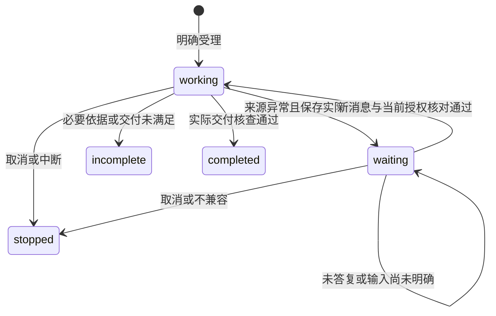

# Spec Delta

## ADDED Requirements

### Requirement: 源码内建的项目定向文献综合

系统 SHALL 提供可发现、按精确整体版本选择的项目定向文献综合业务图，接受明确研究问题、约束、已有库材料及项目成果目标。必要取材、比较、依据核查、保存检查和待用户决定由图推进；节点指导只服务所属工作，不以通用 Agent 加载完整流程提示替代业务图。基础路径允许单 Agent，不能将分阶段自查宣称为独立审阅。

用户 SHALL 可沿现有项目任务入口明确选择图和会话，在所属授权下开始工作；普通导航、发现、查询和重启不启动研究。配置只能使用图开放的参数，不能注入代码、可信角色或额外权限。旧材料分析入口及历史保持原契约，活动报告、在线发现和库知识写回不成为本路径前置。

#### Scenario: 从已有库材料开始定向综合

- **WHEN** 用户在任务中明确选择综合图、研究问题、会话和来源
- **THEN** 经真实内建实现、原科研请求及所属执行推进，可核对实际图版本、调用、运行和项目成果，不要求先复制库原文或运行校准图

#### Scenario: 读取旧方法及未装配版本

- **WHEN** 调用方使用旧材料分析，或请求未装配的综合图版本
- **THEN** 前者保持原方法行为，后者明确不可用；不将旧方法或默认 Agent 冒充该业务图

### Requirement: 综合取材保留实际内容形式与范围

综合图 SHALL 保留实际成功交给节点的题录、文本、PDF 页或规范化章节的来源身份、版本、内容依据和有界读取范围，区分目录、搜索摘要、原字节及正文。初始预检、来源列表、查询时重新读取或只交付大结果临时路径不能算运行时已取得正文。实际采用的新增来源 SHALL 同样进入授权、来源及交付核查，不只检查初始清单。

按需片段读取 SHALL 明确已读范围、截断、续页及未取得的内容；只有同版本所需范围确已覆盖时才报告范围读取完成，不默认读取全书，也不将片段完成等同全文或科研理解充分。原要求完整文本的既有图保持原检查，成果的完整读回检查不能因支持部分取材而放宽。

#### Scenario: 读取 PDF 页及长文档章节

- **WHEN** 节点实际取得指定页或章节的一段内容，并保留续读位置
- **THEN** 记录原材料及实际返回范围，能继续按当前授权取材；不能据本页末尾、搜索完成或截断前缀宣称整篇已读

#### Scenario: 渐进采用新增来源

- **WHEN** 综合期间发现并实际读取初始清单以外的获授权材料
- **THEN** 保存其实际采用依据和范围，后续核查覆盖该来源；撤权、身份变化或读取失败不能由原清单的成功预检替代

### Requirement: 综合内容与过程共同承接研究判断

综合报告及可取回的过程材料 SHALL 共同保存研究问题、范围、纳入／排除理由、比较维度、有来源支撑的发现、冲突与条件、不确定性、未决问题和下一步。领域研究局限、材料覆盖不足与当前证据不足 SHALL 分别表达，不能从本次未覆盖推出研究空白。内容按问题组织，不强制固定章节、每篇文献表格或节点数量。

在形成研究判断时 SHALL 持续保存有接续价值的比较、理由与安排，不能只在最终结束保存摘要。程序核对实际来源和交付，科研判断另行核查；执行完成、可解析或格式齐全不代表科研充分。用户或能力要求独立复核而尚未实际完成时 SHALL 明确未完成，不能以同一执行的自查替代。

#### Scenario: 来源结论存在条件差异

- **WHEN** 已读材料给出不同结论或适用条件
- **THEN** 综合保留可核查依据、已确认的条件差异和尚不能解释的分歧，不抹平冲突或补造未读结果

#### Scenario: 只有题录或必要复核不可用

- **WHEN** 候选文献正常没有全文，或本次明确要求的独立复核不能完成
- **THEN** 如实保存材料层次或未完成复核及影响；不能捏造全文结论，也不能据报告存在判定全部要求满足

### Requirement: 综合角色成果按本次实际保存核查

综合图 SHALL 分别交付真实报告和研究过程的角色引用，支持受保护首次创建和明确既有目标更新。更新核原文件身份及当前读取依据；交付核查 SHALL 沿所属事实确认本次实际保存版本、执行归属、成果关联及可读性，不能以旧创建、同路径同文字、run 结束或图自述代替。

保存效果未知、历史不足、关联未确认及当前版本已变化 SHALL 分别报告，保留实际文件、候选及原回执。后续人工修改不抹去本次可证明的历史保存，也不能冒充本次输出。查询不能自动补写、重生成、回滚或用新 basis 覆盖冲突；需要补关系时只在原身份下核查和补关联。

#### Scenario: 更新已有报告后用户继续修改

- **WHEN** 本次按原依据更新同一报告，随后用户又保存新内容
- **THEN** 能分别核对本次保存的实际版本及当前变化，不将用户新版当作图输出，也不因同一文件曾创建过就宣称本次交付成功

#### Scenario: 已保存而关联未知

- **WHEN** 报告或过程已保存，但其成果关联未确认或任务入口更新冲突
- **THEN** 保留原成果及精确核查依据，分别显示未完成关系；后续只补原关系，不重复生成文件或盲重放未知保存

### Requirement: 综合中的来源决定沿真实等待接续

综合图 SHALL 区分正常材料条件与引用异常。明确删除、权限拒绝、身份不符、库访问异常、托管内容缺失或外链失效时，暂停依赖该来源的工作，保存原错误、已有成果和问题，询问用户并等待明确选择；缺删除历史提供者不能捏造分类。对象不存在且可靠核查无删除记录时交 Agent 核查，不擅自推断用户删除。

用户选择 SHALL 经所属会话普通消息及真实持久等待进入当前执行，核对适用来源和范围；未答复、页面打开和迟到结果不算选择。不使用缓存、同名材料或模型记忆替代原引用，忽略的来源不能列作已读。取消、重启和不兼容接续保留部分成果，不能自动推进。

#### Scenario: 托管附件读取失败后等待

- **WHEN** 已登记材料读取失败而用户尚未决定处理方式
- **THEN** 保存具体错误并保持待决定，不自动跳过、换源或从失败返回空正文继续宣称完成

#### Scenario: 明确忽略后继续

- **WHEN** 用户在原会话明确忽略指定来源，等待输入及当前权限核对通过
- **THEN** 保存选择、适用范围和对交付条件的影响，只按已明确的调整继续；原失败记录和已保存成果保持

### Requirement: 图内 Agent 保持共同执行及消费保证

图内 Agent 工作 SHALL 使用所属真实执行的模型配置、额度、工具授权、取消和保存收尾，不另造默认模型、第二套业务调用或进程容量。完整用户上下文及来源在持久接受前后保持，指令确认须对应所属执行中可恢复的实际控制位置；子图有 checkpoint 不等于宿主已经确认消费。

确认失败 SHALL 阻止依赖该输入的后续模型或工具推进；确认提交后回执丢失按原身份核查，不能重放已受理副作用。重启恢复实际采用的完整上下文、原任务接续和待处理消息，查询不自动开工。普通 Agent 的既有中间消费边界、工具回执及未知效果保护 SHALL 保持，不以共用装配降低保证。

#### Scenario: 子图采用补充指令后中断

- **WHEN** Agent 子图已持久采用补充指令，而下一外层 checkpoint 尚未保存时执行中断
- **THEN** 显式接续能核查原控制位置和完整指令，不丢失已采用要求、不新建任务身份，也不重复已确认的工具效果

#### Scenario: 消费确认提交失败或回执丢失

- **WHEN** 指令确认失败，或提交成功后成功回执未交付
- **THEN** 前者停止依赖推进，后者可核原持久结果并幂等补确认；两者均不能因模型正常返回而伪称消费完成或盲重放工具
