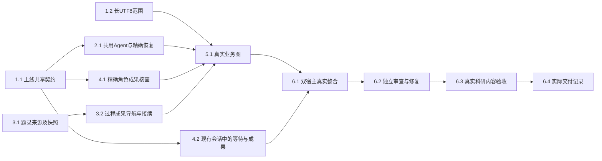

# 执行任务

## 1. 最小共同契约与真实文本范围

- [x] 1.1 主线在protocol的原GraphProgress增加可选有界contentReads／roleResults、精确消费namespace及registered Agent元数据，核旧记录仍通过原schema，真实页／章／文本片段不混作全文。构建及原契约／登记代表检查通过后提交并同步，才能派发消费者；本任务不表示生产恢复或科研交付已经完成。
- [x] 1.2 文献线独占resources.read的UTF8根因修复及必要窄底层，按design在8MiB字节范围内核原身份／basis、严格解码与真实offset／size／nextOffset，保留base64路径。沿resource-access扩独立已知长尾、多字节、非法／超限及续读变化代表；不修改Graph合同、保存、解析引擎或同源TaskLink。主线接收858c529→16857db，真实红2/2、绿15/15，独审无确证P1/P2；每次范围重读完整快照的IO限度见delivery。

## 2. 同一执行中的真实Agent节点

- [x] 2.1 Agent线实现宿主／worker共用装配、串行consumer与原config恢复门，普通Agent及registered同时消费；精确namespace和完整原上下文核对、累计覆盖引用事务、未确认adopted补ACK与成功task skip均经真实KernelApplication／worker／SQLite核查。原工具回执、ModelAccess／预算、取消／撤权、graphResume及未知效果保护不降低。主线接收813d87f→ce6bdda，并修复两项独审P2：新根落盘但ACK未提交的恢复、首条实际HumanMessage；四个真实窗口4/4及普通接续／压缩／累计／terminal四项4/4通过，双路复核关闭。本项不等于生产业务图或最终科研验收。

## 3. 文件任务与来源承接

- [x] 3.1 任务线增加library-source TaskLink及真实题录读取端口，含此类来源的输入使用v2快照，原v1继续可读；沿TaskGraphs／解析／原任务详情导航更新所有受影响调用方，核原source身份／version／revision与权限、不伪造附件Evidence。机械代表覆盖仅题录、后补真实附件及旧v1；不改会话projection或Agent装配。主线接收c1fb988→c7d97a8，并修复独审发现的真实受理窗口P1：题录guard延续到原harness事务前同步检查，三类真实竞态红绿及原准入保护通过，复核无确证P1/P2；具体结果见delivery。
- [ ] 3.2 在3.1及业务图输入接口明确后，沿TaskRef、现有工具及CAS建立真实报告／过程导航与新调用续做，区分graph-call指针与研究过程；入口冲突保留文件与缺关系，补关系不重生成。沿原task-graph-continuation核旧成果可发现、改材料／会话新调用及新旧依据保留；与5.1共同接入，跨模块最终验收归6.1。

## 4. 可核查成果与现有会话呈现

- [x] 4.1 项目线消费1.1的roleResults，沿原FileEdit精确核after Evidence及project／session／run／instance，增加projects原artifact键单项查询的窄端口，科研交付分别核保存、run关联和当前读回。保留旧creation校准行为；以同fileId更新、人工后改、关联unknown／错run代表证明不按路径／同文／旧creation补绿。不得查询时save／reconcile；缺证据仍unknown。主线接收4da53e→cfb37a7，独审无确证P1/P2，整合构建及两项真实角色保存代表2/2通过；具体模拟边界见delivery。
- [x] 4.2 交互线沿原business-session／projection将当前真实Graph等待问题及成果入口呈现在同一Dock／Overlay，派生展示不伪造Message／Artifact／耗时或历史；普通composer继续原send，迟到旧run不盖新状态。先对齐并按需更新UI设计；复用task-graph-launch双宿主核问题可见、草稿保持、同run回复、成果打开及刷新不重复。主线接收4b7f4db→8e8c323，投影3/3及整合Task／会话双宿主4/4通过；仅当前快照，真实业务图及科研内容未随本项验收。

## 5. 内建项目文献综合业务

- [ ] 5.1 图线在2.1、1.2、3.1与4.1接口经主线验收合入后，按design登记精确版本并实现准备、取材、综合、自查／修订、交付与等待；复用实际Agent、领域工具及小片返回形成contentReads／roleResults，形成时保存判断及过程。真实PDF页／规范化章节／长文本／仅题录与渐进新增材料分别诚实表达；旧材料分析不变。复用已有Graph fixtures在受控外部模型边界核实际节点、工具、保存、回路与不足／异常，不以固定模型答案判断科研质量。

## 6. 整合与交付

- [ ] 6.1 主线保全来源提交，顺序整合共享装配与端口后，沿真实任务入口跑隔离项目／库／实际内建Graph的Browser及Electron路径：首次综合、真实问题等待与普通消息、成果打开／编辑、新会话补材料实际续做、入口关联部分成功。核实际SQLite／文件／版本／过程／关系、收尾归属和必要性能范围；原ordinary Agent与旧材料分析保留可用。失败或未跑的必要检查不能勾选。
- [ ] 6.2 独立核消费恢复、权限／取消、保存归属及跨模块关系，与当前契约、diff和真实结果对照；修复确证问题后只复验受影响路径。主线持有最终验收，不由作者自查替代。
- [ ] 6.3 在实现可操作后，主线补齐design的真实多来源样本、来源许可与独立预期，获得本次新的实际模型授权，经产品入口做首次综合与补材料后的新会话续做；按内容判据核来源、比较／冲突、三层局限与实际研究影响。未运行或未经内容核查保持科研质量未验，受控HTTP不算本项通过。
- [ ] 6.4 根据实际执行结果更新开发说明、必要架构声明及同一delivery.md，逐项核完成判据、权限／平台限制和未完成项；只有实际交付完才勾选本项，不以CLI工件齐备或机械绿测代替。

## 续做入口

按design的写入归属先完成1.1；源码、受影响产物及必要检查同步验证后再派发1.2／2.1／3.1／4.1／4.2。5.1等待真实共享consumer与任务／交付接口合入，不猜未来helper。其余未具备独立前置的树保留；不为占满七树重复测试。任务进度以本文件为准，执行证据写delivery及本轮持久cache，均不依赖/tmp。
