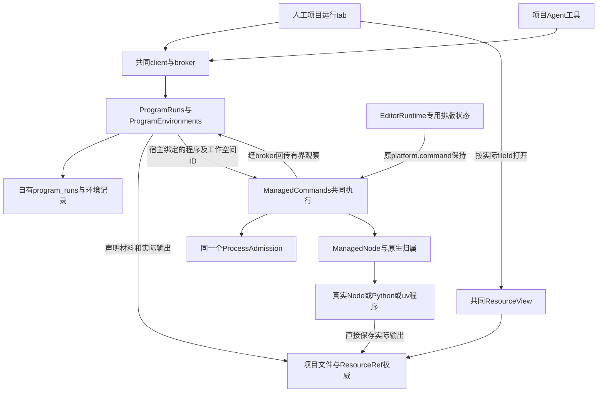
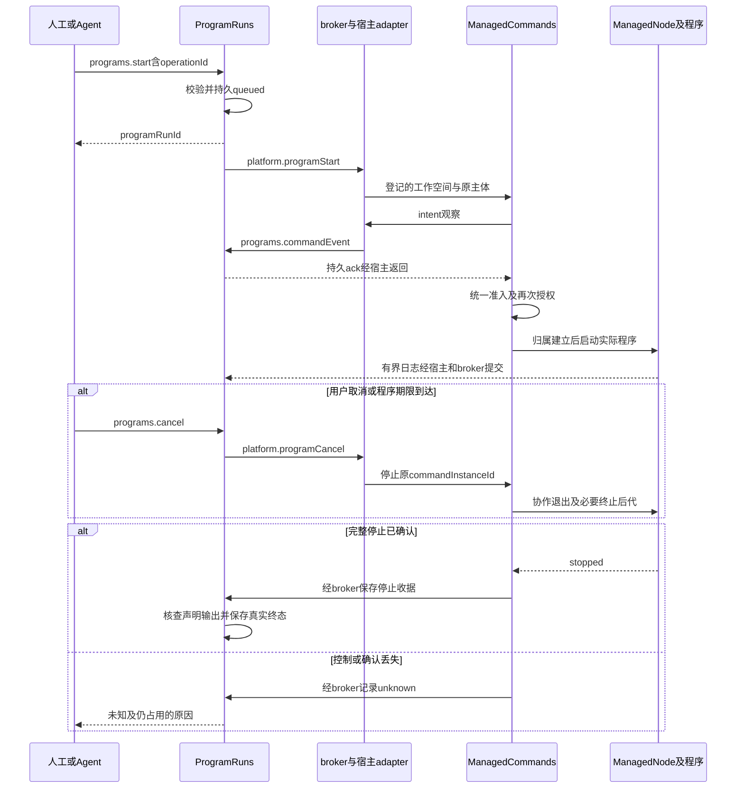

# 实现设计

## 变更总览

依据[调查](investigation.md)和[运行契约](specs/project-program-runs/spec.md)。以下是拟实施方案，不是当前实现。首个change完整交付项目内固定程序闭环与受管Python环境准备，仍以已有共同资源打开实际输出。

兼容宿主不参与本次执行。科研Graph选择方法和解释结果，harness只把受限工具接入本模块；它们均不保存第二份程序运行状态。

## 方案与接口

### 1. 深模块与唯一事实源

新增私有workspace包 `packages/programs`：`ProgramRuns` 处理受理、程序归属、状态、日志、产物核查和接续诊断；`ProgramEnvironments` 处理已有环境与受管准备。两者共用运行执行／记录机制，环境准备是 `kind: environmentPreparation` 的运行，不另造一套job状态、日志或取消器。环境ready状态来自对应准备结果和当前依据。

选择新增模块而非并入editor或harness：删除本模块会使授权准备、幂等受理、日志、停止和核查逻辑散回两个调用方；保留它能让人工与Agent跨同一interface完成整条路径。公共interface只提供环境、运行、日志与取消，不暴露平台句柄或数据库。内部seam分别为真实／受控命令端口和真实／内存记录adapter，供独立测试替换。生产跨模块均经broker，普通静态计算不需要broker。

同源DTO放 `packages/protocol/src/programs.ts`，字段界限、错误、操作副作用和等待语义一起声明；公共映射引用原schema。`packages/programs`只读写自身表与私有环境配置，复用protocol／platform及已有better-sqlite3，未引入新第三方版本。项目文件、身份、授权和成果关联继续归projects。

### 2. 公共操作与字段含义

名称在本change内统一为 `programs.*`。通过现有 `KernelClient.call` 和broker接入，不增加逐操作客户端包装方法。

| 操作 | 输入与输出 | 语义 |
| --- | --- | --- |
| `programs.environments` | projectId、分页；返回environmentId、kind、availability、已知version、diagnostic | read/result，5s；默认25、最大100；只读不自动探测／准备 |
| `programs.registerEnvironment` | projectId、operationId、kind及可信人类登记的解释器／uv位置；返回environmentId | write/reference，5s；只允许人类产品入口，保存配置后以受管探测run核查；Agent不可调用 |
| `programs.environmentPlan` | projectId、operationId、environmentId及项目声明的ResourceEvidence；返回planId及检查run引用 | write/reference，5s；幂等受理有界检查，不安装 |
| `programs.environmentPlanStatus` | projectId、planId；返回检查状态、确切依据／动作／授权需求 | read/result，5s；检查未结束时返回pending及检查run引用，不伪造已解析计划 |
| `programs.authorizeEnvironment` | projectId、planId；返回已绑定原计划的授权引用 | write/result，5s；仅可信人类明确同意该计划，不接受Agent自报批准字段；相同依据复用 |
| `programs.environmentPrepare` | projectId、planId、operationId；返回准备run引用 | write/reference，5s；只消费宿主已有授权；缺授权返回permissionDenied与planId |
| `programs.start` | projectId、operationId、environmentId、cwd、entry、args、inputs、outputs、timeoutMs、lifetime | write/reference，5s；返回持久programRunId和当前state，后台推进 |
| `programs.run` | projectId，以及programRunId或本主体的operationId二选一 | read/result，5s；返回持久事实，不隐式重试程序／安装 |
| `programs.runs` | projectId、before、limit | read/result，5s；默认25、最大100，稳定分页，不返回正文日志 |
| `programs.logs` | projectId、programRunId、after、limitBytes | read/result，5s；最大64KiB，返回stream／seq／text、next、truncatedBefore、lastLogAt |
| `programs.cancel` | projectId、programRunId | write/reference，5s；幂等返回cancelling或真实终态，完整停止异步查询 |
| `programs.handoff` | projectId、programRunId | write/reference，5s；仅可信人类对正在运行的Agent程序逐次移交，保存backgroundOwner |
| `programs.reconcile` | projectId、programRunId | write/reference，5s；仅核查停止证据和明确outputs，补登记／关联，不重跑或重写字节 |

运行字段：

- `programRunId` 是本域身份；`operationId`按项目＋可信主体去重，比较规范化输入本身而非增加hash门禁。同身份不同请求拒绝。`origin`可选保存sessionId／harnessRunId／instanceId，仅溯源，不把它叫programRunId。
- `cwd`为项目相对目录，默认`.`；`entry`是本项目代码的ResourceEvidence；`inputs`最多100项同项目ResourceEvidence。`args`使用独立字符串数组，最多128项、每项最多4KiB、整体最多64KiB，不拼shell字符串。`entry`放在解释器参数的固定位置，禁止用entry字段注入解释器选项；首批不提供任意`-c`／`--eval`／加载器选项入口。
- `outputs`最多100个显式项目相对路径；默认 `runs/<programRunId>/` 下新目录，由项目已有mkdir／路径检查建立。调用方指定已有输出时须有显式覆盖范围，保存启动前依据；不默认复制项目或旧成果。
- `timeoutMs: number | null`是程序期限，null为明确长任务无总期限；不是RPC等待。Node／Python实际计算默认null；版本探测10s，uv准备默认10分钟并允许明确配置调整，不因无日志提前终止。这些初值在实现验收校准，不用CI失败直接修改。
- `lifetime: execution | background`：人工默认background；Agent默认execution且不能自行选择background。可信人类逐次handoff，先由prepareHandoff取得无副作用资格票据，再持久backgroundOwner（human/id/at/state=authorized），同步commit重新检查控制及父取消，最后保存active。父取消先发生或票据失效则failed且仍保留原取消责任。接管已完成但完成收据失败保留已持久授权，以active＋outcomeUnknown报告本宿主事实；后续成功观察可补收据，重启保守核查。
- `state`沿规格；另有`phase: accepted | environment | admission | starting | executing | stopping | inspecting`及结构化`error`，用于定位失败阶段。`exit`保存实际code／signal／reason，可独立于`stop: pending | confirmed | unknown`和`outputAssessment: unassessed | partial | observed`。状态不从日志文案推断。
- `command`保存实际executableId、args、项目相对cwd、解释器版本；原生可执行路径仅在可信本机环境设置／私有诊断可见。密钥或索引令牌不得进参数和普通日志；显式程序stdout仍可能包含用户材料，按项目权限读取，不宣称能可靠脱敏任意程序输出。
- `code`／`inputs`记录实际启动前依据；`dependencyCoverage: declaredOnly`，无法确认的环境版本用缺失字段及原因表达。不能从参数推断“实际已读取”。直接程序执行不具备所有文件读取追踪能力。
- 输出项保存`declaredPath`、实际`ResourceEvidence?`、`observedAt`、`presence`、`completeness: unassessed | incomplete`、`attribution: observed`和可选关联状态。默认无通用科学完整性checker，不把文件存在标成verified；固定程序的CSV内容由独立样本断言验收。

消费的项目窄端口复用 `project.check`、`project.path`、`project.material`、`files.resolve`、`files.mkdir`、`resources.describe` 和适用的 `project.linkArtifact`。项目relative path／nativePath只能在受控宿主adapter内转换，ResourceEvidence必须由resources.describe取得其strong basis；不能把project.material的文件指纹当成共同资源basis。启动前同时核对声明资源basis及宿主执行所定位的实际文件；输出先由项目登记再取共同descriptor，不向UI／模型返回nativePath。既有ProjectTargetReadPort不作为执行输入或写入授权替身。

### 3. 平台增量：共同机制，保留editor语义

原 `platform.command`／`platform.editorCommand` 和 `ManagedCommands.execute` 的返回、stdout1MiB失败／stderr64KiB及有限期限保持。新增内部 `platform.programStart`、`platform.programCancel`，只对宿主装配的programs消费模块开放，客户端／worker不能直接调用。两种模式复用同一个启动、授权、准入和完整停止实现，不维护两个命令执行器。

`platform.programStart` 输入为workspaceId、executableId、args、nullable timeoutMs；workspaceId在宿主私有表中绑定programRunId、ownerModuleId、projectId、受控cwd和允许环境，不能来自客户端任意nativePath。返回commandInstanceId后异步准入；它只有瞬时控制句柄，不提供另一份持久run/status/log仓储。`platform.programCancel`按workspaceId＋commandInstanceId核对真实所有者。

运行观察统一由宿主adapter经broker调用内部 `programs.commandEvent`。输入包含programRunId、hostInstanceId、commandInstanceId、递增seq和事件联合：`intent`、`started`、`output`、`exited`、`stopped`、`unknown`。只允许装配的宿主system调用，载荷不能自授身份。programs持久提交后返回ack；platform库只接受通用observer，不导入programs，不形成包依赖环。事件声明归各自产生的共同执行／运行同源契约，宿主负责映射，不在IPC写第二份载荷。

启动顺序：运行受理落盘 → `intent`落盘并ack → 取得统一准入 → 授权／依据重验 → 创建ManagedNode并持久started → 发送实际命令。原生归属建立前不加载用户代码；intent已保存但started丢失一律保守核查，不推断尚未执行。`stopped`事件只来自原 `ManagedNode.stopped`，先持久停止收据再确认运行终态；收据持久失败保留unknown。

program模式通过 `command-worker` 分片输出，使用UTF-8安全解码，每片最多16KiB，最多4片未确认；IPC确认前暂停继续读取，跨host的背压不可积累无限Promise。到保留容量后继续排空并仅计数／保存尾部，不能无限缓存。每运行 stdout／stderr合计保留1MiB和流顺序，持久记录滚动替换已淘汰片段；读取游标使用seq并报告缺段，不以字节切断Unicode。磁盘写失败停止相关工作并保留日志不完整诊断，不能报告完整日志成功。运行中刷新合并，每250ms至多发布一次运行变化，最终状态立即发布；不把每片正文加入workbench snapshot。

### 4. 环境计划和授权

环境配置由ProgramEnvironments持有。Node使用宿主实际可执行文件；已有Python／Conda使用人类在可信本机启动配置登记的路径，启动时做受管版本探测，某些Conda包需要额外系统变量时明确报不支持／缺项，不复制整个登录shell环境。

新增应用私有 `programs/environments.json` 保存environmentId、类型、登记解释器和项目绑定；已有环境不由prepare修改。运行tab内可信人类环境设置通过registerEnvironment接受本机路径，Agent只能选已登记environmentId。准备授权记录包含planId、projectId、解释器身份、声明资源依据、受管目标、网络范围和允许的安装／构建动作。人类经authorizeEnvironment明确同意，Agent只能消费；本树没有通用任务安装授权提供者，首批不假定已存在，未来若有该adapter再按正式契约消费。配置中的缺失工具不自动安装。

uv首批要求项目根pyproject.toml和uv.lock、已有uv及Python 3.11+，执行 `uv sync --locked --no-dev --no-install-project --no-install-workspace --no-python-downloads --no-build --no-editable --no-config --project <受控项目根> --python <已登记解释器>`；无网络来源时额外offline。宿主显式注入私有UV_PROJECT_ENVIRONMENT／UV_CACHE_DIR，禁自动下载解释器，不继承不受控的UV／PIP配置。仅支持能核对来源和SHA-256的registry wheel及项目内wheel，拒绝源码构建、git、editable／目录依赖；无法解释则拒绝，不放宽到未锁安装。

本树没有现成TOML解析依赖；实测uv 0.9.17的CycloneDX输出不含授权所需完整来源／hash，不能作为计划依据。选择应用固定 `inspect-lock.py`，经已登记Python的标准库tomllib解析有界原声明，核对锁定来源、项目内路径和本地wheel实际hash；同样经ProgramRuns受管执行。计划、同步、验证都携带原ResourceEvidence，在准入等待后及实际启动前重验。Python低于3.11仍可作为直接运行环境，但不能用于uv准备。

声明必须直接位于项目根。uv 0.9.17 即使使用no-config／显式project仍会发现父workspace，已由隔离dry-run确认；计划检查及实际sync前均经固定脚本拒绝父workspace，不能转用其lock。实际准备命令由已登记Python执行 `inspect-lock.py --sync <uv> <项目根> <sync参数>`，检查后execv已有uv，完整进程归属保持。计划中的uv动作与运行中的固定检查包装分别保留，未复制或修改用户声明。

先形成计划再授权再执行，计划变化要求新依据。相同范围授权可复用；只读查询不触发网络。登记探测后保存解释器stat收据，已有环境及ready受管环境在resolve／validate／重启时重验；替换后清除旧版本并标unavailable。准备失败保留目录和诊断，不将部分目录标ready。用户已批准本轮隔离安装与测试，公网registry下载未实跑。

配置UTF-8候选及读取共用4MiB限额，替换前核对；容量拒绝原位恢复对象，保留在途probe持有的引用，不永久污染模块。每个活动登记／计划为有界回执和恢复诊断预留16KiB元数据envelope，已写元数据消耗该预留；不会在每次补引用时重复追加固定16KiB。准备先保存input／principal意图与working，再派发；reference收到后在预留空间内保存。回执未知的意图阻止同一环境的新准备，重启不重放。旧未预留的近上限配置如容不下恢复诊断，保留原文件及全部历史、在内存提供规范化unknown状态；初始化在恢复后完成，新写仍明确tooLarge。

### 5. 归属、持久化和恢复

`program_runs` 是programs独占表，保存请求、依据、生命周期、有界日志及归属收据。公共容器统一为v4→v5 delegations（Agent快照的原表及两个索引）→v6 program_runs；每步事务建表和推进版本，分别保存before-migration-v5.sqlite（v4）／before-migration-v6.sqlite（v5）。v5只指delegations前缀，旧program-only v5隔离样本明确拒绝而不猜历史／覆盖数据。环境与授权在应用私有配置，不随项目备份复制机器路径和凭据。

默认execution程序随父信号停止，父退出等本域收尾；已接管运行从本次父收尾集合排除，不能因集合取得早于移交而等待后台程序结束。backgroundOwner.state区分authorized／active／failed，只有active代表实际接管；先验证、持久授权、同步接管、完成收据的失败窗口均有回归。运行保留origin，后续读取按新主体授权；关闭客户端只解绑订阅。

重启在开放新执行入口前由宿主读取各已登记项目的未确认程序归属：有可信完整stopped收据才标interrupted；明确queued且无启动intent可标interrupted；其余为unknown。未知实例保留与正常执行同一ProcessAdmission中的名额：通过现有reserve＋永不确认的retainUntil重建占用，恢复未知数超过当前上限时饱和占满并保留真实未知数诊断，不排进有期限普通等待队列。按commandInstanceId幂等恢复，不能项目重开就重复计数；在途／未知项目禁止从宿主登记移除。登记项目数据库无法核查时，保守阻止新执行准入并报告具体项目，人工操作仍可用，不能把不可读当作没有在途运行。该步骤必须先于harness／editor新准入，在内核启动ready路径落实；不能只在运行tab打开时做。未知占用不按PID缺失释放，跨重启仍保护可能冲突的项目运行与仓储释放。

没有原生重新接管机制时，不提供自动清除unknown按钮；`reconcile`只能依据已持久可信收据补齐观察。需要恢复执行容量时必须由后续有证据的归属处理解决，不让用户简单“忽略”绕过安全保证。其他人工读写仍可用，剩余容量服务无关执行。正常关闭宿主先停止所有本轮持有程序和准备，再关闭仓储；未知时不得提前释放项目替换／恢复使用中的仓储。

项目原备份包含数据库新表，日志随有限记录保存，实际结果仍沿现有备份清单的文本／图片／大小规则，不能声称任意大结果已备份。独立副本由本域restore重绑定projectId、保留origin历史并清除活动资格；它不控制原归属、不重建原容量、不能复用机器环境路径。缺失环境或产物按实际情况说明。原项目的unknown归属不因副本恢复而解除。

### 6. 输出与UI

只核查声明路径。先经项目path范围检查／material取得实际fileId／basis；运行中观察仅标未完成，停止确认后复查同一文件，不通过重新保存内容登记输出。对外路径只是提示；记录 `attribution: observed`，没有受控发布证据时不声称是本次生成。项目成果关联沿已有能力；人工无需伪造sessionId来写harness artifact。关联接口需要会话而当前没有时，只提供运行输出引用，不建立假关联。`reconcile`只补登记／合法关联，不重跑程序。

新增 `workbench/programs/ProgramRunsTab.tsx` 和controller；中间区项目tab含运行列表、配置、环境、所选运行详情、日志和结果打开。沿当前TabGroups挂载项目级 `programs` kind，项目切换使用现有projectGroups；右侧文件／材料／任务骨架不增加第四区或第四页签。运行配置用当前项目及稳定运行身份隔离草稿，UI展示状态、缺项与操作，内部机制不进入用户流程说明。

启动先选项目代码和环境、核对args／cwd／输出／期限；缺授权时显示当前准备计划及明确同意动作，成功后复用授权。保存代码不等于同意运行代码。列表每页25，详情只读当前run及最多64KiB日志；运行tab关闭取消自己的查询和订阅，不取消background。状态栏可用 `StatusBarContext` 贡献当前项目运行摘要，不能重用Agent执行状态覆盖它。

共享 `changeSchema` 只增加有界 `programRunIds`／`programsChanged`范围线索，不把所有run或日志放入snapshot。事件合并后只刷新当前项目当前页；迟到结果核对projectId、programRunId及请求代际，不能覆盖新配置草稿。日志用纯文本节点和现有等宽token，限高滚动，不做每片Markdown解析或跨DOM查找。结果通过原 `resource-controller`／ResourceView打开CSV文本等实际文件，不新建报告执行器。样式仅引用现有浅深主题token；如确需新语义，实施时先补UI设计再同时补两套token。

## 文件变化

以下是本次实现拥有的文件／符号；无计划删除业务文件。业务实施及必要隔离测试沿用户后续明确授权，提交／推送仍未授权。

| 范围 | 文件／符号所有权和变更 |
| --- | --- |
| 计算域独占 | 新建 `packages/programs/package.json`、`tsconfig.json`、`src/{index,node,runs,environments,records,schema}.ts`；ProgramRuns、ProgramEnvironments、ProgramRecords及自有表。原生SQLite／配置文件适配登记在本包node入口，不导出DB连接 |
| 计算同源契约 | 新建 `packages/protocol/src/programs.ts`；修改package导出、`src/operations.ts`的program操作展开／changeSchema。业务／内部映射沿现有生成脚本产生，不手写平行类型 |
| 平台公共增量 | `packages/platform/src/command.ts`、`command-worker.ts`：共同执行核心、program日志模式；`apps/kernel/src/commands.ts`：ManagedCommands新增start／cancel和宿主观察adapter。`packages/protocol/src/platform.ts`增加内部program操作，保留原command声明。必要导出限platform/node |
| 内核装配 | `apps/kernel/src/manual.ts`：ProgramRuns、程序workspace登记、公共handler、关闭与projectReplacing钩子；`application.ts`：execution归属工具端口和父执行收尾；不修改图driver／委派业务。`project-container.ts`：v5 delegations／v6 program_runs物理升级；内核bootstrap/lifecycle的ready阶段等待归属恢复；内部application schema／映射／package声明随实际生成入口更新 |
| Agent薄适配 | `packages/harness/src/program-tools.ts`新增同源工具adapter；`runtime.ts`仅注入ProgramToolsPort及加入工具，保留信号、来源和显式后台移交。该文件与Agent线共享，实施前交换constructor参数／tool集合具体符号，不能改其委派记录／模型／driver |
| 项目窄接入 | 优先复用 `manual.ts` 的projectOpened／projectReplacing及 `application.ts` 现有project.restore组合位置加入本域restore；不让projects直接import programs或访问program_runs，不预定修改store.ts。只有现有钩子不足才提具体公共增量给项目线，项目方拥有文件身份规则 |
| UI独占 | 新建 `apps/desktop/src/renderer/src/workbench/programs/{ProgramRunsTab,program-controller}.tsx`，实际扩展名按现有controller约定；本域组件只消费公共DTO |
| UI共享精确位置 | `tab-state.ts` TabKind／项目tab恢复、`shell/TabGroups.tsx` renderPrograms插槽、Workbench.tsx挂载、`business-session.tsx` program端口／资源打开、session类型；`styles.css`本域规则、UI设计新增“项目程序运行”分节；不改阅读器内部、报告结构、composer或任务详情 |
| 检查／交付 | `architecture.json`新增programs依赖和精确系统适配，kernel／harness消费声明；协议生成器入口若使用显式声明列表则增加programs。受影响workspace/package清单按最小现有版本接入；需要lock变化时仅在后续获授权执行 |
| 验证与说明 | 新增 `tests/kernel/{program-runs,program-environments}.spec.ts`、`tests/ui/program-runs.spec.ts`及固定CSV程序夹具；扩展现有命令／容量／恢复／人工组合测试。`docs/development.md`增加环境、命令、诊断及范围；初设execution E-05/E-06转为正式规格链接，其他文档只引用，不复制新契约 |

command观察增量已拆为独立patch，含同源platformProgramOperations、ManagedCommands、platform command／deadline、有界sink测试和共享测试夹具；在原基线临时副本独立构建与7项测试，不导入programs。生态只能据此消费进程归属／输出观察证据；started不是Electron ready，管道日志不是双向RPC，正常命令结束会收尾整个范围。长驻宿主身份／ready／消息及生命周期必须另定契约，不能沿此增量自动启用生产。

## 验证与风险

### 最小验收矩阵

| 路径 | 实际接线、替身和判据 |
| --- | --- |
| 共同机制增量 | 扩展managed-commands、platform-command-contracts、process-admission；真实Node及detached后代、原生stopped、受控observer落盘失败，旧editor限额与结果不变 |
| 本域独立 | ProgramRuns通过同一interface对真实命令／真实临时项目／真实仓储跑固定CSV；替身仅用于确定性控制排队／持久失败时序，不以替身成功替代实际文件／broker |
| 固定结果 | 输入值2、4、6，固定程序计算count=3、sum=12、mean=4并写CSV；预期来自独立算术样本。变体覆盖非零退出后半份输出、missing输出、持续超量stdout／stderr、无日志等待、取消detached后代；状态、实际字节及heartbeat一起核对 |
| 环境 | 已有解释器只读探测；受管uv在隔离目录用小型锁定项目和本地包／已有离线cache验实际准备、import及复用；原解释器目录、项目lock和项目.venv前后不变。联网准备另获授权后验证，未运行就保持未完成。缺工具／缺依赖／计划变化／取消准备可诊断 |
| 重启和数据 | 真实宿主正常退出及SIGKILL；持久intent／stopped故障注入、根已退出仍unknown、PID复用不发信号、先恢复占用后接新执行、v4升级副本、备份恢复新项目不控原进程；旧文件／会话事实保持 |
| 人工与Agent I4 | ManualApplication无harness的真实操作＋KernelApplication项目工具查询相同run；外部模型用既有HTTP受控工具计划，内部broker、程序、文件、仓储真实。初始固定CSV路径不等任务／报告实现 |
| 双宿主 | Chromium与真实Electron从运行tab启动、读日志／取消／打开实际CSV、切项目及重开不丢草稿；可视夹具接真实本域组件，仅替未完成依赖。端口计划5361、CDP9361，运行前核占用，仅收尾本轮进程 |
| 回归和基线 | editor.spec／editor-runtime、resource-opening、平台不可用分支；PDF双宿主基线按编译／产物／刷新诊断，Windows计数和执行阶段等待提供者输入。不是先加超时或把失败删掉 |

验证使用根声明入口的实际等价命令：生成映射检查、architecture、受影响包typecheck／build及定向内核／双宿主。依赖按锁定已有版本链接，未新增第三方版本；先构建再测试，不在正在测试时覆盖dist。只扩展由新变化、失败或未决风险必要的回归，不追加全仓测试。

日志/事件、授权、跨进程停止、迁移及复杂整合需要独立只读审查；本线主Agent最终验收。Linux本机成功、Windows真实结果、macOS明确不可用及目标分发包验证分别记录，不以本机Node／uv版本代替目标环境。只检查确定性操作反馈；无日志长计算不设“应在几秒内完成”的科学性能保证。

有限期限通过command-deadline以performance.now单调累计，每次timer至多2147483647ms，分段重核剩余；null不设期限。可控时钟覆盖边界前／边界／30天，真实程序覆盖取消及stopped，不改变原输入合法范围或editor短命令上限。

## 主线快照消费与接入边界（2026-10-26）

主线正式交接根 `/tmp/scholoom-phase2-handoff-VZS5mS`，根manifest.json确认七树共同基线e3d58fc；没有逐树manifest文件。仅消费该包，不检查其他工作树／会话。以下是已取得的实际输入，合入和实跑边界分别记录。

| 精确快照路径（相对交接根） | 核对结果与下一步 |
| --- | --- |
| `research-task-workspace/packages/protocol/src/task-contracts.ts` | TaskRef={projectId,taskId,fileId}；workItemId属于任务元数据链接，任务文件仍由projects负责，四操作为list/read/create/save。程序首批不加taskId，不将programRunId／harness run代作任务身份；未来关联须消费真实TaskPort／条件保存，不在本次补接口 |
| `research-interaction/openspec/changes/add-material-annotation-interactions/design.md`及`delivery.md` | ContextItem文字位置／region目标／draft状态归阅读线；其ResourceView／图片分派与本域现有ResourceRef打开兼容。计算生成的图件可作为实际文件打开，不以源码basis附产物位置；M2／M3没有新提供者，不顺带加修改归因 |
| `research-interaction/openspec/changes/add-interactive-research-reports/design.md` | 报告为项目HTML入口＋清单／basis、显式报告打开及沙箱，仍仅规划。其未来tab-state/resource-controller分派和批量ContextContribution不属于programs tab；本次不执行程序输出HTML脚本，也不声明ReportResources已接入 |
| `research-task-workspace/apps/desktop/src/renderer/src/workbench/{Workbench.tsx,business-session.tsx,session.ts,shell/TabGroups.tsx,tab-state.ts}` | task TabKind、tab.task及renderTask(TaskRef,viewId)必须与programs TabKind／renderPrograms并存。保留任务导航代际、项目身份、同名项目定位和多窗口夹具；共享接入按符号合并，不能覆盖整文件。阅读快照未包含这几个共享文件，其设计中尚未实施的分派不冒充源码 |
| `agent-delegation/packages/harness/src/runtime.ts`、`apps/kernel/src/application.ts` | 两树都在executionResources后新增最后一个构造参数：Agent的delegationOptions与本线programs对象不兼容。最小选项A为接入时保留delegationOptions位置、programs追加其后并更新全部调用者；选项B为共同options对象，能减后续位置冲突但扩大接口变更。推荐A供主线确认，本树不自行重写他域契约。工具集合逐项保留；Agent子执行只获既定资源／scratch工具，不能因为拼接root programTools扩权 |
| `agent-delegation/apps/kernel/src/storage/project-container.ts`、`packages/harness/src/{records.ts,schema.ts}` | 原v5委派表、两个索引、restore重绑及running→interrupted/unknown已消费。迁移在本树组合至v6。仅将records/schema去类型生成临时验证适配，和本树ProgramRecords共同恢复真实SQLite副本；没有把整个委派私有实现导入生产。Kernel project.restore现有HarnessRecords.restore→ResearchRecords.restore→ProgramRecords.restore顺序需在dev保留；04补丁仅供两域合入后的符号组合 |
| `acceptance.md`、`coordination-plan.md`、`agent-delegation/.../delivery.md`、材料delivery | C1—C3与迁移碰撞为本次整改输入。PDF提供者已有当前Linux阶段诊断及回归，原CI根因仍未闭合；Windows进程身份／queued阶段仍明确未交付。不能因看过交付文字或本机成功勾闭原CI项 |

长驻承载的候选：A沿ManagedNode单独定义宿主ready／身份／双向IPC与停机确认；B给command增加通用应用控制协议。推荐A，避免改变command结束即收尾的稳定语义；这只是供生态／主线复核的选择，不是已批准的新生产接口。本轮只交C1—C3修复、迁移组合及公共patch，在该边界停止。

runtime合并还须保留Agent的instanceLifecycle.onStopping中childrenController.abort，以及本线onStop在update('exited')前await programs.settle；Agent的finally settleTools与childrenUnsettled核查也不能被覆盖。两域停止责任尚未在共同宿主组合实跑，不以各自局部停止成功替代。

## 待办边界

### 共同ba29ee6后的isolated-kernel诊断候选A实施

主线第十二轮已授权候选A，本轮拥有tests/isolated-kernel.ts、kernel-fixture解析窄接点和对应测试／可信测试子入口，不改生产代码、model-kernel或harness。kernel-fixture提取唯一固定phase／标量规则，同时供原文件尾读取和本次stderr流使用；流按4KiB单行、至多64条／32KiB序列化记录保存，超长行丢弃至换行，非法／非JSON及未知字段不保留，溢出只淘汰记录并计数。始终消费所有字节，不能在预算满后停止读管道；不读取旧kernel.log作为本次fork依据。

helper将stderr由ignore改pipe，立即订阅，只记录本次child的安全阶段。ready等待的原分支记录固定原因码（readyTimeout、closedBeforeReady、processOrIpcError、notReady），ready后的失败按实际阶段分类；清理前快照ready／exit／close及最后观察阶段，exitReceived／exitCode／exitSignal与closeReceived／closeCode／closeSignal分别来自真实事件，父killRequested与清理后收据单列。未收到对应事件时null表示未知，不从exit推断close、自然提前停止或完整归属。安全摘要写同一profile内isolated-kernel-diagnostics.json（每profile仅一份、每份小于64KiB），清理前保存，之后以最终收据更新；保存失败明确标志，不能覆盖原失败。Error.cause携带同一有界结构，不传出原始异常、路径或配置。停止异常沿同一诊断入口保存原阶段，不多发shutdown或改变原实例／接替者核对。新增stderr管道在未知收尾时也须解除对runner的保活，保持排空、不据此杀进程。

仅测试helper增加可选第三参数entry URL，默认仍为现有可信子入口，供两个受控进程反例使用；正常serveKernel及产品配置无新选项。测试根放test.info.outputPath下，保留profile及安全文件直到所属配置退役；cache TMPDIR用于本轮临时文件。沿原真实配置／竞争／显式替换／旧stop保护回归，再校准ready前exit1、原44s预算无ready至父清理、超长无换行／分片／非法JSON及合法JSON私有额外字段、旧文件残留不混入、64条／32KiB容量。预期只断言结构／原因及真实收据，不锁完整文案或信号的跨平台表现。只改测试不重建已验产物；先类型／安全负例，再必要真实接替者回归，Windows未实跑仍待验，5.2／6.2开放。

### 共同29cd728后的两类启动失败证据与公共夹具候选

本片只读消费 `/tmp/scholoom-round11-acceptance-Jx5Oez/` 与实际CI artifact，不改生产或测试源码。938c33f／Checks40540362614的Windows artifact12754788905表明并发首批四入口均unknown，持锁子PID3188在父prepare541ms、spawn后到preparing-runtime、runtime-prepared、loading、initializing；旧head没有各提供者标记，不能倒写。isolated-kernel另在首次start（spec:34）ready-ipc失败，只知清理后自有child已close，不知原因为超时、提前退出、IPC或非ready消息，不能与并发例按耗时归同因。

新共同源码29cd728的diagnosis40591705558已完成，artifact12775017470实际保存两种占锁释放后的通过样本及提供者时点；PID6348／5876分别核对，不拼接旧run／PID。Checks40591705520唯一查询截点Windows仍在内核阶段，尚无本片新失败提供者时点；在此精确缺证处停止，不轮询或补跑。来源识别窄项保持已交付，本轮实际来源JSON亦可消费，不回查旧未归因10条。

公共fixture确定的诊断缺口：`tests/isolated-kernel.ts` fork忽略stderr，直接调用serveKernel的子入口并不创建kernel.log；故不能靠读取目录里可能残留的kernel.log还原本次fork。裸catch又丢弃失败类别及实际close收据，清理后“owned child closed”不能证明它在ready之前自然退出。归属、unknown保留和停止策略不据此判为错误；本树只读该文件，不实施修正。

供主线审核的最小候选A：仅在helper既有ready/error/close/timeout分支保存固定原因码，并在强制清理前快照是否已close／是否ready，清理后单列killRequested和实际code／signal；持续排空stderr管道，用固定容量及有界逐行JSON解析复用既有phase／标量白名单，按本次child归属重建安全记录，丢弃其他内容、超长行及私有字段，清理前落盘。只复用纯过滤规则，不能读取旧启动日志冒充本次来源。保留空环境、私有配置IPC、全部原等待预算、原实例核对和停机责任，不把原始异常或stderr传出。候选B用专门安全诊断IPC消息，需要主线统筹子入口及ready分流；当前带非ready state的消息会被拒绝，改动面较大。优先A供主线定案，不在本线启用新通道。

反例／验证交主线：ready前明确exit1与“无ready至原预算后由父清理”必须有不同原因；区分清理前close与清理造成的close，不从PID／退出码猜完整归属。合法JSON夹敏感额外字段、超长无换行stderr和旧目录残留日志分别验证脱敏、有界排空及不混旧实例；原真实竞争拒绝、旧stop不影响替代实例继续保留。上述为待实施方案，未运行或称根因修复。本轮只修改原design／investigation／tasks／delivery，以OpenSpec及diff验证交回，不重建已验产物、不重跑Linux绿用例、TeX或UI。

### 共同938c33f后的来源回执与初始化提供者观察

正式输入沿 `/tmp/scholoom-round10-acceptance-j1MosP/`。同源码Windows诊断40540362546的availability六例全部通过，含真实Windows ACL来源正例、同名非来源负例、两种占锁和人工降级／五入口零派发；关闭来源识别窄子项，不反填旧10条身份。artifact12751410950未保留该成功步骤的JSON附件，具体origin枚举及逐事件值不能从成功日志补造。8c2fd24完整组40479176954的artifact12726536151显示首批通过、重启批次失败，新PID1412最后到initializing-application；不与431或新诊断拼时间线，不猜CPU／锁／域根因。

本片仅扩展kernel装配层观察：ManualApplication.initialize及KernelApplication.initialize接受可选固定阶段报告回调，serveKernel传入既有受保护report；各现有提供者调用前后分别报告library、projects、program records、program environments、harness、research阶段。回调仅报告固定阶段，不含路径、参数、环境、项目或异常正文，不进入领域实现或另建状态／日志权威。原无参调用保持；projectOpened等业务接续不改。serveKernel继续绑定同一instanceId／PID及Date.now时点，未完成标记只表示采样时没有完成事实，不证明永久阻塞。

写集限上述三份kernel源码、kernel-fixture阶段白名单及lifecycle现有直接回归；availability现有两份安全JSON与并发启动附件改为显式输出文件并按路径附加，确保成功步骤也由既有artifact路径保留，不改workflow。沿真实并发／独立配置／重启用例验证阶段可消费及同一实例，扩展原有界日志脱敏测试；不新增业务schema、正式规格或依赖。源码变动后只构建kernel，再运行最小回归；目标Windows新提供者时点尚无实跑则交精确缺证，不做机制修复，不改生产deadline、重试、锁、unknown、容量或完整停止。

### 共同4312262后的并发启动与ACL来源反例

消费 `/tmp/scholoom-round9-acceptance-IER31D/` 及实际artifact：caf9025／40455958976的并发首批两个入口返回unknown／availability／held／无discovery，另外两个连接到同一实例；首个unknown在发现发布前6ms返回。4312262／40476577132的活发现占锁前段通过，失败在释放后：一个启动者ready-timeout、两个跟随者held／无discovery，最后stage为initializing-application。当前证据支持分解准备、装载与初始化，不能定为锁失效或按41失败数归统一性能原因；不改生产deadline、unknown、重试或锁归属。

同源码Windows观察组3通过2失败，unavailable的10事件确为初始化7／人工准备2／保存1，均PowerShell成功退出但来源false，仍全部拒绝。真实privateDirectory拒绝路径及同worker子进程通道的隔离校准确认Playwright把函数帧映射到platform/src/private-files.ts，原dist-only条件漏识别；栈限制200，通道中的实际函数帧序号7。后者仅替Windows ACL外部程序为固定成功夹具，不能当Windows ACL效果或目标观察通过。最小修正仅识别同一实现的compiled／source帧，函数名及精确模块路径仍共同要求；保留unresolved拒绝、全窗口计数、阶段及成功退出收据。增加窄origin／栈深事实，不存完整栈／argv／环境。实际privateDirectory及同名其他来源作独立校准，Windows原生分支只在目标跑，不伪造通过。

并发启动只增加必要窄观察：serve在准备运行目录前／后及遇到busy时沿原kernel.log记录固定phase和真实PID，只有取得锁后才附真实instanceId；原loading阶段已紧随成功取锁，无需第二套状态。ensure启动错误沿既有有界消息补preparationMs／spawnedAt，以区分父准备、独立Node引导和子准备／初始化；停止／IPC／期限控制流不变。fixture白名单同步消费，并扩展原日志脱敏校准、真实并发／独立配置及两个占锁回归。没有新业务schema／接口或生产配置，无法闭合的目标原因交回，不加宽启动预算。

### 共同0b78815后的剩余平台观察校准

正式输入 `/tmp/scholoom-round8-acceptance-UrXA7y/`，完整基线b2f3b50／40447074031为Linux734通过1失败23跳过、Windows715通过4失败39跳过、macOS人工UI13通过1失败且入口已通过。Windows artifact 12710309824中同一发现PID8328先processAlive=false、后true／unreachable／connect；未记录当时的进程身份，不能声称holder复用或修改PID判据。夹具不应把已退出PID未来不被复用当作可保证输入。

仅改直接测试：占锁校准以“无发现记录”和“发现PID明确指向仍存活的测试holder、可控loopback端口拒绝连接”分别构造unknown／availability和unreachable／connect。真实SQLite锁和ChildProcess生命周期不替换；记录holder句柄／发现PID／安全结果及采样时间，严格断言原生产分支。只移除本夹具自行写入的伪发现记录后释放holder并核对实际退出，再竞争同一真实kernel实例；不删除锁文件，不给生产自动清理或根据PID取得控制权。不声称此校准证明CI的具体PID复用原因。

不可用测试保留原全窗口child_process订阅，按异步来源阶段和窄可执行文件／privateDirectory调用来源／退出收据记录，最多32项，超限或未知来源失败。源码推导ACL为initialize7、人工项目准备2、文件保存1；不是用固定10替代断言。仅初始化／人工阶段的Windows PowerShell且明确来自现有privateDirectory、成功退出可放行；五个拒绝入口中的任何子进程均失败，包括同名PowerShell。保留unavailable、无消息／run、材料load未调用、原容量断言。观察器用真实已知Node子进程校准，并证明同一事件若来自拒绝阶段会被拒绝；不记录argv、完整env或stack。内部库／项目／仓储不替换，Linux只替availability边界，Windows事件身份仍待目标回执。

没有生产行为变化，不增加正式schema／状态或超时／重试。先build再最小独立校准及Linux回归，已有绿全套不重跑；新CI只读查询已完成job，不等待其他线。0b78815的macOS job现已成功，须以实际步骤日志区分不可用校准、入口与人工UI，不把其成功扩为受管计算可用。目标Windows修正后没有实跑仍开放，历史TeX不重跑。

### 共同8a2f0ce后的目标CI消费与采样修正

正式输入为 `/tmp/scholoom-round7-acceptance-SdxHy8/`。39be889／40432749785的Windows并发入口在首批4个start返回后收到unknown；占锁释放竞争本轮已通过，不沿用上一轮“两例失败”。该基线没有本轮安全stage日志。8a2f0ce／40445841861的Windows execution diagnosis成功，但只覆盖开发所有权与初次Electron等定向路径，不含lifecycle并发两例。完整Checks 40445842005的运行中job不作通过结论。

8a2f0ce的macOS已完成artifact 12708646055：两次窗口均连接、同实例，第一次关窗后内核仍running；失败为第二次关窗后诊断调用app.process()，Playwright已释放通道对象导致TypeError。最小修正限entrypoints夹具，在关窗前取得ChildProcess引用，后续退出观察只读此引用；不改变closeDesktop原有关闭／退出等待或生产行为。该反例能定位新失败，不推断更早macOS连接失败的根因；macOS受管执行不可用与人工入口可用分开验收。

Windows采样限lifecycle直接夹具：各并发入口记录序号、startedAt／returnedAt及既有安全summary，全部入口结算后、断言前保存一次有界stage日志尾及sampledAt；CLI拒绝也先保存已知结果再抛出。占锁及availability附件移至断言前。用stage.at与入口返回时间比较先后，日志尾不完整及首窗监听前事实仍未知。不增加轮询、生产日志框架、时限、重试或锁／PID推断。先构建再运行改动的两条并发／占锁路径及真实Electron入口；必要故障注入只替测试观察API，不替内部内核／仓储／文件。Windows新Checks可用时消费已有artifact；没有目标结果则保留待验。

### 共同4b13183后的生命周期诊断切片

最新CI是6b22d60／40315429083：Linux内核689通过9失败16跳过，Windows628通过49失败30跳过，macOS入口3通过1失败。原始日志与平台清单位于 `/tmp/scholoom-round6-acceptance-dXuzCA/`。Windows生命周期两例在并发start返回后断言unknown／非running；artifact仅有测试trace，未保留各CLI错误／发现锁详情。macOS失败实际发生于第一次launch的初始连接，不是已执行的关闭重开；trace没有bootstrap或WS到达记录。13s UI等待与bootstrap最长17s、随后连接分阶段等待的预算差异只能解释诊断缺失，不能据此认定根因或延长等待。

本轮先在构建产物上只运行一次原render-authorization场景，以隔离被动observer记录ManagedNode已有instance、controller code／signal、stopped及native窄字段；不记录entry／env／参数／RPC正文。未复现保持历史unknown开放，不反复跑排版或安装TeX。

公共写集限 `apps/kernel/src/lifecycle.ts` 的inspect／ensure错误上下文、`bootstrap.ts` 已有execFile失败信息，以及 `tests/kernel/lifecycle.spec.ts`、`tests/smoke/entrypoints.spec.ts` 和直接kernel夹具。沿原ErrorInfo.message／测试attachment记录阶段、耗时、锁／发现／PID观察布尔、子进程退出和结果状态；不另建日志框架、新状态或凭据存储。实际锁、独立Node和WS接线保留；不改变PID存活判定、停止／unknown、容量、生产等待或自动重试。不修改Agent线的harness／模型／恢复内部，也保留生态rememberCatalog持续外发授权修复。

错误总长度沿errorInfoSchema的512字符上限，在完整JSON序列化后检查，必要时去掉可选instanceId／缩短通用提示，保留原因码与完整JSON。ensure内部保留最后一次实际inspect观察，不从字符串反猜锁状态；最终availability诊断携带lastPhase／锁／发现／PID事实。serve的模块加载、初始化、监听、发现发布、服务关闭和锁释放只向既有kernel.log写固定字段，记录失败不能改变归属结果。夹具只读末尾64KiB并筛选至多64条安全阶段；不复制原日志或连接资料。窗口诊断覆盖launch序号、WS认证／状态方法及关闭／关闭后查询，最多100条事件、8个关联请求，缺监听前事件不作反证。

在证据不足的系统分支不猜修复。Linux真实生命周期／独立配置并发、双宿主静态入口及生产Electron关闭重开用于本机回归；Windows／macOS真实验证仍为独立缺口。若只补诊断，已有业务schema／状态契约不变，无新增正式规格行为；当前设计与任务记录该窄切片，结果写同一delivery。

本轮Linux首轮证据另确认两处夹具预算问题：关闭重开两次均认证／状态成功、同实例且窗口exit0，30s总预算耗尽在最后CLI查询；双宿主重试的5s断言在bootstrap返回前结束，日志随后记录发现发布。仅上述入口／重试夹具按现有bootstrap 17s、WS打开3s／认证3s／状态请求5s分阶段预算校正，生产入口等待28s，开发入口再计宿主连接11s及attach5s，共44s。场景总预算单独为两次窗口或停止后重启保留空间，并非端到端硬上界；生产期限保持。保留原失败及新附件，不将这次夹具修正归因为Windows／macOS的历史失败。

### 共同1026796后的有界切片

当前七域实现都在本树。共享构造器末尾executionResources／taskPort／delegationOptions／programs、根工具、统一v6、三域restore和task／programs分派保持；不用快照或替代TaskPort。8.4通过真实任务tab、程序tab、多窗口、各自草稿／资源打开／取消和切项目隔离验收，复用tests/ui/program-runs及research-tasks现有用户入口；只在确有遗漏时修program接点，不改任务组件。登记项目在结果目录保留至所属共享配置退役。

公共退出诊断仅修改 `packages/platform/src/processes.ts` 的ManagedNode现有failure／exit／启动失败错误，及 `process-controller.ts` 原生状态／stop catch／IPC failure detail。controller用固定原因码与有界JSON detail传递native最后状态、code／signal；宿主记录实际controller退出code／signal、instanceId、stoppedReceived和最近native信息，附于现有OperationError.message。没有新业务字段、日志框架、状态或控制接口。不输出entry／env／argv／RPC payload／异常stack或私有bootstrap；启动错误也保留同类上下文。

诊断与停止事实分离：stopped仍只由原生成功收尾后原路径发送，未收到则保持原unknown及reservation保留。controller被杀时native退出未知，只记录此前确知的R／ready，不能推断后代停止。nativeStopUnconfirmed等固定原因只描述观察阶段。复用既有controller丢失及过程fixture，结构断言code／signal／实例／停止布尔／native状态；成功确认和容量回归保持。受控故障不证明历史nativeTeX unknown根因已修，不调整生产期限、释放责任或自动重试。

先构建后测试，不在测试期间重建；模型仅在外部边界受控，内部broker／仓储／worker／文件真实。UI沿既有静态承载及语义token，不新增布局。公共诊断与program联合回归分片交回，不应用旧/tmp累计补丁或操作其他树。Windows／历史CI阶段证据仍开放。

### 第三轮消费记录（历史，等待前置已解除）

主线同步提交91615d5已包含0519904及b838402，恢复时本树干净。当前源码实际消费公共ManagedCommands.start及长时限、Graph来源／执行历史、统一v6迁移；不再重发迁移或搭建/tmp源码组合。ManualApplication继续独占程序登记、workspace、观察落盘和归属恢复，KernelApplication组合ProgramRecords.restore，Harness经工具所需的最窄Programs工具端口调用，人工登记／批准／移交仍留产品入口。started只表示进程已启动，exit记录退出，stopped确认完整归属收尾；环境ready须通过环境模块检查，不将任一命令started当应用ready，生态E4另行负责。

本轮以真实内核测试补强人工／Agent同一运行、日志和输出，失效／只读／全局拒绝，以及宿主丢失后原unknown统一占用和恢复副本无控制资格。UI沿已有组件和token，不新增布局。正式任务快照来自 `/tmp/scholoom-round3-handoff-qefwKi/research-task-workspace/`，只准备programs共享符号兼容补丁；本树尚无TaskRef／任务组件实际提供者，真实联合tab验收保持开放，不复制任务私有实现。本轮本地验证仅当前树，补丁上下文核对不算跨域运行结果。

`ProgramToolsPort`由ProgramsPort排除registerEnvironment／authorizeEnvironment／handoff三个人工操作，harness构造器、工具adapter及KernelApplication装配共用此投影；broker消费清单和领域身份检查仍各自执行。人类产品端口不变。真实Agent回归核对最后一次read_program_run／read_program_logs的HTTP工具结果与人工查询一致，不以“模型调用过工具名”代替结果验证。真实宿主恢复用例核对统一名额保持1，副本historical及控制身份清除、源记录不变；UI第二窗口核对同一运行身份并取消，原窗口实际刷新取消事实。

交回目录 `/tmp/scholoom-project-execution-round3-NCqJgg/` 的06补丁只给任务正式快照的五个共享文件叠加programs；保留task TabKind／tab.task／renderTask(TaskRef,group.id)，沿任务已有openTab使打开程序也撤销迟到任务导航。normalizeLegacyTab白名单同时保留task／programs。05补丁只给Agent正式快照的runtime／application叠加programs：保留delegationOptions原位置，programs追加其后，保留根／子工具分离、childrenController.abort、settleTools和childrenUnsettled，业务restore仍顺序组合。两份均仅上下文检查，未在本树启用他域业务或作生产联合验收；公共Graph来源／历史、统一v6均沿现有基线保留。

- 共享提供者已由共同1026796实际接入，本轮只推进8.4及最小退出诊断，不将代码接入或历史补丁检查冒充真实联合实跑；报告新产品能力、任务强制关联及科研角色保持范围外。
- 项目任务引用、科研Graph、任意依赖发现、自动安装工具本体、Conda完整发现／激活、editor迁移、终端／Notebook、SSH与完整macOS后端均不在首批。新增需求回到各自有界change，不把未接入代码放进本轮必需路径。
- 首批保守unknown可能长期占用容量，这是停止保证的真实限制；不得以计划闭合为由伪造可重新取得原生归属。需要更强自动恢复时另审原生证明机制。
