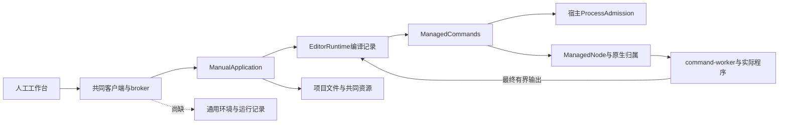

# 调查依据

## 当前事实与复用选择

规划调查日期 2026-10-25，源码基线 `e3d58fc807827a78493dcd16e38de28c8d02766e`，开始时工作区干净且无.codegraph。下文“当前事实／本轮规划检查”为实施前快照；用户后续授权实施，实施发现见末节，实际运行与验证以delivery为准。原生辅助调查、实现及独立审查保持gpt-6.1-sol／high。

已读取根 AGENTS、开发说明、基础决策地图、七线计划的共同范围／文件归属／独立验收／CI及计算线完整小节，职责 #06、基础 #40、运行架构 #01/#02/#03、共同分工 #09/#10、UI 设计和 `scholoom-dev`。规划技能、codebase-design 从用户指定的源项目技能目录只读复用，未安装技能或依赖。

### 已有能力和具体差距

| 源码或当前规格 | 核实事实 | 本次处理 |
| --- | --- | --- |
| `apps/kernel/src/commands.ts`，`ManagedCommands.execute` | 工作空间绑定 ownerModuleId／directory／projectId／executables；校验真实 Agent 归属，准入前后重新授权；只返回最终 code／stdout／stderr | 复用授权和准入；增加受管长程序所需观察适配，不复制执行器 |
| `packages/platform/src/command.ts`、`command-worker.ts` | `runCommand` 在结束前不交付日志；timeoutMs 必填；stdout 超1MiB失败、stderr留前64KiB；finally等待 worker.stop | 原短命令语义供 editor 保持；程序模式需要有界分片、截断指示和可选程序期限 |
| `packages/platform/src/processes.ts`，`ManagedNode` | Linux／Windows可用；macOS拒绝；instanceId绑定活动句柄；stopped区分完整停止与controller退出；没有可供重启后重新取得原生范围控制权的公开接口 | 使用完整停止确认；重启不能把 processMayBeAlive=false当作安全证明，不承诺重接 |
| `packages/platform/src/admission.ts`，`ProcessAdmission` | 宿主统一容量；`retainUntil(stopped)`拒绝时继续保留名额；等待队列有界 | 所有运行和环境准备共用同一个宿主对象；启动前恢复未知占用，不另建计算计数器 |
| `apps/kernel/src/manual.ts`，构造器、commandWorkspace、registerProjectHandlers | 人工宿主不依赖harness；生产工作空间只登记editor的quarto／latexmk；测试可覆写登记Node | 新增计算域独立装配和私有登记；不能把测试覆写误称生产程序已开放 |
| `packages/editor/src/runtime.ts`，`EditorRuntime` | 私有JSON回执、编译工作空间、排版缓存、最后成功产物及独立取消 | 不迁移、不复用为通用运行状态；共同机制变化必须回归editor |
| `packages/projects/src/store.ts`，material／path／backup／restore；`files.ts`，reference／resolve | material取得实际basis和fileId；文件身份、内容保护、实际文件和备份归项目；运行程序可直接在项目工作，不必复制全工程 | 以窄端口取用；输出登记不再次写入字节，不调用resources.create伪装程序自己生成的文件 |
| `apps/kernel/src/storage/project-container.ts` | 物理容器v4；harness_meta／research_attempts／run_instances分属原领域 | 新增program_runs自有表及v5升级保护，不写harness/research表 |
| `packages/protocol/src/resources.ts`、正式 `workbench-resources` | ResourceRef、ResourceEvidence、分片读取、稳定fileId和共同视图已交付 | 消费原契约；通用输出仍用真实项目资源，不新增另一种文件权威 |
| `packages/protocol/src/operations.ts`、`packages/client/src/index.ts` | 同源声明、生成映射、泛型client.call和范围watch已存在 | 增加领域声明及精确刷新范围，不能省略生成映射 |
| `Workbench.tsx`、`tab-state.ts`、`shell/TabGroups.tsx`、`business-session.tsx`、`resource-controller.ts` | 两宿主共用tab、session、事件及结果打开路径；UI设计尚未细化普通程序失败呈现 | 新增项目运行tab和专属组件；UI设计仅在实施时先补对应分节，不另建工作台 |

现状图的实线均已由上述源码确认；虚线为缺失业务能力，非已注册入口。

### 适用正式契约

`openspec list --specs`列出19项，尚无项目程序运行capability。已完整核对 `domain-execution-handoffs`、`platform-access`、`module-runtime`、`execution-work-domains`、`workbench-resources`：分别保留宿主登记与全局禁止、完整归属、领域权威、只读不授予执行、实际资源打开。这些契约不需要重写；本次新增 `project-program-runs`。

初设 `docs/initial-spec/execution.md` 的E-05/E-06与 #40 保持产品方向，但不是现有通用运行实现。架构／接口草稿中的ManagedExecution、旧源码路径和“尚未迁包”描述不当作现状；以本表源码和正式规格为准。交付时只更新开发说明对应入口并将初设相关段落链接到正式运行规格，当前不修改这些文档。

### 可支持环境及准备方式

本机只读版本命令取得 Node v24.12.0、uv 0.9.17；`uv sync --help`确认支持 `--locked`、`--no-dev`、`--no-install-project`、`--no-install-workspace`、`--no-python-downloads`。这只证明本机CLI选项存在，不证明Python／Conda、离线缓存、项目lock或环境准备成功。当前树无本地 `node_modules/@playwright/test/cli.js`，没有尝试触发pnpm自动安装。

补充只读搜索未发现已声明TOML解析依赖；`uv export --help`列出cyclonedx1.5格式及frozen／offline／no-build选项。因此design选用现有uv解析后输出JSON，不为锁文件手写解析器。尚未实际export样本，字段完整性与离线／不写原文件的行为由tasks 3.1明确验收，不能从CLI帮助推导实际准备已可用。

- Node：登记内核实际Node可执行文件，支持显式JS／MJS入口；TS和自定义加载器不自动启用。
- 已有Python／Conda：用户在可信本机设置登记解释器；执行使用其绝对可执行文件，不猜测Conda名称、不自动activate／修改base，不继承整个宿主环境。依赖能否import由明确检查／实际运行报告。
- uv：首批仅支持已有uv＋显式已有Python＋项目pyproject.toml/uv.lock；受管环境及cache在应用私有计算目录，以环境身份隔离，不写项目`.venv`。准备使用锁定同步和禁用自动Python下载，完整计划须包含声明中会执行的安装／构建、联网及本地依赖范围。声明缺失／不支持／越权则不启动，不降为未锁安装；包索引凭据不进入普通运行记录。
- uv/解释器缺失报告unavailable；首次提供工具本体、自动下载Python、TinyTeX和外部软件安装留后续change。首个change仍必须实现并验收授权内uv环境准备，不能只留一个未来按钮。

## 影响方案的未知项与实验

### 当前CI基线

来源为[七线计划](../../../.scratch/domain-development/parallel-development-plan.md#当前-ci-基线的处理)固定 `55d020c` 的 [40100596838](https://github.com/leike0813/Scholoom/actions/runs/40100596838)，原始日志本轮可读于 `/tmp/scholoom-next-parallel-baseline-failures.log`。Linux UI 101通过／9失败／2跳过，Windows kernel 374通过／15失败／12跳过；macOS成功为降级验证，非全功能。

| 证据位置 | 已知 | 尚不能认定／实施时承接 |
| --- | --- | --- |
| 原日志4779、4901行，`writing-editor-pdf.spec.ts:43` | browser与Electron均在60s找不到“排版PDF”region；未抵达后续完成／导出断言 | 不能区分编译失败、产物读取或预览刷新；沿editor.job、实际PDF字节和UI阶段诊断，阅读交互线承接，本线触及共同命令时参与 |
| 原日志6994行，`platform-availability.spec.ts:147` | Expected0／Received9；测试第56行订阅整个child_process通道 | 尚无9个子进程的身份，可能含系统适配或干扰；Agent线承接公共诊断，本线不删除零未受管执行保证 |
| 原日志6879行，`lifecycle.spec.ts:41`；6676起执行状态 | 重启回执至少一个非running；13项执行等待5s未到completed，部分queued／running | 无阶段分解证据；不得从名称推定停止故障或统一延长时限；Agent线提供实际诊断 |
| 原日志4195、6359附近 | 两平台真实排版内核用例通过；原生专项Linux17通过、Windows16通过1跳过 | 不能替代同次UI／全内核失败；也不能据归档的窄成功认定全仓绿色 |

日志在/tmp非永久证据；后续接手者可按固定CI URL取得原结果，当前规划已记录相关断言、阶段与不确定性。本轮未下载trace或复跑。

### 已归档公共基础的证据边界

- [领域交接delivery](../archive/2026-10-24-establish-domain-execution-handoffs/delivery.md)最终“macOS显式不可用与人工降级收尾”：Linux原生／命令／降级19/19；macOS真实内核2/2、双宿主4/4，证明不可用分支。早期进行中记录已由最终记录覆盖，不能重开已归档基础。
- [写作delivery](../archive/2026-10-20-add-research-writing-editor/delivery.md)：Linux真实Quarto／Pandoc／TeX产物和分批双宿主PDF2项通过。这是历史实跑，不是当前CI失败的修复证据。
- [跨平台delivery](../archive/2026-10-24-fix-cross-platform-file-and-writing-behavior/delivery.md)：Windows CI40081004866原两路径10/10、原生命令16通过1跳过；先有约6.4s完成证据再调整那两条整合等待，不能推广至当前13项未诊断失败。
- [工作域delivery](../archive/2026-10-23-establish-scoped-execution-foundation/delivery.md)：真实授权、只读、scratch、仓储及broker已交付；不重新实现工作域或以只读目标授权启动程序。

### 待输入与未承诺部分

| 输入／问题 | 状态和证据 | 影响与选择 |
| --- | --- | --- |
| 阅读交互 `add-material-annotation-interactions/design.md` 和 `add-interactive-research-reports/design.md` | 当前树初始 `openspec list` 无活动change，路径不存在；只读到并行计划中两份设计的职责，未收到其他树结论 | 待用户同步到本树后逐份核对。现有资源打开可独立实施；涉及新增报告动作／批注版本的适配保持受阻，不替对方设计或发送跨树消息 |
| 项目任务／工作项引用 | 项目线尚无本树交付 | 首批不加入taskId字段；程序不强制任务。后续引用只消费项目正式契约，独立验收不需任务替身 |
| 重启后重接任意原生程序 | 当前ManagedNode只持有活动句柄，无可重新取得归属的接口 | 选择保守核查：有停止收据则interrupted；确认丢失则unknown并保留占用与冲突保护。不选新增常驻守护进程或用PID消失推断安全 |
| 任意依赖完整发现 | #06明确不承诺；程序可自行读取更多文件 | 记录声明与可确认版本，dependencyCoverage固定declaredOnly；缺依赖沿显式检查或实际错误，不猜测安装 |
| 环境工具可分发性与目标平台 | 本机help/版本不能证明目标机器可用 | 已有工具就地诊断；Linux/Windows实际运行、macOS拒绝分开验收，缺工具不冒充成功 |

没有需要业务实验才能选择本轮方案的未知项，因此未做执行实验。若后续要求重启自动消除未知归属、完整Conda发现或新报告格式作为首批必需，将改变当前范围：优先保留保守方案，新增机制／体验应带实际提供者另审，不能在实施中悄悄扩大。

## 结论与承接

核心规划已具备依据，后续用户明确授权实施及隔离安装／测试，已进入apply。阅读交互两份design及相关CI提供者诊断仍待输入；既有资源打开和计算核心独立实施，未把本机结果宣称为跨线核对或跨平台验收。

### 本轮规划检查

- `openspec validate add-project-program-runs --strict`、`openspec schema validate scholoom-dev`通过；apply.requires及递归依赖五项齐备，CLI apply状态ready，17项实施任务全部未完成。
- `git diff --check`通过；新增文件尚未跟踪，另逐文件执行 `git diff --no-index --check /dev/null <file>`，并检查本change内Markdown本地文件链接和代码围栏，未发现问题。检查不验证链接锚点；Mermaid仅人工核对图文／语法，未渲染。
- 修改范围仅本change的`.openspec.yaml`、proposal、investigation、specs、design和tasks；没有delivery、业务／正式规格改动、安装、服务、提交推送或PR。以上属于规划工件验证，不是业务交付结果。

## 实施中取得的依据

- 用户已授权业务实施、锁定版本依赖链接、隔离uv准备及双宿主临时服务；另明确采用人工逐次“移交后台”，不假定有通用任务授权提供者。未授权真实用户库、其他树操作、提交推送、PR或归档。
- uv 0.9.17的CycloneDX不足以表达锁定来源和hash；改用已登记Python 3.11+的标准库tomllib及应用固定脚本，不安装解析依赖。已有旧Python仍可直接运行。真实非空本地wheel已在独立EnvironmentPorts组合和完整ManualApplication内分别完成安装、import42及复用，不能从空环境成功推导依赖安装成功。公网下载未实跑。
- `/tmp/scholoom-uv-workspace-proof-ubzXbN` 的隔离dry-run使用locked/offline/no-config/显式project及已有Python，uv明确先发现child项目再使用parent workspace，因parent缺lock失败。修复为只接受项目根声明，计划与sync前均拒绝父workspace；before-plan／before-sync真实回归通过。临时样本保留供诊断，无真实库操作。
- 大量日志结束后原程序退出0却缺stopped：隔离监听确认controller在host持久化完成前自动disconnect。程序模式改为结果后等待host显式stop；固定Unicode流及2.7MB日志回归通过，未放宽生产时限。普通editor短命令保持原断开及输出限制。
- 独立审查发现preflight取消、父执行遗漏持久unknown、入口路径替换、输出核查覆盖原basis、小日志滞留、观察失败原名额释放竞态及uv workspace错位，均按所属机制修复。观察失败在finally释放前保留原lease；取消只释放尚未attempted的排队名额。实际取消／未取消两种持久失败回归均证明后续命令仍排队。
- 父信号取消先于父执行收尾曾使已停止程序显示failed；停止事件同时核对父信号并保存parentStopped，真实Agent两条路径验证未移交随父取消、移交后继续且人工可停。外部模型为受控HTTP，内部工具、进程、broker和运行仓储真实。
- 本线本机PDF／共同资源双宿主回归通过，属于当前树本机证据；没有历史失败trace的阶段分解及Windows身份诊断，不能据此声称原CI失败已修。阅读交互两份design当前树仍不存在。
