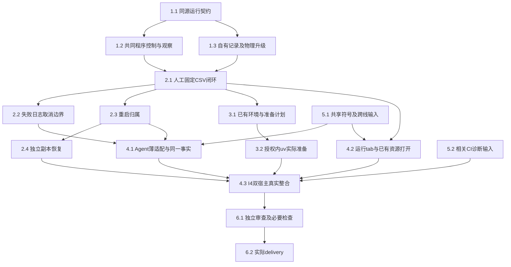

# 执行任务

用户已授权实现及必要依赖链接、隔离环境／双宿主测试，并选择逐次人工“移交后台”。本轮仅交本树增量与独立补丁，提交／同步由主线处理；不推送、PR、归档、安装新依赖、写真实用户库或启动开发服务器。双宿主复用已构建产物及隔离静态夹具。跨线输入与历史CI诊断按实际证据分别记录。

## 下一片：恢复归属统一计入准入

- [x] R16.1 按主线既定方案删除`ManualApplication`的unknownPrograms私有Set及条件匿名reservation，ProgramRuns.retainUnknown直接以实际commandInstanceId调用唯一ProcessAdmission.retainUnknown，不新增容量或结清API。真实host-loss／SQLite恢复的empty、full、already-retained三场景先红（期望1，分别得到2、0、2），修后连同独立备份副本保护及HostConnection未知／满额／同身份live代表共6/6通过；内核先构建再测，tools类型／格式／架构通过。同步design恢复路径，证据及独立补丁在`/home/joshua/.cache/scholoom-project-execution-round15-39VPvO/`。未改libraryHandlers、admission.ts、原生监督、生产期限或报告提供者；Windows启动及5.2／6.2仍开放，未扩查CI或宣称平台已修。

## 1. 可独立交付的共同接入口与记录

- [x] 1.1 在 `protocol/src/programs.ts` 实现design第2节环境／运行／日志／取消同源schema和派生端口；补内部platform程序控制／command观察schema、导出及实际生成映射入口。完成依据：非法身份／参数／超限／联合字段在既有契约测试拒绝，正常端口通过生成一致性和编译期检查，不复制ResourceEvidence。拥有programs领域声明，公共映射仅从原schema生成。
- [x] 1.2 在 `platform/src/command*.ts` 和 `kernel/src/commands.ts` 实现共享执行核心的program start／cancel／有界观察，宿主绑定私有workspace和真实程序；保留原execute／editor结果和输出失败语义。先用固定观察sink独立验收：真实Node、启动门、16KiB分片／4片背压、Unicode、持久ack失败不启动／未知、取消detached后代、已确认停止才释放容量。扩展现有 `managed-commands.spec.ts`、`platform-command-contracts.spec.ts`、`process-admission.spec.ts`，回归editor命令，无需programs业务包即可运行。该公共增量不依赖未合入的私有业务，后续交付可单独提取；此任务不授权提交。
- [x] 1.3 新建 `packages/programs` 的ProgramRecords／ProgramRuns骨架与自有program_runs表，宿主完成v4→v5 delegations→v6 program_runs的明确升级链、保护副本及架构注册；仅复用已有依赖版本。以原接口的真实SQLite临时项目验证operationId去重、不同输入拒绝、日志有界、退出／stop／输出事实分离，旧项目文件／会话记录不变。新测试仅覆盖旧测试没有的通用运行记录与升级行为，不对规划Markdown写静态测试。

1.2与1.3在1.1契约确定后可分别推进；前者拥有command机制，后者拥有programs和物理升级，避免重叠写入。主Agent负责最终接线。

## 2. 无会话的真实程序闭环与恢复

- [x] 2.1 在ManualApplication装配ProgramRuns、Node登记、项目窄端口和程序handler，以真实broker／命令／文件／仓储跑首个固定CSV。新增最小固定程序夹具读取2、4、6并生成count=3、sum=12、mean=4；断言来自独立算术。验证无harness／会话／模型仍能start→run/logs→实际ResourceRef打开，原operationId补交不重跑。拥有programs本域及manual中专属装配符号，不改科研Graph或报告模块。
- [x] 2.2 扩展 `tests/kernel/program-runs.spec.ts` 覆盖同一真实闭环的代表性边界：缺环境、排队后撤权／依据变化、非零退出但已有部分CSV、声明输出缺失、超量stdout／stderr截断、无日志但running、请求等待结束不当作计算失败、程序期限、取消实际后代。复用现有command tree／heartbeat夹具，只为CSV业务边界新增输入；检查状态和字节／心跳，不锁完整日志文案。相关诊断入口随本项更新开发说明。
- [x] 2.3 实现启动intent／完整stopped收据、内核ready前幂等恢复统一占用、项目替换／仓储释放保护、正常停机和unknown核查。真实宿主退出／SIGKILL及受控确认丢失验证：根PID消失不清unknown，旧PID复用不误杀，未恢复前不接受新执行，不自动重跑，旧输出可查；登记DB不可核查明确阻止准入。不得复制另一套容量或修改native归属保证。
- [x] 2.4 在宿主既有project.restore组合位置调用ProgramRecords恢复钩子，校正副本projectId／历史来源并清除活动控制资格。真实v4升级、副本恢复与有限输出备份验证：原项目不变，副本不控制原进程／不恢复原占用，缺环境／超限未备份结果有实际清单；不让projects访问programs表。完成后核对原项目备份及替换回归。

## 3. 环境选择和授权准备

- [x] 3.1 实现ProgramEnvironments及可信人类registerEnvironment／authorizeEnvironment；Node、显式已有Python／Conda路径有界探测，计划绑定解释器、项目声明、目标目录、网络与安装／构建范围。使用合成锁文件及已有Python 3.11+标准库tomllib核对锁定来源／hash、边界及原文件不变；声明只限项目根，计划及实际sync前拒绝父workspace，不手写TOML解析；不能核对的声明明确不支持。完成依据：Agent不能登记本机路径／自行批准，缺工具、缺依赖、不支持声明、计划变化可诊断；只读环境列表不触发安装或网络。探测与准备共用ProgramRuns记录／取消，不新增job权威。
- [x] 3.2 使用已有uv和已有Python实现锁定受管环境准备，显式私有UV_PROJECT_ENVIRONMENT／cache，禁用工具或Python自动下载，不修改项目lock／.venv或现有Conda。获得实际环境准备所需授权后，隔离小型锁定项目＋本地包／离线cache真实sync、import并复用；验证声明变化需重核、未授权不执行、安装失败／取消／重启保留真实状态，旧ready环境可用。若无依赖／准备授权，本项保持未完成并记录具体缺项，不以模拟成功代替。
- [x] 3.3 为上述已有环境、授权准备和失败补齐 `program-environments.spec.ts` 的稳定行为覆盖；实际联网下载若作为交付范围，单独取得授权并记录执行证据，否则明确该边界未验收。更新开发说明的支持矩阵、用户环境保护、操作计划及诊断入口；初设execution相应段落在正式规格同步时转为链接。

## 4. 人和Agent共用事实及工作台I4

- [x] 4.1 在共享runtime注入位置已核对后，新增program-tools薄适配，沿同源ProgramToolsPort提供项目运行／状态／日志／取消。默认execution归属随父收尾；background由可信人类对正在运行的Agent程序逐次执行handoff，持久保存授权主体及时间，宿主接管。通过真实KernelApplication与外部受控HTTP模型验证Agent和人工查询同一programRunId、输出及日志，全局／只读目标／失效实例拒绝；父取消覆盖未移交程序，已明确移交后台程序仍可查可取消。不定义子Agent角色、任务或科研方法。
- [x] 4.2 先在 `docs/ui-design/README.md` 补项目运行tab、环境准备及失败状态分节，再沿既有TabGroups／session挂载真实ProgramRunsTab和controller，样式只用语义token。复用现有资源打开实际CSV；每页25、当前run日志分片、事件范围刷新和请求代际保护，配置草稿按项目隔离；关tab不取消后台。StatusBar贡献若使用则沿标准接口，不覆盖Agent执行状态。公共0519904同步后已在本树实际挂载并通过程序双宿主2项；任务私有提供者联合验收另见8.4，不能由此勾闭。
- [x] 4.3 本线主Agent负责I4：双宿主 `tests/ui/program-runs.spec.ts` 从用户入口人工启动固定程序、查询日志／取消／打开CSV、切项目／重开保护草稿；与4.1真实Agent路径核对相同持久事实。使用隔离配置／项目／库／输出，计划UI5361／CDP9361，先检查占用，仅收尾本轮所属进程。内部broker／程序／仓储／文件／共同视图真实，外部模型可受控；不等待任务UI或交互报告，不声称科研质量验收。

## 5. 明确等待的输入与CI前置

- [x] 5.1 已消费主线正式设计及源码输入；历史路径和符号冲突记录于design。共同1026796已合入全部七域源码，当前executionResources／taskPort／delegationOptions／programs、根工具、三域restore及task／programs标签均在本树；不再等待同步或使用旧累计补丁。真实联合操作另由8.4验收，不把代码合入当作实际整合完成。
- [ ] 5.2 沿固定run／head和实际stage收敛平台缺口。606ae82／专项40729861762已验真实isolated4/4（首次启动及实际替换／重启）和真实ACL5/5（含Utility干扰）；setter八次PS166–194ms，原SID／owner／受保护DACL／继承／错误及生产期限不变，独审无发现。同次Agent1/3，两例在initialize响应前耗尽原窗口，原失败及同次时间线保留，不归取消／附件缺陷。完整Checks40729861720查询时Linux／Windows仍运行、macOS成功，相关平台回执未收齐前不关闭。旧f976b67／1c84937及TeX／分发结果独立保留，不放宽停止／容量、锁或重试。

5.1的输入核对不意味着新增报告适配属于本change；只有共同符号冲突或相关必要回归才阻塞对应整合，其他任务不串行等待。

## 6. 审查与实际交付

- [x] 6.1 对本次新变化运行最小必要生成一致性、architecture、typecheck、build及上述定向内核／双宿主；共同命令触及editor时回归editor.spec／editor-runtime及实际资源打开。Linux／Windows实际运行和macOS不可用分别记录；取得日志、身份授权、跨进程停止、升级／恢复和复杂整合的独立只读审查，处理发现后由主Agent最终接受。依赖缺失先说明并按授权准备，不隐式安装；未运行或失败不记通过，不追加全仓测试。
- [ ] 6.2 实际执行后获取 `openspec instructions delivery --change add-project-program-runs --json`，填写同一delivery.md，逐项对应proposal完成判据、真实接线／替身、目标平台、相关CI未决、授权及下一步；核对任务和证据后再更新本项。没有实际执行结果时保持delivery未创建，不因CLI ready而补造交付。

## 7. 主线验收整改与公共对接（2026-10-26）

- [x] 7.1 修复C1：资格票据无副作用，持久授权后同步接管，authorized／active／failed及完成收据未知分别表达；保存失败父取消仍生效、持久成功／父取消竞态、接管失败与完成收据失败有8项内核回归；独立只读复核接受。本机双宿主核对DTO／运行面板不回归，不代表已合入委派提供者。
- [x] 7.2 修复C2：读写同4MiB总界限，替换前拒绝并原位恢复对象；活动元数据预留、准备派发前持久意图、未知回执跨重启不重复、近上限旧配置只读恢复且不改原文件。保留历史与独立可用环境；环境31项通过，独立复核接受。
- [x] 7.3 修复C3：以单调累计时间和int32分段timer保持原长时限／null语义，不收窄同源输入；边界／30天／取消可控时钟和真实停止收据通过，首次OverflowWarning及反例保留。
- [x] 7.4 组合公共迁移v4→v5 delegations→v6 program_runs，保留表、两个索引、授权与保护副本，事务失败后重试；拒绝未发布program-only v5样本而不猜历史／删除数据。公共基线容器／迁移6项通过；正式交接的Agent records/schema临时适配与本域仓储共同恢复真实SQLite副本4项通过，生产联合宿主仍未接入。
- [x] 7.5 拆出01-command-observation、02-delegations-v5、03-program-runs-v6及04-restore-hooks-after-domains临时patch，附依赖manifest／README；01在不含programs的共同基线临时副本独立构建并7项通过，02→03在同副本6项通过；04仅核对Agent快照上下文可应用，须两域实际合入后再验证。精确交回路径见delivery，不提交或操作其他树。
- [x] 7.6 完成本次整改的97项定向内核、4项双宿主程序／PDF、受影响构建／类型／架构／OpenSpec及diff核对；更新同一tasks／delivery和必要设计／规格／说明。C1—C3及迁移准备交回即停止，不扩大任务关联、报告、批注、环境类型或新平台，不自动进入dev接入／归档。

## 续做入口

当前起点为58eda1404fcc60036ce0e0f3ce30d5453ce1ee30，开始时工作区干净，主线已接收第17组并完成同步及必要验证。证据为 `/home/joshua/.cache/scholoom-round14-acceptance/`；本轮只推进第18组Linux显示预检。仅所属测试／CI准备／原工件变更，生产源码与已验f4ab1e5相同，不重建相同产物。所有新工件、TMPDIR、profile及结果在 `/home/joshua/.cache/scholoom-project-execution-round14-CXHAoy/`，不依赖现有/tmp输入，不自行同步、触发或循环轮询CI。

## 8. 公共同步后的实际消费

- [x] 8.1 只读确认同步HEAD／祖先／工作区及 `/tmp/scholoom-sync-recovery-wyn13R/recovery.md`、本线日志；消费 `/tmp/scholoom-round3-handoff-qefwKi/prompts/project-execution.md` 的已定任务。C1—C3沿主线复验关闭，保留统一v6与原恢复保护，不重新发公共迁移补丁。
- [x] 8.2 核对实际ManualApplication／KernelApplication／Harness工具和架构准入符号；新增ProgramToolsPort，harness不持有人类登记／授权／移交入口。扩展已有真实Agent用例，核对HTTP工具返回与人工同一运行／日志／实际输出，全局／目标只读／失效实例及Agent自行移交被拒绝。73项定向内核通过，含公共执行历史回归，保留Graph来源。
- [x] 8.3 核对真实project.restore钩子，原unknown保留统一名额，副本无原command／host控制身份，取消副本和重开源项目不改原记录；小输出／大输出遗漏保护通过。共同1026796已装配真实委派仓储，本轮直接导入HarnessRecords的组合恢复1项随57项内核通过，未使用快照env或外部适配。
- [x] 8.4 共同1026796真实TaskPanel／TaskPort／程序tab双宿主2项首跑通过：任务正文编辑保存／过程材料打开与程序真实CSV／日志并存，第二窗口核对同一运行并取消，两类草稿跨项目及刷新隔离。程序不强制绑定任务。登记项目保留在结果目录至共享profile退役，无替代TaskPort，无生产任务组件改动；真实HarnessRecords恢复组合另随内核通过。
- [x] 8.5 先构建再定向内核73项／程序双宿主2项静态夹具验收，测试期间未重建产物；类型／生成／架构／OpenSpec／diff通过，首次UI定位失败和最终结果分别保留。独立只读审查未发现确证缺陷；同一delivery及分片业务补丁已交回。Windows／macOS／全仓CI／真实科研质量及整个change收尾保持原边界。

## 9. 最小公共退出诊断

- [x] 9.1 在原design落稿后，仅修改platform processes／process-controller：既有IPC detail和错误末行JSON保留controller code／signal、instanceId、stoppedReceived、native最后状态／退出结果及固定reason；停止确认后刷新启动错误的最终诊断。无新ErrorInfo字段／框架／状态，无凭据／bootstrap日志；unknown、停止证明、容量、期限及重试未变。
- [x] 9.2 真实controller SIGKILL／原生失败fixture／成功code0结构回归通过，未知继续占容量，明确停止才释放。独立审查发现启动错误使用旧快照的P2：初版构建反例1红1绿，补最终收据后全部通过、只读复核关闭。故障fixture仅替原生可执行文件，不宣称修复历史nativeTeX根因。
- [x] 9.3 先完成shared／desktop及审查修复后的platform构建，再运行定向内核57项、C2容量／恢复3项和双宿主2项，全部通过；测试期间无重建，pnpm显式optimisticRepeatInstall=false，无安装／下载。类型／架构／8份生成映射／strict／diff通过；首次红与结果保留，公共诊断独立patch及同一delivery交回后停止。5.2历史CI／Windows与6.2整项交付仍开放。

## 10. 最新CI生命周期与一次排版观察

- [x] 10.1 消费6b22d60／40315429083原始日志及Windows两例／macOS入口artifact，保留阶段事实和缺口；构建后只运行一次原render-authorization最小nativeTeX相关场景，1项通过，5实例均controller0／native0／收到stopped，无unknown。被动观察不读私有payload，不安装工具，不因未复现声称历史根因修复；Windows两例和macOS第一次launch仍待目标诊断。
- [x] 10.2 先落design再补kernel lifecycle／bootstrap既有错误与直接夹具的窄诊断，保留discovery／锁／引导／服务连接／窗口关闭的实际观察，严格排除token／连接凭据／私有payload。512错误上限、最终availability最后观察及窗口launch／关闭附件经独立审查补齐；Linux真实锁／并发／停止及脱敏27项通过。未改变unknown、容量、PID归属、生产等待期限、自动重试或harness内部机制；仅本机有证据的定向入口／重试夹具阶段预算校正，保留首次失败。
- [x] 10.3 先build后Linux生命周期／过程／容量27项、入口3项、双宿主重试4项通过，原双宿主传输重连2项通过；测试期间不重建。首次入口总预算及双宿主重试阶段断言失败保留，生产判据／期限未改。类型／架构／8份生成映射／strict／schema／diff通过，增量patch和同一delivery交回；Windows／macOS目标证据不足不关闭，5.2／6.2仍开放，到此停止。

## 11. 目标CI消费与断言前采样

- [x] 11.1 对照39be889／40432749785及8a2f0ce已完成job／artifact：旧Windows只有并发入口失败、占锁释放已通过；新Windows专项成功但不含lifecycle两例，完整Checks查询截点仍运行。新macOS两次均连接，首失败是关闭后的process诊断TypeError，非始终连接中。缺口和首失败前安全附件分别记录，不轮询或自行触发CI。
- [x] 11.2 关窗前缓存真实ChildProcess引用，关闭后不重读已释放Playwright映射；并发入口逐次返回时间、拒绝结果及断言前有界附件已补。先构建，受控观察API反例1红→1绿、Linux并发／占锁2项、普通真实Electron入口1项通过，无新生产机制或预算变化。
- [x] 11.3 tools类型／两个源码格式／架构／strict／schema／diff通过，独立只读核对Playwright调用链和采样无新增确证问题。同一delivery记录首次无测试启动错误、有效红／绿、普通入口及目标缺口，交本轮增量补丁；5.2／6.2仍开放，到此停止。

## 12. 剩余Windows平台观察

- [x] 12.1 消费b2f3b50 artifact12710309824：旧发现PID8328从false变true，具体身份缺失；全窗口10事件无身份附件，7+2+1仅源码解释。0b78815新macOS不可用2／入口4／人工UI14通过，Windows完整Checks查询截点仍运行。未沿用旧54项清单或将Windows专项成功冒充本片验证。
- [x] 12.2 两条真实占锁／竞争校准分别通过；全窗口观察按异步来源／ACL来源／成功退出严格核查，拒绝入口零派发，真实Node正校准及启动失败校准通过，原人工降级最终通过。首次URL不合schema和Node早期通道字段错误保留；先构建无重建，不改生产拒绝、停止、容量、PID或时限。
- [x] 12.3 tools类型／两个源码格式／架构／strict／schema／diff通过；只读复核采样、锁保护及关闭失败保留profile，无新增确定缺陷。同一delivery与本轮独立增量交回，Windows新夹具／历史事件身份仍待目标回执，5.2／6.2保持开放；不再重复TeX，到此停止。

## 13. 同源码Windows反例与并发启动诊断

- [x] 13.1 已消费caf artifact12715580670、431诊断12721785916及同源码完整Checks12724656293：释放后启动失败与完整组并发／占锁通过并存；unavailable在两组仍来源false。分开记录3通过2失败步骤与727通过3失败完整组，不据名称／相位推身份或将正样本当稳定性闭合。
- [x] 13.2 真实来源校准证实mapped source帧漏识别，精确模块／函数识别修正，全部拒绝约束保留；并发仅补prepare／busy、preparationMs／spawnedAt观察。先构建后Linux生命周期7项、来源／人工降级4项通过，秘密／512／日志边界通过，无生产预算／停止／容量／PID政策变化。
- [x] 13.3 原delivery记录目标首次失败、来源调查的OS替身边界、本机最终命令与新目标缺口；类型／四源码格式／架构／strict／schema／diff核对，独立只读审查无确定问题。本轮增量交回即停，Windows修正后origin及启动初始化因果仍开放于5.2／6.2，不改Agent／生态内部。

## 14. 来源目标回执与初始化提供者窄观察

- [x] 14.1 核938c33f诊断40540362546逐例结果／artifact，关闭有实际正负来源校准及零派发断言的窄子项；分开记录8c2重启反例、431正反例和当前新结果，不把缺失成功附件字段补造或单次通过当稳定性关闭。
- [x] 14.2 沿原initialize装配调用增加固定提供者开始／完成日志，fixture有界白名单消费；kernel构建后最小真实并发／独立配置／重启及脱敏3项、活占锁／来源／不可用3项均通过。既有附件显式文件保留已核查。不改域初始化机制、生产期限、unknown、容量、停止或锁归属。
- [x] 14.3 已获取delivery instructions更新同一记录，保留CI反例、首次格式失败／最终结果、调用符号及目标缺口；类型／格式／架构／strict／schema／diff通过，独立只读审查无确定缺陷，交三份可审查增量即停。5.2／6.2整项保持开放。

## 15. 完整Windows组与可信子启动的有界证据交回

- [x] 15.1 消费40540362614／938c33f目标trace，分开记录并发首批PID3188的父准备／spawn／子阶段及isolated-kernel首次ready-ipc失败；核29cd728新诊断完成样本与唯一Checks查询截点，不倒填旧提供者或等待新结果。
- [x] 15.2 只读追踪公共isolated-kernel夹具，给出诊断丢失的具体证据、最小候选及区分自然退出／清理退出的反例，交主线而不修改该文件、子入口或归属策略；内核实际根因未闭合则保持开放。
- [x] 15.3 实际执行后已取delivery instructions，更新原记录与必要当前事实，OpenSpec strict／schema／diff通过，只读复核诊断候选未发现确定错误，交四工件文档增量；无源码变化未重建／重跑已绿测试。5.2／6.2与目标平台稳定性保持开放，到精确缺证处停止。

## 16. 公共isolated-kernel安全诊断

- [x] 16.1 提取唯一生命周期phase／安全标量过滤，原文件尾与持续stderr排空共享；4KiB单行／64条／32KiB序列化记录上限，非法／超长／私有字段丢弃且计数，预算耗尽不停止读取，分片UTF-8及容量回归通过。
- [x] 16.2 helper记录原ready失败类别、清理前ready／close／exit及父kill请求／真实close分开；安全摘要清理前保存再更新，失败不泄漏原始配置／异常，不混旧kernel.log。真实exit1及原44s无ready反例通过，归属／shutdown／预算与旧stop保护保持。
- [x] 16.3 沿原真实配置／进程替换及代表exit1／原预算无ready／安全解析五个场景通过；分开exit事实后四个受影响场景最终复验通过。类型／格式／架构／OpenSpec／diff通过，已取delivery instructions更新同一记录并交增量。仅测试变化未重建，Windows未验及5.2／6.2保持开放，完成即停。

## 17. Windows专项新诊断采样入口

- [x] 17.1 仅为既有windows-execution workflow补isolated-kernel helper、kernel-fixture、两个可信fixture及自身spec触发路径；availability后新增完整spec独立步骤，--list核实四个当前场景，沿用单worker／零重试／原预算及!cancelled条件，不改首批旧步骤条件。
- [x] 17.2 核test-results/windows-isolated-kernel下安全JSON纳入既有artifact，失败trace及首失败不被重跑覆盖；未发现缺口，未改测试实现。本机同一四场景4/4及tools类型、YAML结构／workflow差异、OpenSpec／diff通过，已取delivery instructions更新原记录并交独立补丁。审计必需输入实路径及所有新工件均在Git／cache，不依赖现有/tmp。Windows目标未跑保持5.2／6.2开放，不触发或轮询远端。

## 18. Linux显示预检与诊断覆盖

- [x] 18.1 消费固定40622631905／f4ab1e5日志及trace，核managed env／命令查找和程序模式输出；真实缺scratch故障注入与原负例确认流式stderr被空result覆盖，首次红例保留，不据127猜定缺包。新Xvfb及共享DISPLAY实际条件分别核查。
- [x] 18.2 display helper只保留已有4096字符流式stderr尾，scope原负例新增mktemp语义断言并由红转绿；checks既有Linux准备后声明xauth／x11-utils、核包版本与四工具绝对路径。原业务、后代收尾、共享显示、预算、权限、停止及重试均未改。
- [x] 18.3 缺scratch首次1红，修复后两个负例2/2、新Xvfb原完整场景1/1、已有DISPLAY原场景1/1分别通过；类型／格式／CI静态／架构／OpenSpec／diff通过。新Windows40630840362按本轮head一次查询并消费完成日志／安全JSON，真实配置1失败与三个校准通过分开，未循环等待。已取delivery instructions更新原记录，交增量及cache入口；历史127具体来源、新Linux CI及Windows根因／5.2／6.2保持开放即停。
