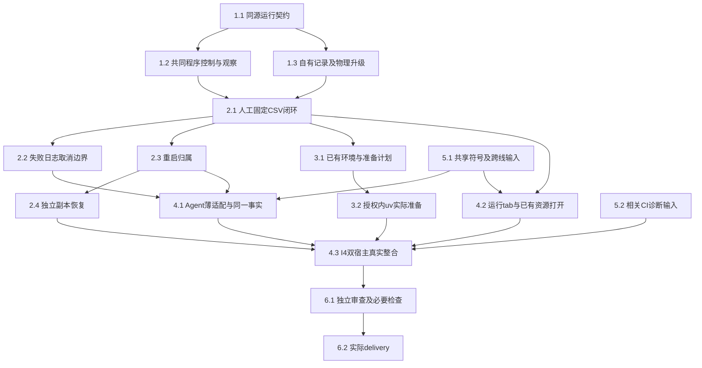

# 执行任务

用户已授权实现及必要依赖链接、隔离环境／双宿主测试，并选择逐次人工“移交后台”。本文件按真实结果更新；提交、推送、PR、归档和真实用户库仍未授权。跨线输入与历史CI诊断仍保留第5组，不以本机成功宣称这些输入已收到。

## 1. 可独立交付的共同接入口与记录

- [x] 1.1 在 `protocol/src/programs.ts` 实现design第2节环境／运行／日志／取消同源schema和派生端口；补内部platform程序控制／command观察schema、导出及实际生成映射入口。完成依据：非法身份／参数／超限／联合字段在既有契约测试拒绝，正常端口通过生成一致性和编译期检查，不复制ResourceEvidence。拥有programs领域声明，公共映射仅从原schema生成。
- [x] 1.2 在 `platform/src/command*.ts` 和 `kernel/src/commands.ts` 实现共享执行核心的program start／cancel／有界观察，宿主绑定私有workspace和真实程序；保留原execute／editor结果和输出失败语义。先用固定观察sink独立验收：真实Node、启动门、16KiB分片／4片背压、Unicode、持久ack失败不启动／未知、取消detached后代、已确认停止才释放容量。扩展现有 `managed-commands.spec.ts`、`platform-command-contracts.spec.ts`、`process-admission.spec.ts`，回归editor命令，无需programs业务包即可运行。该公共增量不依赖未合入的私有业务，后续交付可单独提取；此任务不授权提交。
- [x] 1.3 新建 `packages/programs` 的ProgramRecords／ProgramRuns骨架与自有program_runs表，宿主完成v4→v5 delegations→v6 program_runs的明确升级链、保护副本及架构注册；仅复用已有依赖版本。以原接口的真实SQLite临时项目验证operationId去重、不同输入拒绝、日志有界、退出／stop／输出事实分离，旧项目文件／会话记录不变。新测试仅覆盖旧测试没有的通用运行记录与升级行为，不对规划Markdown写静态测试。

1.2与1.3在1.1契约确定后可分别推进；前者拥有command机制，后者拥有programs和物理升级，避免重叠写入。主Agent负责最终接线。

## 2. 无会话的真实程序闭环与恢复

- [x] 2.1 在ManualApplication装配ProgramRuns、Node登记、项目窄端口和程序handler，以真实broker／命令／文件／仓储跑首个固定CSV。新增最小固定程序夹具读取2、4、6并生成count=3、sum=12、mean=4；断言来自独立算术。验证无harness／会话／模型仍能start→run/logs→实际ResourceRef打开，原operationId补交不重跑。拥有programs本域及manual中专属装配符号，不改科研Graph或报告模块。
- [x] 2.2 扩展 `tests/kernel/program-runs.spec.ts` 覆盖同一真实闭环的代表性边界：缺环境、排队后撤权／依据变化、非零退出但已有部分CSV、声明输出缺失、超量stdout／stderr截断、无日志但running、请求等待结束不当作计算失败、程序期限、取消实际后代。复用现有command tree／heartbeat夹具，只为CSV业务边界新增输入；检查状态和字节／心跳，不锁完整日志文案。相关诊断入口随本项更新开发说明。
- [x] 2.3 实现启动intent／完整stopped收据、内核ready前幂等恢复统一占用、项目替换／仓储释放保护、正常停机和unknown核查。真实宿主退出／SIGKILL及受控确认丢失验证：根PID消失不清unknown，旧PID复用不误杀，未恢复前不接受新执行，不自动重跑，旧输出可查；登记DB不可核查明确阻止准入。不得复制另一套容量或修改native归属保证。
- [x] 2.4 在宿主既有project.restore组合位置调用ProgramRecords恢复钩子，校正副本projectId／历史来源并清除活动控制资格。真实v4升级、副本恢复与有限输出备份验证：原项目不变，副本不控制原进程／不恢复原占用，缺环境／超限未备份结果有实际清单；不让projects访问programs表。完成后核对原项目备份及替换回归。

## 3. 环境选择和授权准备

- [x] 3.1 实现ProgramEnvironments及可信人类registerEnvironment／authorizeEnvironment；Node、显式已有Python／Conda路径有界探测，计划绑定解释器、项目声明、目标目录、网络与安装／构建范围。使用合成锁文件及已有Python 3.11+标准库tomllib核对锁定来源／hash、边界及原文件不变；声明只限项目根，计划及实际sync前拒绝父workspace，不手写TOML解析；不能核对的声明明确不支持。完成依据：Agent不能登记本机路径／自行批准，缺工具、缺依赖、不支持声明、计划变化可诊断；只读环境列表不触发安装或网络。探测与准备共用ProgramRuns记录／取消，不新增job权威。
- [x] 3.2 使用已有uv和已有Python实现锁定受管环境准备，显式私有UV_PROJECT_ENVIRONMENT／cache，禁用工具或Python自动下载，不修改项目lock／.venv或现有Conda。获得实际环境准备所需授权后，隔离小型锁定项目＋本地包／离线cache真实sync、import并复用；验证声明变化需重核、未授权不执行、安装失败／取消／重启保留真实状态，旧ready环境可用。若无依赖／准备授权，本项保持未完成并记录具体缺项，不以模拟成功代替。
- [x] 3.3 为上述已有环境、授权准备和失败补齐 `program-environments.spec.ts` 的稳定行为覆盖；实际联网下载若作为交付范围，单独取得授权并记录执行证据，否则明确该边界未验收。更新开发说明的支持矩阵、用户环境保护、操作计划及诊断入口；初设execution相应段落在正式规格同步时转为链接。

## 4. 人和Agent共用事实及工作台I4

- [x] 4.1 在共享runtime注入位置已核对后，新增program-tools薄适配，沿同源ProgramToolsPort提供项目运行／状态／日志／取消。默认execution归属随父收尾；background由可信人类对正在运行的Agent程序逐次执行handoff，持久保存授权主体及时间，宿主接管。通过真实KernelApplication与外部受控HTTP模型验证Agent和人工查询同一programRunId、输出及日志，全局／只读目标／失效实例拒绝；父取消覆盖未移交程序，已明确移交后台程序仍可查可取消。不定义子Agent角色、任务或科研方法。
- [ ] 4.2 先在 `docs/ui-design/README.md` 补项目运行tab、环境准备及失败状态分节，再沿既有TabGroups／session挂载真实ProgramRunsTab和controller，样式只用语义token。复用现有资源打开实际CSV；每页25、当前run日志分片、事件范围刷新和请求代际保护，配置草稿按项目隔离；关tab不取消后台。StatusBar贡献若使用则沿标准接口，不覆盖Agent执行状态。独占组件可先用真实模块可视夹具验证，共享挂载需5.1输入核对。
- [x] 4.3 本线主Agent负责I4：双宿主 `tests/ui/program-runs.spec.ts` 从用户入口人工启动固定程序、查询日志／取消／打开CSV、切项目／重开保护草稿；与4.1真实Agent路径核对相同持久事实。使用隔离配置／项目／库／输出，计划UI5361／CDP9361，先检查占用，仅收尾本轮所属进程。内部broker／程序／仓储／文件／共同视图真实，外部模型可受控；不等待任务UI或交互报告，不声称科研质量验收。

## 5. 明确等待的输入与CI前置

- [x] 5.1 消费主线正式交接包 `/tmp/scholoom-phase2-handoff-VZS5mS` 的两份阅读design、项目TaskRef、Agent runtime／仓储／宿主及共享工作台快照；精确路径、字段及符号冲突已记录design“主线快照消费与接入边界”。输入核对闭合，真实提供者未合入；constructor参数顺序、工具权限及共享tab／恢复组合待主线接入验证，不把读设计写成I4／跨域已接通。
- [ ] 5.2 进入受影响整合前承接调查记录中的CI基线：读取提供者实际诊断，PDF按发送／受理／编译／真实产物／视图刷新定位；Windows子进程计数核对身份，queued／running失败核对阶段。阅读交互／Agent线尚无本树诊断时记录等待，本线只做与command增量有关的隔离定向核查；所需公共修复单独界定。不放宽生产时限、不删保证、不把历史10/10推广到当前失败；未解决的必要回归保持失败／未完成，独立核心任务继续。

5.1的输入核对不意味着新增报告适配属于本change；只有共同符号冲突或相关必要回归才阻塞对应整合，其他任务不串行等待。

## 6. 审查与实际交付

- [x] 6.1 对本次新变化运行最小必要生成一致性、architecture、typecheck、build及上述定向内核／双宿主；共同命令触及editor时回归editor.spec／editor-runtime及实际资源打开。Linux／Windows实际运行和macOS不可用分别记录；取得日志、身份授权、跨进程停止、升级／恢复和复杂整合的独立只读审查，处理发现后由主Agent最终接受。依赖缺失先说明并按授权准备，不隐式安装；未运行或失败不记通过，不追加全仓测试。
- [ ] 6.2 实际执行后获取 `openspec instructions delivery --change add-project-program-runs --json`，填写同一delivery.md，逐项对应proposal完成判据、真实接线／替身、目标平台、相关CI未决、授权及下一步；核对任务和证据后再更新本项。没有实际执行结果时保持delivery未创建，不因CLI ready而补造交付。

## 7. 主线验收整改与公共对接（2026-10-26）

- [x] 7.1 修复C1：资格票据无副作用，持久授权后同步接管，authorized／active／failed及完成收据未知分别表达；保存失败父取消仍生效、持久成功／父取消竞态、接管失败与完成收据失败有8项内核回归；独立只读复核接受。本机双宿主核对DTO／运行面板不回归，不代表已合入委派提供者。
- [x] 7.2 修复C2：读写同4MiB总界限，替换前拒绝并原位恢复对象；活动元数据预留、准备派发前持久意图、未知回执跨重启不重复、近上限旧配置只读恢复且不改原文件。保留历史与独立可用环境；环境31项通过，独立复核接受。
- [x] 7.3 修复C3：以单调累计时间和int32分段timer保持原长时限／null语义，不收窄同源输入；边界／30天／取消可控时钟和真实停止收据通过，首次OverflowWarning及反例保留。
- [x] 7.4 组合公共迁移v4→v5 delegations→v6 program_runs，保留表、两个索引、授权与保护副本，事务失败后重试；拒绝未发布program-only v5样本而不猜历史／删除数据。公共基线容器／迁移6项通过；正式交接的Agent records/schema临时适配与本域仓储共同恢复真实SQLite副本4项通过，生产联合宿主仍未接入。
- [x] 7.5 拆出01-command-observation、02-delegations-v5、03-program-runs-v6及04-restore-hooks-after-domains临时patch，附依赖manifest／README；01在不含programs的共同基线临时副本独立构建并7项通过，02→03在同副本6项通过；04仅核对Agent快照上下文可应用，须两域实际合入后再验证。精确交回路径见delivery，不提交或操作其他树。
- [x] 7.6 完成本次整改的97项定向内核、4项双宿主程序／PDF、受影响构建／类型／架构／OpenSpec及diff核对；更新同一tasks／delivery和必要设计／规格／说明。C1—C3及迁移准备交回即停止，不扩大任务关联、报告、批注、环境类型或新平台，不自动进入dev接入／归档。

## 续做入口

本轮按用户范围止于C1—C3修复、迁移方案／最小组合及公共补丁交回。7组记录本次结果；4.2仍等真实共享宿主／tab合并验收，5.2仍缺Windows／历史CI阶段诊断，6.2保留整个change最终交付。已正式收到设计输入，不再重复等待用户同步；接入和实跑仍按真实条件开放。
