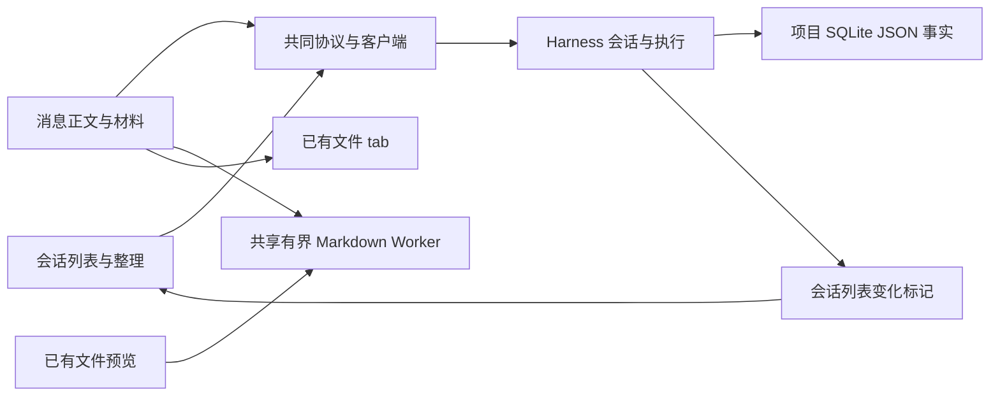
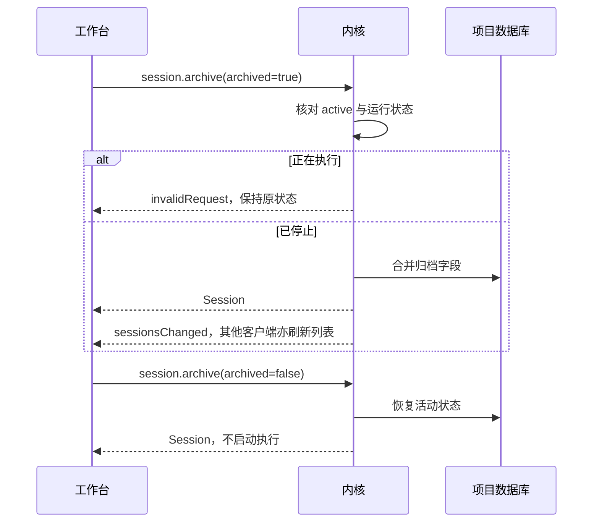

# 实现设计

## 变更总览

## 方案与接口

协议仍由 packages/protocol/src/business.ts 唯一定义。新增 session.list（projectId、archived、query、cursor={updatedAt,id}、limit，返回 sessions、nextCursor）、session.rename、session.archive（archived 布尔 setter）。列表 SQL 按 JSON 更新时间与 id 排序，字面子串过滤；默认 50、最多 100。Session 增加可选 archived、titleSource=default/instruction/manual，旧记录视为活动并保留标题；当前快照新增 session 字段，includeSessions=false 允许工作台消息刷新不查询列表。客户端将 list 归入只读请求。

首条指令受理事务内重新读取标题来源，只对 default 派生标题；手动修改标为 manual。发送在受理事务内核对归档及原指令回执，覆盖凭据等待期间的竞争；并发重复请求返回原回执并跳过调度。归档核对运行状态与 active map，恢复不调度。会话变更通知带 sessionsChanged，server 按项目转发并合并标记；跨项目清理旧通知，同项目切换会话保留适用的列表变化，不放宽其他会话正文范围。实际材料按 fileId 收集，路径复用不覆盖原身份。

左区列表由独立分页状态承接（单页 50，上一页／下一页），scope 世代丢弃旧请求；当前会话、overlay 标题与发送条件来自 snapshot.session。project 变化重置查询，create 清除筛选；archive 当前会话保留选择、草稿及历史，输入只读。新增元数据组件读取 projection custom metadata，正文保持原值。材料点击按 fileId 解析；新实际读取材料由 ProjectBackend 回调收集身份。复制沿浏览器 Clipboard API；外链沿既有宿主桥。共享链接解析先分离片段并 URI 解码，再核对项目边界；通知放入 overlay 消息滚动区，长待核查指令不挤出输入器。

复用 markdown-render 的 unified/GFM/KaTeX，不装依赖。抽取有界共享 Worker 调度，按消费者只留最新待处理请求，引用释放后销毁；文件预览保留原图片资源职责。消息正文组件只在可见时请求树，离开可见区保留占位高度和释放树；代码复制及链接使用同一安全策略。原 HTML 仍转文本，消息 img 显示替代说明。错误退回原文。正文和事实组件由主 Agent 接入 assistant-ui，辅助实现者只承担 Markdown 模块。

## 文件变化

- 修改 protocol/business.ts、client/index.ts、kernel 的 harness/runtime.ts、harness/files.ts、application.ts、server.ts：共享契约、会话查询与控制、实际材料身份及范围通知。
- 修改 workbench 的 business-session.tsx、session.ts、projection.ts、Workbench.tsx、shell/ActivityPane.tsx、shell/AgentOverlay.tsx、styles.css；新增 SessionList.tsx、MessageContent.tsx：列表、独立选择、消息事实与操作。
- 修改 MarkdownPreview.tsx，新增 MarkdownText.tsx 与 markdown-queue.ts：共享调度、消息树与代码复制，保留文件图片能力。
- 扩展内核及 UI 稳定行为测试和 tests/model-server.ts 的合成输入；必要时新增 sessions.spec.ts、conversation.spec.ts。
- 先更新 docs/ui-design/README.md；同步 docs/development.md、implementation-roadmap.md、architecture.md 的入口和失效链接。无计划删除文件。

## 验证与风险

内核经真实客户端验证命名、归档、幂等、超过 100 条分页、跨会话通知、备份恢复和无自启动；UI 经 Chromium 与真实 Electron 验证阅读、剪贴板、链接、材料定位、草稿、过期响应及运行中输入／取消。外部 HTTP 模型替身不替换内部图、数据库或文件。最终执行 pnpm check、OpenSpec strict 校验及独立审查，查看实际双宿主截图。

不用数据库结构迁移，不删除旧内容。归档与发送存在异步凭据检查竞态，必须在最后受理边界核对；Worker 回调必须按实例和版本隔离。更新源码不停止或替换用户日常驻留内核。未验付费模型及其他操作系统的结论只写真实证据。
