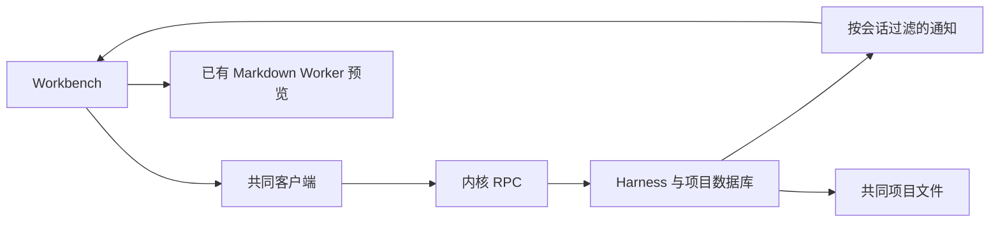

# 调查依据

## 当前事实与复用选择

依据当前源码及 2026-10-15 三项 harness／工作台归档交付，静态调查已确认：

- `harness/runtime.ts` 持久保存会话、指令、执行与消息，创建默认标题；列表先 limit(100) 后内存排序。工作台 business-session 和 Workbench 从列表查当前会话，筛选或翻页会放大隐含耦合。
- `server.ts` 按所选 sessionId 过滤通知，其他会话元数据不能更新同项目列表。共同客户端维护只读方法分类，新列表接口需要加入。
- `projection.ts` 把状态与材料拼进正文；assistant-ui 0.15.27 支持自定义 metadata 与正文呈现，可保留原始文本而分开展示事实。
- unified、GFM、KaTeX 与 Worker 已在文件预览使用，路径和外链策略已有共同实现。当前每份预览独立 Worker；消息复用需共享调度，不能每条历史建 Worker。
- 文件引用使用稳定 fileId；用户附加材料已有对应字段，实际读取材料需从 ProjectBackend 收集。备份恢复以展开原 Session JSON 的方式保留新增可选字段。
- 可复用 tests/kernel/harness.spec.ts、tests/ui/harness.spec.ts、file-workbench.spec.ts 和外部 HTTP 模型夹具；旧 UI 测试有依赖列表按钮位置的断言，需要改为稳定身份。

## 结论与承接

无改变方案的未知项，不增加依赖。共享协议及执行控制由主 Agent 负责；Markdown 呈现与共享 Worker 可独立委派。实际复制、订阅、归档与流式阅读由内核和双宿主测试验收；既有 delivery 的通过记录不是本轮实跑证据。
