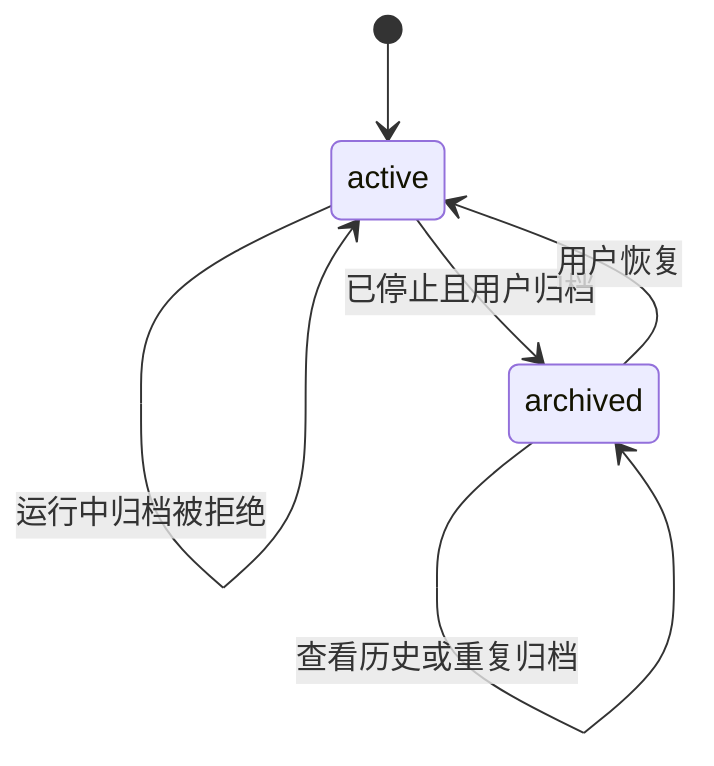

## ADDED Requirements

### Requirement: 会话命名与有界发现

系统 SHALL 从新会话首条已受理指令生成不超过 40 字符的短标题，合并空白；显式指定或手动修改的标题 SHALL 保留，重命名接受 1 至 200 字符的非空内容。历史标题不回填。会话 SHALL 按当前项目、活动／归档状态及字面标题子串查询，按最近更新时间及身份降序分页，默认 50、上限 100 条；不得先截断任意集合再排序。当前所选会话 SHALL 独立读取，不依赖列表页或筛选是否包含它。同项目的会话元数据和执行状态变化 SHALL 通知各客户端，流式文本不要求重新查询列表。

#### Scenario: 首条发送与手动改名并发
- **WHEN** 用户在首条指令受理前手动重命名，或重复提交同一已受理指令
- **THEN** 手动标题保留，重复提交取得原回执，不重新命名或启动执行

#### Scenario: 会话不在列表页内
- **WHEN** 项目超过 100 个会话，或筛选排除了当前会话
- **THEN** 所选会话及其执行控制仍可读取，其他会话可经分页或标题查找发现

#### Scenario: 另一客户端修改会话
- **WHEN** 客户端正在观察一个会话，而同项目的另一个会话被改名或改变执行状态
- **THEN** 列表可刷新真实状态，不混入另一个会话的消息

### Requirement: 可逆会话归档

系统 SHALL 允许停止后的会话归档和恢复，重复设置相同状态保持同一结果。排队、运行、取消中或尚未退出本地执行单元的会话 SHALL 拒绝归档。归档 SHALL 保留消息、执行、成果、未处理指令和草稿，只允许查看历史；发送新指令和继续执行必须先恢复。恢复 SHALL 不自动执行或消费指令。已受理指令的重复提交 SHALL 仍返回原回执。旧记录没有归档字段时 SHALL 视为活动会话。

#### Scenario: 停止后归档与恢复
- **WHEN** 用户取消会话并等待本地停止，然后归档、重启内核并恢复
- **THEN** 历史和成果保留，恢复不启动模型请求，原未处理指令可在显式继续后处理

#### Scenario: 多客户端执行与归档竞争
- **WHEN** 一个客户端请求执行而另一个客户端请求归档
- **THEN** 内核按实际受理状态拒绝冲突操作，不产生归档中仍新启动的执行
