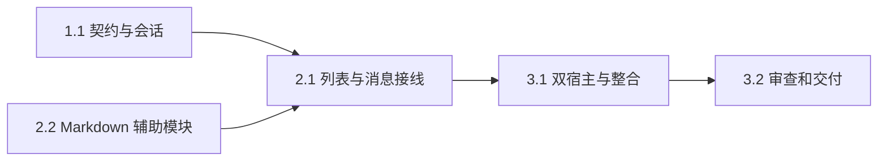

# 执行任务

## 1. 内核会话闭环

- [x] 1.1 主 Agent 实现 schema、列表、独立当前会话、标题、归档与幂等保护、跨客户端通知和新实际材料身份；经真实客户端测试超过 100 条分页、执行／归档竞争、恢复不自启动和备份恢复。

## 2. 会话与消息工作台

- [x] 2.1 主 Agent 更新 UI 设计并接入列表、查找、整理、折叠轨、归档只读、独立当前会话、消息事实／复制／材料入口；旧请求与草稿隔离，维护对应测试。
- [x] 2.2 辅助实现者仅在 MarkdownPreview.tsx、MarkdownText.tsx、markdown-queue.ts 范围复用解析、共享有界 Worker 和可见正文呈现，支持代码复制、安全链接和失败原文；主 Agent 负责 styles.css、消息接线与双宿主验收。

## 3. 整合与交付

- [x] 3.1 更新开发说明、路线图和架构链接；完成双宿主真实内部接线测试、流式输入／取消、剪贴板、材料定位、截图检查，以及 OpenSpec strict 和 pnpm check。
- [x] 3.2 独立审查归档／发送竞态、协议与通知、文件定位及 Worker 过期响应，修复并复验；依据实际结果创建 delivery.md，核对 proposal 完成判据后再完成本项。

## 续做入口

使用 openspec instructions apply --change complete-agent-conversation-workbench --json。进度以此文件为准；执行证据及交接写入 delivery.md。
