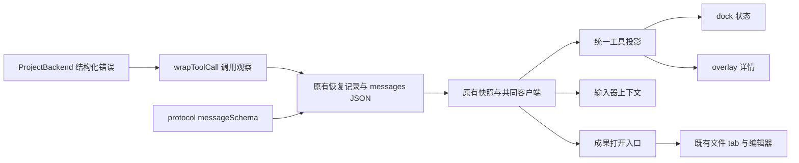
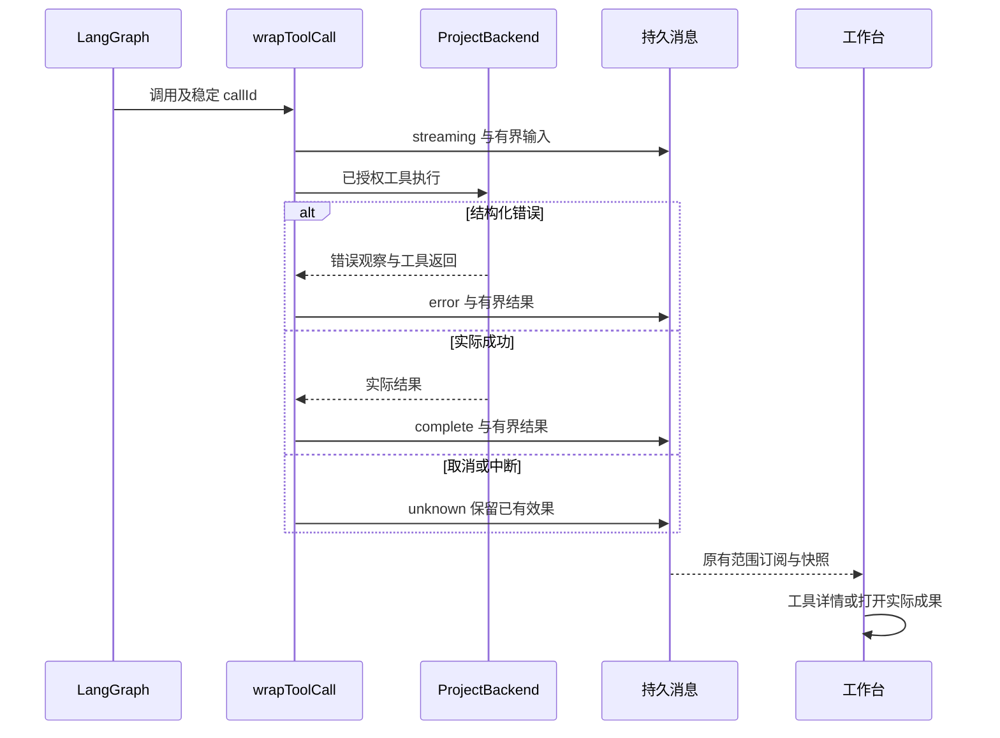

# 实现设计

## 变更总览

## 方案与接口

- `messageSchema` 新增可选 `tool`：`runId/name/input/output/inputTruncated/outputTruncated`；输入和输出各最多 16,384 个 UTF-16 单元，分别标记截断。通用 `state` 增加 `unknown`，用于效果未确认的工具；不新增表、不迁移旧 JSON。
- 调用身份复用 `tool:${run.id}:${callId}`；`wrapToolCall` 负责开始／结束／异常观察并维持原防重放记录。删除 streamEvents 的重复工具投影。SDK 返回 `ToolMessage.status` 与 ProjectBackend 的结构化错误共同确定终态，不解析文案。Node AsyncLocalStorage 关联并行工具与后端错误；只有错误观察使用此本地上下文。
- 后端可选错误观察回调不改变文件接口契约；SDK 把错误包装为成功时，依据结构化错误将 ToolMessage.status 修正为 error，模型与界面保持一致。unknown 副作用仍保留既有核查与防重放要求。
- 两个内部暂存目录的 FilesystemBackend 同样观察结构化错误，通过窄 Proxy 保留方法接收者及 AsyncLocalStorage 归属；不根据错误文本推断成功。恢复先核对已有记录，再决定是否写入开始状态，保留已确认失败及预览。
- 取消／失败收尾和启动时将所属执行残留 streaming 工具改为 unknown，成功结果保留。读取旧无详情工具仍显示其历史文字，不捏造参数或结果。
- UI 层从协议投影 assistant-ui tool-call，提供一个工具 fallback 与状态标签映射，dock 和 overlay 复用；无需第二个消息控制器。消息按已有分页读取，详情原生 details 延迟展开，不另扫 DOM。
- `WorkbenchSession.executionContext` 是来源提供的只读项目／模型／权限说明，两个输入器共享组件。使用当前选择匹配的快照，不将旧范围事实投影到新选择。保留断线草稿。
- 新建会话调用前设置 adapter.isDisabled，成功先切换新会话再恢复输入；失败也恢复输入。迟到创建只在原选择仍有效时激活，新快照未到继续禁止发送，保留原草稿。
- 成果入口复用 setFile/FileTarget，Workbench 收到 fileTarget 时收起 overlay 以显示文件；文件权限与失败继续由既有编辑器处理。
- 成果列表由来源提供一个 ReactNode，dock 形态放在中间区，overlay 形态放到消息流尾部，避免按钮被浮层遮挡；模型、权限常显，项目环境行可在窄窗口隐藏。新增字号 token 同时映射浅／深主题。

## 文件变化

| 文件 | 变化 |
| --- | --- |
| `packages/protocol/src/business.ts` | 可选工具 DTO 与预览限制 |
| `apps/kernel/src/harness/runtime.ts`、`files.ts` | 真实工具观察、错误传播与中断收尾 |
| `workbench/projection.ts`、`session.ts`、`business-session.tsx` | 统一投影、上下文与成果打开、范围匹配 |
| `workbench/shell/ToolCall.tsx`、`InstructionComposer.tsx`、`AgentDock.tsx`、`AgentOverlay.tsx`、`Workbench.tsx` | 工具 renderer、共享上下文、双形态与文件可见性 |
| `styles.css` | 仅引用语义 token 的详情／上下文样式 |
| `tests/kernel/harness.spec.ts`、`tests/ui/harness.spec.ts` | 扩展真实图与双宿主 e2e；必要时补充独立工具中断用例 |
| `docs/ui-design/README.md`、`docs/development.md`、`docs/implementation-roadmap.md` | 先明确设计后实现，更新使用入口与归档链接 |

## 验证与风险

复用外部 HTTP 模型夹具，内部图、数据库、文件、传输与工作台保持真实。核对成功、写文件结构化错误、预览截断、取消与重启未知状态、刷新保留及打开成果不丢草稿。运行 lint、typecheck、build、kernel、双宿主 UI 与相关生命周期 smoke。共享协议和并行调用状态安排原生子代理独立审查。测试服务仅由既有 harness 管理；不启动日常开发实例。

新字段可选，旧记录缺失详情可读。工具摘要可能含获授权材料，仅沿当前本机业务接口读取；凭据和内部目录继续受 ProjectStore 保护。预览不是完整工具输出或副作用证明。Linux 双宿主不代表三平台发布验收。

## 待办边界

P3d 方法／能力调用随后以独立 change 完成，不扩展本次到 shell、MCP、多 Agent、任务管理或文献业务。输入器先呈现已有模型及权限，配置仍走已有设置入口。
