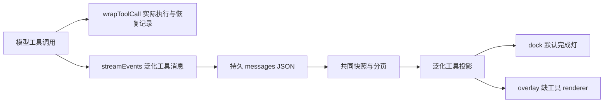

# 调查依据

## 当前事实与复用选择

- 路线图与两个最新归档交付确认 P3a–P3c 和三区外壳已实现；当前正式规格为 `agent-harness`、`ui-workbench-shell`。路线图、UI 设计仍引用已归档前路径，需修正。
- `Harness.execute` 的 `wrapToolCall` 已保存稳定调用身份与完整恢复结果；另一条 `streamEvents` 路径只把工具起止转成泛化文字，无法表达结果错误。复用 middleware 的实际执行 seam，删除重复工具事件投影。
- `Message` 是 JSON 列，不需要新表；新增可选工具详情不会重写旧消息。协议 schema 仍为 DTO 唯一事实源。
- `projection.ts` 把工具统一命名“项目工具”并附加重复文字；overlay 未注册 assistant-ui 工具 fallback，dock 只检查 `isError`，在途工具因而显示“完成”。
- `business-session.tsx` 已拥有 provider、project、run 和 artifacts；`Workbench` 已支持真实文件 tab，成果打开复用 `fileTarget` 即可。
- 已安装 deepagents 1.15.0、langchain 1.5.16、assistant-ui React 0.15.27；测试已有真实图和外部 HTTP 模型替身，无需依赖变更。

以上为当前源码静态核对，非本轮实跑证据。两个只读 scout 的结果用于定位，关键判断由主 Agent 核对原实现。

## 结论与承接

无阻塞未知项。在 middleware 捕获真实结果并保持已有恢复记录，工作台只消费协议事实。取消或重启遗留调用显示结果未知，不推断文件操作已撤销；SDK 返回的结构化错误需在受控真实图用例中验证。任务 1 核对边界和重启，任务 2 核对双形态及双宿主。P3d 继续作为后续方法／能力变更，不引入任务、shell 或多 Agent。
