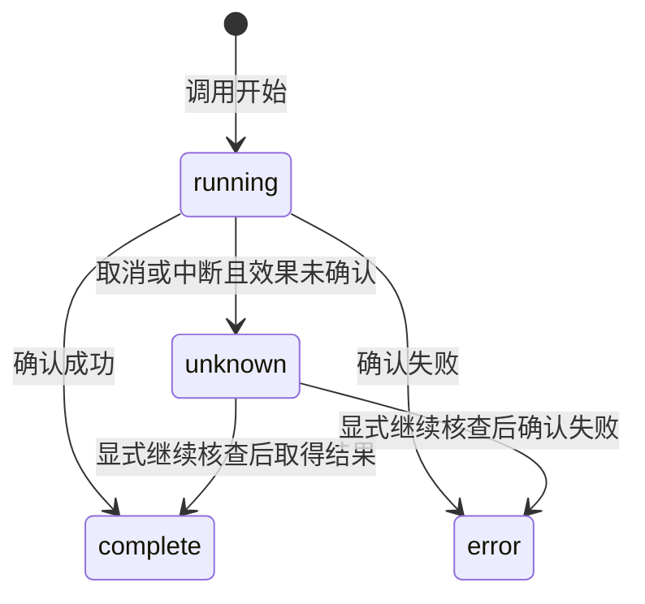

## ADDED Requirements

### Requirement: 持久工具调用事实

系统 SHALL 为实际工具调用持久保存稳定身份、所属执行、调用名、有界输入与结果预览，并明确预览是否截断。工具状态 SHALL 区分执行中、成功、失败与结果未知；结构化后端错误和工具异常不得因工具函数正常返回而被记为成功。取消或内核重启后的在途工具 SHALL 转为结果未知，保留已确认结果，不宣称既有效果已撤销。工具记录 SHALL 经共同客户端分页读取，界面刷新不重新执行工具；原有无详情记录仍可读取。

#### Scenario: 正常返回错误

- **WHEN** 文件工具返回权限、冲突或缺失等结构化错误
- **THEN** 持久工具记录与模型看到失败结果，执行图正常结束也不改变该次工具失败的事实

#### Scenario: 取消或重启中断

- **WHEN** 工具调用在结果确认前因取消或内核重启中断
- **THEN** 该工具显示结果未知，保留调用身份及已有成果，不自动重新调用

#### Scenario: 有界详情与再次读取

- **WHEN** 工具输入或结果超过预览上限且用户稍后读取历史
- **THEN** 返回有明确截断标记的有界详情，已结束状态保留，不因读取或刷新而重跑工具
