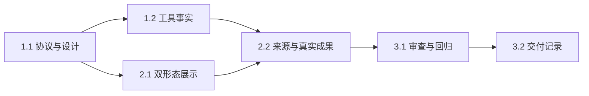

# 执行任务

共享协议由主 Agent 统筹；辅助实现者只写 shell 展示文件，不写内核／来源／测试。主 Agent 完成整合验收。

## 1. 工具事实

- [x] 1.1 明确可选工具 DTO、有界预览与 unknown 状态，先更新 UI 设计；通过类型和 OpenSpec 结构校验。
- [x] 1.2 在真实执行 seam 保存工具事实，依据后端结构化错误报告失败，取消及重启收尾为 unknown；扩展内核测试覆盖成功、错误、截断和中断，保留原恢复／防重放行为。

## 2. 可操作的工作台

- [x] 2.1 接入共同工具投影、overlay 详情、dock 正确状态及共享输入上下文；复用语义 token。辅助写入范围为 shell 工具／输入器／双形态文件，行为以 UI delta spec 为准。
- [x] 2.2 来源提供当前范围上下文与成果打开，防止旧快照跨选择投影；双宿主从用户入口核对详情、失败、刷新、草稿和实际成果文件，更新开发说明及路线图。

## 3. 整合与交付

- [x] 3.1 主 Agent 核对真实接线，完成必要独立审查及 lint、typecheck、build、内核、双宿主 UI 与生命周期 smoke 回归，处理相关发现。
- [x] 3.2 根据实际执行结果完成 delivery.md，核对本次完成判据及必要验证，再更新本项状态。

## 续做入口

本变更的执行结果与限制见 [delivery.md](delivery.md)；下一步沿路线图 P3d 起草独立方法／能力调用变更。
