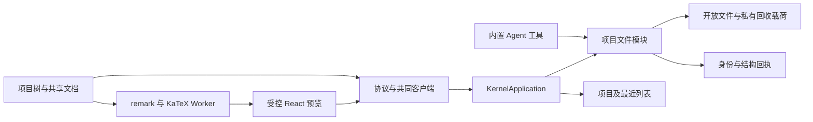
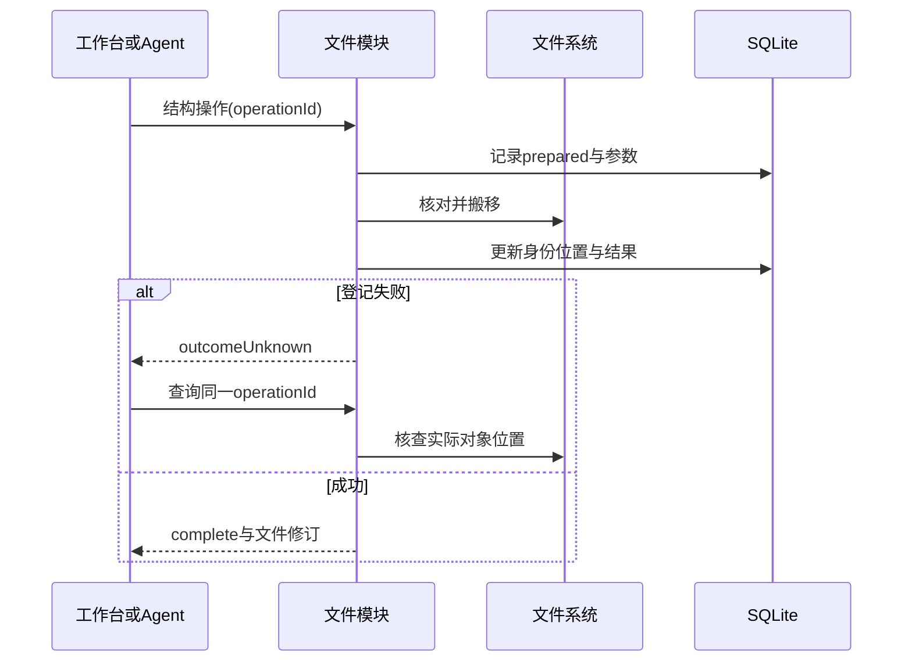

# 实现设计

## 变更总览

## 方案与接口

复用 investigation 所列模块。协议是 DTO 唯一事实源。新增 project.create/rename/forget，files.mkdir/rename/trash/restore/trashList/resolve/operation/resource。结构操作带 operationId，文件项、内容、编辑和成果可携带 fileId；resolve 分页有界地返回当前位置或回收状态。ProjectFiles 集中身份、结构操作、路径协调与图片读取，Store 继续承载项目、数据库、原有文本保存和备份，文本保存与结构操作共用路径协调及身份。无需扫描全库登记文件。

项目 meta 保存显示名；最近列表独立于已加载 Store，移出不关闭数据库。旧 Schema 升至 v2 前备份，原 write 清零并重新确认；已有其他授权保留。旧编辑和成果按需绑定身份，历史 path 和消息正文不重写；定位与历史内容分开。结构操作更新已登记子项，原路径新建分配新身份。撤销按身份定位后仍核对整份内容。未确认的 session.send 请求保留原参数，不改写幂等身份。

材料选择与新发送参数可携带同序 `materialFileIds`，受理时核对身份与路径一致。旧消息路径保留为历史事实，新的材料选择按身份更新当前位置；待确认请求不被自动改写。

实际树操作为项目内同文件系统的 rename，回收目录 `.scholoom/trash/<operationId>/payload`。提交前保存回执和源对象识别线索；结果未知通过查询原操作核查，不重放移动。按同路径及祖先／后代关系协调短暂提交，不串行无关生成。目标必须不存在，恢复支持另选路径。外部写入窗口沿 #13 如实保留，不声称全局事务。备份增加受控图片与回收载荷，缺项列清单。

整份读取、保存和结构提交共用相交路径协调，避免读取依据登记晚于结构失效。关闭 Store 等待该协调队列。未决操作目标在原回执核查前拒绝登记新身份；原操作查询在持锁并重读回执后核查文件对象。备份省略路径统一为正斜线；载荷截断或读取失败标记相关回收项不完整，目录预算整体截断时保守标记全部回收项。

前端沿 fileNavigator 接真实树，树使用文件修订而非成果数量刷新。源码与预览共享文档草稿、磁盘基线和请求世代；文件身份保证改名不丢草稿，旧路径草稿首次读取时迁入。项目 tab 按项目隔离。默认真实工作台为空态，样例显式注入占位 tab。设置复用已有模型与授权／备份区。

Worker 使用已核对的八个 MIT 依赖，KaTeX 固定0.16.47并本地打包CSS字体，trust=false；HAST经受控a/img组件展示。图片只读授权项目内1MiB以内的栅格格式，屏幕按需读取且释放objectURL。文件正文仍限256KiB。外链仅显式点击并校验http/https/mailto；相对链接走文件tab。新渲染替换待处理旧版本，不逐次排队；旧结果不能覆盖新文档。

Vite 两宿主解析条件包含 `worker`，避免 Worker 选择依赖的 DOM 实现；浏览器预构建预览流水线依赖，避免首次加载 Worker 引发整页重载。`pnpm-workspace.yaml` 将 HAST 渲染器的 `style-to-js` 限定到 1.1.21，以满足可调用默认导出契约。

## 文件变化

- 修改 `packages/protocol/src/business.ts`、`packages/client/src/index.ts`：接口、身份、文件修订和只读调用分类。
- 修改 `apps/kernel/src/projects/store.ts`、新增 `projects/files.ts`：项目管理、结构操作、引用和备份；修改 storage/schema.ts及新增SQL迁移与journal。
- 修改 application.ts、harness/files.ts、harness/runtime.ts：RPC、共同工具、成果身份与打开项目的执行状态核查。
- 修改共同工作台 Workbench.tsx、session.ts、business-session.tsx、project-ui.tsx及shell组件；复用drafts.ts，新增共享文档／预览／Worker；按职责拆出项目控制与树组件。
- 修改 desktop package.json、pnpm-lock.yaml、pnpm-workspace.yaml、Vite双宿主配置、styles.css、main/preload窄宿主桥和样例来源。
- 扩展 tests/kernel/project-files.spec.ts、harness.spec.ts，复用既有client重连测试，新增 tests/ui/file-workbench.spec.ts，调整既有双宿主用例。
- 更新 docs/ui-design/README.md（界面变更前）、development.md、architecture.md、implementation-roadmap.md；本change规划工件及实际执行后的delivery。

## 验证与风险

测试从接口核对可观察行为和实际载荷，复用项目／模型／UI夹具。覆盖非空目录、路径复用、撤销、权限迁移、并发、落盘后登记失败和重启核查、回收备份实际恢复。双宿主从用户入口验证预览、图片公式、安全URL、草稿、成果及结构操作。256KiB代表文档下输入与本地取消受理目标≤1秒，记录实际环境。执行 OpenSpec strict 与 pnpm check，并独立审查数据保护与并发。付费模型、三平台分发和科研质量不由受控测试证明。
