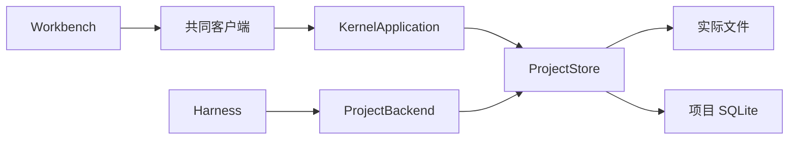

# 调查依据

## 当前事实与复用选择

静态核对 `projects/store.ts`、`harness/files.ts`、`runtime.ts`、协议、客户端及共同工作台，并由两个只读 scout 分别盘点 UI 与存储引用。项目打开／授权／备份、文件分页读取、安全保存与撤销、持久 Agent 已存在。`project-ui.tsx` 的真实导航经 fileNavigator 接入右区；默认 tab 仍为占位，文件树以成果数量刷新会漏掉普通保存。

`edits.path`、成果 JSON／主键、材料选择和草稿均嵌入路径，没有稳定文件定位；项目显示名来自 basename，最近列表与已载入 Store 混用。结构操作必须修复这些引用边界，不能只调用 rename。现有按文件队列、整份依据、私有路径检查、待核查回执及独立副本恢复可复用。备份当前排除所有私有载荷和二进制，需要显式扩充本次图片与回收范围。

2026-10-15 从 npm registry 与官方 README 核对 MIT 许可的 unified 11.0.5、remark-parse 11.0.0、remark-gfm 4.0.1、remark-math 6.0.0、remark-rehype 11.1.2、rehype-katex 7.0.1、hast-util-to-jsx-runtime 2.3.6、KaTeX 0.16.47。官方 API 支持 Worker 中 parse/runSync 得到可克隆 HAST，再以 React jsx runtime 展示；禁用 raw HTML，链接／图片需要自行执行安全 URL 策略。来源：https://github.com/remarkjs/react-markdown 、https://github.com/remarkjs/remark-math 、https://github.com/syntax-tree/hast-util-to-jsx-runtime 。

## 结论与承接

无阻塞性未知项。复用现有运行时和编辑器，新增文件身份／结构操作模块和 Worker 预览。未运行新功能；并发、中断恢复、256 KiB 渲染、打包字体及双宿主实测由 tasks 承接。原有 AGENTS.md 与参考 PDF 不修改。
